# Sensibilité de tous les paramètres — service MEDF_pic

Un paramètre varie à la fois, tout le reste au réglage retenu (marqué « retenu »). Mêmes jours, même validation glissante. Diebold-Mariano (perte pinball au quantile τ, HLN, correction de Holm) contre la valeur retenue. Amplitude = (MAE max − MAE min) / MAE retenue.

## Synthèse

| paramètre | horizon | famille | valeur retenue | meilleure valeur (MAE) | amplitude MAE % | verdict |
|---|---|---|---|---|---|---|
| C (poids des erreurs) | 1 | svr4 | 3 | 10 | 70.5 | défendable |
| ε (tube, niveaux quantiles) | 1 | svr4 | 0 | 0 (retenu) | 5.4 | défendable |
| γ₁ (portée, bloc occupation) | 1 | svr4 | 0,1 | 0,05 | 16.7 | défendable |
| γ₂ (portée, bloc flux et saison) | 1 | svr4 | 0,05 | 0,05 (retenu) | 7.4 | à revoir : 0,02 |
| τ (quantile décisionnel) | 1 | svr4 | 0,8 | 0,7 | 0.6 | défendable |
| η₀ (taux d'apprentissage d'Adam) | 1 | svr4 | 0,05 | 0,005 | 0.4 | défendable |
| nombre maximal d'itérations | 1 | svr4 | 3000 | 300 | 0.2 | à revoir : 300, 6000 |
| T (décroissance du pas ; aucune = pas constant) | 1 | svr4 | 500 | aucune | 0.1 | à revoir : aucune, 2000 |
| part des pas moyennée (Polyak ; 0 = aucune) | 1 | svr4 | 0,5 | 0 | 0.0 | défendable |
| tolérance d'arrêt anticipé | 1 | svr4 | 1e-07 | 1e-05 | 0.1 | défendable |
| direction préconditionnée α + Cg | 1 | svr4 | True | True (retenu) | 0.8 | à revoir : False |
| optimiseur | 1 | svr4 | adam | adam (retenu) | 37.5 | défendable |
| C | 1 | svr2 | 3 | 10 | 66.0 | à revoir : 10 |
| ε (tube ε-insensible, en lits) | 1 | svr2 | 0,5 | 0 | 13.7 | défendable |
| γ (portée du noyau RBF) | 1 | svr2 | 0,02 | 0,02 (retenu) | 64.6 | défendable |
| nombre d'arbres | 1 | foret | 300 | 300 (retenu) | 1.5 | défendable |
| profondeur maximale | 1 | foret | 12 | 20 | 12.9 | défendable |
| taille minimale d'une feuille | 1 | foret | 5 | 2 | 7.0 | défendable |
| part des variables tirées par nœud | 1 | foret | 0,333333 | 1 | 18.8 | défendable |
| nombre d'étapes | 1 | boosting | 300 | 300 (retenu) | 9.2 | défendable |
| taux ν (shrinkage) | 1 | boosting | 0,05 | 0,05 (retenu) | 9.6 | défendable |
| profondeur des arbres | 1 | boosting | 3 | 2 | 2.8 | défendable |
| part du sous-échantillon | 1 | boosting | 0,8 | 0,5 | 3.5 | défendable |
| architecture (neurones par couche) | 1 | mlp | 32×16 | 64×32 | 22.0 | défendable |
| taux d'apprentissage | 1 | mlp | 0,01 | 0,03 | 16.3 | défendable |
| pénalité L2 λ | 1 | mlp | 0,001 | 0,1 | 9.6 | défendable |
| époques maximales | 1 | mlp | 1500 | 300 | 0.0 | défendable |
| patience de l'arrêt anticipé | 1 | mlp | 150 | 50 | 0.0 | défendable |
| nombre d'initialisations moyennées | 1 | mlp | 3 | 1 | 12.1 | défendable |
| taille de l'état caché H | 1 | lstm | 16 | 16 (retenu) | 6.3 | défendable |
| taux d'apprentissage | 1 | lstm | 0,01 | 0,03 | 3.9 | défendable |
| pénalité L2 λ | 1 | lstm | 0,001 | 0,01 | 8.6 | défendable |
| jours d'occupation passée en entrée | 1 | variables | 7 | 3 | 27.4 | défendable |
| C (poids des erreurs) | 7 | svr4 | 0,3 | 10 | 7.2 | défendable |
| ε (tube, niveaux quantiles) | 7 | svr4 | 0 | 1 | 1.3 | défendable |
| γ₁ (portée, bloc occupation) | 7 | svr4 | 0,1 | 0,5 | 0.5 | défendable |
| γ₂ (portée, bloc flux et saison) | 7 | svr4 | 0,05 | 0,2 | 2.0 | défendable |
| τ (quantile décisionnel) | 7 | svr4 | 0,8 | 0,5 | 0.0 | défendable |
| η₀ (taux d'apprentissage d'Adam) | 7 | svr4 | 0,05 | 0,02 | 0.1 | défendable |
| nombre maximal d'itérations | 7 | svr4 | 3000 | 300 | 0.1 | défendable |
| T (décroissance du pas ; aucune = pas constant) | 7 | svr4 | 500 | 2000 | 0.1 | défendable |
| part des pas moyennée (Polyak ; 0 = aucune) | 7 | svr4 | 0,5 | 0 | 0.0 | défendable |
| tolérance d'arrêt anticipé | 7 | svr4 | 1e-07 | 1e-09 | 0.1 | défendable |
| direction préconditionnée α + Cg | 7 | svr4 | True | True (retenu) | 0.0 | défendable |
| optimiseur | 7 | svr4 | adam | sgd | 0.1 | défendable |
| C | 7 | svr2 | 3 | 10 | 6.9 | défendable |
| ε (tube ε-insensible, en lits) | 7 | svr2 | 0,5 | 0,25 | 4.6 | à revoir : 0, 0,25 |
| γ (portée du noyau RBF) | 7 | svr2 | 0,05 | 0,1 | 8.7 | défendable |
| nombre d'arbres | 7 | foret | 300 | 500 | 4.5 | défendable |
| profondeur maximale | 7 | foret | 12 | 8 | 2.8 | défendable |
| taille minimale d'une feuille | 7 | foret | 5 | 10 | 1.8 | défendable |
| part des variables tirées par nœud | 7 | foret | 0,333333 | 0,15 | 1.5 | défendable |
| nombre d'étapes | 7 | boosting | 300 | 100 | 5.1 | à revoir : 50, 100 |
| taux ν (shrinkage) | 7 | boosting | 0,05 | 0,01 | 10.1 | à revoir : 0,01 |
| profondeur des arbres | 7 | boosting | 3 | 1 | 2.2 | à revoir : 1, 2 |
| part du sous-échantillon | 7 | boosting | 0,8 | 0,8 (retenu) | 3.6 | défendable |
| architecture (neurones par couche) | 7 | mlp | 32×16 | 32×16×8 | 19.1 | défendable |
| taux d'apprentissage | 7 | mlp | 0,01 | 0,01 (retenu) | 2.3 | défendable |
| pénalité L2 λ | 7 | mlp | 0,001 | 0,1 | 11.4 | défendable |
| époques maximales | 7 | mlp | 1500 | 300 | 0.0 | défendable |
| patience de l'arrêt anticipé | 7 | mlp | 150 | 50 | 0.0 | défendable |
| nombre d'initialisations moyennées | 7 | mlp | 3 | 1 | 2.6 | défendable |
| taille de l'état caché H | 7 | lstm | 16 | 4 | 14.1 | défendable |
| taux d'apprentissage | 7 | lstm | 0,01 | 0,003 | 5.9 | défendable |
| pénalité L2 λ | 7 | lstm | 0,001 | 0 | 0.9 | défendable |
| jours d'occupation passée en entrée | 7 | variables | 7 | 3 | 2.6 | défendable |

## Horizon J+1

### svr4 · C (poids des erreurs)

| variante | MAE | RMSE | biais | pinball τ=0.8 | couverture 90 % | temps (s) | DM p (pinball τ=0.8) | p Holm | vs choix retenu |
|---|---|---|---|---|---|---|---|---|---|
| C = 0,1 | 2.316 | 2.737 | -0.945 | 0.7588 | 91.8 | 3.7 | 0.0 | 0.0 | moins bon |
| C = 0,3 | 1.95 | 2.323 | -0.655 | 0.638 | 91.8 | 3.7 | 0.0008 | 0.0032 | moins bon |
| C = 1 | 1.62 | 1.982 | -0.465 | 0.5534 | 89.1 | 6.0 | 0.0517 | 0.1551 | équivalent |
| C = 3 (retenu) | 1.399 | 1.782 | -0.38 | 0.5262 | 85.2 | 6.8 |  |  | — choix retenu |
| C = 10 | 1.33 | 1.729 | -0.334 | 0.5189 | 79.8 | 8.5 | 0.6504 | 1.0 | équivalent |
| C = 30 | 1.338 | 1.718 | -0.305 | 0.5113 | 71.0 | 8.5 | 0.5309 | 1.0 | équivalent |

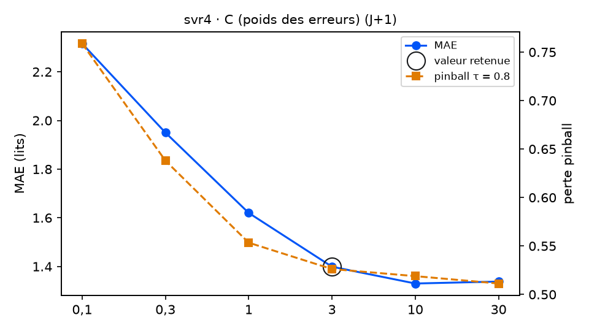

Amplitude de la MAE : 70.5 %. Aucune valeur ne fait significativement mieux que la valeur retenue.

### svr4 · ε (tube, niveaux quantiles)

| variante | MAE | RMSE | biais | pinball τ=0.8 | couverture 90 % | temps (s) | DM p (pinball τ=0.8) | p Holm | vs choix retenu |
|---|---|---|---|---|---|---|---|---|---|
| epsilon_quantile = 0 (retenu) | 1.399 | 1.782 | -0.38 | 0.5262 | 85.2 | 6.7 |  |  | — choix retenu |
| epsilon_quantile = 0,25 | 1.414 | 1.797 | -0.451 | 0.5351 | 81.4 | 7.0 | 0.163 | 0.163 | équivalent |
| epsilon_quantile = 0,5 | 1.419 | 1.802 | -0.417 | 0.5656 | 74.3 | 7.2 | 0.0004 | 0.0008 | moins bon |
| epsilon_quantile = 1 | 1.474 | 1.838 | -0.377 | 0.6083 | 63.9 | 7.0 | 0.0 | 0.0 | moins bon |

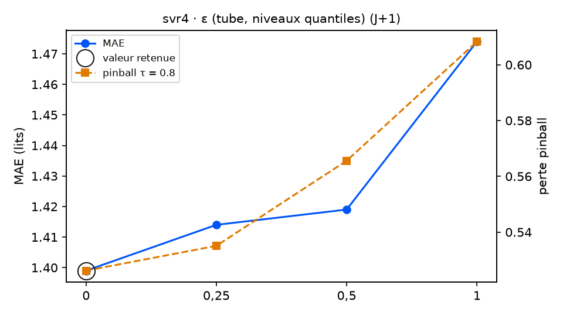

Amplitude de la MAE : 5.4 %. Aucune valeur ne fait significativement mieux que la valeur retenue.

### svr4 · γ₁ (portée, bloc occupation)

| variante | MAE | RMSE | biais | pinball τ=0.8 | couverture 90 % | temps (s) | DM p (pinball τ=0.8) | p Holm | vs choix retenu |
|---|---|---|---|---|---|---|---|---|---|
| gamma1 = 0,01 | 1.617 | 1.969 | -0.536 | 0.6585 | 82.0 | 7.8 | 0.0 | 0.0 | moins bon |
| gamma1 = 0,02 | 1.473 | 1.829 | -0.48 | 0.5868 | 81.4 | 7.4 | 0.0018 | 0.0054 | moins bon |
| gamma1 = 0,05 | 1.394 | 1.764 | -0.433 | 0.5284 | 83.1 | 8.0 | 0.7752 | 0.7752 | équivalent |
| gamma1 = 0,1 (retenu) | 1.399 | 1.782 | -0.38 | 0.5262 | 85.2 | 6.9 |  |  | — choix retenu |
| gamma1 = 0,2 | 1.465 | 1.861 | -0.408 | 0.543 | 83.6 | 7.2 | 0.0637 | 0.1274 | équivalent |
| gamma1 = 0,5 | 1.628 | 2.032 | -0.453 | 0.6119 | 78.1 | 7.3 | 0.0 | 0.0 | moins bon |

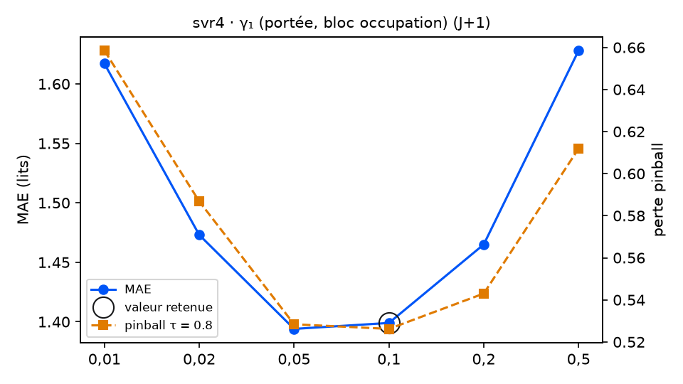

Amplitude de la MAE : 16.7 %. Aucune valeur ne fait significativement mieux que la valeur retenue.

### svr4 · γ₂ (portée, bloc flux et saison)

| variante | MAE | RMSE | biais | pinball τ=0.8 | couverture 90 % | temps (s) | DM p (pinball τ=0.8) | p Holm | vs choix retenu |
|---|---|---|---|---|---|---|---|---|---|
| gamma2 = 0,02 | 1.412 | 1.829 | -0.4 | 0.4995 | 91.3 | 7.0 | 0.0067 | 0.0183 | meilleur |
| gamma2 = 0,05 (retenu) | 1.399 | 1.782 | -0.38 | 0.5262 | 85.2 | 6.7 |  |  | — choix retenu |
| gamma2 = 0,1 | 1.419 | 1.79 | -0.378 | 0.5383 | 80.3 | 6.6 | 0.0924 | 0.0924 | équivalent |
| gamma2 = 0,2 | 1.496 | 1.878 | -0.389 | 0.5673 | 76.0 | 7.4 | 0.0038 | 0.0152 | moins bon |
| gamma2 = 0,5 | 1.503 | 1.911 | -0.378 | 0.5717 | 78.1 | 8.2 | 0.0061 | 0.0183 | moins bon |

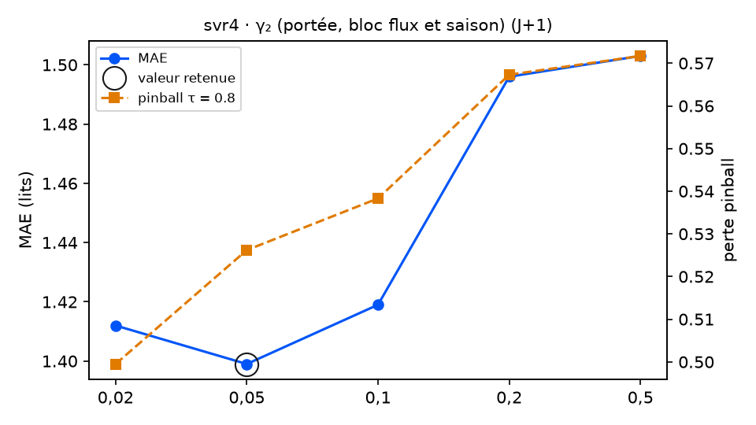

Amplitude de la MAE : 7.4 %. Valeur(s) significativement meilleure(s) : gamma2 = 0,02 — réglage à revoir.

### svr4 · τ (quantile décisionnel)

| variante | MAE | RMSE | biais | pinball τ=0.8 | couverture 90 % | temps (s) | DM p (pinball τ=0.8) | p Holm | vs choix retenu |
|---|---|---|---|---|---|---|---|---|---|
| tau = 0,5 | 1.399 | 1.782 | -0.38 | 0.8134 | 85.2 | 5.1 | 0.0 | 0.0 | moins bon |
| tau = 0,6 | 1.406 | 1.788 | -0.393 | 0.8207 | 85.2 | 6.5 | 0.0 | 0.0 | moins bon |
| tau = 0,7 | 1.398 | 1.782 | -0.381 | 0.8133 | 85.2 | 6.6 | 0.0 | 0.0 | moins bon |
| tau = 0,8 (retenu) | 1.399 | 1.782 | -0.38 | 0.5262 | 85.2 | 6.7 |  |  | — choix retenu |
| tau = 0,9 | 1.399 | 1.782 | -0.38 | 0.8134 | 85.2 | 6.5 | 0.0 | 0.0 | moins bon |

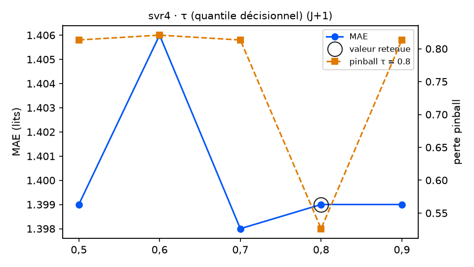

Amplitude de la MAE : 0.6 %. Aucune valeur ne fait significativement mieux que la valeur retenue.

### svr4 · η₀ (taux d'apprentissage d'Adam)

| variante | MAE | RMSE | biais | pinball τ=0.8 | couverture 90 % | temps (s) | DM p (pinball τ=0.8) | p Holm | vs choix retenu |
|---|---|---|---|---|---|---|---|---|---|
| taux = 0,005 | 1.396 | 1.779 | -0.366 | 0.5152 | 86.9 | 8.0 | 0.0237 | 0.0948 | équivalent |
| taux = 0,01 | 1.398 | 1.781 | -0.374 | 0.5225 | 85.2 | 8.1 | 0.0832 | 0.2496 | équivalent |
| taux = 0,02 | 1.398 | 1.782 | -0.376 | 0.5259 | 85.2 | 7.3 | 0.4204 | 0.4204 | équivalent |
| taux = 0,05 (retenu) | 1.399 | 1.782 | -0.38 | 0.5262 | 85.2 | 6.8 |  |  | — choix retenu |
| taux = 0,1 | 1.398 | 1.782 | -0.386 | 0.5254 | 85.2 | 7.4 | 0.0988 | 0.2496 | équivalent |
| taux = 0,2 | 1.402 | 1.786 | -0.391 | 0.5247 | 84.7 | 8.5 | 0.0185 | 0.0925 | équivalent |

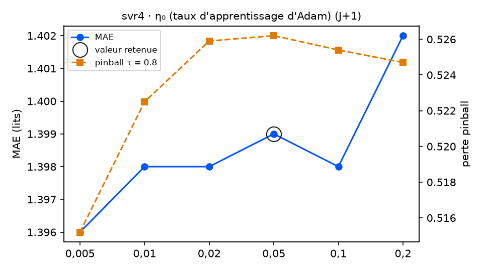

Amplitude de la MAE : 0.4 %. Aucune valeur ne fait significativement mieux que la valeur retenue.

### svr4 · nombre maximal d'itérations

| variante | MAE | RMSE | biais | pinball τ=0.8 | couverture 90 % | temps (s) | DM p (pinball τ=0.8) | p Holm | vs choix retenu |
|---|---|---|---|---|---|---|---|---|---|
| iterations = 300 | 1.396 | 1.781 | -0.378 | 0.5158 | 86.9 | 1.0 | 0.0187 | 0.0374 | meilleur |
| iterations = 1000 | 1.398 | 1.782 | -0.381 | 0.5254 | 85.2 | 3.0 | 0.2321 | 0.2321 | équivalent |
| iterations = 3000 (retenu) | 1.399 | 1.782 | -0.38 | 0.5262 | 85.2 | 7.0 |  |  | — choix retenu |
| iterations = 6000 | 1.399 | 1.783 | -0.38 | 0.5258 | 85.2 | 10.0 | 0.0001 | 0.0003 | meilleur |

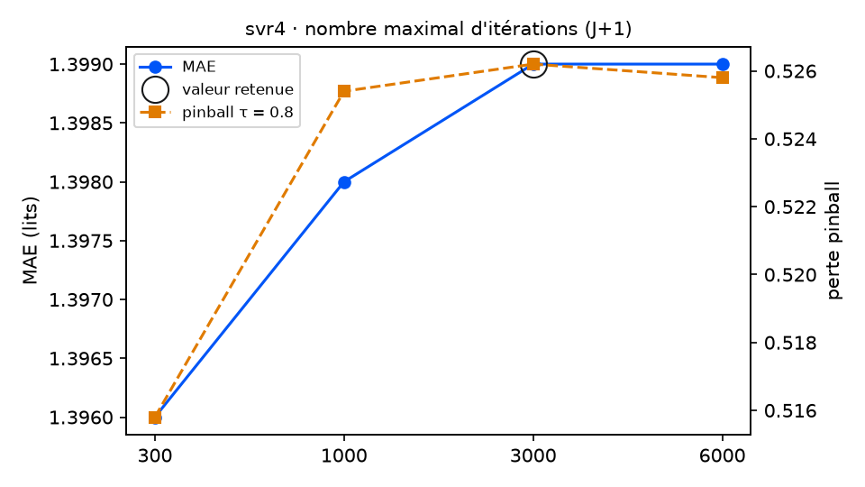

Amplitude de la MAE : 0.2 %. Valeur(s) significativement meilleure(s) : iterations = 300, iterations = 6000 — réglage à revoir.

### svr4 · T (décroissance du pas ; aucune = pas constant)

| variante | MAE | RMSE | biais | pinball τ=0.8 | couverture 90 % | temps (s) | DM p (pinball τ=0.8) | p Holm | vs choix retenu |
|---|---|---|---|---|---|---|---|---|---|
| decroissance = aucune | 1.397 | 1.781 | -0.376 | 0.5251 | 84.7 | 8.0 | 0.0124 | 0.0248 | meilleur |
| decroissance = 100 | 1.399 | 1.783 | -0.377 | 0.526 | 85.2 | 6.9 | 0.316 | 0.316 | équivalent |
| decroissance = 500 (retenu) | 1.399 | 1.782 | -0.38 | 0.5262 | 85.2 | 6.8 |  |  | — choix retenu |
| decroissance = 2000 | 1.398 | 1.783 | -0.381 | 0.5249 | 85.2 | 7.9 | 0.003 | 0.009 | meilleur |

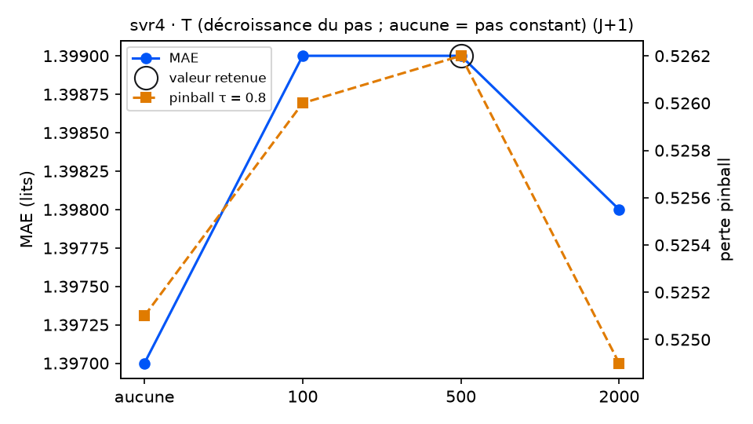

Amplitude de la MAE : 0.1 %. Valeur(s) significativement meilleure(s) : decroissance = aucune, decroissance = 2000 — réglage à revoir.

### svr4 · part des pas moyennée (Polyak ; 0 = aucune)

| variante | MAE | RMSE | biais | pinball τ=0.8 | couverture 90 % | temps (s) | DM p (pinball τ=0.8) | p Holm | vs choix retenu |
|---|---|---|---|---|---|---|---|---|---|
| moyenne_polyak = 0 | 1.399 | 1.783 | -0.381 | 0.5262 | 85.2 | 6.1 |  |  | identique |
| moyenne_polyak = 0,25 | 1.399 | 1.782 | -0.38 | 0.5262 | 85.2 | 7.1 |  |  | identique |
| moyenne_polyak = 0,5 (retenu) | 1.399 | 1.782 | -0.38 | 0.5262 | 85.2 | 7.0 |  |  | — choix retenu |
| moyenne_polyak = 0,75 | 1.399 | 1.782 | -0.38 | 0.5262 | 85.2 | 6.8 |  |  | identique |

Amplitude de la MAE : 0.0 %. Aucune valeur ne fait significativement mieux que la valeur retenue.

### svr4 · tolérance d'arrêt anticipé

| variante | MAE | RMSE | biais | pinball τ=0.8 | couverture 90 % | temps (s) | DM p (pinball τ=0.8) | p Holm | vs choix retenu |
|---|---|---|---|---|---|---|---|---|---|
| tolerance = 1e-05 | 1.397 | 1.78 | -0.374 | 0.5241 | 85.2 | 1.9 | 0.1591 | 0.3182 | équivalent |
| tolerance = 1e-07 (retenu) | 1.399 | 1.782 | -0.38 | 0.5262 | 85.2 | 6.6 |  |  | — choix retenu |
| tolerance = 1e-09 | 1.398 | 1.782 | -0.379 | 0.5262 | 85.2 | 8.2 | 0.5701 | 0.5701 | équivalent |

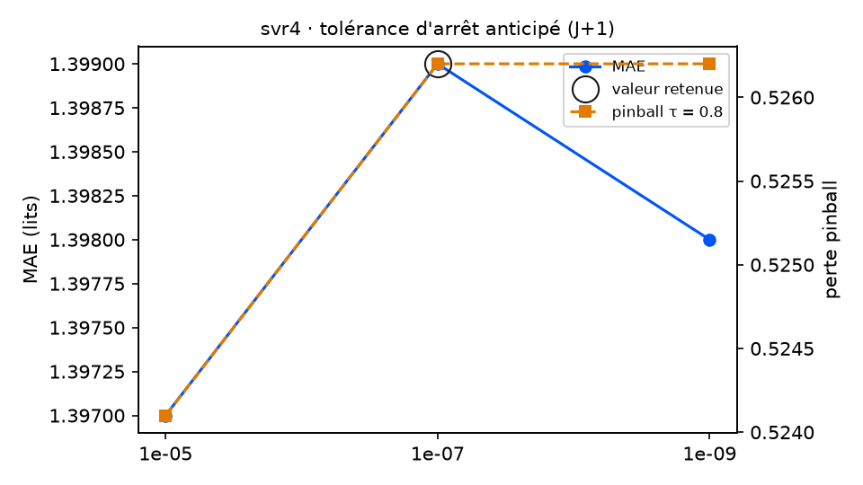

Amplitude de la MAE : 0.1 %. Aucune valeur ne fait significativement mieux que la valeur retenue.

### svr4 · direction préconditionnée α + Cg

| variante | MAE | RMSE | biais | pinball τ=0.8 | couverture 90 % | temps (s) | DM p (pinball τ=0.8) | p Holm | vs choix retenu |
|---|---|---|---|---|---|---|---|---|---|
| preconditionne = True (retenu) | 1.399 | 1.782 | -0.38 | 0.5262 | 85.2 | 6.4 |  |  | — choix retenu |
| preconditionne = False | 1.41 | 1.797 | -0.399 | 0.518 | 85.2 | 10.0 | 0.0056 | 0.0056 | meilleur |

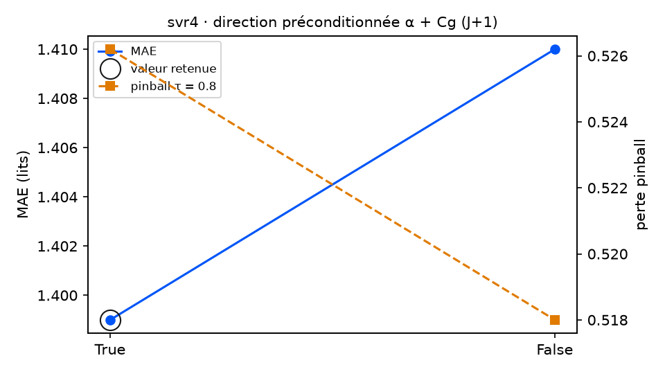

Amplitude de la MAE : 0.8 %. Valeur(s) significativement meilleure(s) : preconditionne = False — réglage à revoir.

### svr4 · optimiseur

| variante | MAE | RMSE | biais | pinball τ=0.8 | couverture 90 % | temps (s) | DM p (pinball τ=0.8) | p Holm | vs choix retenu |
|---|---|---|---|---|---|---|---|---|---|
| optimiseur = adam (retenu) | 1.399 | 1.782 | -0.38 | 0.5262 | 85.2 | 6.4 |  |  | — choix retenu |
| optimiseur = momentum | 1.732 | 2.109 | -0.362 | 0.5504 | 91.8 | 6.1 | 0.2822 | 0.2822 | équivalent |
| optimiseur = sgd | 1.924 | 2.253 | -0.53 | 0.4878 | 86.3 | 5.6 | 0.0764 | 0.1528 | équivalent |

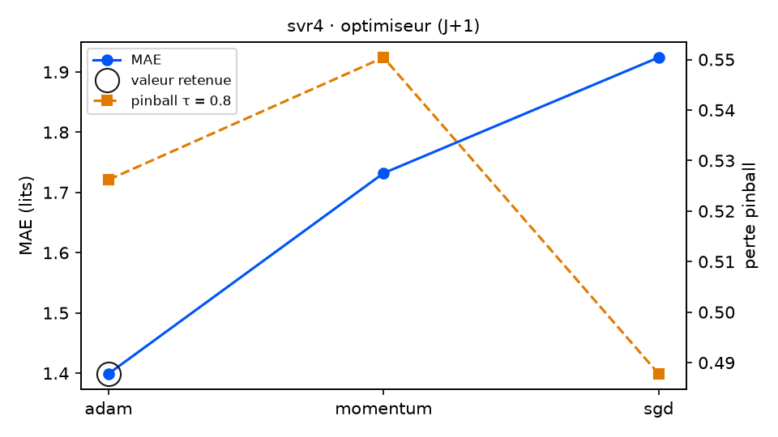

Amplitude de la MAE : 37.5 %. Aucune valeur ne fait significativement mieux que la valeur retenue.

### svr2 · C

| variante | MAE | RMSE | biais | pinball τ=0.8 | temps (s) | DM p (pinball τ=0.8) | p Holm | vs choix retenu |
|---|---|---|---|---|---|---|---|---|
| C = 0,1 | 2.187 | 2.578 | -0.784 | 1.3284 | 0.2 | 0.0 | 0.0 | moins bon |
| C = 0,3 | 1.809 | 2.166 | -0.555 | 1.071 | 0.3 | 0.0 | 0.0 | moins bon |
| C = 1 | 1.516 | 1.871 | -0.461 | 0.8966 | 0.8 | 0.0 | 0.0 | moins bon |
| C = 3 (retenu) | 1.341 | 1.708 | -0.406 | 0.7926 | 1.3 |  |  | — choix retenu |
| C = 10 | 1.302 | 1.669 | -0.333 | 0.7509 | 1.3 | 0.0173 | 0.0346 | meilleur |
| C = 30 | 1.328 | 1.692 | -0.247 | 0.7378 | 1.4 | 0.0717 | 0.0717 | équivalent |

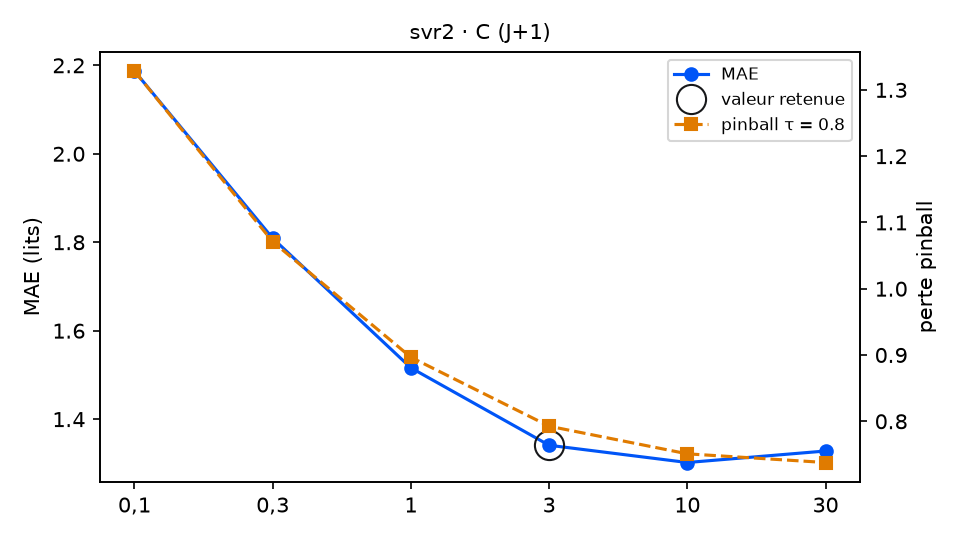

Amplitude de la MAE : 66.0 %. Valeur(s) significativement meilleure(s) : C = 10 — réglage à revoir.

### svr2 · ε (tube ε-insensible, en lits)

| variante | MAE | RMSE | biais | pinball τ=0.8 | temps (s) | DM p (pinball τ=0.8) | p Holm | vs choix retenu |
|---|---|---|---|---|---|---|---|---|
| epsilon = 0 | 1.318 | 1.677 | -0.425 | 0.7867 | 1.3 | 0.5607 | 0.5607 | équivalent |
| epsilon = 0,25 | 1.321 | 1.687 | -0.412 | 0.7839 | 0.9 | 0.2264 | 0.4528 | équivalent |
| epsilon = 0,5 (retenu) | 1.341 | 1.708 | -0.406 | 0.7926 | 1.3 |  |  | — choix retenu |
| epsilon = 1 | 1.374 | 1.729 | -0.407 | 0.8094 | 1.3 | 0.0907 | 0.2721 | équivalent |
| epsilon = 2 | 1.502 | 1.819 | -0.54 | 0.9129 | 1.3 | 0.0 | 0.0 | moins bon |

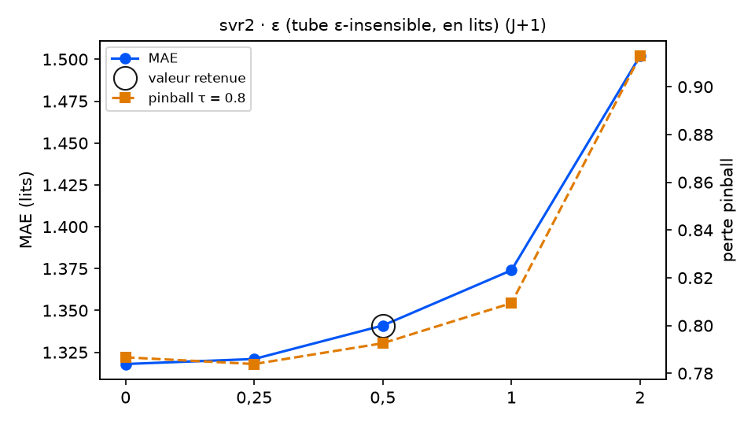

Amplitude de la MAE : 13.7 %. Aucune valeur ne fait significativement mieux que la valeur retenue.

### svr2 · γ (portée du noyau RBF)

| variante | MAE | RMSE | biais | pinball τ=0.8 | temps (s) | DM p (pinball τ=0.8) | p Holm | vs choix retenu |
|---|---|---|---|---|---|---|---|---|
| gamma = 0,005 | 1.471 | 1.818 | -0.431 | 0.8645 | 1.0 | 0.0001 | 0.0003 | moins bon |
| gamma = 0,01 | 1.367 | 1.721 | -0.412 | 0.8072 | 1.3 | 0.1295 | 0.259 | équivalent |
| gamma = 0,02 (retenu) | 1.341 | 1.708 | -0.406 | 0.7926 | 1.3 |  |  | — choix retenu |
| gamma = 0,05 | 1.414 | 1.783 | -0.366 | 0.8168 | 1.3 | 0.1524 | 0.259 | équivalent |
| gamma = 0,1 | 1.566 | 1.977 | -0.425 | 0.9108 | 1.3 | 0.0 | 0.0 | moins bon |
| gamma = 0,2 | 1.788 | 2.24 | -0.541 | 1.0562 | 1.2 | 0.0 | 0.0 | moins bon |
| gamma = 0,5 | 2.207 | 2.68 | -0.793 | 1.3417 | 0.6 | 0.0 | 0.0 | moins bon |

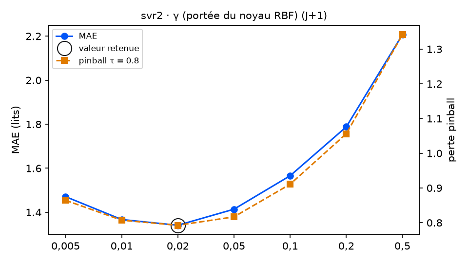

Amplitude de la MAE : 64.6 %. Aucune valeur ne fait significativement mieux que la valeur retenue.

### foret · nombre d'arbres

| variante | MAE | RMSE | biais | pinball τ=0.8 | couverture 90 % | temps (s) | DM p (pinball τ=0.8) | p Holm | vs choix retenu |
|---|---|---|---|---|---|---|---|---|---|
| arbres = 25 | 1.445 | 1.83 | -0.295 | 0.5142 | 93.4 | 0.9 | 0.3007 | 1.0 | équivalent |
| arbres = 50 | 1.452 | 1.832 | -0.296 | 0.4994 | 94.5 | 1.7 | 0.7844 | 1.0 | équivalent |
| arbres = 100 | 1.432 | 1.82 | -0.26 | 0.5016 | 93.4 | 3.2 | 0.9938 | 1.0 | équivalent |
| arbres = 300 (retenu) | 1.431 | 1.816 | -0.285 | 0.5017 | 94.0 | 9.8 |  |  | — choix retenu |
| arbres = 500 | 1.439 | 1.825 | -0.287 | 0.5035 | 94.0 | 16.1 | 0.5805 | 1.0 | équivalent |

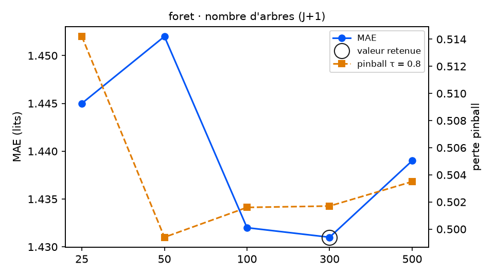

Amplitude de la MAE : 1.5 %. Aucune valeur ne fait significativement mieux que la valeur retenue.

### foret · profondeur maximale

| variante | MAE | RMSE | biais | pinball τ=0.8 | couverture 90 % | temps (s) | DM p (pinball τ=0.8) | p Holm | vs choix retenu |
|---|---|---|---|---|---|---|---|---|---|
| profondeur_foret = 3 | 1.593 | 1.961 | -0.421 | 0.5075 | 97.8 | 1.8 | 0.7297 | 1.0 | équivalent |
| profondeur_foret = 5 | 1.489 | 1.87 | -0.34 | 0.5053 | 94.5 | 4.4 | 0.6285 | 1.0 | équivalent |
| profondeur_foret = 8 | 1.438 | 1.818 | -0.29 | 0.5006 | 94.5 | 8.5 | 0.8572 | 1.0 | équivalent |
| profondeur_foret = 12 (retenu) | 1.431 | 1.816 | -0.285 | 0.5017 | 94.0 | 9.3 |  |  | — choix retenu |
| profondeur_foret = 20 | 1.409 | 1.814 | -0.273 | 0.5028 | 94.5 | 9.5 | 0.824 | 1.0 | équivalent |

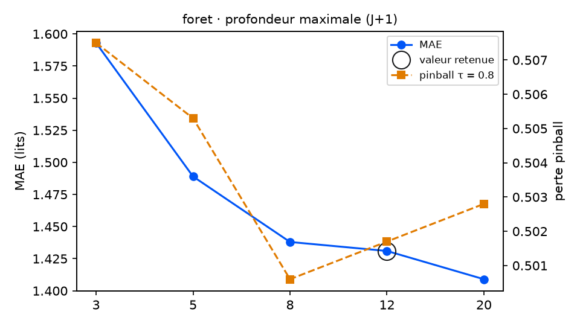

Amplitude de la MAE : 12.9 %. Aucune valeur ne fait significativement mieux que la valeur retenue.

### foret · taille minimale d'une feuille

| variante | MAE | RMSE | biais | pinball τ=0.8 | couverture 90 % | temps (s) | DM p (pinball τ=0.8) | p Holm | vs choix retenu |
|---|---|---|---|---|---|---|---|---|---|
| min_feuille = 2 | 1.412 | 1.801 | -0.258 | 0.5027 | 94.0 | 21.6 | 0.8832 | 1.0 | équivalent |
| min_feuille = 5 (retenu) | 1.431 | 1.816 | -0.285 | 0.5017 | 94.0 | 9.2 |  |  | — choix retenu |
| min_feuille = 10 | 1.465 | 1.845 | -0.329 | 0.4946 | 94.0 | 5.0 | 0.3882 | 1.0 | équivalent |
| min_feuille = 20 | 1.512 | 1.884 | -0.362 | 0.4998 | 95.6 | 2.8 | 0.8833 | 1.0 | équivalent |

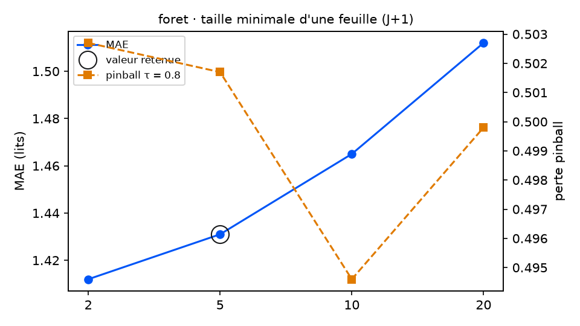

Amplitude de la MAE : 7.0 %. Aucune valeur ne fait significativement mieux que la valeur retenue.

### foret · part des variables tirées par nœud

| variante | MAE | RMSE | biais | pinball τ=0.8 | couverture 90 % | temps (s) | DM p (pinball τ=0.8) | p Holm | vs choix retenu |
|---|---|---|---|---|---|---|---|---|---|
| part_variables = 0,15 | 1.593 | 1.954 | -0.381 | 0.5168 | 97.3 | 9.4 | 0.1757 | 0.5271 | équivalent |
| part_variables = 0,333333 (retenu) | 1.431 | 1.816 | -0.285 | 0.5017 | 94.0 | 10.0 |  |  | — choix retenu |
| part_variables = 0,5 | 1.404 | 1.811 | -0.262 | 0.503 | 94.0 | 10.1 | 0.8589 | 0.91 | équivalent |
| part_variables = 1 | 1.324 | 1.774 | -0.256 | 0.4907 | 92.3 | 10.7 | 0.455 | 0.91 | équivalent |

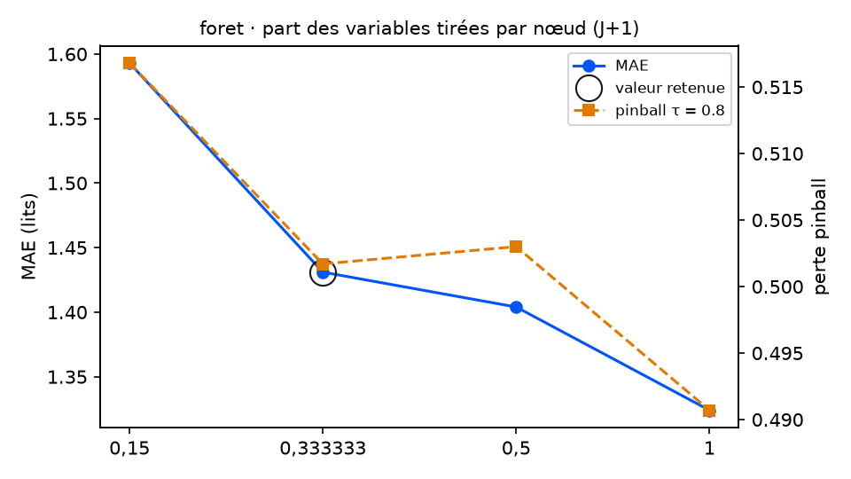

Amplitude de la MAE : 18.8 %. Aucune valeur ne fait significativement mieux que la valeur retenue.

### boosting · nombre d'étapes

| variante | MAE | RMSE | biais | pinball τ=0.8 | couverture 90 % | temps (s) | DM p (pinball τ=0.8) | p Holm | vs choix retenu |
|---|---|---|---|---|---|---|---|---|---|
| etapes = 50 | 1.463 | 1.841 | -0.445 | 0.5197 | 90.2 | 1.5 | 0.1418 | 0.1556 | équivalent |
| etapes = 100 | 1.373 | 1.776 | -0.39 | 0.5292 | 80.9 | 3.0 | 0.0778 | 0.1556 | équivalent |
| etapes = 300 (retenu) | 1.34 | 1.759 | -0.323 | 0.5542 | 71.0 | 8.9 |  |  | — choix retenu |
| etapes = 600 | 1.35 | 1.762 | -0.317 | 0.5743 | 68.3 | 18.2 | 0.0059 | 0.0177 | moins bon |

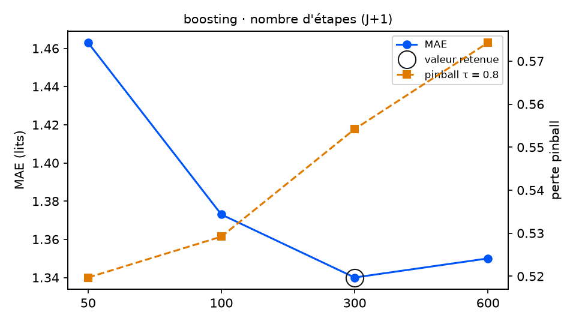

Amplitude de la MAE : 9.2 %. Aucune valeur ne fait significativement mieux que la valeur retenue.

### boosting · taux ν (shrinkage)

| variante | MAE | RMSE | biais | pinball τ=0.8 | couverture 90 % | temps (s) | DM p (pinball τ=0.8) | p Holm | vs choix retenu |
|---|---|---|---|---|---|---|---|---|---|
| taux_boosting = 0,01 | 1.429 | 1.817 | -0.412 | 0.531 | 86.3 | 9.0 | 0.2437 | 0.3468 | équivalent |
| taux_boosting = 0,05 (retenu) | 1.34 | 1.759 | -0.323 | 0.5542 | 71.0 | 9.1 |  |  | — choix retenu |
| taux_boosting = 0,1 | 1.357 | 1.781 | -0.379 | 0.5794 | 67.2 | 9.1 | 0.0679 | 0.2037 | équivalent |
| taux_boosting = 0,2 | 1.468 | 1.877 | -0.368 | 0.5797 | 65.0 | 8.9 | 0.1734 | 0.3468 | équivalent |

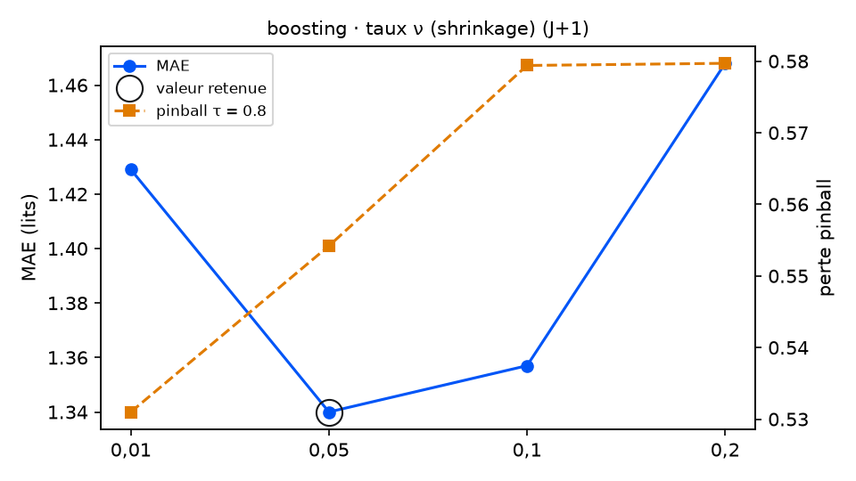

Amplitude de la MAE : 9.6 %. Aucune valeur ne fait significativement mieux que la valeur retenue.

### boosting · profondeur des arbres

| variante | MAE | RMSE | biais | pinball τ=0.8 | couverture 90 % | temps (s) | DM p (pinball τ=0.8) | p Holm | vs choix retenu |
|---|---|---|---|---|---|---|---|---|---|
| profondeur_boosting = 1 | 1.337 | 1.765 | -0.333 | 0.5066 | 83.6 | 2.8 | 0.0305 | 0.0915 | équivalent |
| profondeur_boosting = 2 | 1.32 | 1.749 | -0.36 | 0.534 | 78.1 | 5.4 | 0.185 | 0.185 | équivalent |
| profondeur_boosting = 3 (retenu) | 1.34 | 1.759 | -0.323 | 0.5542 | 71.0 | 8.4 |  |  | — choix retenu |
| profondeur_boosting = 5 | 1.357 | 1.76 | -0.325 | 0.5803 | 64.5 | 17.6 | 0.0724 | 0.1448 | équivalent |

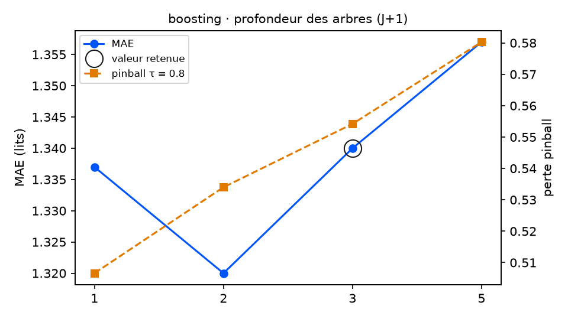

Amplitude de la MAE : 2.8 %. Aucune valeur ne fait significativement mieux que la valeur retenue.

### boosting · part du sous-échantillon

| variante | MAE | RMSE | biais | pinball τ=0.8 | couverture 90 % | temps (s) | DM p (pinball τ=0.8) | p Holm | vs choix retenu |
|---|---|---|---|---|---|---|---|---|---|
| sous_echantillon = 0,5 | 1.318 | 1.719 | -0.317 | 0.5603 | 69.9 | 8.0 | 0.7172 | 0.76 | équivalent |
| sous_echantillon = 0,8 (retenu) | 1.34 | 1.759 | -0.323 | 0.5542 | 71.0 | 8.7 |  |  | — choix retenu |
| sous_echantillon = 1 | 1.365 | 1.794 | -0.368 | 0.5674 | 70.5 | 8.7 | 0.38 | 0.76 | équivalent |

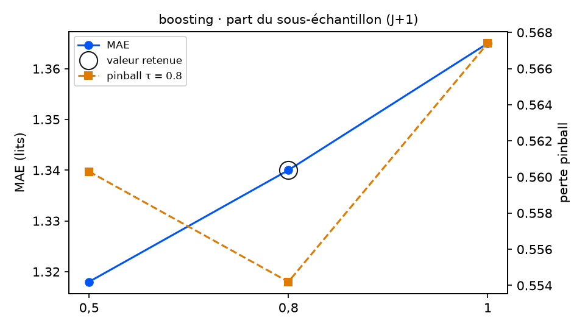

Amplitude de la MAE : 3.5 %. Aucune valeur ne fait significativement mieux que la valeur retenue.

### mlp · architecture (neurones par couche)

| variante | MAE | RMSE | biais | pinball τ=0.8 | couverture 90 % | temps (s) | DM p (pinball τ=0.8) | p Holm | vs choix retenu |
|---|---|---|---|---|---|---|---|---|---|
| couches = 8 | 1.535 | 1.912 | -0.515 | 0.7548 | 73.8 | 1.1 | 0.0 | 0.0 | moins bon |
| couches = 32 | 1.381 | 1.775 | -0.541 | 0.5049 | 84.2 | 0.8 | 0.0877 | 0.2631 | équivalent |
| couches = 32×16 (retenu) | 1.675 | 2.004 | -0.91 | 0.5466 | 84.7 | 1.0 |  |  | — choix retenu |
| couches = 64×32 | 1.306 | 1.693 | -0.419 | 0.5161 | 89.6 | 1.2 | 0.3814 | 0.3942 | équivalent |
| couches = 32×16×8 | 1.503 | 1.87 | -0.581 | 0.5842 | 79.8 | 1.2 | 0.1971 | 0.3942 | équivalent |

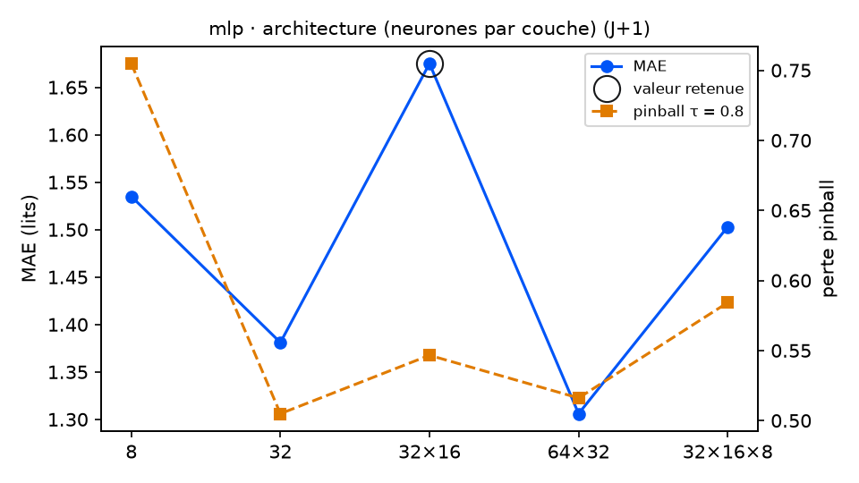

Amplitude de la MAE : 22.0 %. Aucune valeur ne fait significativement mieux que la valeur retenue.

### mlp · taux d'apprentissage

| variante | MAE | RMSE | biais | pinball τ=0.8 | couverture 90 % | temps (s) | DM p (pinball τ=0.8) | p Holm | vs choix retenu |
|---|---|---|---|---|---|---|---|---|---|
| taux_reseau = 0,001 | 1.79 | 2.117 | -0.818 | 0.6184 | 75.4 | 2.3 | 0.0001 | 0.0003 | moins bon |
| taux_reseau = 0,003 | 1.819 | 2.145 | -0.917 | 0.6109 | 77.6 | 1.3 | 0.0001 | 0.0003 | moins bon |
| taux_reseau = 0,01 (retenu) | 1.675 | 2.004 | -0.91 | 0.5466 | 84.7 | 1.0 |  |  | — choix retenu |
| taux_reseau = 0,03 | 1.546 | 1.889 | -0.806 | 0.5848 | 88.5 | 0.9 | 0.0442 | 0.0442 | moins bon |

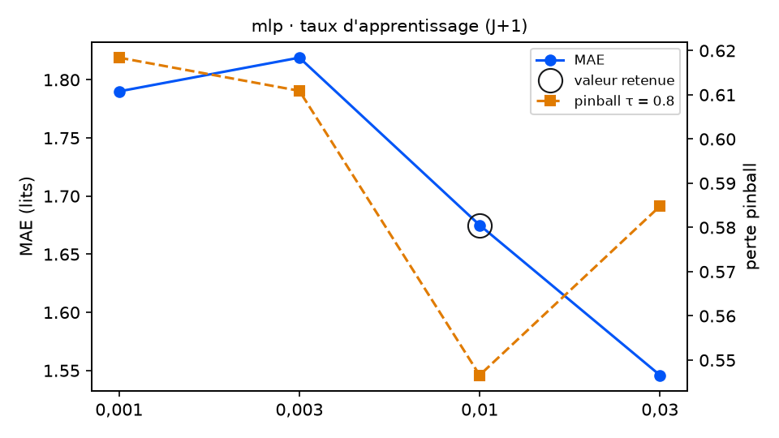

Amplitude de la MAE : 16.3 %. Aucune valeur ne fait significativement mieux que la valeur retenue.

### mlp · pénalité L2 λ

| variante | MAE | RMSE | biais | pinball τ=0.8 | couverture 90 % | temps (s) | DM p (pinball τ=0.8) | p Holm | vs choix retenu |
|---|---|---|---|---|---|---|---|---|---|
| lambda_ = 0 | 1.666 | 1.991 | -0.916 | 0.5563 | 84.7 | 1.0 | 0.1494 | 0.5976 | équivalent |
| lambda_ = 0,0001 | 1.644 | 1.982 | -0.859 | 0.5403 | 85.8 | 1.0 | 0.237 | 0.5976 | équivalent |
| lambda_ = 0,001 (retenu) | 1.675 | 2.004 | -0.91 | 0.5466 | 84.7 | 1.1 |  |  | — choix retenu |
| lambda_ = 0,01 | 1.547 | 1.874 | -0.73 | 0.57 | 75.4 | 1.2 | 0.1534 | 0.5976 | équivalent |
| lambda_ = 0,1 | 1.514 | 1.856 | -0.76 | 0.5268 | 85.2 | 3.2 | 0.5317 | 0.5976 | équivalent |

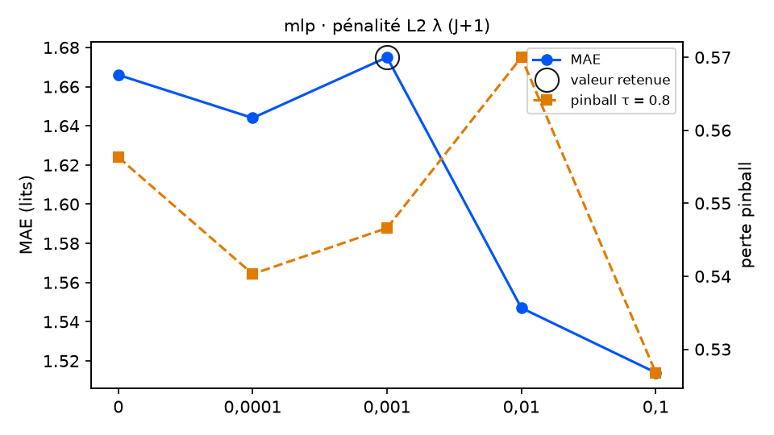

Amplitude de la MAE : 9.6 %. Aucune valeur ne fait significativement mieux que la valeur retenue.

### mlp · époques maximales

| variante | MAE | RMSE | biais | pinball τ=0.8 | couverture 90 % | temps (s) | DM p (pinball τ=0.8) | p Holm | vs choix retenu |
|---|---|---|---|---|---|---|---|---|---|
| epoques = 300 | 1.675 | 2.004 | -0.91 | 0.5466 | 84.7 | 1.1 |  |  | identique |
| epoques = 800 | 1.675 | 2.004 | -0.91 | 0.5466 | 84.7 | 1.1 |  |  | identique |
| epoques = 1500 (retenu) | 1.675 | 2.004 | -0.91 | 0.5466 | 84.7 | 1.1 |  |  | — choix retenu |
| epoques = 3000 | 1.675 | 2.004 | -0.91 | 0.5466 | 84.7 | 1.1 |  |  | identique |

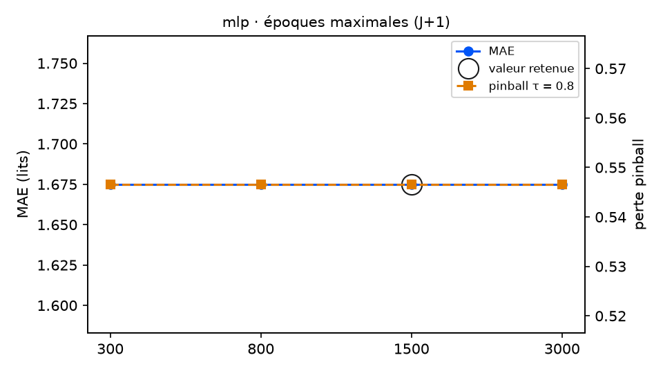

Amplitude de la MAE : 0.0 %. Aucune valeur ne fait significativement mieux que la valeur retenue.

### mlp · patience de l'arrêt anticipé

| variante | MAE | RMSE | biais | pinball τ=0.8 | couverture 90 % | temps (s) | DM p (pinball τ=0.8) | p Holm | vs choix retenu |
|---|---|---|---|---|---|---|---|---|---|
| patience = 50 | 1.675 | 2.004 | -0.91 | 0.5466 | 84.7 | 0.5 |  |  | identique |
| patience = 150 (retenu) | 1.675 | 2.004 | -0.91 | 0.5466 | 84.7 | 1.0 |  |  | — choix retenu |
| patience = 300 | 1.675 | 2.004 | -0.91 | 0.5466 | 84.7 | 1.8 |  |  | identique |

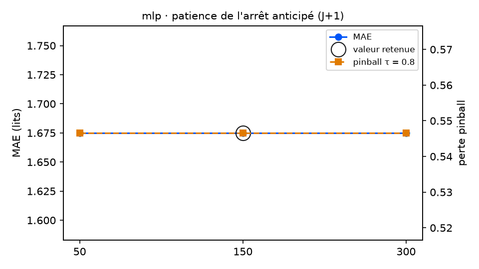

Amplitude de la MAE : 0.0 %. Aucune valeur ne fait significativement mieux que la valeur retenue.

### mlp · nombre d'initialisations moyennées

| variante | MAE | RMSE | biais | pinball τ=0.8 | couverture 90 % | temps (s) | DM p (pinball τ=0.8) | p Holm | vs choix retenu |
|---|---|---|---|---|---|---|---|---|---|
| graines = 1 | 1.515 | 1.877 | -0.717 | 0.5845 | 82.0 | 0.5 | 0.2258 | 0.4516 | équivalent |
| graines = 3 (retenu) | 1.675 | 2.004 | -0.91 | 0.5466 | 84.7 | 1.1 |  |  | — choix retenu |
| graines = 5 | 1.717 | 2.062 | -1.045 | 0.5345 | 86.9 | 1.7 | 0.409 | 0.4516 | équivalent |

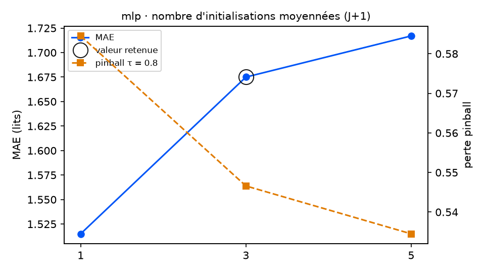

Amplitude de la MAE : 12.1 %. Aucune valeur ne fait significativement mieux que la valeur retenue.

### lstm · taille de l'état caché H

| variante | MAE | RMSE | biais | pinball τ=0.8 | couverture 90 % | temps (s) | DM p (pinball τ=0.8) | p Holm | vs choix retenu |
|---|---|---|---|---|---|---|---|---|---|
| cache_lstm = 4 | 1.462 | 1.82 | -0.563 | 0.5443 | 72.1 | 8.6 | 0.0771 | 0.0771 | équivalent |
| cache_lstm = 8 | 1.502 | 1.886 | -0.674 | 0.5858 | 71.6 | 8.3 | 0.0003 | 0.0009 | moins bon |
| cache_lstm = 16 (retenu) | 1.413 | 1.769 | -0.528 | 0.5125 | 75.4 | 8.7 |  |  | — choix retenu |
| cache_lstm = 32 | 1.424 | 1.804 | -0.571 | 0.5638 | 74.9 | 14.3 | 0.0079 | 0.0158 | moins bon |

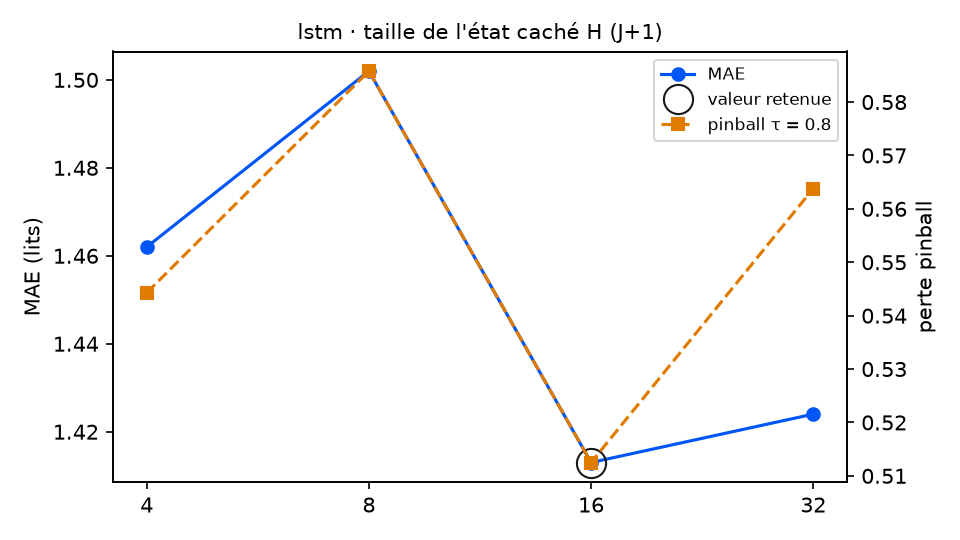

Amplitude de la MAE : 6.3 %. Aucune valeur ne fait significativement mieux que la valeur retenue.

### lstm · taux d'apprentissage

| variante | MAE | RMSE | biais | pinball τ=0.8 | couverture 90 % | temps (s) | DM p (pinball τ=0.8) | p Holm | vs choix retenu |
|---|---|---|---|---|---|---|---|---|---|
| taux_reseau = 0,003 | 1.403 | 1.759 | -0.513 | 0.5259 | 73.2 | 15.7 | 0.2376 | 0.4682 | équivalent |
| taux_reseau = 0,01 (retenu) | 1.413 | 1.769 | -0.528 | 0.5125 | 75.4 | 8.6 |  |  | — choix retenu |
| taux_reseau = 0,03 | 1.358 | 1.713 | -0.485 | 0.5286 | 69.9 | 7.2 | 0.2341 | 0.4682 | équivalent |

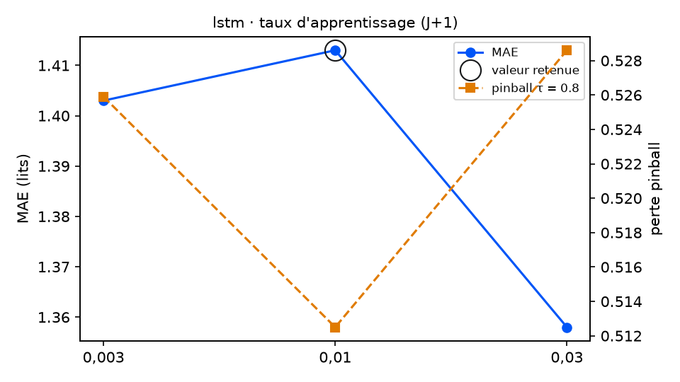

Amplitude de la MAE : 3.9 %. Aucune valeur ne fait significativement mieux que la valeur retenue.

### lstm · pénalité L2 λ

| variante | MAE | RMSE | biais | pinball τ=0.8 | couverture 90 % | temps (s) | DM p (pinball τ=0.8) | p Holm | vs choix retenu |
|---|---|---|---|---|---|---|---|---|---|
| lambda_ = 0 | 1.505 | 1.859 | -0.682 | 0.5315 | 76.5 | 7.8 | 0.113 | 0.226 | équivalent |
| lambda_ = 0,001 (retenu) | 1.413 | 1.769 | -0.528 | 0.5125 | 75.4 | 8.4 |  |  | — choix retenu |
| lambda_ = 0,01 | 1.383 | 1.752 | -0.436 | 0.51 | 73.2 | 14.5 | 0.8329 | 0.8329 | équivalent |

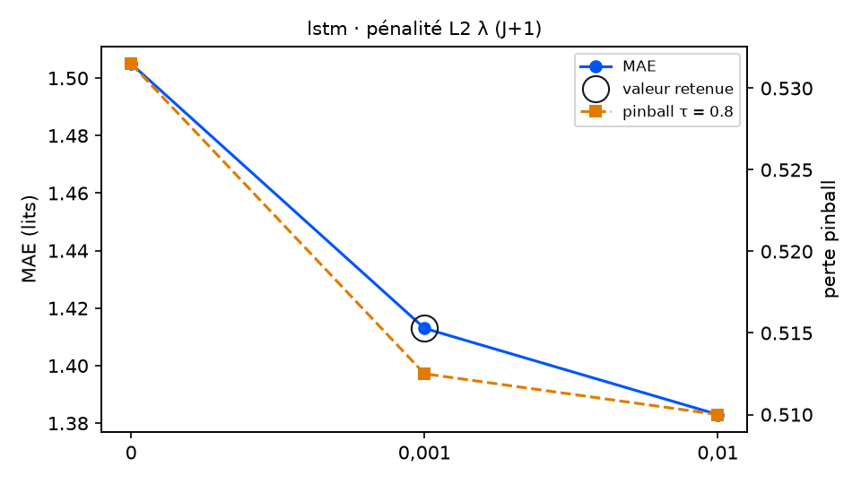

Amplitude de la MAE : 8.6 %. Aucune valeur ne fait significativement mieux que la valeur retenue.

### variables · jours d'occupation passée en entrée

| variante | MAE | RMSE | biais | pinball τ=0.8 | couverture 90 % | temps (s) | DM p (pinball τ=0.8) | p Holm | vs choix retenu |
|---|---|---|---|---|---|---|---|---|---|
| retards = 3 | 1.391 | 1.794 | -0.388 | 0.5086 | 84.7 | 6.0 | 0.2685 | 0.537 | équivalent |
| retards = 5 | 1.432 | 1.832 | -0.426 | 0.5239 | 82.0 | 6.3 | 0.8485 | 0.8485 | équivalent |
| retards = 7 (retenu) | 1.399 | 1.782 | -0.38 | 0.5262 | 85.2 | 6.5 |  |  | — choix retenu |
| retards = 10 | 1.48 | 1.884 | -0.41 | 0.5565 | 81.4 | 7.1 | 0.0038 | 0.0114 | moins bon |
| retards = 14 | 1.587 | 2.007 | -0.51 | 0.6023 | 79.8 | 7.8 | 0.0 | 0.0 | moins bon |
| retards = 21 | 1.774 | 2.139 | -0.635 | 0.7472 | 73.8 | 7.6 | 0.0 | 0.0 | moins bon |

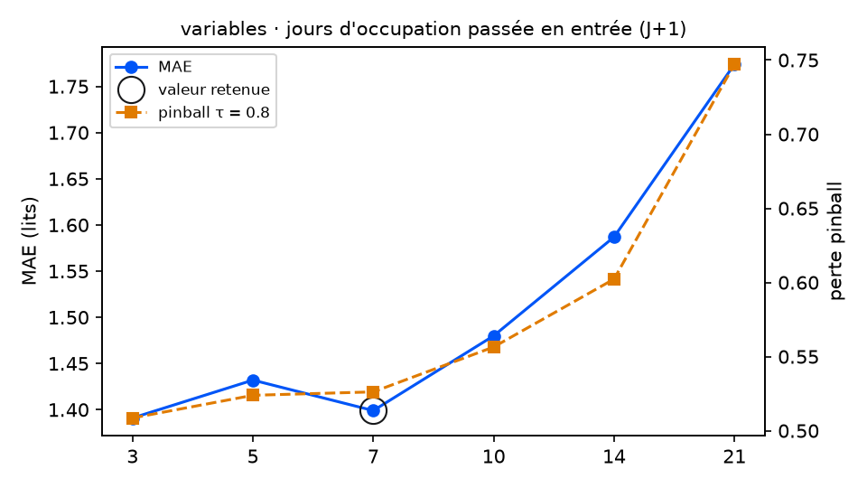

Amplitude de la MAE : 27.4 %. Aucune valeur ne fait significativement mieux que la valeur retenue.

## Horizon J+7

### svr4 · C (poids des erreurs)

| variante | MAE | RMSE | biais | pinball τ=0.8 | couverture 90 % | temps (s) | DM p (pinball τ=0.8) | p Holm | vs choix retenu |
|---|---|---|---|---|---|---|---|---|---|
| C = 0,1 | 2.717 | 3.201 | -1.094 | 0.8752 | 91.0 | 4.7 | 0.6837 | 1.0 | équivalent |
| C = 0,3 (retenu) | 2.698 | 3.166 | -0.978 | 0.8824 | 89.8 | 5.5 |  |  | — choix retenu |
| C = 1 | 2.604 | 3.052 | -0.847 | 0.8956 | 91.0 | 4.8 | 0.6841 | 1.0 | équivalent |
| C = 3 | 2.571 | 3.031 | -0.833 | 0.9776 | 84.2 | 5.8 | 0.2854 | 0.935 | équivalent |
| C = 10 | 2.524 | 3.065 | -1.118 | 1.0791 | 80.8 | 7.9 | 0.187 | 0.935 | équivalent |
| C = 30 | 2.599 | 3.187 | -1.267 | 1.0925 | 72.3 | 8.9 | 0.2154 | 0.935 | équivalent |

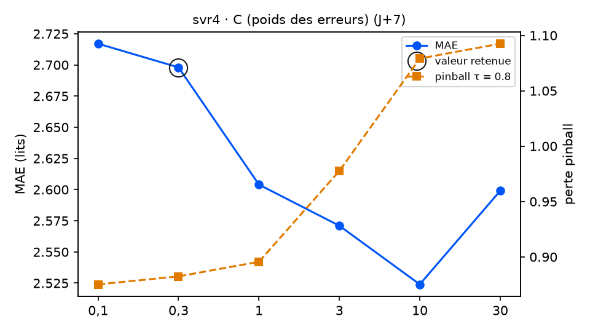

Amplitude de la MAE : 7.2 %. Aucune valeur ne fait significativement mieux que la valeur retenue.

### svr4 · ε (tube, niveaux quantiles)

| variante | MAE | RMSE | biais | pinball τ=0.8 | couverture 90 % | temps (s) | DM p (pinball τ=0.8) | p Holm | vs choix retenu |
|---|---|---|---|---|---|---|---|---|---|
| epsilon_quantile = 0 (retenu) | 2.698 | 3.166 | -0.978 | 0.8824 | 89.8 | 5.1 |  |  | — choix retenu |
| epsilon_quantile = 0,25 | 2.704 | 3.174 | -0.942 | 0.8953 | 88.1 | 5.0 | 0.2327 | 0.6981 | équivalent |
| epsilon_quantile = 0,5 | 2.698 | 3.166 | -0.934 | 0.8912 | 86.4 | 4.7 | 0.6262 | 0.6981 | équivalent |
| epsilon_quantile = 1 | 2.67 | 3.127 | -0.912 | 0.9243 | 80.8 | 4.6 | 0.2896 | 0.6981 | équivalent |

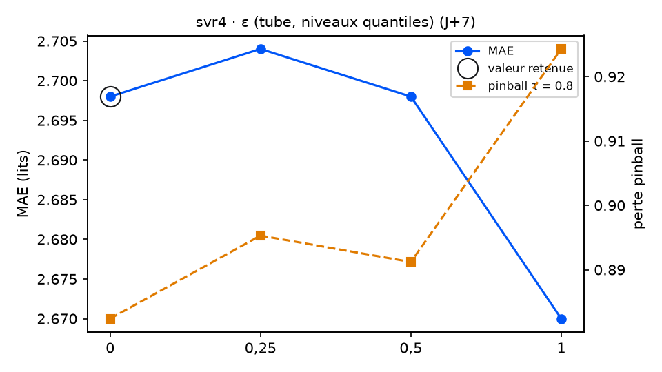

Amplitude de la MAE : 1.3 %. Aucune valeur ne fait significativement mieux que la valeur retenue.

### svr4 · γ₁ (portée, bloc occupation)

| variante | MAE | RMSE | biais | pinball τ=0.8 | couverture 90 % | temps (s) | DM p (pinball τ=0.8) | p Holm | vs choix retenu |
|---|---|---|---|---|---|---|---|---|---|
| gamma1 = 0,01 | 2.696 | 3.168 | -0.99 | 0.8917 | 89.8 | 5.2 | 0.4 | 1.0 | équivalent |
| gamma1 = 0,02 | 2.695 | 3.167 | -0.989 | 0.8905 | 89.3 | 5.6 | 0.4553 | 1.0 | équivalent |
| gamma1 = 0,05 | 2.695 | 3.166 | -0.989 | 0.8888 | 88.7 | 3.0 | 0.5418 | 1.0 | équivalent |
| gamma1 = 0,1 (retenu) | 2.698 | 3.166 | -0.978 | 0.8824 | 89.8 | 5.4 |  |  | — choix retenu |
| gamma1 = 0,2 | 2.697 | 3.155 | -0.974 | 0.8864 | 91.0 | 4.1 | 0.5406 | 1.0 | équivalent |
| gamma1 = 0,5 | 2.684 | 3.135 | -0.994 | 0.8846 | 89.8 | 4.4 | 0.8718 | 1.0 | équivalent |

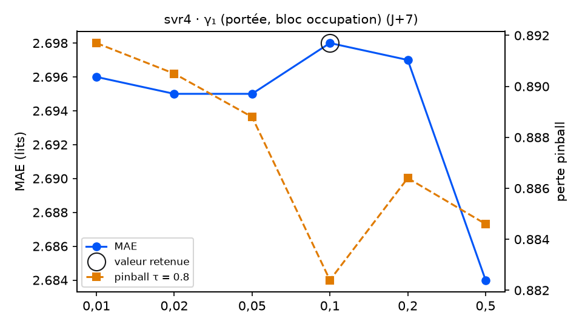

Amplitude de la MAE : 0.5 %. Aucune valeur ne fait significativement mieux que la valeur retenue.

### svr4 · γ₂ (portée, bloc flux et saison)

| variante | MAE | RMSE | biais | pinball τ=0.8 | couverture 90 % | temps (s) | DM p (pinball τ=0.8) | p Holm | vs choix retenu |
|---|---|---|---|---|---|---|---|---|---|
| gamma2 = 0,02 | 2.71 | 3.173 | -1.047 | 0.8766 | 91.5 | 5.1 | 0.7072 | 1.0 | équivalent |
| gamma2 = 0,05 (retenu) | 2.698 | 3.166 | -0.978 | 0.8824 | 89.8 | 5.4 |  |  | — choix retenu |
| gamma2 = 0,1 | 2.671 | 3.132 | -0.945 | 0.8909 | 89.3 | 3.7 | 0.5377 | 1.0 | équivalent |
| gamma2 = 0,2 | 2.655 | 3.109 | -0.958 | 0.8861 | 88.7 | 4.7 | 0.7881 | 1.0 | équivalent |
| gamma2 = 0,5 | 2.686 | 3.148 | -1.052 | 0.8763 | 88.7 | 4.9 | 0.7642 | 1.0 | équivalent |

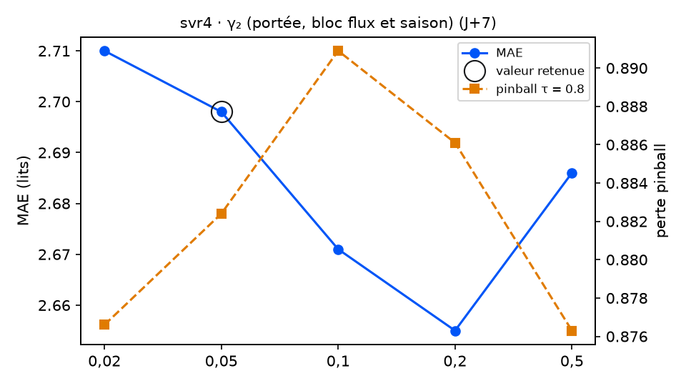

Amplitude de la MAE : 2.0 %. Aucune valeur ne fait significativement mieux que la valeur retenue.

### svr4 · τ (quantile décisionnel)

| variante | MAE | RMSE | biais | pinball τ=0.8 | couverture 90 % | temps (s) | DM p (pinball τ=0.8) | p Holm | vs choix retenu |
|---|---|---|---|---|---|---|---|---|---|
| tau = 0,5 | 2.698 | 3.166 | -0.978 | 1.6423 | 89.8 | 4.2 | 0.0011 | 0.0044 | moins bon |
| tau = 0,6 | 2.698 | 3.166 | -0.978 | 1.6423 | 89.8 | 5.7 | 0.0011 | 0.0044 | moins bon |
| tau = 0,7 | 2.698 | 3.166 | -0.978 | 1.6423 | 89.8 | 5.3 | 0.0011 | 0.0044 | moins bon |
| tau = 0,8 (retenu) | 2.698 | 3.166 | -0.978 | 0.8824 | 89.8 | 5.4 |  |  | — choix retenu |
| tau = 0,9 | 2.698 | 3.166 | -0.978 | 1.6423 | 89.8 | 5.2 | 0.0011 | 0.0044 | moins bon |

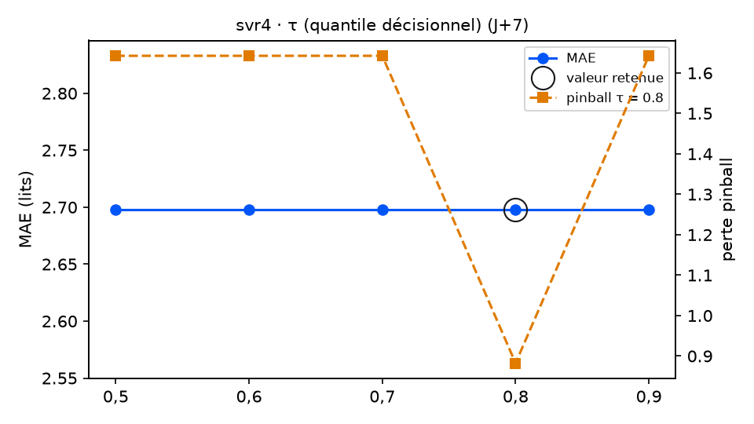

Amplitude de la MAE : 0.0 %. Aucune valeur ne fait significativement mieux que la valeur retenue.

### svr4 · η₀ (taux d'apprentissage d'Adam)

| variante | MAE | RMSE | biais | pinball τ=0.8 | couverture 90 % | temps (s) | DM p (pinball τ=0.8) | p Holm | vs choix retenu |
|---|---|---|---|---|---|---|---|---|---|
| taux = 0,005 | 2.698 | 3.165 | -0.977 | 0.8872 | 90.4 | 7.4 | 0.2939 | 0.7944 | équivalent |
| taux = 0,01 | 2.697 | 3.164 | -0.979 | 0.8887 | 89.8 | 6.1 | 0.2325 | 0.7944 | équivalent |
| taux = 0,02 | 2.695 | 3.163 | -0.981 | 0.8901 | 89.8 | 5.2 | 0.1986 | 0.7944 | équivalent |
| taux = 0,05 (retenu) | 2.698 | 3.166 | -0.978 | 0.8824 | 89.8 | 5.2 |  |  | — choix retenu |
| taux = 0,1 | 2.695 | 3.163 | -0.982 | 0.8848 | 91.5 | 4.8 | 0.2166 | 0.7944 | équivalent |
| taux = 0,2 | 2.695 | 3.163 | -0.981 | 0.8918 | 91.5 | 5.8 | 0.096 | 0.48 | équivalent |

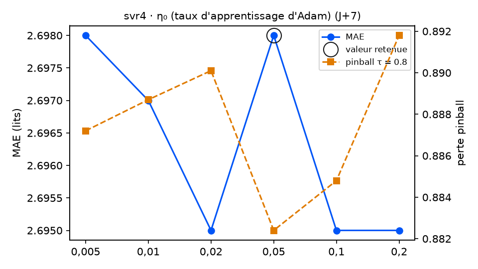

Amplitude de la MAE : 0.1 %. Aucune valeur ne fait significativement mieux que la valeur retenue.

### svr4 · nombre maximal d'itérations

| variante | MAE | RMSE | biais | pinball τ=0.8 | couverture 90 % | temps (s) | DM p (pinball τ=0.8) | p Holm | vs choix retenu |
|---|---|---|---|---|---|---|---|---|---|
| iterations = 300 | 2.696 | 3.163 | -0.979 | 0.8764 | 92.1 | 1.0 | 0.6051 | 1.0 | équivalent |
| iterations = 1000 | 2.698 | 3.166 | -0.978 | 0.8825 | 91.5 | 2.8 | 0.9789 | 1.0 | équivalent |
| iterations = 3000 (retenu) | 2.698 | 3.166 | -0.978 | 0.8824 | 89.8 | 5.2 |  |  | — choix retenu |
| iterations = 6000 | 2.698 | 3.166 | -0.978 | 0.8824 | 89.8 | 6.3 |  |  | identique |

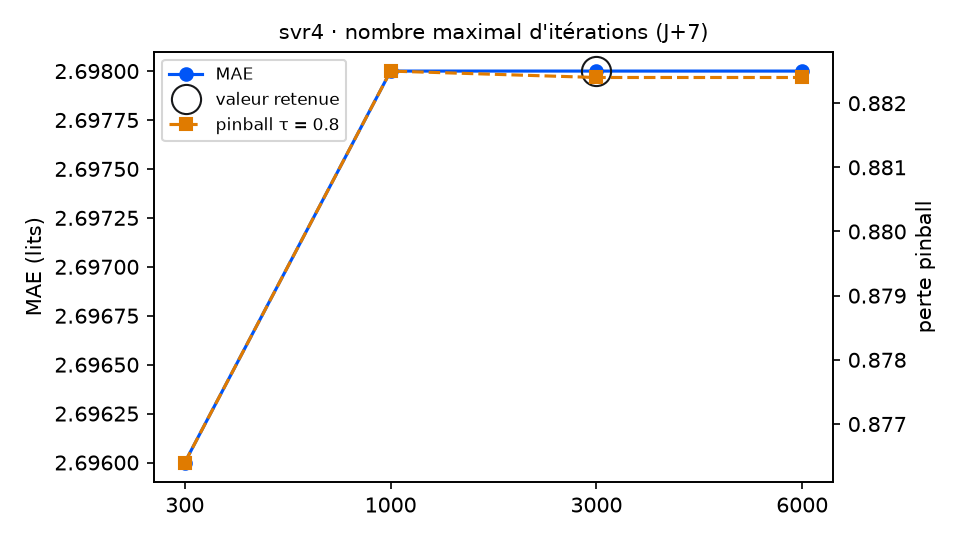

Amplitude de la MAE : 0.1 %. Aucune valeur ne fait significativement mieux que la valeur retenue.

### svr4 · T (décroissance du pas ; aucune = pas constant)

| variante | MAE | RMSE | biais | pinball τ=0.8 | couverture 90 % | temps (s) | DM p (pinball τ=0.8) | p Holm | vs choix retenu |
|---|---|---|---|---|---|---|---|---|---|
| decroissance = aucune | 2.696 | 3.164 | -0.981 | 0.8934 | 89.8 | 5.7 | 0.1362 | 0.3546 | équivalent |
| decroissance = 100 | 2.696 | 3.164 | -0.982 | 0.8892 | 90.4 | 5.2 | 0.169 | 0.3546 | équivalent |
| decroissance = 500 (retenu) | 2.698 | 3.166 | -0.978 | 0.8824 | 89.8 | 5.1 |  |  | — choix retenu |
| decroissance = 2000 | 2.695 | 3.163 | -0.986 | 0.8936 | 89.8 | 4.8 | 0.1182 | 0.3546 | équivalent |

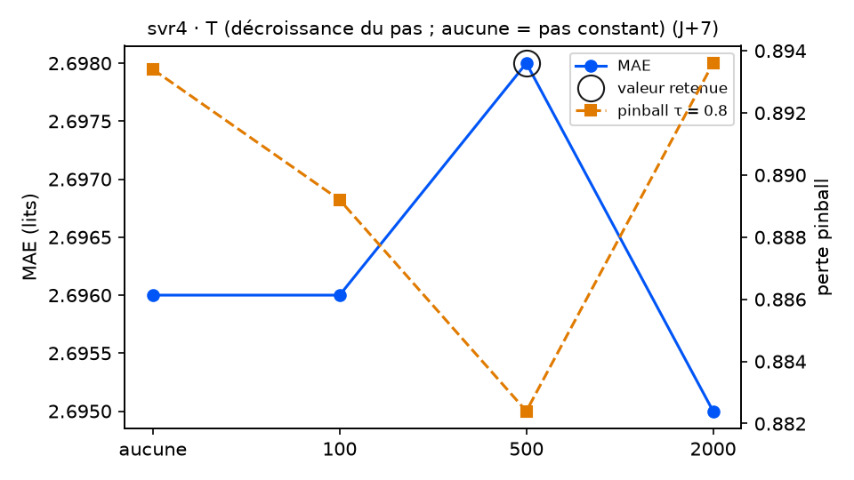

Amplitude de la MAE : 0.1 %. Aucune valeur ne fait significativement mieux que la valeur retenue.

### svr4 · part des pas moyennée (Polyak ; 0 = aucune)

| variante | MAE | RMSE | biais | pinball τ=0.8 | couverture 90 % | temps (s) | DM p (pinball τ=0.8) | p Holm | vs choix retenu |
|---|---|---|---|---|---|---|---|---|---|
| moyenne_polyak = 0 | 2.698 | 3.166 | -0.978 | 0.8824 | 89.8 | 4.6 | 0.8188 | 0.8188 | équivalent |
| moyenne_polyak = 0,25 | 2.698 | 3.166 | -0.978 | 0.8824 | 89.8 | 5.4 |  |  | identique |
| moyenne_polyak = 0,5 (retenu) | 2.698 | 3.166 | -0.978 | 0.8824 | 89.8 | 5.4 |  |  | — choix retenu |
| moyenne_polyak = 0,75 | 2.698 | 3.166 | -0.978 | 0.8824 | 89.8 | 5.1 |  |  | identique |

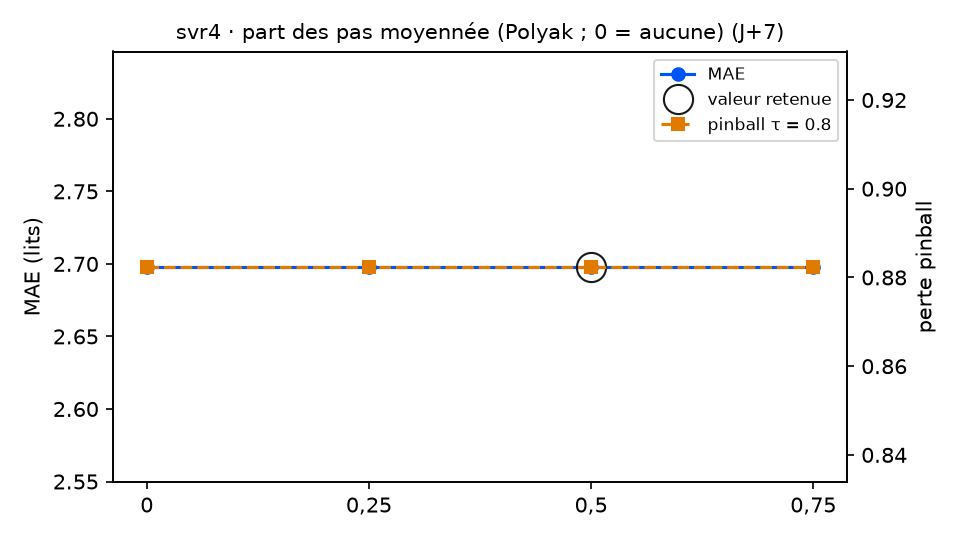

Amplitude de la MAE : 0.0 %. Aucune valeur ne fait significativement mieux que la valeur retenue.

### svr4 · tolérance d'arrêt anticipé

| variante | MAE | RMSE | biais | pinball τ=0.8 | couverture 90 % | temps (s) | DM p (pinball τ=0.8) | p Holm | vs choix retenu |
|---|---|---|---|---|---|---|---|---|---|
| tolerance = 1e-05 | 2.696 | 3.162 | -0.979 | 0.8809 | 89.8 | 3.0 | 0.3879 | 0.3879 | équivalent |
| tolerance = 1e-07 (retenu) | 2.698 | 3.166 | -0.978 | 0.8824 | 89.8 | 5.3 |  |  | — choix retenu |
| tolerance = 1e-09 | 2.695 | 3.163 | -0.984 | 0.8938 | 89.8 | 8.8 | 0.0908 | 0.1816 | équivalent |

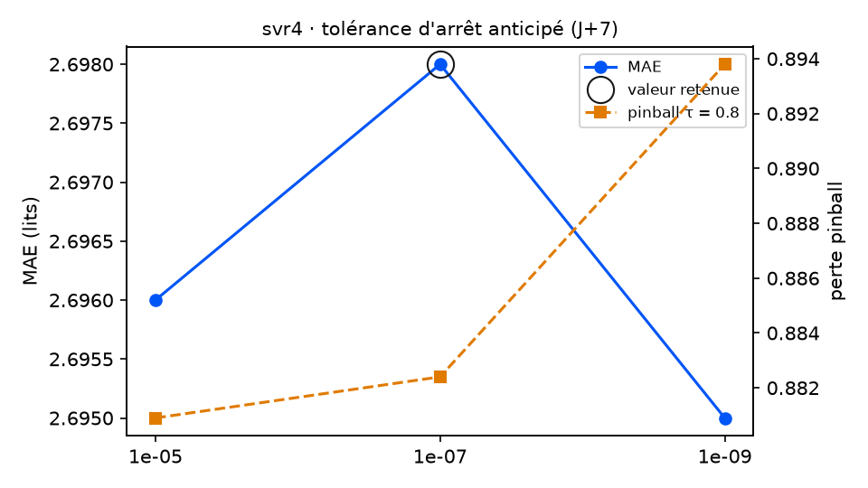

Amplitude de la MAE : 0.1 %. Aucune valeur ne fait significativement mieux que la valeur retenue.

### svr4 · direction préconditionnée α + Cg

| variante | MAE | RMSE | biais | pinball τ=0.8 | couverture 90 % | temps (s) | DM p (pinball τ=0.8) | p Holm | vs choix retenu |
|---|---|---|---|---|---|---|---|---|---|
| preconditionne = True (retenu) | 2.698 | 3.166 | -0.978 | 0.8824 | 89.8 | 5.7 |  |  | — choix retenu |
| preconditionne = False | 2.698 | 3.165 | -0.977 | 0.8859 | 90.4 | 9.8 | 0.2365 | 0.2365 | équivalent |

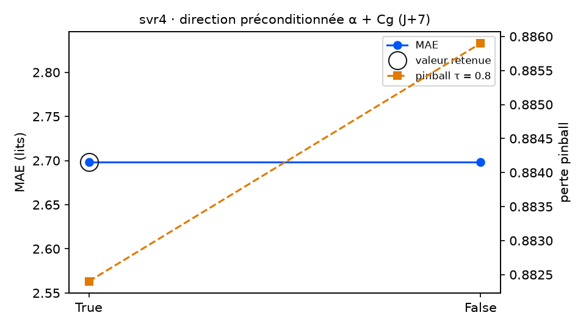

Amplitude de la MAE : 0.0 %. Aucune valeur ne fait significativement mieux que la valeur retenue.

### svr4 · optimiseur

| variante | MAE | RMSE | biais | pinball τ=0.8 | couverture 90 % | temps (s) | DM p (pinball τ=0.8) | p Holm | vs choix retenu |
|---|---|---|---|---|---|---|---|---|---|
| optimiseur = adam (retenu) | 2.698 | 3.166 | -0.978 | 0.8824 | 89.8 | 5.2 |  |  | — choix retenu |
| optimiseur = momentum | 2.698 | 3.166 | -0.976 | 0.8949 | 89.8 | 3.2 | 0.0853 | 0.1706 | équivalent |
| optimiseur = sgd | 2.696 | 3.161 | -0.963 | 0.893 | 90.4 | 3.5 | 0.14 | 0.1706 | équivalent |

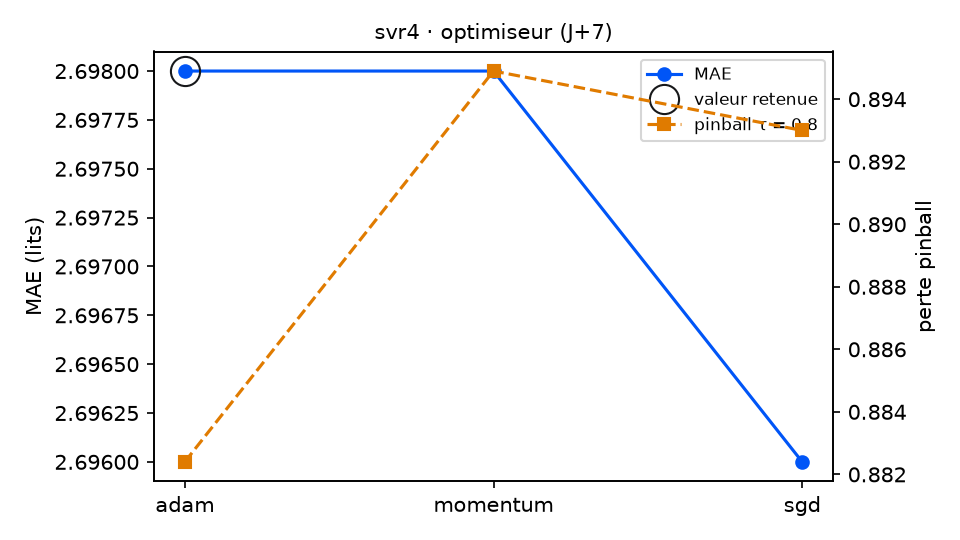

Amplitude de la MAE : 0.1 %. Aucune valeur ne fait significativement mieux que la valeur retenue.

### svr2 · C

| variante | MAE | RMSE | biais | pinball τ=0.8 | temps (s) | DM p (pinball τ=0.8) | p Holm | vs choix retenu |
|---|---|---|---|---|---|---|---|---|
| C = 0,1 | 2.707 | 3.177 | -1.019 | 1.6594 | 0.3 | 0.3736 | 1.0 | équivalent |
| C = 0,3 | 2.674 | 3.134 | -0.912 | 1.6106 | 0.4 | 0.5918 | 1.0 | équivalent |
| C = 1 | 2.595 | 3.048 | -0.85 | 1.5522 | 0.8 | 0.7954 | 1.0 | équivalent |
| C = 3 (retenu) | 2.534 | 3.011 | -0.998 | 1.5663 | 0.9 |  |  | — choix retenu |
| C = 10 | 2.533 | 3.076 | -1.184 | 1.6219 | 1.4 | 0.2358 | 0.9432 | équivalent |
| C = 30 | 2.592 | 3.242 | -1.356 | 1.7029 | 1.4 | 0.1223 | 0.6115 | équivalent |

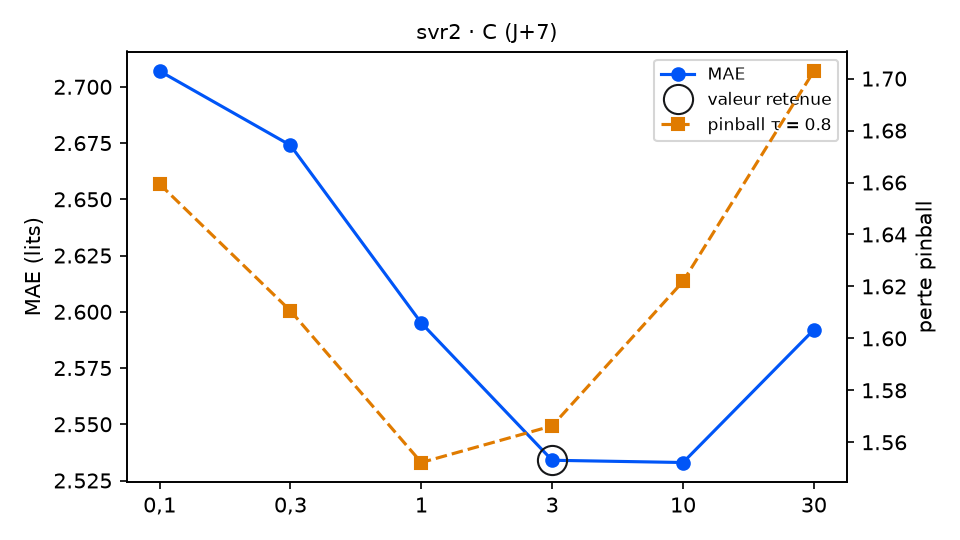

Amplitude de la MAE : 6.9 %. Aucune valeur ne fait significativement mieux que la valeur retenue.

### svr2 · ε (tube ε-insensible, en lits)

| variante | MAE | RMSE | biais | pinball τ=0.8 | temps (s) | DM p (pinball τ=0.8) | p Holm | vs choix retenu |
|---|---|---|---|---|---|---|---|---|
| epsilon = 0 | 2.519 | 3.006 | -0.83 | 1.5087 | 1.3 | 0.0081 | 0.0243 | meilleur |
| epsilon = 0,25 | 2.511 | 2.989 | -0.897 | 1.5247 | 1.1 | 0.002 | 0.008 | meilleur |
| epsilon = 0,5 (retenu) | 2.534 | 3.011 | -0.998 | 1.5663 | 0.9 |  |  | — choix retenu |
| epsilon = 1 | 2.55 | 3.051 | -1.109 | 1.6079 | 1.1 | 0.1251 | 0.1251 | équivalent |
| epsilon = 2 | 2.628 | 3.136 | -1.187 | 1.67 | 1.2 | 0.0551 | 0.1102 | équivalent |

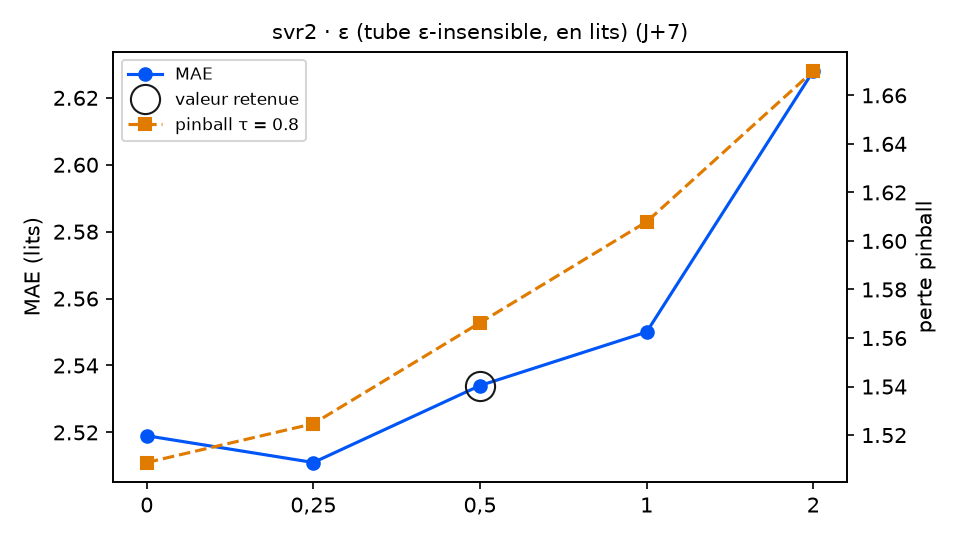

Amplitude de la MAE : 4.6 %. Valeur(s) significativement meilleure(s) : epsilon = 0, epsilon = 0,25 — réglage à revoir.

### svr2 · γ (portée du noyau RBF)

| variante | MAE | RMSE | biais | pinball τ=0.8 | temps (s) | DM p (pinball τ=0.8) | p Holm | vs choix retenu |
|---|---|---|---|---|---|---|---|---|
| gamma = 0,005 | 2.753 | 3.245 | -0.95 | 1.6618 | 0.5 | 0.2732 | 1.0 | équivalent |
| gamma = 0,01 | 2.749 | 3.253 | -0.997 | 1.6737 | 0.5 | 0.179 | 0.895 | équivalent |
| gamma = 0,02 | 2.704 | 3.197 | -1.033 | 1.6616 | 0.6 | 0.0965 | 0.579 | équivalent |
| gamma = 0,05 (retenu) | 2.534 | 3.011 | -0.998 | 1.5663 | 0.9 |  |  | — choix retenu |
| gamma = 0,1 | 2.532 | 3.03 | -1.015 | 1.5708 | 1.2 | 0.9119 | 1.0 | équivalent |
| gamma = 0,2 | 2.615 | 3.1 | -1.051 | 1.6231 | 1.2 | 0.3664 | 1.0 | équivalent |
| gamma = 0,5 | 2.635 | 3.061 | -0.936 | 1.5982 | 0.9 | 0.7358 | 1.0 | équivalent |

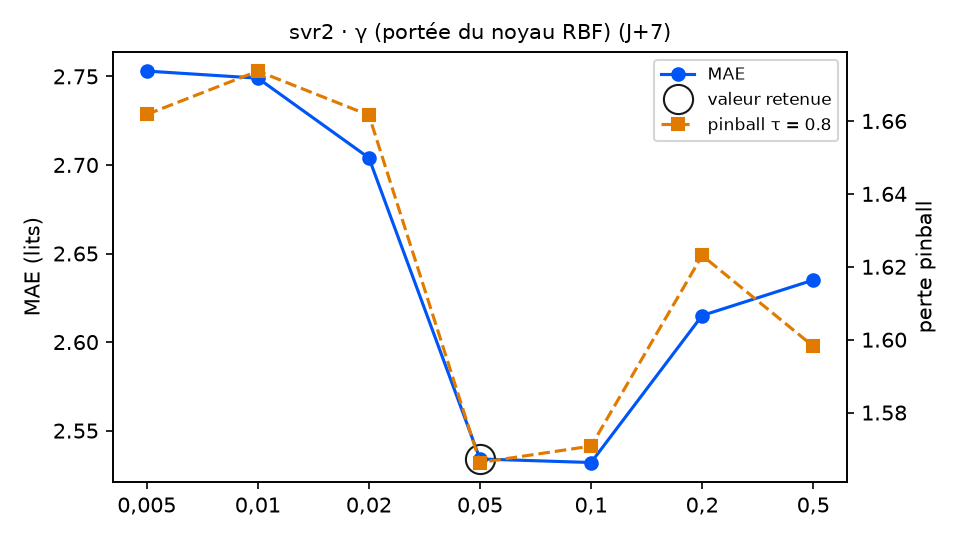

Amplitude de la MAE : 8.7 %. Aucune valeur ne fait significativement mieux que la valeur retenue.

### foret · nombre d'arbres

| variante | MAE | RMSE | biais | pinball τ=0.8 | couverture 90 % | temps (s) | DM p (pinball τ=0.8) | p Holm | vs choix retenu |
|---|---|---|---|---|---|---|---|---|---|
| arbres = 25 | 2.703 | 3.202 | -1.054 | 0.9356 | 88.1 | 0.9 | 0.0192 | 0.0768 | équivalent |
| arbres = 50 | 2.698 | 3.18 | -1.028 | 0.9139 | 87.0 | 1.7 | 0.3055 | 0.9165 | équivalent |
| arbres = 100 | 2.63 | 3.108 | -1.035 | 0.9032 | 88.7 | 3.4 | 0.4882 | 0.9764 | équivalent |
| arbres = 300 (retenu) | 2.604 | 3.082 | -0.997 | 0.895 | 89.3 | 9.7 |  |  | — choix retenu |
| arbres = 500 | 2.585 | 3.08 | -1.009 | 0.8921 | 88.7 | 16.2 | 0.7132 | 0.9764 | équivalent |

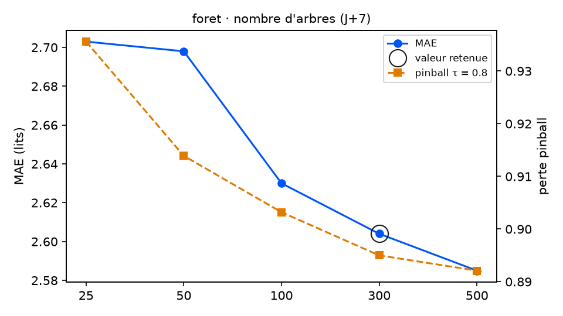

Amplitude de la MAE : 4.5 %. Aucune valeur ne fait significativement mieux que la valeur retenue.

### foret · profondeur maximale

| variante | MAE | RMSE | biais | pinball τ=0.8 | couverture 90 % | temps (s) | DM p (pinball τ=0.8) | p Holm | vs choix retenu |
|---|---|---|---|---|---|---|---|---|---|
| profondeur_foret = 3 | 2.665 | 3.139 | -1.094 | 0.8599 | 92.7 | 1.9 | 0.4531 | 1.0 | équivalent |
| profondeur_foret = 5 | 2.618 | 3.112 | -1.066 | 0.8883 | 91.5 | 4.3 | 0.6878 | 1.0 | équivalent |
| profondeur_foret = 8 | 2.591 | 3.085 | -1.038 | 0.8972 | 89.3 | 8.1 | 0.8602 | 1.0 | équivalent |
| profondeur_foret = 12 (retenu) | 2.604 | 3.082 | -0.997 | 0.895 | 89.3 | 9.8 |  |  | — choix retenu |
| profondeur_foret = 20 | 2.626 | 3.111 | -1.011 | 0.9196 | 89.3 | 9.8 | 0.0214 | 0.0856 | équivalent |

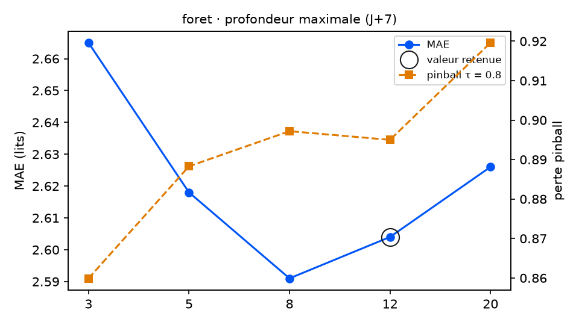

Amplitude de la MAE : 2.8 %. Aucune valeur ne fait significativement mieux que la valeur retenue.

### foret · taille minimale d'une feuille

| variante | MAE | RMSE | biais | pinball τ=0.8 | couverture 90 % | temps (s) | DM p (pinball τ=0.8) | p Holm | vs choix retenu |
|---|---|---|---|---|---|---|---|---|---|
| min_feuille = 2 | 2.62 | 3.128 | -0.991 | 0.9078 | 90.4 | 20.6 | 0.1531 | 0.3567 | équivalent |
| min_feuille = 5 (retenu) | 2.604 | 3.082 | -0.997 | 0.895 | 89.3 | 9.7 |  |  | — choix retenu |
| min_feuille = 10 | 2.573 | 3.064 | -0.993 | 0.8747 | 91.5 | 5.3 | 0.1189 | 0.3567 | équivalent |
| min_feuille = 20 | 2.58 | 3.068 | -0.978 | 0.8644 | 93.8 | 3.0 | 0.3468 | 0.3567 | équivalent |

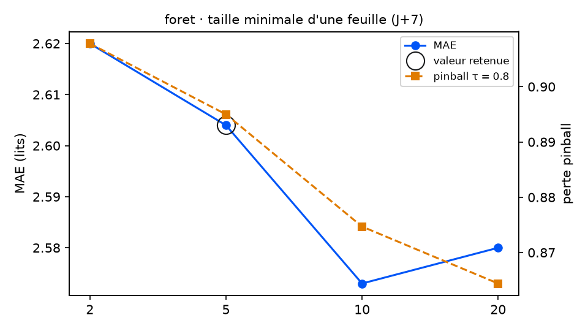

Amplitude de la MAE : 1.8 %. Aucune valeur ne fait significativement mieux que la valeur retenue.

### foret · part des variables tirées par nœud

| variante | MAE | RMSE | biais | pinball τ=0.8 | couverture 90 % | temps (s) | DM p (pinball τ=0.8) | p Holm | vs choix retenu |
|---|---|---|---|---|---|---|---|---|---|
| part_variables = 0,15 | 2.592 | 3.066 | -0.999 | 0.889 | 90.4 | 9.2 | 0.8164 | 0.8164 | équivalent |
| part_variables = 0,333333 (retenu) | 2.604 | 3.082 | -0.997 | 0.895 | 89.3 | 9.8 |  |  | — choix retenu |
| part_variables = 0,5 | 2.63 | 3.137 | -1.039 | 0.9174 | 88.7 | 10.1 | 0.0754 | 0.2262 | équivalent |
| part_variables = 1 | 2.613 | 3.128 | -1.059 | 0.9267 | 89.8 | 10.7 | 0.1837 | 0.3674 | équivalent |

Amplitude de la MAE : 1.5 %. Aucune valeur ne fait significativement mieux que la valeur retenue.

### boosting · nombre d'étapes

| variante | MAE | RMSE | biais | pinball τ=0.8 | couverture 90 % | temps (s) | DM p (pinball τ=0.8) | p Holm | vs choix retenu |
|---|---|---|---|---|---|---|---|---|---|
| etapes = 50 | 2.645 | 3.178 | -0.993 | 1.0269 | 80.2 | 1.6 | 0.0129 | 0.0279 | meilleur |
| etapes = 100 | 2.641 | 3.191 | -1.099 | 1.094 | 75.1 | 3.1 | 0.011 | 0.0279 | meilleur |
| etapes = 300 (retenu) | 2.734 | 3.275 | -1.202 | 1.2295 | 64.4 | 8.9 |  |  | — choix retenu |
| etapes = 600 | 2.781 | 3.334 | -1.266 | 1.3201 | 58.2 | 17.3 | 0.0093 | 0.0279 | moins bon |

Amplitude de la MAE : 5.1 %. Valeur(s) significativement meilleure(s) : etapes = 50, etapes = 100 — réglage à revoir.

### boosting · taux ν (shrinkage)

| variante | MAE | RMSE | biais | pinball τ=0.8 | couverture 90 % | temps (s) | DM p (pinball τ=0.8) | p Holm | vs choix retenu |
|---|---|---|---|---|---|---|---|---|---|
| taux_boosting = 0,01 | 2.693 | 3.234 | -1.068 | 1.0084 | 79.1 | 8.8 | 0.0097 | 0.0291 | meilleur |
| taux_boosting = 0,05 (retenu) | 2.734 | 3.275 | -1.202 | 1.2295 | 64.4 | 8.8 |  |  | — choix retenu |
| taux_boosting = 0,1 | 2.825 | 3.396 | -1.274 | 1.3111 | 61.6 | 8.7 | 0.0958 | 0.1302 | équivalent |
| taux_boosting = 0,2 | 2.969 | 3.558 | -1.37 | 1.3384 | 57.1 | 9.1 | 0.0651 | 0.1302 | équivalent |

Amplitude de la MAE : 10.1 %. Valeur(s) significativement meilleure(s) : taux_boosting = 0,01 — réglage à revoir.

### boosting · profondeur des arbres

| variante | MAE | RMSE | biais | pinball τ=0.8 | couverture 90 % | temps (s) | DM p (pinball τ=0.8) | p Holm | vs choix retenu |
|---|---|---|---|---|---|---|---|---|---|
| profondeur_boosting = 1 | 2.709 | 3.258 | -1.185 | 1.0012 | 85.3 | 2.9 | 0.0106 | 0.0212 | meilleur |
| profondeur_boosting = 2 | 2.735 | 3.277 | -1.125 | 1.1172 | 74.0 | 5.5 | 0.0037 | 0.0111 | meilleur |
| profondeur_boosting = 3 (retenu) | 2.734 | 3.275 | -1.202 | 1.2295 | 64.4 | 8.6 |  |  | — choix retenu |
| profondeur_boosting = 5 | 2.77 | 3.312 | -1.134 | 1.2213 | 52.5 | 16.9 | 0.8326 | 0.8326 | équivalent |

Amplitude de la MAE : 2.2 %. Valeur(s) significativement meilleure(s) : profondeur_boosting = 1, profondeur_boosting = 2 — réglage à revoir.

### boosting · part du sous-échantillon

| variante | MAE | RMSE | biais | pinball τ=0.8 | couverture 90 % | temps (s) | DM p (pinball τ=0.8) | p Holm | vs choix retenu |
|---|---|---|---|---|---|---|---|---|---|
| sous_echantillon = 0,5 | 2.833 | 3.403 | -1.388 | 1.2266 | 61.6 | 7.9 | 0.9125 | 0.9125 | équivalent |
| sous_echantillon = 0,8 (retenu) | 2.734 | 3.275 | -1.202 | 1.2295 | 64.4 | 9.1 |  |  | — choix retenu |
| sous_echantillon = 1 | 2.753 | 3.303 | -1.146 | 1.1512 | 69.5 | 9.1 | 0.175 | 0.35 | équivalent |

Amplitude de la MAE : 3.6 %. Aucune valeur ne fait significativement mieux que la valeur retenue.

### mlp · architecture (neurones par couche)

| variante | MAE | RMSE | biais | pinball τ=0.8 | couverture 90 % | temps (s) | DM p (pinball τ=0.8) | p Holm | vs choix retenu |
|---|---|---|---|---|---|---|---|---|---|
| couches = 8 | 3.133 | 3.72 | -1.74 | 1.5655 | 67.8 | 0.8 | 0.0019 | 0.0076 | moins bon |
| couches = 32 | 3.332 | 3.937 | -1.692 | 0.9843 | 84.7 | 0.9 | 0.7676 | 0.7676 | équivalent |
| couches = 32×16 (retenu) | 3.12 | 3.681 | -1.402 | 0.9601 | 81.9 | 1.1 |  |  | — choix retenu |
| couches = 64×32 | 3.306 | 3.872 | -2.06 | 1.1835 | 90.4 | 1.2 | 0.055 | 0.165 | équivalent |
| couches = 32×16×8 | 2.735 | 3.247 | -1.006 | 0.8915 | 79.7 | 1.2 | 0.1662 | 0.3324 | équivalent |

Amplitude de la MAE : 19.1 %. Aucune valeur ne fait significativement mieux que la valeur retenue.

### mlp · taux d'apprentissage

| variante | MAE | RMSE | biais | pinball τ=0.8 | couverture 90 % | temps (s) | DM p (pinball τ=0.8) | p Holm | vs choix retenu |
|---|---|---|---|---|---|---|---|---|---|
| taux_reseau = 0,001 | 3.174 | 3.717 | -1.143 | 1.1156 | 65.5 | 1.9 | 0.0104 | 0.0312 | moins bon |
| taux_reseau = 0,003 | 3.193 | 3.745 | -1.309 | 1.1134 | 76.3 | 1.4 | 0.0394 | 0.0788 | équivalent |
| taux_reseau = 0,01 (retenu) | 3.12 | 3.681 | -1.402 | 0.9601 | 81.9 | 1.1 |  |  | — choix retenu |
| taux_reseau = 0,03 | 3.144 | 3.68 | -1.445 | 0.975 | 84.7 | 0.9 | 0.6461 | 0.6461 | équivalent |

Amplitude de la MAE : 2.3 %. Aucune valeur ne fait significativement mieux que la valeur retenue.

### mlp · pénalité L2 λ

| variante | MAE | RMSE | biais | pinball τ=0.8 | couverture 90 % | temps (s) | DM p (pinball τ=0.8) | p Holm | vs choix retenu |
|---|---|---|---|---|---|---|---|---|---|
| lambda_ = 0 | 3.152 | 3.717 | -1.391 | 0.9606 | 83.6 | 1.1 | 0.9539 | 1.0 | équivalent |
| lambda_ = 0,0001 | 3.15 | 3.713 | -1.412 | 0.9583 | 83.6 | 1.0 | 0.8195 | 1.0 | équivalent |
| lambda_ = 0,001 (retenu) | 3.12 | 3.681 | -1.402 | 0.9601 | 81.9 | 1.1 |  |  | — choix retenu |
| lambda_ = 0,01 | 3.126 | 3.68 | -1.436 | 1.0411 | 80.2 | 1.1 | 0.0059 | 0.0236 | moins bon |
| lambda_ = 0,1 | 2.796 | 3.312 | -1.208 | 0.9076 | 82.5 | 3.0 | 0.5427 | 1.0 | équivalent |

Amplitude de la MAE : 11.4 %. Aucune valeur ne fait significativement mieux que la valeur retenue.

### mlp · époques maximales

| variante | MAE | RMSE | biais | pinball τ=0.8 | couverture 90 % | temps (s) | DM p (pinball τ=0.8) | p Holm | vs choix retenu |
|---|---|---|---|---|---|---|---|---|---|
| epoques = 300 | 3.12 | 3.681 | -1.402 | 0.9601 | 81.9 | 1.0 |  |  | identique |
| epoques = 800 | 3.12 | 3.681 | -1.402 | 0.9601 | 81.9 | 1.0 |  |  | identique |
| epoques = 1500 (retenu) | 3.12 | 3.681 | -1.402 | 0.9601 | 81.9 | 1.0 |  |  | — choix retenu |
| epoques = 3000 | 3.12 | 3.681 | -1.402 | 0.9601 | 81.9 | 1.0 |  |  | identique |

Amplitude de la MAE : 0.0 %. Aucune valeur ne fait significativement mieux que la valeur retenue.

### mlp · patience de l'arrêt anticipé

| variante | MAE | RMSE | biais | pinball τ=0.8 | couverture 90 % | temps (s) | DM p (pinball τ=0.8) | p Holm | vs choix retenu |
|---|---|---|---|---|---|---|---|---|---|
| patience = 50 | 3.12 | 3.681 | -1.402 | 0.9601 | 81.9 | 0.6 |  |  | identique |
| patience = 150 (retenu) | 3.12 | 3.681 | -1.402 | 0.9601 | 81.9 | 1.1 |  |  | — choix retenu |
| patience = 300 | 3.12 | 3.681 | -1.402 | 0.9601 | 81.9 | 2.1 |  |  | identique |

Amplitude de la MAE : 0.0 %. Aucune valeur ne fait significativement mieux que la valeur retenue.

### mlp · nombre d'initialisations moyennées

| variante | MAE | RMSE | biais | pinball τ=0.8 | couverture 90 % | temps (s) | DM p (pinball τ=0.8) | p Holm | vs choix retenu |
|---|---|---|---|---|---|---|---|---|---|
| graines = 1 | 3.038 | 3.619 | -1.355 | 0.9535 | 91.5 | 0.4 | 0.9217 | 0.9217 | équivalent |
| graines = 3 (retenu) | 3.12 | 3.681 | -1.402 | 0.9601 | 81.9 | 1.0 |  |  | — choix retenu |
| graines = 5 | 3.097 | 3.65 | -1.443 | 0.9132 | 79.7 | 1.6 | 0.0655 | 0.131 | équivalent |

Amplitude de la MAE : 2.6 %. Aucune valeur ne fait significativement mieux que la valeur retenue.

### lstm · taille de l'état caché H

| variante | MAE | RMSE | biais | pinball τ=0.8 | couverture 90 % | temps (s) | DM p (pinball τ=0.8) | p Holm | vs choix retenu |
|---|---|---|---|---|---|---|---|---|---|
| cache_lstm = 4 | 2.912 | 3.456 | -1.159 | 1.232 | 61.0 | 4.5 | 0.0497 | 0.0994 | équivalent |
| cache_lstm = 8 | 3.028 | 3.555 | -1.39 | 1.4562 | 61.0 | 5.6 | 0.001 | 0.003 | moins bon |
| cache_lstm = 16 (retenu) | 3.389 | 3.983 | -1.914 | 1.0421 | 67.8 | 7.6 |  |  | — choix retenu |
| cache_lstm = 32 | 3.3 | 3.833 | -2.034 | 1.0238 | 78.0 | 11.4 | 0.7979 | 0.7979 | équivalent |

Amplitude de la MAE : 14.1 %. Aucune valeur ne fait significativement mieux que la valeur retenue.

### lstm · taux d'apprentissage

| variante | MAE | RMSE | biais | pinball τ=0.8 | couverture 90 % | temps (s) | DM p (pinball τ=0.8) | p Holm | vs choix retenu |
|---|---|---|---|---|---|---|---|---|---|
| taux_reseau = 0,003 | 3.264 | 3.828 | -1.868 | 1.0802 | 65.0 | 11.3 | 0.1797 | 0.3594 | équivalent |
| taux_reseau = 0,01 (retenu) | 3.389 | 3.983 | -1.914 | 1.0421 | 67.8 | 7.5 |  |  | — choix retenu |
| taux_reseau = 0,03 | 3.464 | 4.056 | -1.937 | 1.0768 | 69.5 | 6.7 | 0.6764 | 0.6764 | équivalent |

Amplitude de la MAE : 5.9 %. Aucune valeur ne fait significativement mieux que la valeur retenue.

### lstm · pénalité L2 λ

| variante | MAE | RMSE | biais | pinball τ=0.8 | couverture 90 % | temps (s) | DM p (pinball τ=0.8) | p Holm | vs choix retenu |
|---|---|---|---|---|---|---|---|---|---|
| lambda_ = 0 | 3.359 | 3.947 | -1.972 | 1.0122 | 67.8 | 7.3 | 0.2464 | 0.2464 | équivalent |
| lambda_ = 0,001 (retenu) | 3.389 | 3.983 | -1.914 | 1.0421 | 67.8 | 7.5 |  |  | — choix retenu |
| lambda_ = 0,01 | 3.364 | 3.953 | -1.853 | 1.1287 | 66.1 | 8.0 | 0.0013 | 0.0026 | moins bon |

Amplitude de la MAE : 0.9 %. Aucune valeur ne fait significativement mieux que la valeur retenue.

### variables · jours d'occupation passée en entrée

| variante | MAE | RMSE | biais | pinball τ=0.8 | couverture 90 % | temps (s) | DM p (pinball τ=0.8) | p Holm | vs choix retenu |
|---|---|---|---|---|---|---|---|---|---|
| retards = 3 | 2.694 | 3.164 | -0.992 | 0.8884 | 89.8 | 3.6 | 0.5723 | 1.0 | équivalent |
| retards = 5 | 2.694 | 3.164 | -0.991 | 0.8872 | 90.4 | 4.1 | 0.6401 | 1.0 | équivalent |
| retards = 7 (retenu) | 2.698 | 3.166 | -0.978 | 0.8824 | 89.8 | 5.3 |  |  | — choix retenu |
| retards = 10 | 2.711 | 3.174 | -0.99 | 0.878 | 90.4 | 4.5 | 0.7656 | 1.0 | équivalent |
| retards = 14 | 2.717 | 3.186 | -1.003 | 0.8837 | 89.8 | 5.0 | 0.9591 | 1.0 | équivalent |
| retards = 21 | 2.764 | 3.248 | -1.041 | 0.8843 | 89.3 | 5.0 | 0.9429 | 1.0 | équivalent |

Amplitude de la MAE : 2.6 %. Aucune valeur ne fait significativement mieux que la valeur retenue.

