# Sensibilité de tous les paramètres — service PED

Un paramètre varie à la fois, tout le reste au réglage retenu (marqué « retenu »). Mêmes jours, même validation glissante. Diebold-Mariano (perte pinball au quantile τ, HLN, correction de Holm) contre la valeur retenue. Amplitude = (MAE max − MAE min) / MAE retenue.

## Synthèse

| paramètre | horizon | famille | valeur retenue | meilleure valeur (MAE) | amplitude MAE % | verdict |
|---|---|---|---|---|---|---|
| C (poids des erreurs) | 1 | svr4 | 3 | 10 | 33.2 | défendable |
| ε (tube, niveaux quantiles) | 1 | svr4 | 0 | 0 (retenu) | 1.2 | défendable |
| γ₁ (portée, bloc occupation) | 1 | svr4 | 0,02 | 0,05 | 11.7 | défendable |
| γ₂ (portée, bloc flux et saison) | 1 | svr4 | 0,2 | 0,2 (retenu) | 4.7 | défendable |
| τ (quantile décisionnel) | 1 | svr4 | 0,8 | 0,6 | 0.1 | défendable |
| η₀ (taux d'apprentissage d'Adam) | 1 | svr4 | 0,05 | 0,2 | 0.1 | défendable |
| nombre maximal d'itérations | 1 | svr4 | 3000 | 6000 | 0.1 | à revoir : 1000 |
| T (décroissance du pas ; aucune = pas constant) | 1 | svr4 | 500 | aucune | 0.1 | défendable |
| part des pas moyennée (Polyak ; 0 = aucune) | 1 | svr4 | 0,5 | 0 | 0.0 | défendable |
| tolérance d'arrêt anticipé | 1 | svr4 | 1e-07 | 1e-07 (retenu) | 0.1 | défendable |
| direction préconditionnée α + Cg | 1 | svr4 | True | True (retenu) | 0.7 | défendable |
| optimiseur | 1 | svr4 | adam | adam (retenu) | 47.5 | défendable |
| C | 1 | svr2 | 3 | 3 (retenu) | 22.3 | défendable |
| ε (tube ε-insensible, en lits) | 1 | svr2 | 1 | 1 (retenu) | 0.8 | défendable |
| γ (portée du noyau RBF) | 1 | svr2 | 0,02 | 0,02 (retenu) | 31.6 | défendable |
| nombre d'arbres | 1 | foret | 300 | 500 | 1.7 | défendable |
| profondeur maximale | 1 | foret | 12 | 8 | 7.3 | défendable |
| taille minimale d'une feuille | 1 | foret | 5 | 5 (retenu) | 2.8 | défendable |
| part des variables tirées par nœud | 1 | foret | 0,333333 | 0,5 | 6.7 | défendable |
| nombre d'étapes | 1 | boosting | 300 | 300 (retenu) | 3.9 | défendable |
| taux ν (shrinkage) | 1 | boosting | 0,05 | 0,05 (retenu) | 5.0 | défendable |
| profondeur des arbres | 1 | boosting | 3 | 3 (retenu) | 3.9 | défendable |
| part du sous-échantillon | 1 | boosting | 0,8 | 0,8 (retenu) | 2.5 | défendable |
| architecture (neurones par couche) | 1 | mlp | 32×16 | 8 | 6.6 | défendable |
| taux d'apprentissage | 1 | mlp | 0,01 | 0,001 | 1.8 | défendable |
| pénalité L2 λ | 1 | mlp | 0,001 | 0,01 | 5.4 | défendable |
| époques maximales | 1 | mlp | 1500 | 300 | 0.0 | défendable |
| patience de l'arrêt anticipé | 1 | mlp | 150 | 50 | 0.0 | défendable |
| nombre d'initialisations moyennées | 1 | mlp | 3 | 3 (retenu) | 2.3 | défendable |
| taille de l'état caché H | 1 | lstm | 16 | 16 (retenu) | 2.0 | défendable |
| taux d'apprentissage | 1 | lstm | 0,01 | 0,01 (retenu) | 1.8 | défendable |
| pénalité L2 λ | 1 | lstm | 0,001 | 0 | 0.3 | défendable |
| jours d'occupation passée en entrée | 1 | variables | 7 | 3 | 2.8 | défendable |
| C (poids des erreurs) | 7 | svr4 | 0,3 | 0,3 (retenu) | 17.8 | défendable |
| ε (tube, niveaux quantiles) | 7 | svr4 | 0 | 0,25 | 1.2 | défendable |
| γ₁ (portée, bloc occupation) | 7 | svr4 | 0,02 | 0,02 (retenu) | 1.5 | défendable |
| γ₂ (portée, bloc flux et saison) | 7 | svr4 | 0,2 | 0,2 (retenu) | 3.6 | défendable |
| τ (quantile décisionnel) | 7 | svr4 | 0,8 | 0,5 | 0.0 | défendable |
| η₀ (taux d'apprentissage d'Adam) | 7 | svr4 | 0,05 | 0,05 (retenu) | 0.0 | défendable |
| nombre maximal d'itérations | 7 | svr4 | 3000 | 1000 | 0.1 | défendable |
| T (décroissance du pas ; aucune = pas constant) | 7 | svr4 | 500 | aucune | 0.0 | défendable |
| part des pas moyennée (Polyak ; 0 = aucune) | 7 | svr4 | 0,5 | 0 | 0.0 | défendable |
| tolérance d'arrêt anticipé | 7 | svr4 | 1e-07 | 1e-07 (retenu) | 0.0 | défendable |
| direction préconditionnée α + Cg | 7 | svr4 | True | True (retenu) | 0.3 | défendable |
| optimiseur | 7 | svr4 | adam | sgd | 0.0 | défendable |
| C | 7 | svr2 | 0,3 | 0,1 | 14.9 | défendable |
| ε (tube ε-insensible, en lits) | 7 | svr2 | 0,5 | 0,25 | 0.9 | défendable |
| γ (portée du noyau RBF) | 7 | svr2 | 0,2 | 0,5 | 2.9 | défendable |
| nombre d'arbres | 7 | foret | 300 | 100 | 3.2 | défendable |
| profondeur maximale | 7 | foret | 12 | 3 | 3.0 | défendable |
| taille minimale d'une feuille | 7 | foret | 5 | 5 (retenu) | 1.5 | défendable |
| part des variables tirées par nœud | 7 | foret | 0,333333 | 0,15 | 2.3 | défendable |
| nombre d'étapes | 7 | boosting | 300 | 50 | 4.3 | défendable |
| taux ν (shrinkage) | 7 | boosting | 0,05 | 0,01 | 6.5 | défendable |
| profondeur des arbres | 7 | boosting | 3 | 1 | 2.0 | défendable |
| part du sous-échantillon | 7 | boosting | 0,8 | 1 | 3.2 | défendable |
| architecture (neurones par couche) | 7 | mlp | 32×16 | 32×16×8 | 5.4 | défendable |
| taux d'apprentissage | 7 | mlp | 0,01 | 0,03 | 2.3 | défendable |
| pénalité L2 λ | 7 | mlp | 0,001 | 0,1 | 4.3 | défendable |
| époques maximales | 7 | mlp | 1500 | 300 | 0.0 | défendable |
| patience de l'arrêt anticipé | 7 | mlp | 150 | 50 | 0.0 | défendable |
| nombre d'initialisations moyennées | 7 | mlp | 3 | 5 | 1.4 | défendable |
| taille de l'état caché H | 7 | lstm | 16 | 4 | 3.5 | défendable |
| taux d'apprentissage | 7 | lstm | 0,01 | 0,003 | 3.6 | défendable |
| pénalité L2 λ | 7 | lstm | 0,001 | 0,01 | 0.3 | défendable |
| jours d'occupation passée en entrée | 7 | variables | 7 | 5 | 0.6 | défendable |

## Horizon J+1

### svr4 · C (poids des erreurs)

| variante | MAE | RMSE | biais | pinball τ=0.8 | couverture 90 % | temps (s) | DM p (pinball τ=0.8) | p Holm | vs choix retenu |
|---|---|---|---|---|---|---|---|---|---|
| C = 0,1 | 2.445 | 3.0 | -0.028 | 0.877 | 90.7 | 4.7 | 0.0001 | 0.0005 | moins bon |
| C = 0,3 | 2.198 | 2.715 | -0.063 | 0.8064 | 90.7 | 9.4 | 0.0005 | 0.002 | moins bon |
| C = 1 | 1.993 | 2.461 | -0.072 | 0.7081 | 90.2 | 7.8 | 0.1573 | 0.3146 | équivalent |
| C = 3 (retenu) | 1.839 | 2.348 | 0.018 | 0.6789 | 85.8 | 13.6 |  |  | — choix retenu |
| C = 10 | 1.834 | 2.409 | -0.002 | 0.7028 | 83.6 | 15.7 | 0.2337 | 0.3146 | équivalent |
| C = 30 | 1.928 | 2.576 | -0.08 | 0.7762 | 73.8 | 14.2 | 0.0159 | 0.0477 | moins bon |

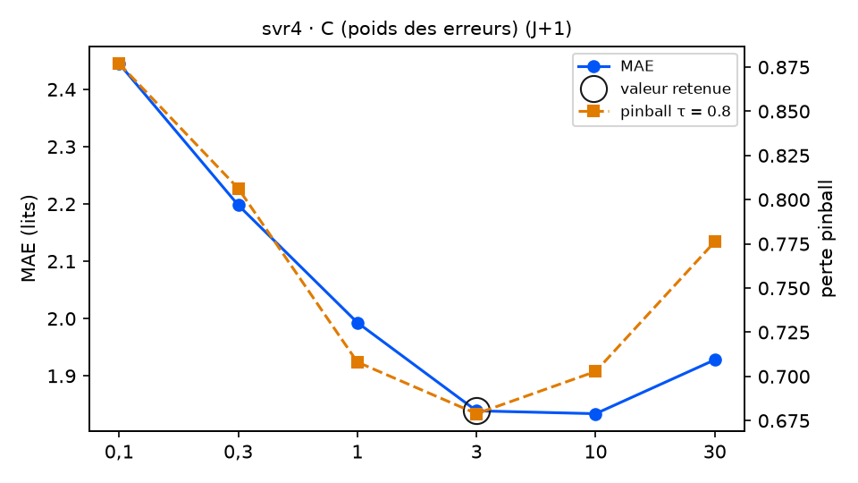

Amplitude de la MAE : 33.2 %. Aucune valeur ne fait significativement mieux que la valeur retenue.

### svr4 · ε (tube, niveaux quantiles)

| variante | MAE | RMSE | biais | pinball τ=0.8 | couverture 90 % | temps (s) | DM p (pinball τ=0.8) | p Holm | vs choix retenu |
|---|---|---|---|---|---|---|---|---|---|
| epsilon_quantile = 0 (retenu) | 1.839 | 2.348 | 0.018 | 0.6789 | 85.8 | 12.0 |  |  | — choix retenu |
| epsilon_quantile = 0,25 | 1.85 | 2.359 | -0.019 | 0.6832 | 85.2 | 11.1 | 0.3144 | 0.6288 | équivalent |
| epsilon_quantile = 0,5 | 1.861 | 2.365 | 0.01 | 0.6859 | 81.4 | 11.4 | 0.3689 | 0.6288 | équivalent |
| epsilon_quantile = 1 | 1.857 | 2.364 | 0.004 | 0.7075 | 78.1 | 13.6 | 0.0431 | 0.1293 | équivalent |

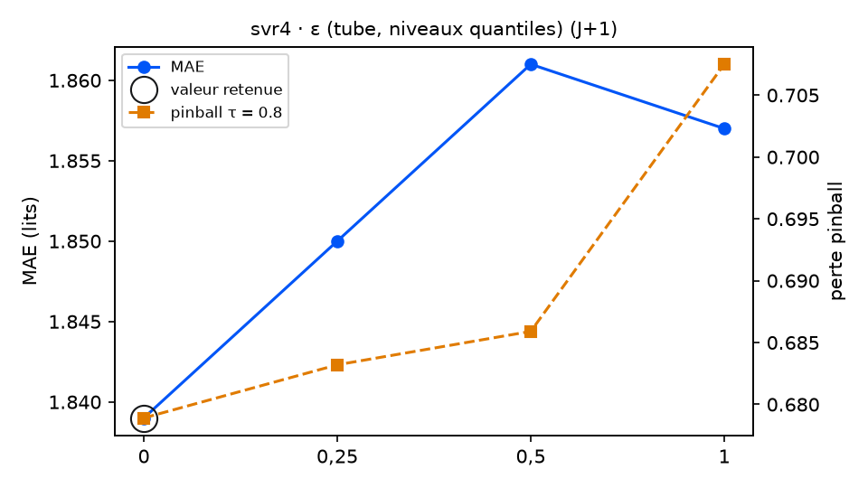

Amplitude de la MAE : 1.2 %. Aucune valeur ne fait significativement mieux que la valeur retenue.

### svr4 · γ₁ (portée, bloc occupation)

| variante | MAE | RMSE | biais | pinball τ=0.8 | couverture 90 % | temps (s) | DM p (pinball τ=0.8) | p Holm | vs choix retenu |
|---|---|---|---|---|---|---|---|---|---|
| gamma1 = 0,01 | 1.863 | 2.374 | -0.012 | 0.6795 | 87.4 | 15.9 | 0.9471 | 0.9471 | équivalent |
| gamma1 = 0,02 (retenu) | 1.839 | 2.348 | 0.018 | 0.6789 | 85.8 | 11.8 |  |  | — choix retenu |
| gamma1 = 0,05 | 1.82 | 2.361 | 0.014 | 0.691 | 86.9 | 11.9 | 0.1192 | 0.2384 | équivalent |
| gamma1 = 0,1 | 1.855 | 2.402 | 0.043 | 0.7091 | 84.7 | 11.5 | 0.0156 | 0.0468 | moins bon |
| gamma1 = 0,2 | 1.947 | 2.485 | 0.058 | 0.7278 | 84.7 | 10.7 | 0.0042 | 0.0168 | moins bon |
| gamma1 = 0,5 | 2.035 | 2.559 | 0.084 | 0.7586 | 82.0 | 10.9 | 0.0005 | 0.0025 | moins bon |

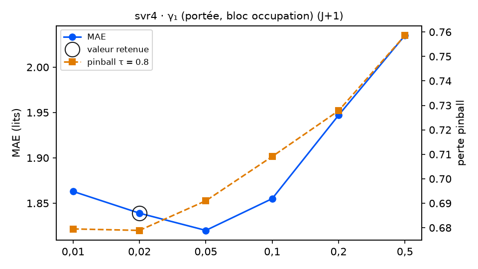

Amplitude de la MAE : 11.7 %. Aucune valeur ne fait significativement mieux que la valeur retenue.

### svr4 · γ₂ (portée, bloc flux et saison)

| variante | MAE | RMSE | biais | pinball τ=0.8 | couverture 90 % | temps (s) | DM p (pinball τ=0.8) | p Holm | vs choix retenu |
|---|---|---|---|---|---|---|---|---|---|
| gamma2 = 0,02 | 1.926 | 2.427 | -0.052 | 0.6896 | 88.5 | 9.5 | 0.5339 | 1.0 | équivalent |
| gamma2 = 0,05 | 1.882 | 2.389 | -0.084 | 0.6835 | 89.6 | 9.4 | 0.6981 | 1.0 | équivalent |
| gamma2 = 0,1 | 1.856 | 2.363 | -0.028 | 0.6767 | 88.0 | 12.3 | 0.7496 | 1.0 | équivalent |
| gamma2 = 0,2 (retenu) | 1.839 | 2.348 | 0.018 | 0.6789 | 85.8 | 13.5 |  |  | — choix retenu |
| gamma2 = 0,5 | 1.919 | 2.412 | 0.037 | 0.7011 | 84.2 | 13.1 | 0.0469 | 0.1876 | équivalent |

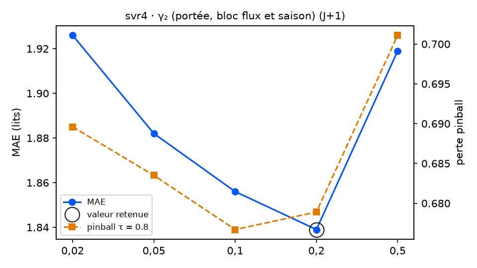

Amplitude de la MAE : 4.7 %. Aucune valeur ne fait significativement mieux que la valeur retenue.

### svr4 · τ (quantile décisionnel)

| variante | MAE | RMSE | biais | pinball τ=0.8 | couverture 90 % | temps (s) | DM p (pinball τ=0.8) | p Holm | vs choix retenu |
|---|---|---|---|---|---|---|---|---|---|
| tau = 0,5 | 1.839 | 2.348 | 0.018 | 0.914 | 85.8 | 9.0 | 0.0 | 0.0 | moins bon |
| tau = 0,6 | 1.838 | 2.347 | 0.016 | 0.9142 | 85.8 | 11.9 | 0.0 | 0.0 | moins bon |
| tau = 0,7 | 1.839 | 2.348 | 0.018 | 0.914 | 85.8 | 11.9 | 0.0 | 0.0 | moins bon |
| tau = 0,8 (retenu) | 1.839 | 2.348 | 0.018 | 0.6789 | 85.8 | 12.6 |  |  | — choix retenu |
| tau = 0,9 | 1.839 | 2.348 | 0.018 | 0.914 | 85.8 | 12.0 | 0.0 | 0.0 | moins bon |

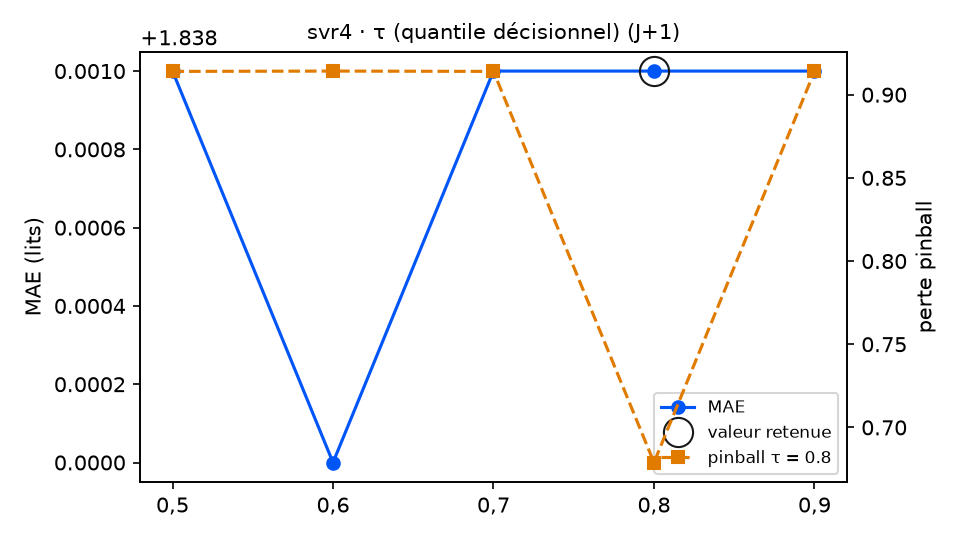

Amplitude de la MAE : 0.1 %. Aucune valeur ne fait significativement mieux que la valeur retenue.

### svr4 · η₀ (taux d'apprentissage d'Adam)

| variante | MAE | RMSE | biais | pinball τ=0.8 | couverture 90 % | temps (s) | DM p (pinball τ=0.8) | p Holm | vs choix retenu |
|---|---|---|---|---|---|---|---|---|---|
| taux = 0,005 | 1.839 | 2.35 | 0.012 | 0.6732 | 85.8 | 12.8 | 0.0157 | 0.0785 | équivalent |
| taux = 0,01 | 1.84 | 2.349 | 0.012 | 0.675 | 85.8 | 13.9 | 0.0238 | 0.0952 | équivalent |
| taux = 0,02 | 1.839 | 2.348 | 0.015 | 0.6762 | 86.3 | 14.2 | 0.0451 | 0.1353 | équivalent |
| taux = 0,05 (retenu) | 1.839 | 2.348 | 0.018 | 0.6789 | 85.8 | 12.2 |  |  | — choix retenu |
| taux = 0,1 | 1.839 | 2.348 | 0.021 | 0.6782 | 86.3 | 14.1 | 0.3323 | 0.6646 | équivalent |
| taux = 0,2 | 1.838 | 2.348 | 0.021 | 0.6782 | 86.3 | 14.3 | 0.6394 | 0.6646 | équivalent |

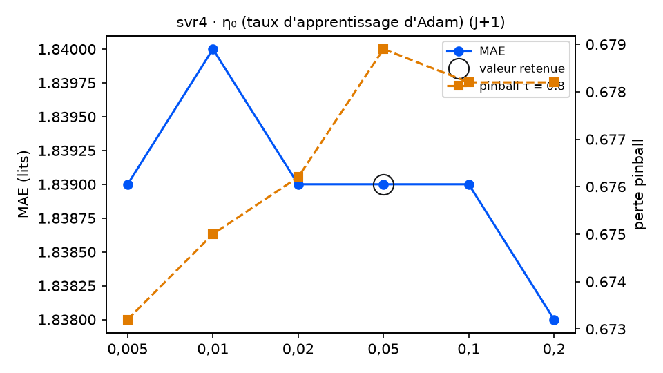

Amplitude de la MAE : 0.1 %. Aucune valeur ne fait significativement mieux que la valeur retenue.

### svr4 · nombre maximal d'itérations

| variante | MAE | RMSE | biais | pinball τ=0.8 | couverture 90 % | temps (s) | DM p (pinball τ=0.8) | p Holm | vs choix retenu |
|---|---|---|---|---|---|---|---|---|---|
| iterations = 300 | 1.839 | 2.348 | 0.013 | 0.6738 | 86.3 | 1.6 | 0.2037 | 0.3572 | équivalent |
| iterations = 1000 | 1.84 | 2.348 | 0.016 | 0.6769 | 86.3 | 5.3 | 0.0148 | 0.0444 | meilleur |
| iterations = 3000 (retenu) | 1.839 | 2.348 | 0.018 | 0.6789 | 85.8 | 12.7 |  |  | — choix retenu |
| iterations = 6000 | 1.838 | 2.347 | 0.018 | 0.6791 | 85.8 | 17.1 | 0.1786 | 0.3572 | équivalent |

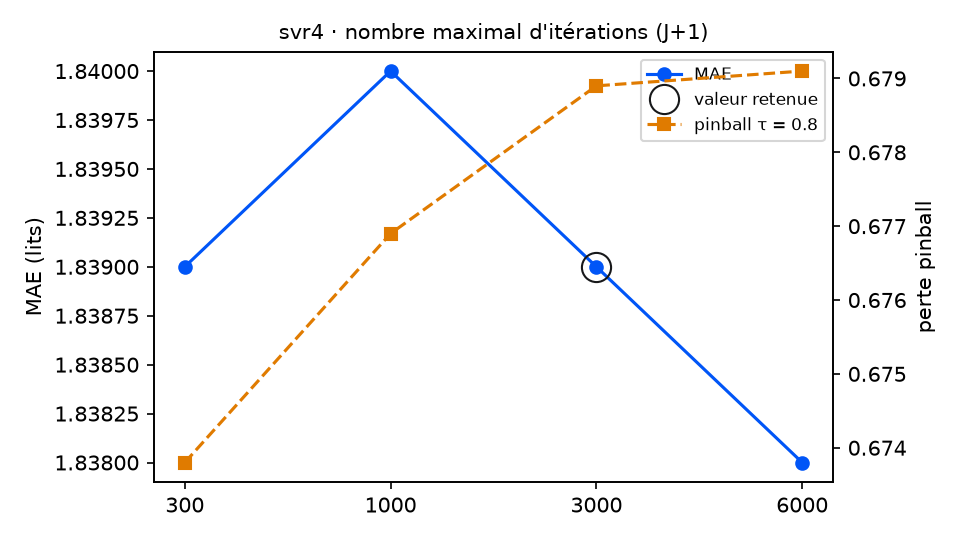

Amplitude de la MAE : 0.1 %. Valeur(s) significativement meilleure(s) : iterations = 1000 — réglage à revoir.

### svr4 · T (décroissance du pas ; aucune = pas constant)

| variante | MAE | RMSE | biais | pinball τ=0.8 | couverture 90 % | temps (s) | DM p (pinball τ=0.8) | p Holm | vs choix retenu |
|---|---|---|---|---|---|---|---|---|---|
| decroissance = aucune | 1.837 | 2.346 | 0.019 | 0.679 | 86.3 | 13.9 | 0.7099 | 0.9776 | équivalent |
| decroissance = 100 | 1.839 | 2.348 | 0.016 | 0.6782 | 85.8 | 11.6 | 0.1999 | 0.5997 | équivalent |
| decroissance = 500 (retenu) | 1.839 | 2.348 | 0.018 | 0.6789 | 85.8 | 12.0 |  |  | — choix retenu |
| decroissance = 2000 | 1.838 | 2.348 | 0.017 | 0.6792 | 86.3 | 12.3 | 0.4888 | 0.9776 | équivalent |

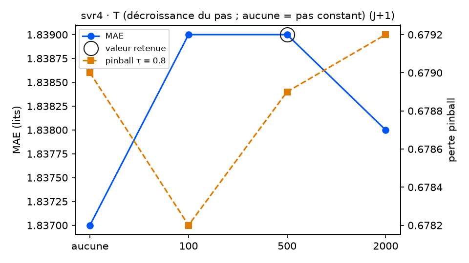

Amplitude de la MAE : 0.1 %. Aucune valeur ne fait significativement mieux que la valeur retenue.

### svr4 · part des pas moyennée (Polyak ; 0 = aucune)

| variante | MAE | RMSE | biais | pinball τ=0.8 | couverture 90 % | temps (s) | DM p (pinball τ=0.8) | p Holm | vs choix retenu |
|---|---|---|---|---|---|---|---|---|---|
| moyenne_polyak = 0 | 1.839 | 2.348 | 0.018 | 0.6789 | 85.8 | 10.8 |  |  | identique |
| moyenne_polyak = 0,25 | 1.839 | 2.348 | 0.018 | 0.6789 | 85.8 | 11.8 |  |  | identique |
| moyenne_polyak = 0,5 (retenu) | 1.839 | 2.348 | 0.018 | 0.6789 | 85.8 | 11.7 |  |  | — choix retenu |
| moyenne_polyak = 0,75 | 1.839 | 2.348 | 0.018 | 0.6789 | 85.8 | 11.9 |  |  | identique |

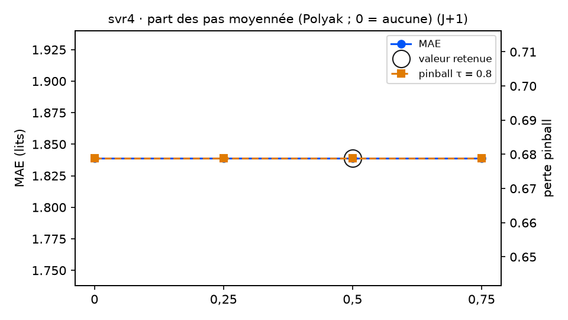

Amplitude de la MAE : 0.0 %. Aucune valeur ne fait significativement mieux que la valeur retenue.

### svr4 · tolérance d'arrêt anticipé

| variante | MAE | RMSE | biais | pinball τ=0.8 | couverture 90 % | temps (s) | DM p (pinball τ=0.8) | p Holm | vs choix retenu |
|---|---|---|---|---|---|---|---|---|---|
| tolerance = 1e-05 | 1.841 | 2.349 | 0.013 | 0.6745 | 86.3 | 3.0 | 0.0397 | 0.0794 | équivalent |
| tolerance = 1e-07 (retenu) | 1.839 | 2.348 | 0.018 | 0.6789 | 85.8 | 11.7 |  |  | — choix retenu |
| tolerance = 1e-09 | 1.839 | 2.348 | 0.018 | 0.6791 | 86.3 | 15.0 | 0.4815 | 0.4815 | équivalent |

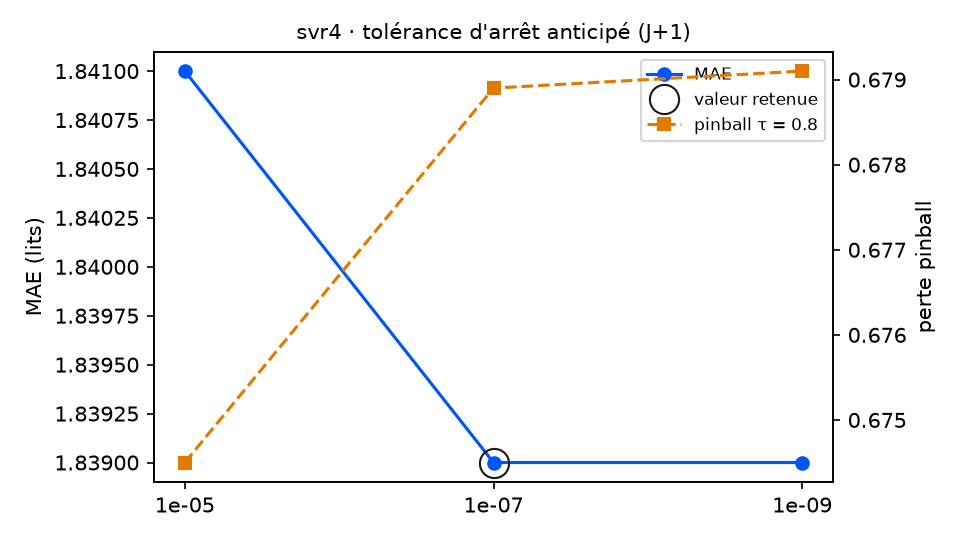

Amplitude de la MAE : 0.1 %. Aucune valeur ne fait significativement mieux que la valeur retenue.

### svr4 · direction préconditionnée α + Cg

| variante | MAE | RMSE | biais | pinball τ=0.8 | couverture 90 % | temps (s) | DM p (pinball τ=0.8) | p Holm | vs choix retenu |
|---|---|---|---|---|---|---|---|---|---|
| preconditionne = True (retenu) | 1.839 | 2.348 | 0.018 | 0.6789 | 85.8 | 11.8 |  |  | — choix retenu |
| preconditionne = False | 1.852 | 2.361 | 0.011 | 0.6761 | 86.3 | 19.8 | 0.5562 | 0.5562 | équivalent |

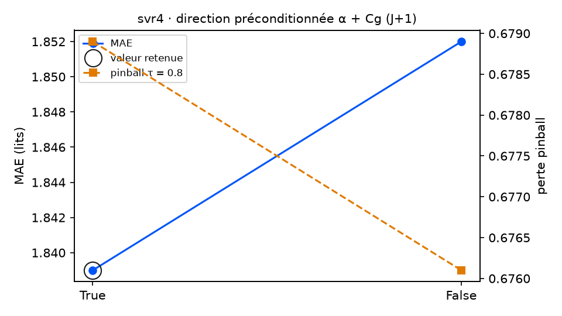

Amplitude de la MAE : 0.7 %. Aucune valeur ne fait significativement mieux que la valeur retenue.

### svr4 · optimiseur

| variante | MAE | RMSE | biais | pinball τ=0.8 | couverture 90 % | temps (s) | DM p (pinball τ=0.8) | p Holm | vs choix retenu |
|---|---|---|---|---|---|---|---|---|---|
| optimiseur = adam (retenu) | 1.839 | 2.348 | 0.018 | 0.6789 | 85.8 | 12.4 |  |  | — choix retenu |
| optimiseur = momentum | 2.572 | 3.195 | -0.184 | 0.8497 | 87.4 | 12.1 | 0.0011 | 0.0022 | moins bon |
| optimiseur = sgd | 2.713 | 3.367 | -0.445 | 0.6821 | 86.3 | 10.4 | 0.9178 | 0.9178 | équivalent |

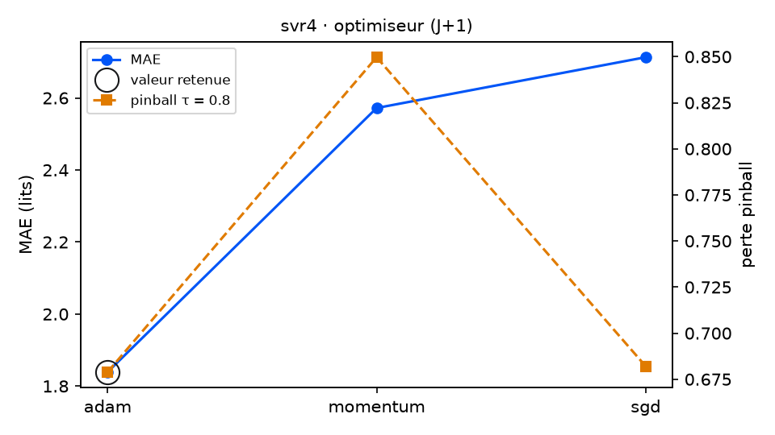

Amplitude de la MAE : 47.5 %. Aucune valeur ne fait significativement mieux que la valeur retenue.

### svr2 · C

| variante | MAE | RMSE | biais | pinball τ=0.8 | temps (s) | DM p (pinball τ=0.8) | p Holm | vs choix retenu |
|---|---|---|---|---|---|---|---|---|
| C = 0,1 | 2.224 | 2.755 | -0.078 | 1.1353 | 0.4 | 0.0002 | 0.001 | moins bon |
| C = 0,3 | 2.041 | 2.522 | -0.09 | 1.0473 | 0.4 | 0.0003 | 0.0012 | moins bon |
| C = 1 | 1.887 | 2.38 | 0.015 | 0.939 | 1.4 | 0.1194 | 0.141 | équivalent |
| C = 3 (retenu) | 1.819 | 2.344 | -0.024 | 0.9167 | 1.9 |  |  | — choix retenu |
| C = 10 | 1.829 | 2.376 | -0.104 | 0.9455 | 2.0 | 0.0355 | 0.1065 | équivalent |
| C = 30 | 1.858 | 2.439 | -0.123 | 0.9661 | 2.1 | 0.0705 | 0.141 | équivalent |

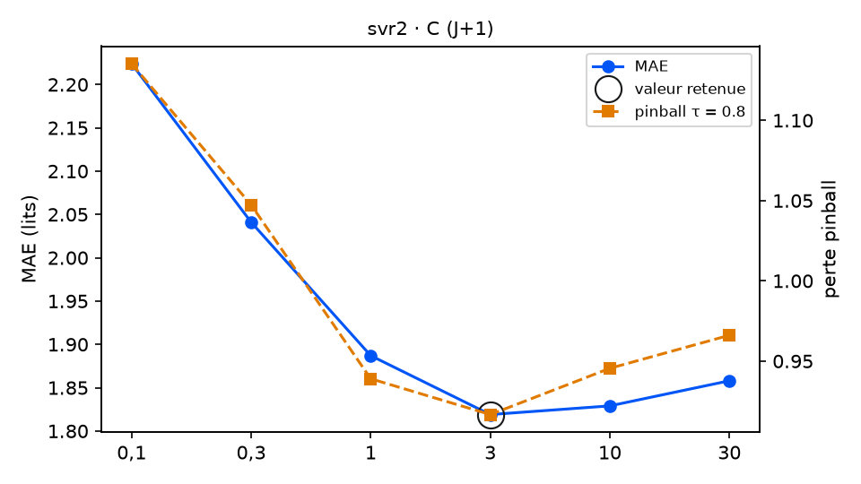

Amplitude de la MAE : 22.3 %. Aucune valeur ne fait significativement mieux que la valeur retenue.

### svr2 · ε (tube ε-insensible, en lits)

| variante | MAE | RMSE | biais | pinball τ=0.8 | temps (s) | DM p (pinball τ=0.8) | p Holm | vs choix retenu |
|---|---|---|---|---|---|---|---|---|
| epsilon = 0 | 1.824 | 2.357 | -0.08 | 0.9356 | 1.6 | 0.1528 | 0.4203 | équivalent |
| epsilon = 0,25 | 1.825 | 2.361 | -0.072 | 0.934 | 1.4 | 0.1401 | 0.4203 | équivalent |
| epsilon = 0,5 | 1.833 | 2.362 | -0.057 | 0.9336 | 1.7 | 0.0824 | 0.3296 | équivalent |
| epsilon = 1 (retenu) | 1.819 | 2.344 | -0.024 | 0.9167 | 1.9 |  |  | — choix retenu |
| epsilon = 2 | 1.824 | 2.327 | -0.009 | 0.9146 | 1.9 | 0.8411 | 0.8411 | équivalent |

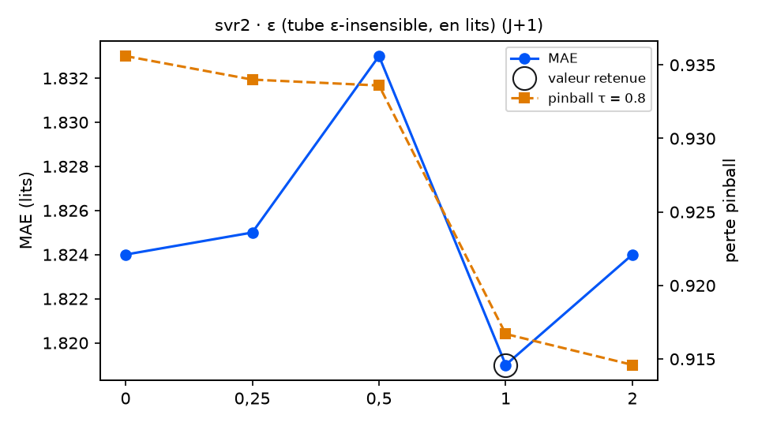

Amplitude de la MAE : 0.8 %. Aucune valeur ne fait significativement mieux que la valeur retenue.

### svr2 · γ (portée du noyau RBF)

| variante | MAE | RMSE | biais | pinball τ=0.8 | temps (s) | DM p (pinball τ=0.8) | p Holm | vs choix retenu |
|---|---|---|---|---|---|---|---|---|
| gamma = 0,005 | 1.891 | 2.382 | -0.018 | 0.9509 | 0.6 | 0.0352 | 0.1408 | équivalent |
| gamma = 0,01 | 1.83 | 2.349 | -0.019 | 0.921 | 1.5 | 0.6106 | 0.6106 | équivalent |
| gamma = 0,02 (retenu) | 1.819 | 2.344 | -0.024 | 0.9167 | 2.0 |  |  | — choix retenu |
| gamma = 0,05 | 1.847 | 2.382 | -0.077 | 0.9464 | 1.5 | 0.0705 | 0.1524 | équivalent |
| gamma = 0,1 | 1.925 | 2.464 | -0.026 | 0.9702 | 2.1 | 0.0508 | 0.1524 | équivalent |
| gamma = 0,2 | 2.031 | 2.601 | 0.006 | 1.0136 | 1.5 | 0.0166 | 0.083 | équivalent |
| gamma = 0,5 | 2.394 | 2.978 | 0.022 | 1.1904 | 0.8 | 0.0001 | 0.0006 | moins bon |

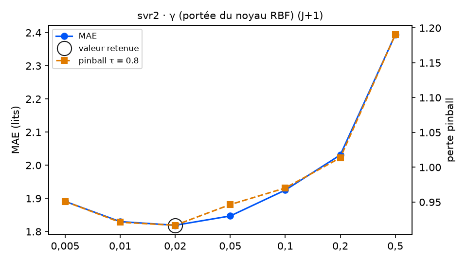

Amplitude de la MAE : 31.6 %. Aucune valeur ne fait significativement mieux que la valeur retenue.

### foret · nombre d'arbres

| variante | MAE | RMSE | biais | pinball τ=0.8 | couverture 90 % | temps (s) | DM p (pinball τ=0.8) | p Holm | vs choix retenu |
|---|---|---|---|---|---|---|---|---|---|
| arbres = 25 | 1.942 | 2.488 | -0.067 | 0.7125 | 91.3 | 2.0 | 0.7821 | 1.0 | équivalent |
| arbres = 50 | 1.958 | 2.498 | -0.098 | 0.7145 | 91.8 | 3.9 | 0.4643 | 1.0 | équivalent |
| arbres = 100 | 1.959 | 2.509 | -0.095 | 0.7143 | 92.3 | 7.9 | 0.4046 | 1.0 | équivalent |
| arbres = 300 (retenu) | 1.929 | 2.483 | -0.122 | 0.709 | 92.3 | 22.7 |  |  | — choix retenu |
| arbres = 500 | 1.926 | 2.479 | -0.108 | 0.7138 | 92.3 | 37.0 | 0.0542 | 0.2168 | équivalent |

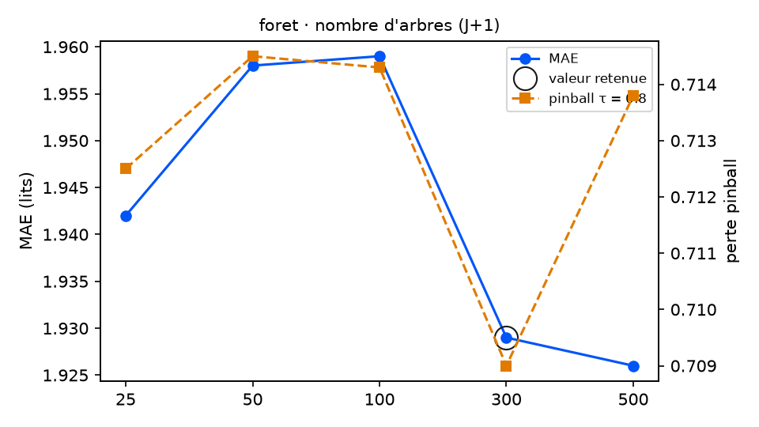

Amplitude de la MAE : 1.7 %. Aucune valeur ne fait significativement mieux que la valeur retenue.

### foret · profondeur maximale

| variante | MAE | RMSE | biais | pinball τ=0.8 | couverture 90 % | temps (s) | DM p (pinball τ=0.8) | p Holm | vs choix retenu |
|---|---|---|---|---|---|---|---|---|---|
| profondeur_foret = 3 | 2.053 | 2.586 | -0.122 | 0.7335 | 94.5 | 2.4 | 0.2899 | 0.8697 | équivalent |
| profondeur_foret = 5 | 2.005 | 2.525 | -0.133 | 0.7191 | 94.0 | 6.4 | 0.4003 | 0.8697 | équivalent |
| profondeur_foret = 8 | 1.912 | 2.464 | -0.125 | 0.7125 | 92.3 | 15.9 | 0.5332 | 0.8697 | équivalent |
| profondeur_foret = 12 (retenu) | 1.929 | 2.483 | -0.122 | 0.709 | 92.3 | 22.2 |  |  | — choix retenu |
| profondeur_foret = 20 | 1.93 | 2.469 | -0.104 | 0.7179 | 92.3 | 22.6 | 0.0691 | 0.2764 | équivalent |

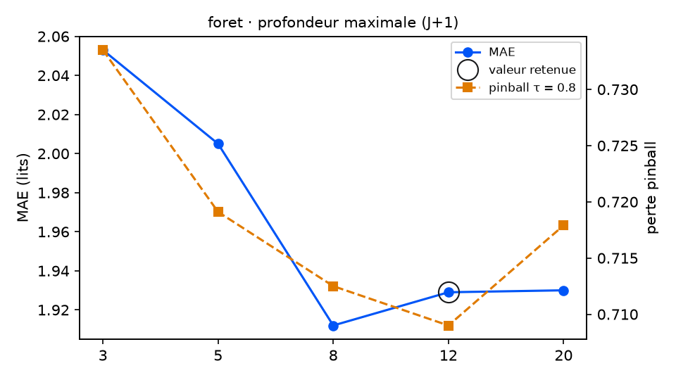

Amplitude de la MAE : 7.3 %. Aucune valeur ne fait significativement mieux que la valeur retenue.

### foret · taille minimale d'une feuille

| variante | MAE | RMSE | biais | pinball τ=0.8 | couverture 90 % | temps (s) | DM p (pinball τ=0.8) | p Holm | vs choix retenu |
|---|---|---|---|---|---|---|---|---|---|
| min_feuille = 2 | 1.932 | 2.498 | -0.116 | 0.7145 | 90.7 | 44.5 | 0.5725 | 0.5725 | équivalent |
| min_feuille = 5 (retenu) | 1.929 | 2.483 | -0.122 | 0.709 | 92.3 | 22.1 |  |  | — choix retenu |
| min_feuille = 10 | 1.941 | 2.48 | -0.09 | 0.717 | 92.9 | 12.2 | 0.2552 | 0.5104 | équivalent |
| min_feuille = 20 | 1.983 | 2.504 | -0.094 | 0.7311 | 93.4 | 6.6 | 0.0386 | 0.1158 | équivalent |

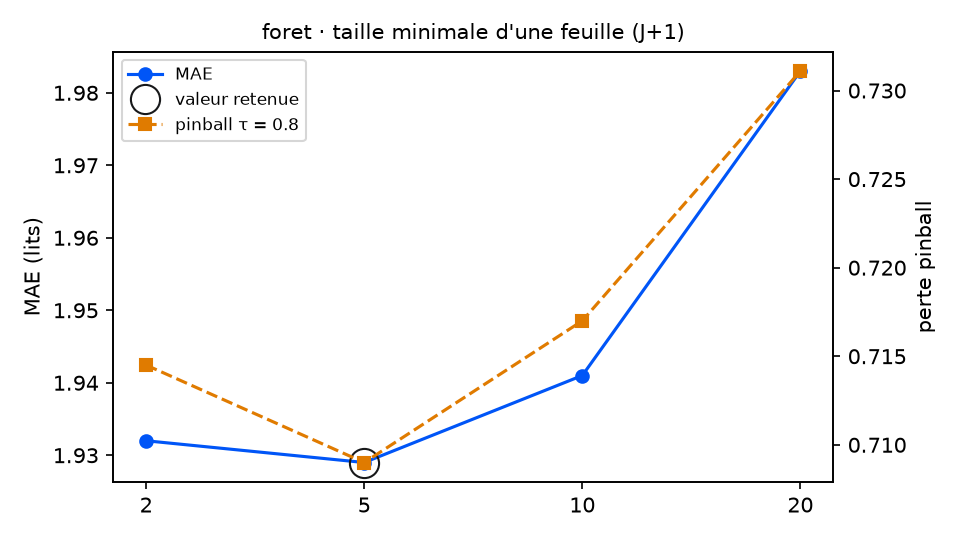

Amplitude de la MAE : 2.8 %. Aucune valeur ne fait significativement mieux que la valeur retenue.

### foret · part des variables tirées par nœud

| variante | MAE | RMSE | biais | pinball τ=0.8 | couverture 90 % | temps (s) | DM p (pinball τ=0.8) | p Holm | vs choix retenu |
|---|---|---|---|---|---|---|---|---|---|
| part_variables = 0,15 | 2.033 | 2.574 | -0.154 | 0.7203 | 93.4 | 20.5 | 0.5161 | 0.5161 | équivalent |
| part_variables = 0,333333 (retenu) | 1.929 | 2.483 | -0.122 | 0.709 | 92.3 | 21.8 |  |  | — choix retenu |
| part_variables = 0,5 | 1.904 | 2.474 | -0.072 | 0.7219 | 91.8 | 22.5 | 0.2241 | 0.4482 | équivalent |
| part_variables = 1 | 1.905 | 2.473 | -0.045 | 0.7369 | 89.1 | 23.2 | 0.1438 | 0.4314 | équivalent |

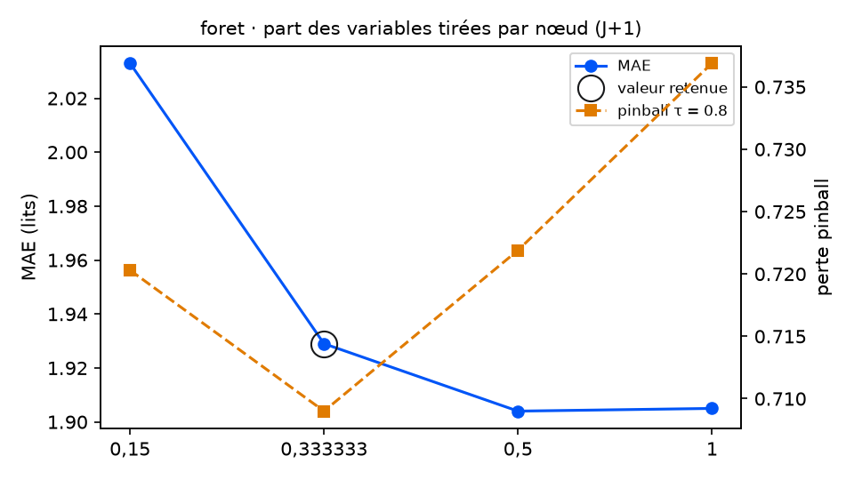

Amplitude de la MAE : 6.7 %. Aucune valeur ne fait significativement mieux que la valeur retenue.

### boosting · nombre d'étapes

| variante | MAE | RMSE | biais | pinball τ=0.8 | couverture 90 % | temps (s) | DM p (pinball τ=0.8) | p Holm | vs choix retenu |
|---|---|---|---|---|---|---|---|---|---|
| etapes = 50 | 1.927 | 2.442 | -0.112 | 0.7068 | 88.5 | 2.0 | 0.4975 | 0.995 | équivalent |
| etapes = 100 | 1.89 | 2.429 | -0.121 | 0.7154 | 85.8 | 3.8 | 0.5142 | 0.995 | équivalent |
| etapes = 300 (retenu) | 1.854 | 2.406 | -0.079 | 0.7244 | 81.4 | 11.5 |  |  | — choix retenu |
| etapes = 600 | 1.863 | 2.422 | -0.095 | 0.7338 | 79.8 | 22.1 | 0.189 | 0.567 | équivalent |

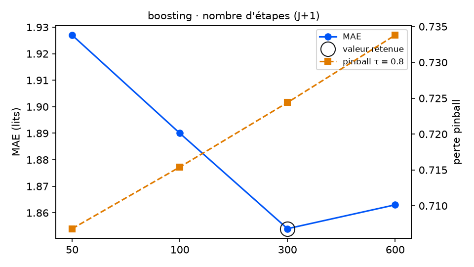

Amplitude de la MAE : 3.9 %. Aucune valeur ne fait significativement mieux que la valeur retenue.

### boosting · taux ν (shrinkage)

| variante | MAE | RMSE | biais | pinball τ=0.8 | couverture 90 % | temps (s) | DM p (pinball τ=0.8) | p Holm | vs choix retenu |
|---|---|---|---|---|---|---|---|---|---|
| taux_boosting = 0,01 | 1.904 | 2.431 | -0.11 | 0.7045 | 88.5 | 11.5 | 0.3721 | 0.3721 | équivalent |
| taux_boosting = 0,05 (retenu) | 1.854 | 2.406 | -0.079 | 0.7244 | 81.4 | 11.0 |  |  | — choix retenu |
| taux_boosting = 0,1 | 1.861 | 2.425 | -0.066 | 0.755 | 78.7 | 11.3 | 0.02 | 0.06 | équivalent |
| taux_boosting = 0,2 | 1.946 | 2.529 | -0.187 | 0.757 | 73.8 | 11.1 | 0.0853 | 0.1706 | équivalent |

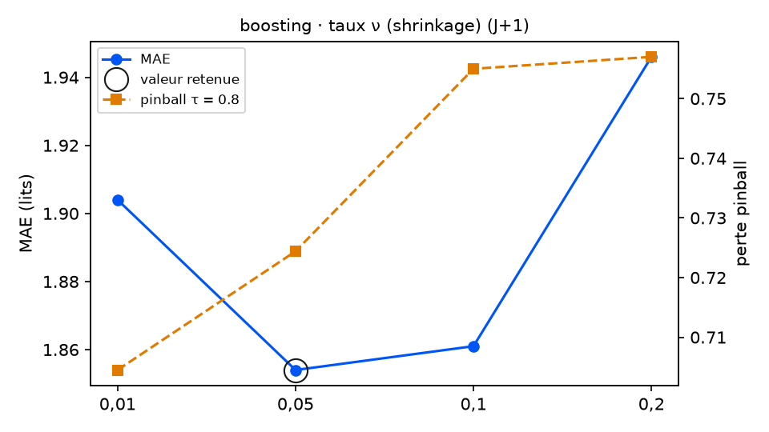

Amplitude de la MAE : 5.0 %. Aucune valeur ne fait significativement mieux que la valeur retenue.

### boosting · profondeur des arbres

| variante | MAE | RMSE | biais | pinball τ=0.8 | couverture 90 % | temps (s) | DM p (pinball τ=0.8) | p Holm | vs choix retenu |
|---|---|---|---|---|---|---|---|---|---|
| profondeur_boosting = 1 | 1.927 | 2.443 | -0.099 | 0.7067 | 87.4 | 3.5 | 0.3218 | 0.6436 | équivalent |
| profondeur_boosting = 2 | 1.9 | 2.423 | -0.047 | 0.7126 | 86.3 | 7.1 | 0.3243 | 0.6436 | équivalent |
| profondeur_boosting = 3 (retenu) | 1.854 | 2.406 | -0.079 | 0.7244 | 81.4 | 11.7 |  |  | — choix retenu |
| profondeur_boosting = 5 | 1.889 | 2.447 | -0.089 | 0.7679 | 71.6 | 23.3 | 0.0086 | 0.0258 | moins bon |

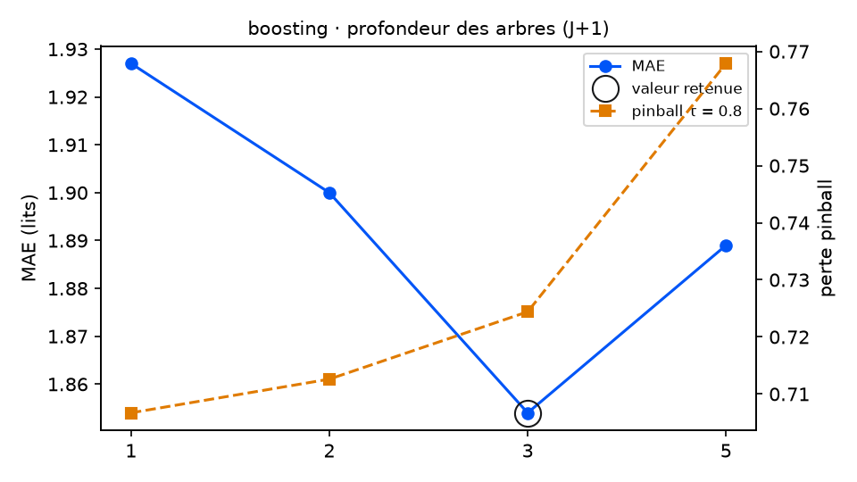

Amplitude de la MAE : 3.9 %. Aucune valeur ne fait significativement mieux que la valeur retenue.

### boosting · part du sous-échantillon

| variante | MAE | RMSE | biais | pinball τ=0.8 | couverture 90 % | temps (s) | DM p (pinball τ=0.8) | p Holm | vs choix retenu |
|---|---|---|---|---|---|---|---|---|---|
| sous_echantillon = 0,5 | 1.9 | 2.429 | -0.002 | 0.7252 | 79.2 | 10.0 | 0.9515 | 1.0 | équivalent |
| sous_echantillon = 0,8 (retenu) | 1.854 | 2.406 | -0.079 | 0.7244 | 81.4 | 11.5 |  |  | — choix retenu |
| sous_echantillon = 1 | 1.871 | 2.415 | -0.088 | 0.7314 | 84.2 | 12.7 | 0.6094 | 1.0 | équivalent |

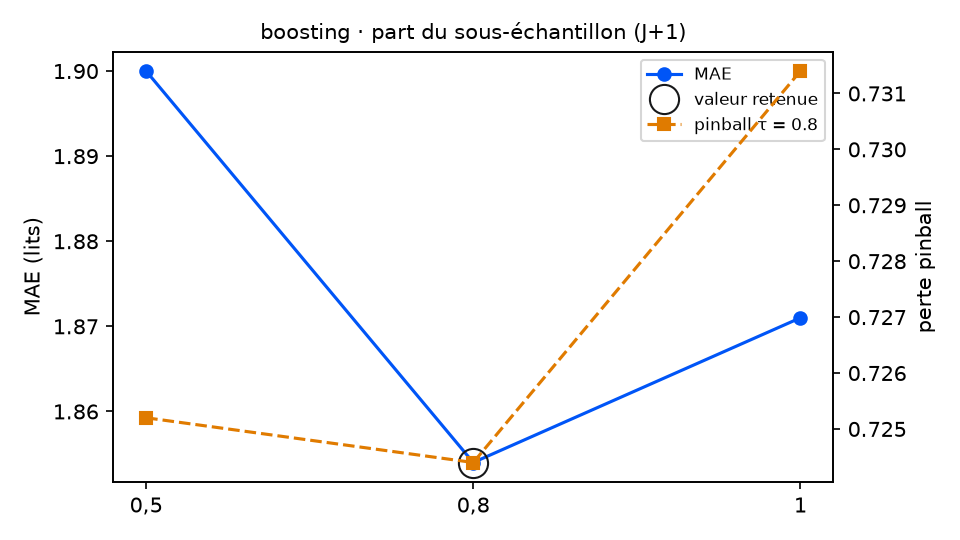

Amplitude de la MAE : 2.5 %. Aucune valeur ne fait significativement mieux que la valeur retenue.

### mlp · architecture (neurones par couche)

| variante | MAE | RMSE | biais | pinball τ=0.8 | couverture 90 % | temps (s) | DM p (pinball τ=0.8) | p Holm | vs choix retenu |
|---|---|---|---|---|---|---|---|---|---|
| couches = 8 | 1.82 | 2.378 | -0.062 | 0.6649 | 83.6 | 1.1 | 0.7506 | 1.0 | équivalent |
| couches = 32 | 1.837 | 2.385 | -0.19 | 0.6826 | 87.4 | 1.2 | 0.2516 | 0.7548 | équivalent |
| couches = 32×16 (retenu) | 1.86 | 2.369 | -0.164 | 0.6581 | 88.0 | 1.4 |  |  | — choix retenu |
| couches = 64×32 | 1.893 | 2.427 | -0.131 | 0.6679 | 88.5 | 1.8 | 0.5931 | 1.0 | équivalent |
| couches = 32×16×8 | 1.942 | 2.446 | 0.157 | 0.6876 | 86.9 | 1.7 | 0.1195 | 0.478 | équivalent |

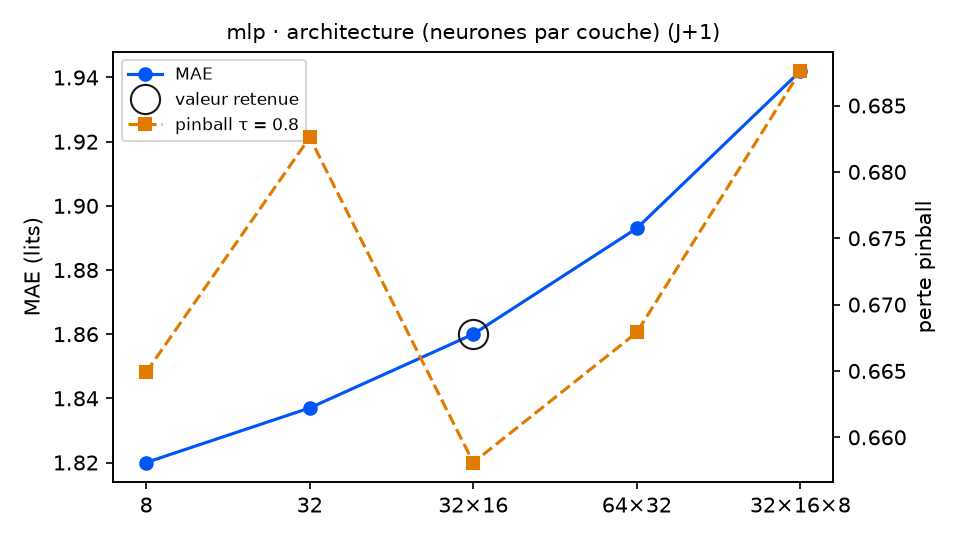

Amplitude de la MAE : 6.6 %. Aucune valeur ne fait significativement mieux que la valeur retenue.

### mlp · taux d'apprentissage

| variante | MAE | RMSE | biais | pinball τ=0.8 | couverture 90 % | temps (s) | DM p (pinball τ=0.8) | p Holm | vs choix retenu |
|---|---|---|---|---|---|---|---|---|---|
| taux_reseau = 0,001 | 1.827 | 2.378 | -0.159 | 0.6763 | 85.2 | 3.4 | 0.1817 | 0.5451 | équivalent |
| taux_reseau = 0,003 | 1.846 | 2.389 | -0.189 | 0.6468 | 90.2 | 1.7 | 0.4282 | 0.6756 | équivalent |
| taux_reseau = 0,01 (retenu) | 1.86 | 2.369 | -0.164 | 0.6581 | 88.0 | 1.3 |  |  | — choix retenu |
| taux_reseau = 0,03 | 1.854 | 2.403 | -0.116 | 0.673 | 84.2 | 1.3 | 0.3378 | 0.6756 | équivalent |

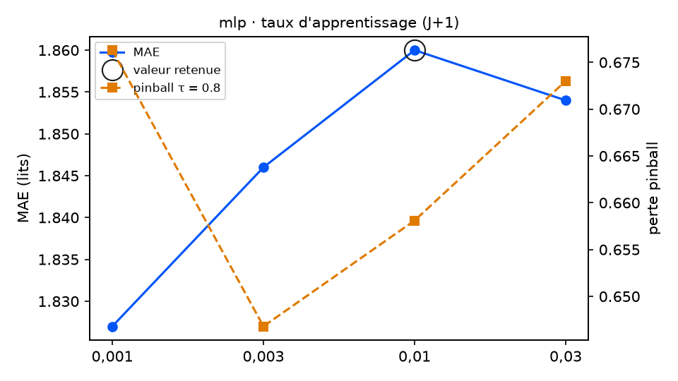

Amplitude de la MAE : 1.8 %. Aucune valeur ne fait significativement mieux que la valeur retenue.

### mlp · pénalité L2 λ

| variante | MAE | RMSE | biais | pinball τ=0.8 | couverture 90 % | temps (s) | DM p (pinball τ=0.8) | p Holm | vs choix retenu |
|---|---|---|---|---|---|---|---|---|---|
| lambda_ = 0 | 1.862 | 2.368 | -0.17 | 0.6512 | 88.5 | 1.4 | 0.1747 | 0.6732 | équivalent |
| lambda_ = 0,0001 | 1.859 | 2.369 | -0.183 | 0.6519 | 88.5 | 1.3 | 0.2324 | 0.6732 | équivalent |
| lambda_ = 0,001 (retenu) | 1.86 | 2.369 | -0.164 | 0.6581 | 88.0 | 1.4 |  |  | — choix retenu |
| lambda_ = 0,01 | 1.828 | 2.362 | -0.101 | 0.6661 | 88.0 | 1.4 | 0.5086 | 0.6732 | équivalent |
| lambda_ = 0,1 | 1.928 | 2.427 | -0.188 | 0.6891 | 88.0 | 3.2 | 0.1683 | 0.6732 | équivalent |

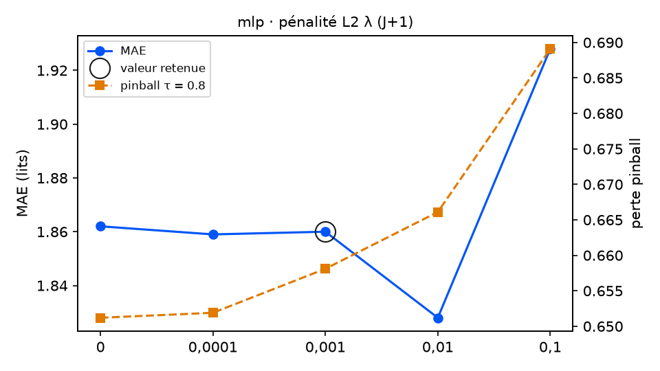

Amplitude de la MAE : 5.4 %. Aucune valeur ne fait significativement mieux que la valeur retenue.

### mlp · époques maximales

| variante | MAE | RMSE | biais | pinball τ=0.8 | couverture 90 % | temps (s) | DM p (pinball τ=0.8) | p Holm | vs choix retenu |
|---|---|---|---|---|---|---|---|---|---|
| epoques = 300 | 1.86 | 2.369 | -0.164 | 0.6581 | 88.0 | 1.3 |  |  | identique |
| epoques = 800 | 1.86 | 2.369 | -0.164 | 0.6581 | 88.0 | 1.3 |  |  | identique |
| epoques = 1500 (retenu) | 1.86 | 2.369 | -0.164 | 0.6581 | 88.0 | 1.3 |  |  | — choix retenu |
| epoques = 3000 | 1.86 | 2.369 | -0.164 | 0.6581 | 88.0 | 1.3 |  |  | identique |

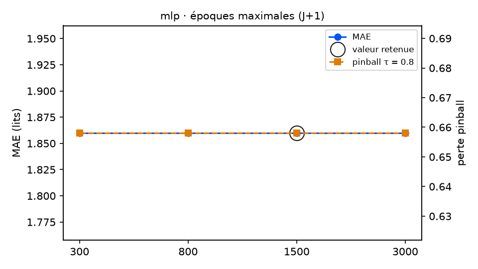

Amplitude de la MAE : 0.0 %. Aucune valeur ne fait significativement mieux que la valeur retenue.

### mlp · patience de l'arrêt anticipé

| variante | MAE | RMSE | biais | pinball τ=0.8 | couverture 90 % | temps (s) | DM p (pinball τ=0.8) | p Holm | vs choix retenu |
|---|---|---|---|---|---|---|---|---|---|
| patience = 50 | 1.86 | 2.369 | -0.164 | 0.6581 | 88.0 | 0.6 |  |  | identique |
| patience = 150 (retenu) | 1.86 | 2.369 | -0.164 | 0.6581 | 88.0 | 1.3 |  |  | — choix retenu |
| patience = 300 | 1.86 | 2.369 | -0.164 | 0.6581 | 88.0 | 2.3 |  |  | identique |

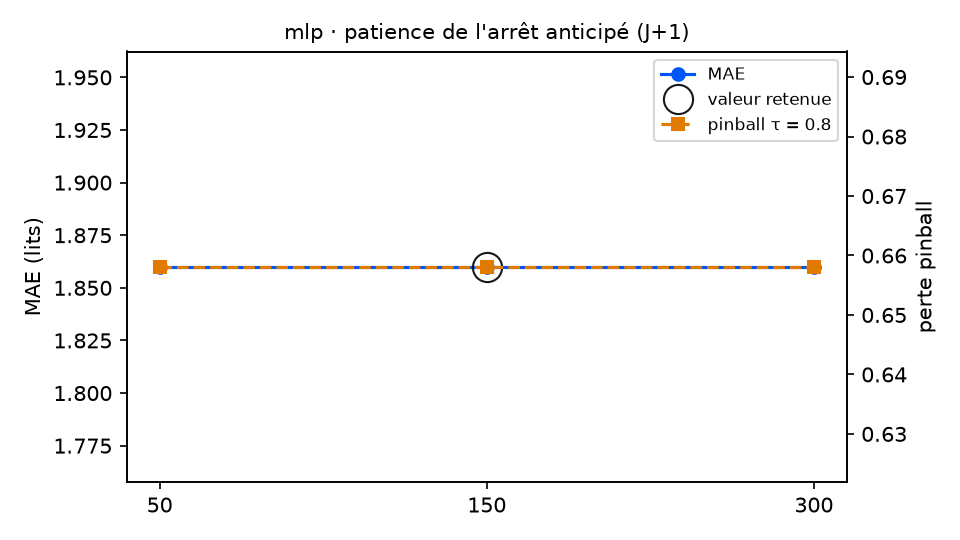

Amplitude de la MAE : 0.0 %. Aucune valeur ne fait significativement mieux que la valeur retenue.

### mlp · nombre d'initialisations moyennées

| variante | MAE | RMSE | biais | pinball τ=0.8 | couverture 90 % | temps (s) | DM p (pinball τ=0.8) | p Holm | vs choix retenu |
|---|---|---|---|---|---|---|---|---|---|
| graines = 1 | 1.903 | 2.453 | -0.201 | 0.731 | 86.9 | 0.5 | 0.0057 | 0.0114 | moins bon |
| graines = 3 (retenu) | 1.86 | 2.369 | -0.164 | 0.6581 | 88.0 | 1.4 |  |  | — choix retenu |
| graines = 5 | 1.874 | 2.376 | -0.115 | 0.6532 | 88.5 | 2.1 | 0.6455 | 0.6455 | équivalent |

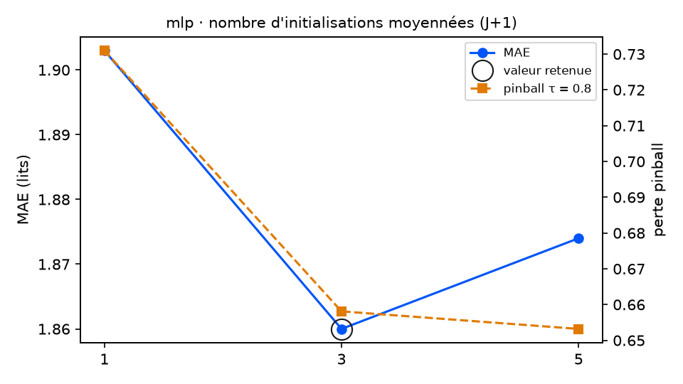

Amplitude de la MAE : 2.3 %. Aucune valeur ne fait significativement mieux que la valeur retenue.

### lstm · taille de l'état caché H

| variante | MAE | RMSE | biais | pinball τ=0.8 | couverture 90 % | temps (s) | DM p (pinball τ=0.8) | p Holm | vs choix retenu |
|---|---|---|---|---|---|---|---|---|---|
| cache_lstm = 4 | 1.843 | 2.413 | 0.011 | 0.6819 | 86.3 | 9.9 | 0.461 | 0.922 | équivalent |
| cache_lstm = 8 | 1.839 | 2.387 | 0.063 | 0.6814 | 87.4 | 9.9 | 0.6358 | 0.922 | équivalent |
| cache_lstm = 16 (retenu) | 1.83 | 2.405 | 0.038 | 0.6753 | 88.5 | 13.2 |  |  | — choix retenu |
| cache_lstm = 32 | 1.867 | 2.44 | 0.006 | 0.6974 | 85.8 | 24.9 | 0.1544 | 0.4632 | équivalent |

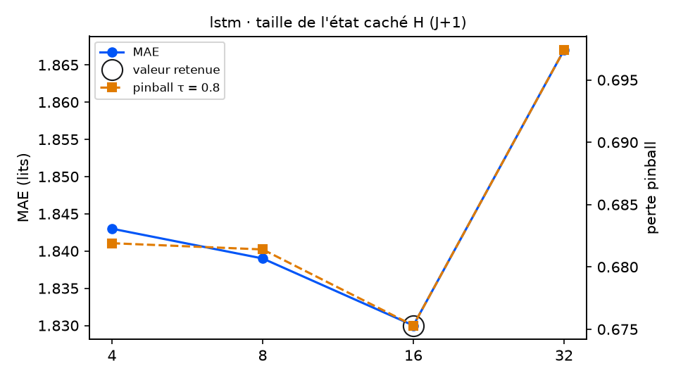

Amplitude de la MAE : 2.0 %. Aucune valeur ne fait significativement mieux que la valeur retenue.

### lstm · taux d'apprentissage

| variante | MAE | RMSE | biais | pinball τ=0.8 | couverture 90 % | temps (s) | DM p (pinball τ=0.8) | p Holm | vs choix retenu |
|---|---|---|---|---|---|---|---|---|---|
| taux_reseau = 0,003 | 1.848 | 2.421 | 0.009 | 0.674 | 90.2 | 21.9 | 0.8824 | 0.8824 | équivalent |
| taux_reseau = 0,01 (retenu) | 1.83 | 2.405 | 0.038 | 0.6753 | 88.5 | 13.6 |  |  | — choix retenu |
| taux_reseau = 0,03 | 1.863 | 2.429 | 0.012 | 0.6656 | 86.3 | 11.8 | 0.4031 | 0.8062 | équivalent |

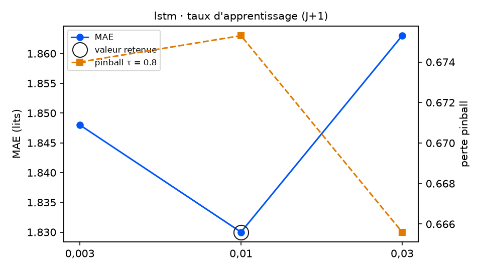

Amplitude de la MAE : 1.8 %. Aucune valeur ne fait significativement mieux que la valeur retenue.

### lstm · pénalité L2 λ

| variante | MAE | RMSE | biais | pinball τ=0.8 | couverture 90 % | temps (s) | DM p (pinball τ=0.8) | p Holm | vs choix retenu |
|---|---|---|---|---|---|---|---|---|---|
| lambda_ = 0 | 1.828 | 2.418 | 0.043 | 0.6867 | 86.9 | 14.1 | 0.216 | 0.432 | équivalent |
| lambda_ = 0,001 (retenu) | 1.83 | 2.405 | 0.038 | 0.6753 | 88.5 | 13.3 |  |  | — choix retenu |
| lambda_ = 0,01 | 1.834 | 2.384 | 0.043 | 0.6737 | 86.3 | 19.2 | 0.8697 | 0.8697 | équivalent |

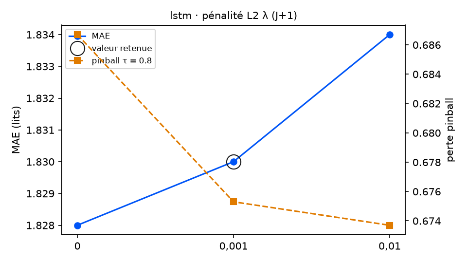

Amplitude de la MAE : 0.3 %. Aucune valeur ne fait significativement mieux que la valeur retenue.

### variables · jours d'occupation passée en entrée

| variante | MAE | RMSE | biais | pinball τ=0.8 | couverture 90 % | temps (s) | DM p (pinball τ=0.8) | p Holm | vs choix retenu |
|---|---|---|---|---|---|---|---|---|---|
| retards = 3 | 1.822 | 2.317 | -0.058 | 0.662 | 87.4 | 11.8 | 0.1977 | 0.5931 | équivalent |
| retards = 5 | 1.833 | 2.332 | -0.044 | 0.6637 | 86.9 | 12.5 | 0.1424 | 0.5696 | équivalent |
| retards = 7 (retenu) | 1.839 | 2.348 | 0.018 | 0.6789 | 85.8 | 12.5 |  |  | — choix retenu |
| retards = 10 | 1.836 | 2.364 | 0.031 | 0.6874 | 85.2 | 11.7 | 0.0794 | 0.397 | équivalent |
| retards = 14 | 1.863 | 2.386 | 0.083 | 0.6749 | 85.2 | 13.7 | 0.7539 | 1.0 | équivalent |
| retards = 21 | 1.874 | 2.371 | 0.072 | 0.6738 | 85.2 | 13.2 | 0.8108 | 1.0 | équivalent |

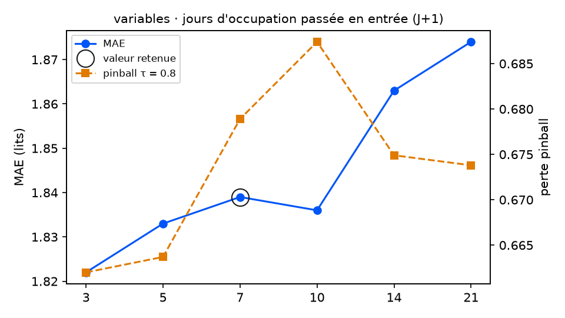

Amplitude de la MAE : 2.8 %. Aucune valeur ne fait significativement mieux que la valeur retenue.

## Horizon J+7

### svr4 · C (poids des erreurs)

| variante | MAE | RMSE | biais | pinball τ=0.8 | couverture 90 % | temps (s) | DM p (pinball τ=0.8) | p Holm | vs choix retenu |
|---|---|---|---|---|---|---|---|---|---|
| C = 0,1 | 2.706 | 3.338 | -0.095 | 0.9523 | 90.4 | 10.7 | 0.8217 | 0.9842 | équivalent |
| C = 0,3 (retenu) | 2.687 | 3.306 | -0.123 | 0.9574 | 89.3 | 10.5 |  |  | — choix retenu |
| C = 1 | 2.7 | 3.31 | -0.265 | 0.9687 | 85.3 | 12.5 | 0.4921 | 0.9842 | équivalent |
| C = 3 | 2.768 | 3.404 | -0.352 | 1.0014 | 83.1 | 11.6 | 0.1514 | 0.4542 | équivalent |
| C = 10 | 2.934 | 3.664 | -0.414 | 1.0758 | 78.0 | 14.2 | 0.0274 | 0.1096 | équivalent |
| C = 30 | 3.165 | 4.007 | -0.544 | 1.2092 | 67.2 | 13.9 | 0.0198 | 0.099 | équivalent |

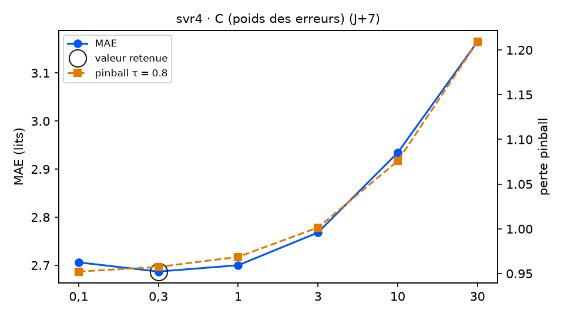

Amplitude de la MAE : 17.8 %. Aucune valeur ne fait significativement mieux que la valeur retenue.

### svr4 · ε (tube, niveaux quantiles)

| variante | MAE | RMSE | biais | pinball τ=0.8 | couverture 90 % | temps (s) | DM p (pinball τ=0.8) | p Holm | vs choix retenu |
|---|---|---|---|---|---|---|---|---|---|
| epsilon_quantile = 0 (retenu) | 2.687 | 3.306 | -0.123 | 0.9574 | 89.3 | 10.1 |  |  | — choix retenu |
| epsilon_quantile = 0,25 | 2.684 | 3.31 | -0.138 | 0.9646 | 85.9 | 10.2 | 0.3173 | 0.8355 | équivalent |
| epsilon_quantile = 0,5 | 2.694 | 3.321 | -0.142 | 0.9717 | 84.7 | 10.2 | 0.2805 | 0.8355 | équivalent |
| epsilon_quantile = 1 | 2.716 | 3.352 | -0.152 | 0.9809 | 79.7 | 10.6 | 0.2785 | 0.8355 | équivalent |

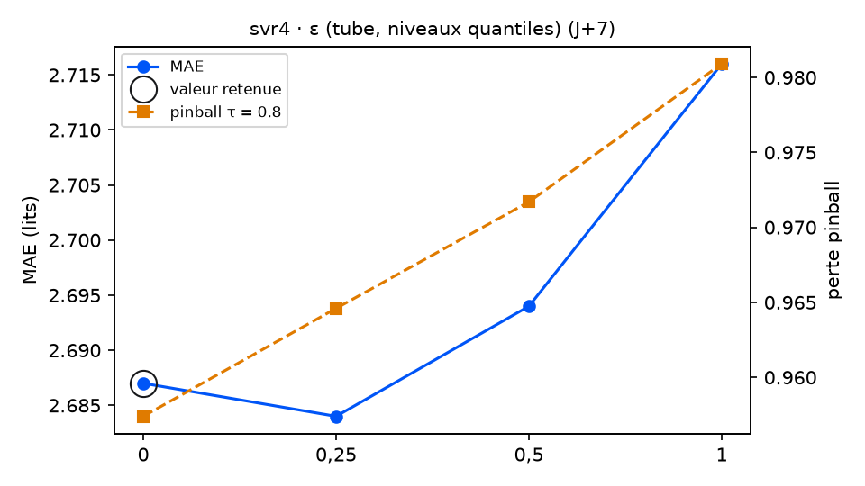

Amplitude de la MAE : 1.2 %. Aucune valeur ne fait significativement mieux que la valeur retenue.

### svr4 · γ₁ (portée, bloc occupation)

| variante | MAE | RMSE | biais | pinball τ=0.8 | couverture 90 % | temps (s) | DM p (pinball τ=0.8) | p Holm | vs choix retenu |
|---|---|---|---|---|---|---|---|---|---|
| gamma1 = 0,01 | 2.688 | 3.306 | -0.123 | 0.9572 | 89.3 | 10.5 | 0.3165 | 1.0 | équivalent |
| gamma1 = 0,02 (retenu) | 2.687 | 3.306 | -0.123 | 0.9574 | 89.3 | 10.4 |  |  | — choix retenu |
| gamma1 = 0,05 | 2.698 | 3.319 | -0.113 | 0.9575 | 89.3 | 8.6 | 0.2732 | 1.0 | équivalent |
| gamma1 = 0,1 | 2.722 | 3.347 | -0.097 | 0.9577 | 89.3 | 9.2 | 0.3135 | 1.0 | équivalent |
| gamma1 = 0,2 | 2.728 | 3.353 | -0.071 | 0.9573 | 89.3 | 5.0 | 0.7321 | 1.0 | équivalent |
| gamma1 = 0,5 | 2.698 | 3.318 | -0.11 | 0.9569 | 88.7 | 6.6 | 0.3529 | 1.0 | équivalent |

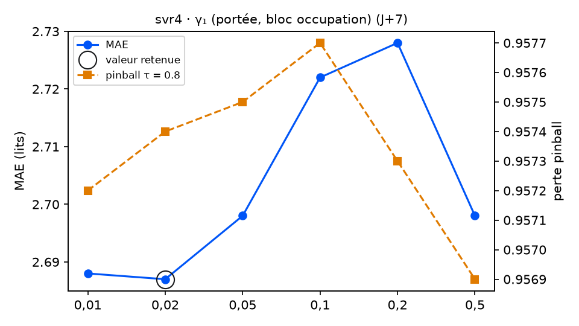

Amplitude de la MAE : 1.5 %. Aucune valeur ne fait significativement mieux que la valeur retenue.

### svr4 · γ₂ (portée, bloc flux et saison)

| variante | MAE | RMSE | biais | pinball τ=0.8 | couverture 90 % | temps (s) | DM p (pinball τ=0.8) | p Holm | vs choix retenu |
|---|---|---|---|---|---|---|---|---|---|
| gamma2 = 0,02 | 2.783 | 3.432 | -0.007 | 0.9792 | 89.8 | 8.6 | 0.2278 | 0.6804 | équivalent |
| gamma2 = 0,05 | 2.736 | 3.381 | -0.143 | 0.9807 | 89.8 | 9.9 | 0.1701 | 0.6804 | équivalent |
| gamma2 = 0,1 | 2.701 | 3.326 | -0.143 | 0.9709 | 87.6 | 10.7 | 0.1717 | 0.6804 | équivalent |
| gamma2 = 0,2 (retenu) | 2.687 | 3.306 | -0.123 | 0.9574 | 89.3 | 10.8 |  |  | — choix retenu |
| gamma2 = 0,5 | 2.69 | 3.318 | -0.062 | 0.9447 | 89.8 | 10.5 | 0.5321 | 0.6804 | équivalent |

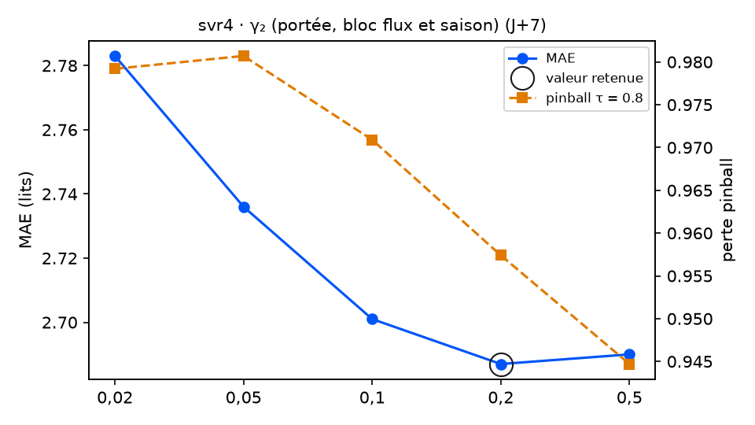

Amplitude de la MAE : 3.6 %. Aucune valeur ne fait significativement mieux que la valeur retenue.

### svr4 · τ (quantile décisionnel)

| variante | MAE | RMSE | biais | pinball τ=0.8 | couverture 90 % | temps (s) | DM p (pinball τ=0.8) | p Holm | vs choix retenu |
|---|---|---|---|---|---|---|---|---|---|
| tau = 0,5 | 2.687 | 3.306 | -0.123 | 1.3804 | 89.3 | 7.4 | 0.0119 | 0.0476 | moins bon |
| tau = 0,6 | 2.687 | 3.306 | -0.123 | 1.3804 | 89.3 | 10.0 | 0.0119 | 0.0476 | moins bon |
| tau = 0,7 | 2.687 | 3.306 | -0.123 | 1.3804 | 89.3 | 11.1 | 0.0119 | 0.0476 | moins bon |
| tau = 0,8 (retenu) | 2.687 | 3.306 | -0.123 | 0.9574 | 89.3 | 11.0 |  |  | — choix retenu |
| tau = 0,9 | 2.687 | 3.306 | -0.123 | 1.3804 | 89.3 | 10.7 | 0.0119 | 0.0476 | moins bon |

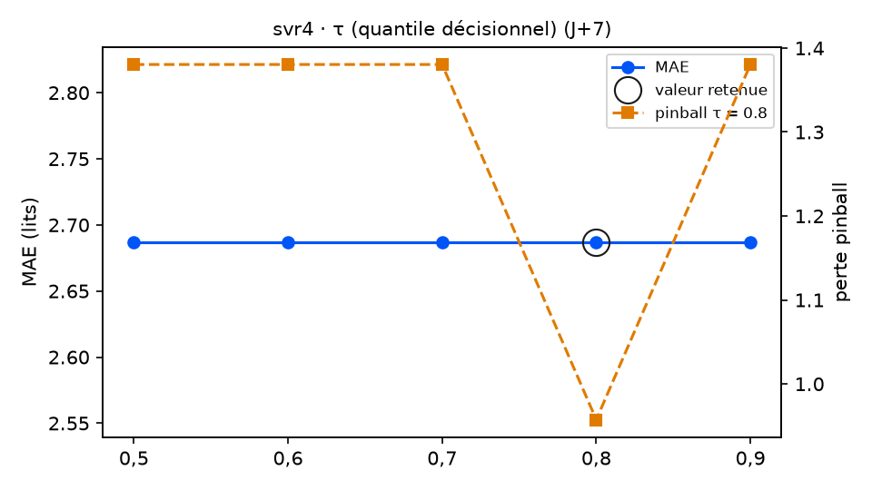

Amplitude de la MAE : 0.0 %. Aucune valeur ne fait significativement mieux que la valeur retenue.

### svr4 · η₀ (taux d'apprentissage d'Adam)

| variante | MAE | RMSE | biais | pinball τ=0.8 | couverture 90 % | temps (s) | DM p (pinball τ=0.8) | p Holm | vs choix retenu |
|---|---|---|---|---|---|---|---|---|---|
| taux = 0,005 | 2.688 | 3.307 | -0.122 | 0.9594 | 89.3 | 13.5 | 0.2291 | 0.956 | équivalent |
| taux = 0,01 | 2.688 | 3.306 | -0.122 | 0.9583 | 88.7 | 12.5 | 0.1912 | 0.956 | équivalent |
| taux = 0,02 | 2.688 | 3.306 | -0.122 | 0.9577 | 88.7 | 11.2 | 0.2943 | 0.956 | équivalent |
| taux = 0,05 (retenu) | 2.687 | 3.306 | -0.123 | 0.9574 | 89.3 | 10.8 |  |  | — choix retenu |
| taux = 0,1 | 2.688 | 3.307 | -0.121 | 0.9574 | 89.3 | 10.3 | 0.8484 | 1.0 | équivalent |
| taux = 0,2 | 2.688 | 3.308 | -0.123 | 0.9577 | 89.8 | 8.3 | 0.5129 | 1.0 | équivalent |

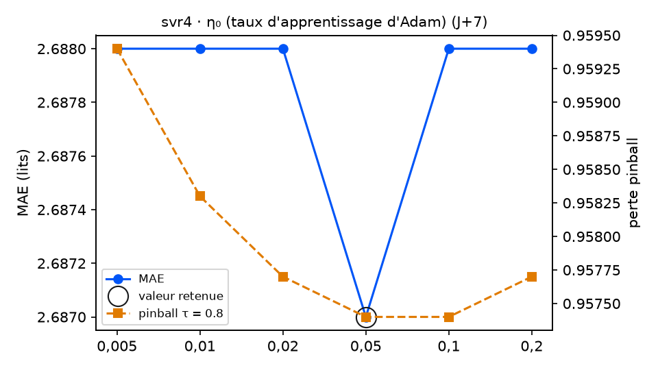

Amplitude de la MAE : 0.0 %. Aucune valeur ne fait significativement mieux que la valeur retenue.

### svr4 · nombre maximal d'itérations

| variante | MAE | RMSE | biais | pinball τ=0.8 | couverture 90 % | temps (s) | DM p (pinball τ=0.8) | p Holm | vs choix retenu |
|---|---|---|---|---|---|---|---|---|---|
| iterations = 300 | 2.689 | 3.309 | -0.12 | 0.9588 | 90.4 | 1.5 | 0.7635 | 0.9198 | équivalent |
| iterations = 1000 | 2.687 | 3.306 | -0.123 | 0.9596 | 89.3 | 4.4 | 0.1366 | 0.4098 | équivalent |
| iterations = 3000 (retenu) | 2.687 | 3.306 | -0.123 | 0.9574 | 89.3 | 10.5 |  |  | — choix retenu |
| iterations = 6000 | 2.687 | 3.306 | -0.123 | 0.9572 | 89.3 | 14.9 | 0.4599 | 0.9198 | équivalent |

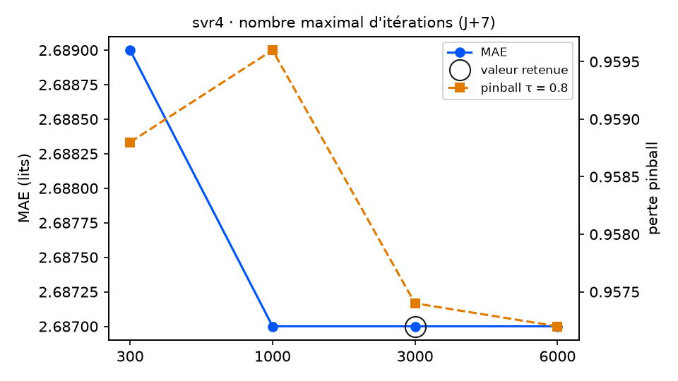

Amplitude de la MAE : 0.1 %. Aucune valeur ne fait significativement mieux que la valeur retenue.

### svr4 · T (décroissance du pas ; aucune = pas constant)

| variante | MAE | RMSE | biais | pinball τ=0.8 | couverture 90 % | temps (s) | DM p (pinball τ=0.8) | p Holm | vs choix retenu |
|---|---|---|---|---|---|---|---|---|---|
| decroissance = aucune | 2.687 | 3.306 | -0.12 | 0.9576 | 89.3 | 9.4 | 0.3938 | 0.5294 | équivalent |
| decroissance = 100 | 2.688 | 3.306 | -0.122 | 0.9579 | 89.3 | 9.9 | 0.2647 | 0.5294 | équivalent |
| decroissance = 500 (retenu) | 2.687 | 3.306 | -0.123 | 0.9574 | 89.3 | 10.4 |  |  | — choix retenu |
| decroissance = 2000 | 2.688 | 3.306 | -0.122 | 0.9571 | 89.3 | 11.8 | 0.0804 | 0.2412 | équivalent |

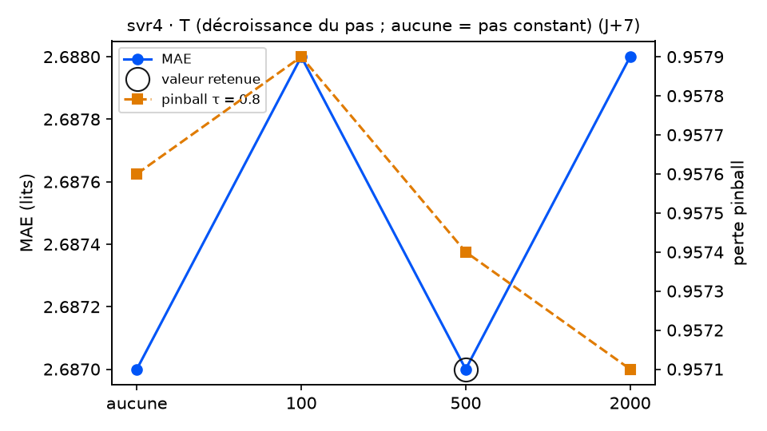

Amplitude de la MAE : 0.0 %. Aucune valeur ne fait significativement mieux que la valeur retenue.

### svr4 · part des pas moyennée (Polyak ; 0 = aucune)

| variante | MAE | RMSE | biais | pinball τ=0.8 | couverture 90 % | temps (s) | DM p (pinball τ=0.8) | p Holm | vs choix retenu |
|---|---|---|---|---|---|---|---|---|---|
| moyenne_polyak = 0 | 2.687 | 3.306 | -0.123 | 0.9574 | 89.3 | 10.8 |  |  | identique |
| moyenne_polyak = 0,25 | 2.687 | 3.306 | -0.123 | 0.9574 | 89.3 | 9.8 |  |  | identique |
| moyenne_polyak = 0,5 (retenu) | 2.687 | 3.306 | -0.123 | 0.9574 | 89.3 | 10.0 |  |  | — choix retenu |
| moyenne_polyak = 0,75 | 2.687 | 3.306 | -0.123 | 0.9574 | 89.3 | 9.8 |  |  | identique |

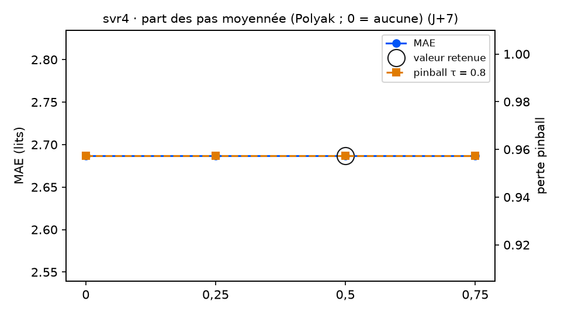

Amplitude de la MAE : 0.0 %. Aucune valeur ne fait significativement mieux que la valeur retenue.

### svr4 · tolérance d'arrêt anticipé

| variante | MAE | RMSE | biais | pinball τ=0.8 | couverture 90 % | temps (s) | DM p (pinball τ=0.8) | p Holm | vs choix retenu |
|---|---|---|---|---|---|---|---|---|---|
| tolerance = 1e-05 | 2.688 | 3.306 | -0.12 | 0.9577 | 88.7 | 7.2 | 0.2436 | 0.2436 | équivalent |
| tolerance = 1e-07 (retenu) | 2.687 | 3.306 | -0.123 | 0.9574 | 89.3 | 10.2 |  |  | — choix retenu |
| tolerance = 1e-09 | 2.687 | 3.306 | -0.123 | 0.9574 | 89.3 | 13.6 |  |  | identique |

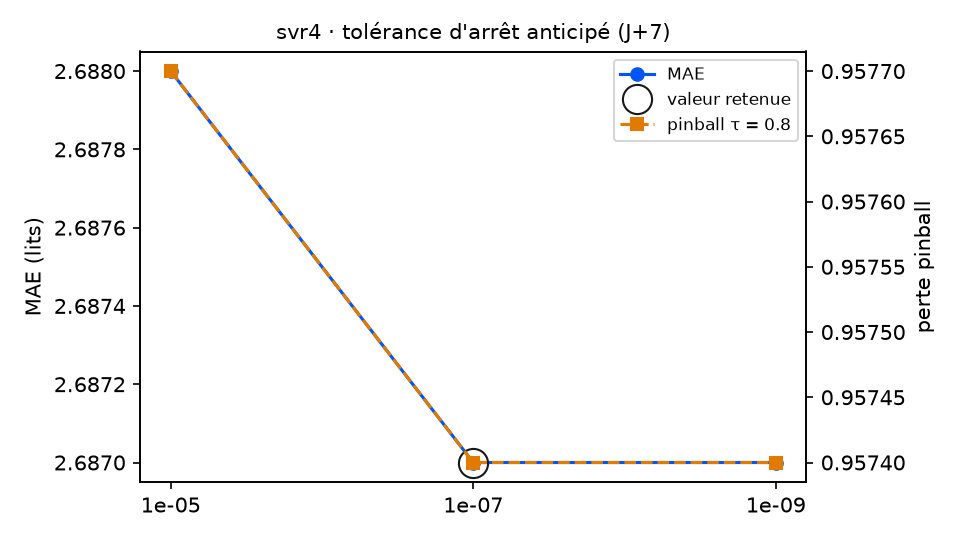

Amplitude de la MAE : 0.0 %. Aucune valeur ne fait significativement mieux que la valeur retenue.

### svr4 · direction préconditionnée α + Cg

| variante | MAE | RMSE | biais | pinball τ=0.8 | couverture 90 % | temps (s) | DM p (pinball τ=0.8) | p Holm | vs choix retenu |
|---|---|---|---|---|---|---|---|---|---|
| preconditionne = True (retenu) | 2.687 | 3.306 | -0.123 | 0.9574 | 89.3 | 10.7 |  |  | — choix retenu |
| preconditionne = False | 2.694 | 3.315 | -0.122 | 0.9581 | 89.3 | 20.2 | 0.194 | 0.194 | équivalent |

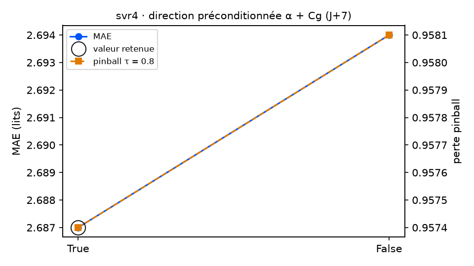

Amplitude de la MAE : 0.3 %. Aucune valeur ne fait significativement mieux que la valeur retenue.

### svr4 · optimiseur

| variante | MAE | RMSE | biais | pinball τ=0.8 | couverture 90 % | temps (s) | DM p (pinball τ=0.8) | p Holm | vs choix retenu |
|---|---|---|---|---|---|---|---|---|---|
| optimiseur = adam (retenu) | 2.687 | 3.306 | -0.123 | 0.9574 | 89.3 | 10.3 |  |  | — choix retenu |
| optimiseur = momentum | 2.687 | 3.306 | -0.124 | 0.9567 | 89.8 | 8.0 | 0.239 | 0.4396 | équivalent |
| optimiseur = sgd | 2.686 | 3.306 | -0.125 | 0.9568 | 89.8 | 6.3 | 0.2198 | 0.4396 | équivalent |

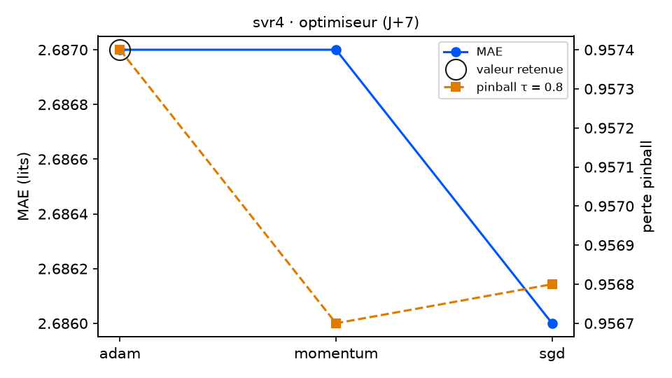

Amplitude de la MAE : 0.0 %. Aucune valeur ne fait significativement mieux que la valeur retenue.

### svr2 · C

| variante | MAE | RMSE | biais | pinball τ=0.8 | temps (s) | DM p (pinball τ=0.8) | p Holm | vs choix retenu |
|---|---|---|---|---|---|---|---|---|
| C = 0,1 | 2.738 | 3.351 | 0.048 | 1.3546 | 0.3 | 0.595 | 1.0 | équivalent |
| C = 0,3 (retenu) | 2.763 | 3.371 | 0.048 | 1.3671 | 0.3 |  |  | — choix retenu |
| C = 1 | 2.846 | 3.407 | 0.038 | 1.4115 | 0.6 | 0.1759 | 0.8795 | équivalent |
| C = 3 | 2.928 | 3.502 | 0.086 | 1.4378 | 1.5 | 0.2749 | 1.0 | équivalent |
| C = 10 | 3.068 | 3.763 | 0.334 | 1.4339 | 1.9 | 0.4984 | 1.0 | équivalent |
| C = 30 | 3.149 | 3.857 | 0.44 | 1.4426 | 1.9 | 0.4728 | 1.0 | équivalent |

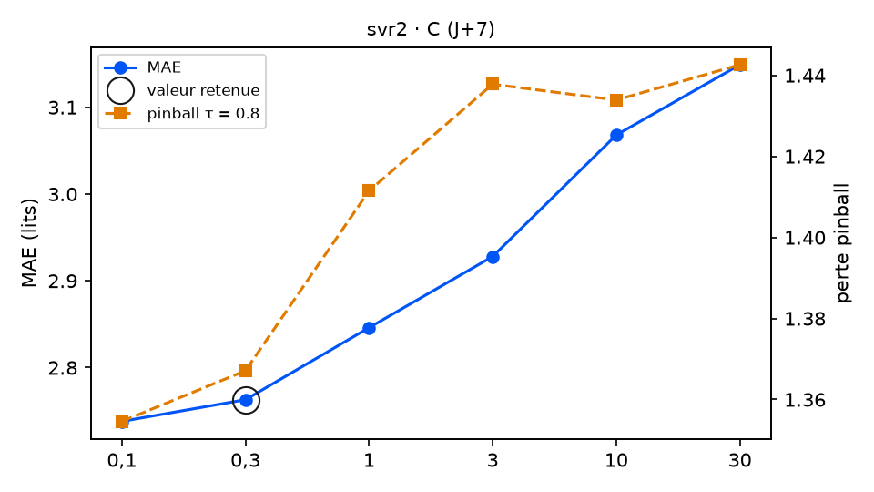

Amplitude de la MAE : 14.9 %. Aucune valeur ne fait significativement mieux que la valeur retenue.

### svr2 · ε (tube ε-insensible, en lits)

| variante | MAE | RMSE | biais | pinball τ=0.8 | temps (s) | DM p (pinball τ=0.8) | p Holm | vs choix retenu |
|---|---|---|---|---|---|---|---|---|
| epsilon = 0 | 2.752 | 3.357 | 0.084 | 1.3511 | 0.4 | 0.0238 | 0.0952 | équivalent |
| epsilon = 0,25 | 2.748 | 3.355 | 0.043 | 1.3611 | 0.3 | 0.2709 | 0.388 | équivalent |
| epsilon = 0,5 (retenu) | 2.763 | 3.371 | 0.048 | 1.3671 | 0.3 |  |  | — choix retenu |
| epsilon = 1 | 2.773 | 3.388 | 0.004 | 1.3851 | 0.6 | 0.0381 | 0.1143 | équivalent |
| epsilon = 2 | 2.758 | 3.376 | -0.011 | 1.3825 | 0.4 | 0.194 | 0.388 | équivalent |

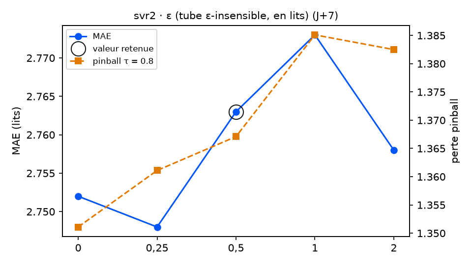

Amplitude de la MAE : 0.9 %. Aucune valeur ne fait significativement mieux que la valeur retenue.

### svr2 · γ (portée du noyau RBF)

| variante | MAE | RMSE | biais | pinball τ=0.8 | temps (s) | DM p (pinball τ=0.8) | p Holm | vs choix retenu |
|---|---|---|---|---|---|---|---|---|
| gamma = 0,005 | 2.793 | 3.443 | -0.073 | 1.4184 | 0.6 | 0.2041 | 0.4082 | équivalent |
| gamma = 0,01 | 2.814 | 3.463 | -0.095 | 1.4357 | 0.7 | 0.1018 | 0.3054 | équivalent |
| gamma = 0,02 | 2.817 | 3.466 | -0.106 | 1.4401 | 0.8 | 0.0489 | 0.1956 | équivalent |
| gamma = 0,05 | 2.793 | 3.431 | -0.056 | 1.4132 | 0.4 | 0.0232 | 0.116 | équivalent |
| gamma = 0,1 | 2.78 | 3.399 | -0.002 | 1.3906 | 0.5 | 0.0133 | 0.0798 | équivalent |
| gamma = 0,2 (retenu) | 2.763 | 3.371 | 0.048 | 1.3671 | 0.3 |  |  | — choix retenu |
| gamma = 0,5 | 2.737 | 3.348 | 0.069 | 1.3476 | 0.3 | 0.5271 | 0.5271 | équivalent |

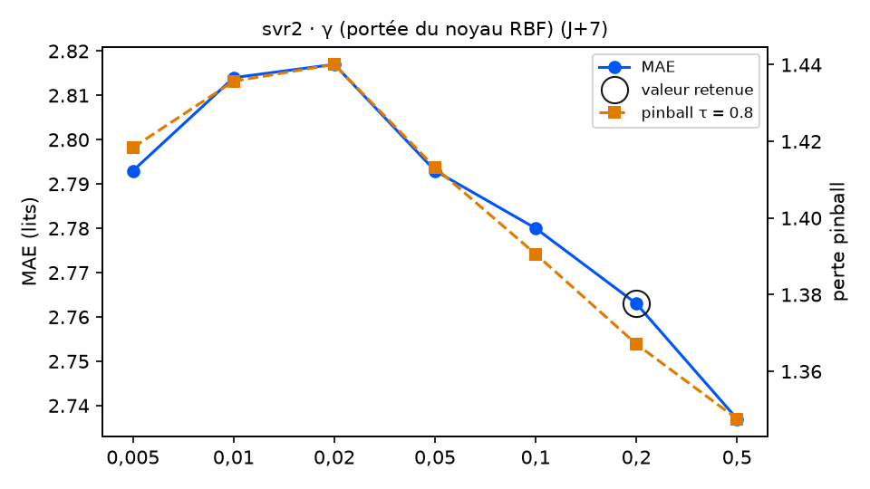

Amplitude de la MAE : 2.9 %. Aucune valeur ne fait significativement mieux que la valeur retenue.

### foret · nombre d'arbres

| variante | MAE | RMSE | biais | pinball τ=0.8 | couverture 90 % | temps (s) | DM p (pinball τ=0.8) | p Holm | vs choix retenu |
|---|---|---|---|---|---|---|---|---|---|
| arbres = 25 | 2.824 | 3.426 | -0.214 | 1.0038 | 89.3 | 1.8 | 0.6665 | 1.0 | équivalent |
| arbres = 50 | 2.781 | 3.374 | -0.207 | 1.0055 | 91.0 | 3.6 | 0.4969 | 1.0 | équivalent |
| arbres = 100 | 2.735 | 3.345 | -0.196 | 0.9917 | 91.0 | 6.9 | 0.9555 | 1.0 | équivalent |
| arbres = 300 (retenu) | 2.756 | 3.353 | -0.183 | 0.9926 | 91.5 | 20.9 |  |  | — choix retenu |
| arbres = 500 | 2.768 | 3.375 | -0.148 | 0.9813 | 92.1 | 34.8 | 0.124 | 0.496 | équivalent |

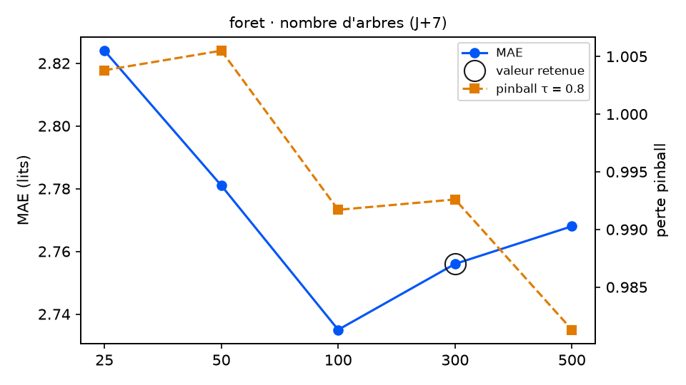

Amplitude de la MAE : 3.2 %. Aucune valeur ne fait significativement mieux que la valeur retenue.

### foret · profondeur maximale

| variante | MAE | RMSE | biais | pinball τ=0.8 | couverture 90 % | temps (s) | DM p (pinball τ=0.8) | p Holm | vs choix retenu |
|---|---|---|---|---|---|---|---|---|---|
| profondeur_foret = 3 | 2.698 | 3.357 | -0.085 | 1.0012 | 94.4 | 2.4 | 0.7873 | 1.0 | équivalent |
| profondeur_foret = 5 | 2.782 | 3.403 | -0.177 | 0.9957 | 93.2 | 6.0 | 0.8457 | 1.0 | équivalent |
| profondeur_foret = 8 | 2.765 | 3.363 | -0.196 | 0.9917 | 92.7 | 13.8 | 0.9444 | 1.0 | équivalent |
| profondeur_foret = 12 (retenu) | 2.756 | 3.353 | -0.183 | 0.9926 | 91.5 | 20.6 |  |  | — choix retenu |
| profondeur_foret = 20 | 2.777 | 3.39 | -0.131 | 0.9739 | 91.5 | 22.6 | 0.1073 | 0.4292 | équivalent |

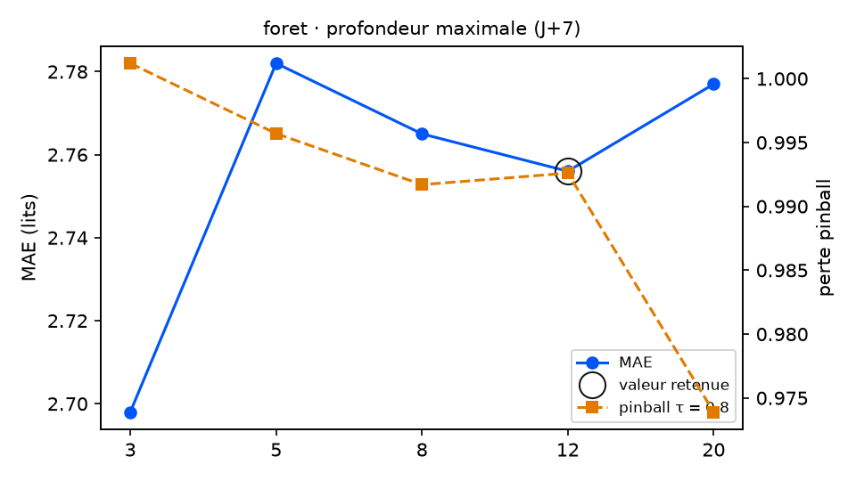

Amplitude de la MAE : 3.0 %. Aucune valeur ne fait significativement mieux que la valeur retenue.

### foret · taille minimale d'une feuille

| variante | MAE | RMSE | biais | pinball τ=0.8 | couverture 90 % | temps (s) | DM p (pinball τ=0.8) | p Holm | vs choix retenu |
|---|---|---|---|---|---|---|---|---|---|
| min_feuille = 2 | 2.796 | 3.409 | -0.142 | 0.986 | 92.1 | 38.7 | 0.6805 | 1.0 | équivalent |
| min_feuille = 5 (retenu) | 2.756 | 3.353 | -0.183 | 0.9926 | 91.5 | 20.4 |  |  | — choix retenu |
| min_feuille = 10 | 2.77 | 3.399 | -0.164 | 0.9728 | 92.1 | 11.9 | 0.158 | 0.474 | équivalent |
| min_feuille = 20 | 2.782 | 3.4 | -0.09 | 0.9876 | 93.8 | 6.6 | 0.8508 | 1.0 | équivalent |

Amplitude de la MAE : 1.5 %. Aucune valeur ne fait significativement mieux que la valeur retenue.

### foret · part des variables tirées par nœud

| variante | MAE | RMSE | biais | pinball τ=0.8 | couverture 90 % | temps (s) | DM p (pinball τ=0.8) | p Holm | vs choix retenu |
|---|---|---|---|---|---|---|---|---|---|
| part_variables = 0,15 | 2.738 | 3.363 | -0.115 | 0.982 | 92.7 | 18.9 | 0.4956 | 1.0 | équivalent |
| part_variables = 0,333333 (retenu) | 2.756 | 3.353 | -0.183 | 0.9926 | 91.5 | 20.2 |  |  | — choix retenu |
| part_variables = 0,5 | 2.801 | 3.399 | -0.21 | 0.9808 | 92.1 | 21.1 | 0.3548 | 1.0 | équivalent |
| part_variables = 1 | 2.78 | 3.371 | -0.195 | 0.9975 | 91.0 | 22.0 | 0.7317 | 1.0 | équivalent |

Amplitude de la MAE : 2.3 %. Aucune valeur ne fait significativement mieux que la valeur retenue.

### boosting · nombre d'étapes

| variante | MAE | RMSE | biais | pinball τ=0.8 | couverture 90 % | temps (s) | DM p (pinball τ=0.8) | p Holm | vs choix retenu |
|---|---|---|---|---|---|---|---|---|---|
| etapes = 50 | 2.787 | 3.417 | -0.173 | 0.9891 | 84.2 | 2.1 | 0.3069 | 0.5048 | équivalent |
| etapes = 100 | 2.82 | 3.453 | -0.224 | 0.9984 | 82.5 | 4.0 | 0.2524 | 0.5048 | équivalent |
| etapes = 300 (retenu) | 2.885 | 3.54 | -0.349 | 1.0299 | 73.4 | 11.5 |  |  | — choix retenu |
| etapes = 600 | 2.911 | 3.575 | -0.41 | 1.0529 | 71.8 | 22.2 | 0.1399 | 0.4197 | équivalent |

Amplitude de la MAE : 4.3 %. Aucune valeur ne fait significativement mieux que la valeur retenue.

### boosting · taux ν (shrinkage)

| variante | MAE | RMSE | biais | pinball τ=0.8 | couverture 90 % | temps (s) | DM p (pinball τ=0.8) | p Holm | vs choix retenu |
|---|---|---|---|---|---|---|---|---|---|
| taux_boosting = 0,01 | 2.797 | 3.429 | -0.187 | 1.0117 | 83.1 | 11.7 | 0.6039 | 0.89 | équivalent |
| taux_boosting = 0,05 (retenu) | 2.885 | 3.54 | -0.349 | 1.0299 | 73.4 | 11.5 |  |  | — choix retenu |
| taux_boosting = 0,1 | 2.923 | 3.531 | -0.506 | 1.0438 | 71.2 | 11.2 | 0.445 | 0.89 | équivalent |
| taux_boosting = 0,2 | 2.984 | 3.64 | -0.573 | 1.0832 | 67.2 | 11.3 | 0.2109 | 0.6327 | équivalent |

Amplitude de la MAE : 6.5 %. Aucune valeur ne fait significativement mieux que la valeur retenue.

### boosting · profondeur des arbres

| variante | MAE | RMSE | biais | pinball τ=0.8 | couverture 90 % | temps (s) | DM p (pinball τ=0.8) | p Holm | vs choix retenu |
|---|---|---|---|---|---|---|---|---|---|
| profondeur_boosting = 1 | 2.84 | 3.501 | -0.295 | 1.0223 | 83.6 | 3.8 | 0.8576 | 1.0 | équivalent |
| profondeur_boosting = 2 | 2.897 | 3.556 | -0.374 | 1.0061 | 81.9 | 7.4 | 0.4745 | 1.0 | équivalent |
| profondeur_boosting = 3 (retenu) | 2.885 | 3.54 | -0.349 | 1.0299 | 73.4 | 12.4 |  |  | — choix retenu |
| profondeur_boosting = 5 | 2.878 | 3.49 | -0.263 | 1.0504 | 66.1 | 23.4 | 0.5111 | 1.0 | équivalent |

Amplitude de la MAE : 2.0 %. Aucune valeur ne fait significativement mieux que la valeur retenue.

### boosting · part du sous-échantillon

| variante | MAE | RMSE | biais | pinball τ=0.8 | couverture 90 % | temps (s) | DM p (pinball τ=0.8) | p Holm | vs choix retenu |
|---|---|---|---|---|---|---|---|---|---|
| sous_echantillon = 0,5 | 2.916 | 3.539 | -0.446 | 1.019 | 74.0 | 9.9 | 0.558 | 1.0 | équivalent |
| sous_echantillon = 0,8 (retenu) | 2.885 | 3.54 | -0.349 | 1.0299 | 73.4 | 12.1 |  |  | — choix retenu |
| sous_echantillon = 1 | 2.825 | 3.477 | -0.271 | 1.0554 | 80.8 | 12.2 | 0.5835 | 1.0 | équivalent |

Amplitude de la MAE : 3.2 %. Aucune valeur ne fait significativement mieux que la valeur retenue.

### mlp · architecture (neurones par couche)

| variante | MAE | RMSE | biais | pinball τ=0.8 | couverture 90 % | temps (s) | DM p (pinball τ=0.8) | p Holm | vs choix retenu |
|---|---|---|---|---|---|---|---|---|---|
| couches = 8 | 2.851 | 3.455 | -0.276 | 0.9741 | 85.3 | 0.8 | 0.5059 | 1.0 | équivalent |
| couches = 32 | 2.909 | 3.538 | -0.47 | 0.9891 | 88.7 | 0.9 | 0.4394 | 1.0 | équivalent |
| couches = 32×16 (retenu) | 2.838 | 3.5 | -0.334 | 1.008 | 84.7 | 1.2 |  |  | — choix retenu |
| couches = 64×32 | 2.855 | 3.51 | -0.656 | 1.0033 | 87.0 | 1.6 | 0.8783 | 1.0 | équivalent |
| couches = 32×16×8 | 2.756 | 3.392 | 0.153 | 0.9626 | 84.2 | 1.4 | 0.2833 | 1.0 | équivalent |

Amplitude de la MAE : 5.4 %. Aucune valeur ne fait significativement mieux que la valeur retenue.

### mlp · taux d'apprentissage

| variante | MAE | RMSE | biais | pinball τ=0.8 | couverture 90 % | temps (s) | DM p (pinball τ=0.8) | p Holm | vs choix retenu |
|---|---|---|---|---|---|---|---|---|---|
| taux_reseau = 0,001 | 2.816 | 3.521 | -0.189 | 1.007 | 79.7 | 2.3 | 0.9774 | 1.0 | équivalent |
| taux_reseau = 0,003 | 2.852 | 3.543 | -0.258 | 1.001 | 81.9 | 1.4 | 0.7339 | 1.0 | équivalent |
| taux_reseau = 0,01 (retenu) | 2.838 | 3.5 | -0.334 | 1.008 | 84.7 | 1.1 |  |  | — choix retenu |
| taux_reseau = 0,03 | 2.788 | 3.437 | -0.15 | 0.9814 | 84.2 | 1.0 | 0.0399 | 0.1197 | équivalent |

Amplitude de la MAE : 2.3 %. Aucune valeur ne fait significativement mieux que la valeur retenue.

### mlp · pénalité L2 λ

| variante | MAE | RMSE | biais | pinball τ=0.8 | couverture 90 % | temps (s) | DM p (pinball τ=0.8) | p Holm | vs choix retenu |
|---|---|---|---|---|---|---|---|---|---|
| lambda_ = 0 | 2.847 | 3.512 | -0.338 | 1.0102 | 84.7 | 1.1 | 0.7152 | 1.0 | équivalent |
| lambda_ = 0,0001 | 2.846 | 3.509 | -0.348 | 1.0134 | 84.7 | 1.1 | 0.3435 | 1.0 | équivalent |
| lambda_ = 0,001 (retenu) | 2.838 | 3.5 | -0.334 | 1.008 | 84.7 | 1.2 |  |  | — choix retenu |
| lambda_ = 0,01 | 2.791 | 3.448 | -0.318 | 1.0136 | 83.6 | 1.2 | 0.7417 | 1.0 | équivalent |
| lambda_ = 0,1 | 2.726 | 3.344 | 0.093 | 0.9882 | 87.0 | 2.8 | 0.7462 | 1.0 | équivalent |

Amplitude de la MAE : 4.3 %. Aucune valeur ne fait significativement mieux que la valeur retenue.

### mlp · époques maximales

| variante | MAE | RMSE | biais | pinball τ=0.8 | couverture 90 % | temps (s) | DM p (pinball τ=0.8) | p Holm | vs choix retenu |
|---|---|---|---|---|---|---|---|---|---|
| epoques = 300 | 2.838 | 3.5 | -0.334 | 1.008 | 84.7 | 1.2 |  |  | identique |
| epoques = 800 | 2.838 | 3.5 | -0.334 | 1.008 | 84.7 | 1.2 |  |  | identique |
| epoques = 1500 (retenu) | 2.838 | 3.5 | -0.334 | 1.008 | 84.7 | 1.2 |  |  | — choix retenu |
| epoques = 3000 | 2.838 | 3.5 | -0.334 | 1.008 | 84.7 | 1.2 |  |  | identique |

Amplitude de la MAE : 0.0 %. Aucune valeur ne fait significativement mieux que la valeur retenue.

### mlp · patience de l'arrêt anticipé

| variante | MAE | RMSE | biais | pinball τ=0.8 | couverture 90 % | temps (s) | DM p (pinball τ=0.8) | p Holm | vs choix retenu |
|---|---|---|---|---|---|---|---|---|---|
| patience = 50 | 2.838 | 3.5 | -0.334 | 1.008 | 84.7 | 0.6 |  |  | identique |
| patience = 150 (retenu) | 2.838 | 3.5 | -0.334 | 1.008 | 84.7 | 1.2 |  |  | — choix retenu |
| patience = 300 | 2.838 | 3.5 | -0.334 | 1.008 | 84.7 | 2.2 |  |  | identique |

Amplitude de la MAE : 0.0 %. Aucune valeur ne fait significativement mieux que la valeur retenue.

### mlp · nombre d'initialisations moyennées

| variante | MAE | RMSE | biais | pinball τ=0.8 | couverture 90 % | temps (s) | DM p (pinball τ=0.8) | p Holm | vs choix retenu |
|---|---|---|---|---|---|---|---|---|---|
| graines = 1 | 2.846 | 3.503 | -0.484 | 1.1307 | 83.1 | 0.5 | 0.0231 | 0.0462 | moins bon |
| graines = 3 (retenu) | 2.838 | 3.5 | -0.334 | 1.008 | 84.7 | 1.2 |  |  | — choix retenu |
| graines = 5 | 2.805 | 3.474 | -0.332 | 1.0063 | 85.3 | 2.1 | 0.9626 | 0.9626 | équivalent |

Amplitude de la MAE : 1.4 %. Aucune valeur ne fait significativement mieux que la valeur retenue.

### lstm · taille de l'état caché H

| variante | MAE | RMSE | biais | pinball τ=0.8 | couverture 90 % | temps (s) | DM p (pinball τ=0.8) | p Holm | vs choix retenu |
|---|---|---|---|---|---|---|---|---|---|
| cache_lstm = 4 | 2.901 | 3.576 | 0.0 | 1.0438 | 88.1 | 5.9 | 0.4108 | 0.8216 | équivalent |
| cache_lstm = 8 | 3.004 | 3.64 | -0.117 | 1.0412 | 82.5 | 7.8 | 0.495 | 0.8216 | équivalent |
| cache_lstm = 16 (retenu) | 2.953 | 3.62 | -0.15 | 1.0173 | 85.3 | 10.3 |  |  | — choix retenu |
| cache_lstm = 32 | 2.985 | 3.627 | -0.217 | 1.077 | 86.4 | 16.9 | 0.0257 | 0.0771 | équivalent |

Amplitude de la MAE : 3.5 %. Aucune valeur ne fait significativement mieux que la valeur retenue.

### lstm · taux d'apprentissage

| variante | MAE | RMSE | biais | pinball τ=0.8 | couverture 90 % | temps (s) | DM p (pinball τ=0.8) | p Holm | vs choix retenu |
|---|---|---|---|---|---|---|---|---|---|
| taux_reseau = 0,003 | 2.875 | 3.524 | -0.141 | 1.0142 | 84.2 | 13.2 | 0.852 | 0.852 | équivalent |
| taux_reseau = 0,01 (retenu) | 2.953 | 3.62 | -0.15 | 1.0173 | 85.3 | 10.5 |  |  | — choix retenu |
| taux_reseau = 0,03 | 2.98 | 3.643 | -0.232 | 1.0557 | 84.7 | 9.6 | 0.0995 | 0.199 | équivalent |

Amplitude de la MAE : 3.6 %. Aucune valeur ne fait significativement mieux que la valeur retenue.

### lstm · pénalité L2 λ

| variante | MAE | RMSE | biais | pinball τ=0.8 | couverture 90 % | temps (s) | DM p (pinball τ=0.8) | p Holm | vs choix retenu |
|---|---|---|---|---|---|---|---|---|---|
| lambda_ = 0 | 2.948 | 3.622 | -0.139 | 1.0154 | 85.9 | 9.6 | 0.7526 | 1.0 | équivalent |
| lambda_ = 0,001 (retenu) | 2.953 | 3.62 | -0.15 | 1.0173 | 85.3 | 10.9 |  |  | — choix retenu |
| lambda_ = 0,01 | 2.945 | 3.617 | -0.139 | 1.0275 | 81.9 | 10.4 | 0.6006 | 1.0 | équivalent |

Amplitude de la MAE : 0.3 %. Aucune valeur ne fait significativement mieux que la valeur retenue.

### variables · jours d'occupation passée en entrée

| variante | MAE | RMSE | biais | pinball τ=0.8 | couverture 90 % | temps (s) | DM p (pinball τ=0.8) | p Holm | vs choix retenu |
|---|---|---|---|---|---|---|---|---|---|
| retards = 3 | 2.688 | 3.307 | -0.123 | 0.9569 | 89.3 | 8.3 | 0.1233 | 0.6165 | équivalent |
| retards = 5 | 2.687 | 3.306 | -0.122 | 0.9572 | 89.3 | 8.4 | 0.2322 | 0.8324 | équivalent |
| retards = 7 (retenu) | 2.687 | 3.306 | -0.123 | 0.9574 | 89.3 | 9.7 |  |  | — choix retenu |
| retards = 10 | 2.69 | 3.308 | -0.114 | 0.9573 | 89.3 | 8.6 | 0.705 | 0.8324 | équivalent |
| retards = 14 | 2.702 | 3.319 | -0.119 | 0.9569 | 89.8 | 7.8 | 0.2081 | 0.8324 | équivalent |
| retards = 21 | 2.703 | 3.302 | 0.018 | 0.9527 | 89.8 | 4.7 | 0.2201 | 0.8324 | équivalent |

Amplitude de la MAE : 0.6 %. Aucune valeur ne fait significativement mieux que la valeur retenue.

