# Sensibilité de tous les paramètres — service MEDF

Un paramètre varie à la fois, tout le reste au réglage retenu (marqué « retenu »). Mêmes jours, même validation glissante. Diebold-Mariano (perte absolue, HLN) contre la valeur retenue. Amplitude = (MAE max − MAE min) / MAE retenue.

## Synthèse

| paramètre | horizon | famille | valeur retenue | meilleure valeur (MAE) | amplitude MAE % | verdict |
|---|---|---|---|---|---|---|
| C (poids des erreurs) | 1 | svr4 | 3 | 10 | 29.2 | défendable |
| ε (tube, niveaux quantiles) | 1 | svr4 | 0 | 0,5 | 1.5 | défendable |
| γ₁ (portée, bloc occupation) | 1 | svr4 | 0,1 | 0,05 | 10.6 | défendable |
| γ₂ (portée, bloc flux et saison) | 1 | svr4 | 0,05 | 0,02 | 4.8 | défendable |
| τ (quantile décisionnel) | 1 | svr4 | 0,8 | 0,5 | 0.1 | défendable |
| η₀ (taux d'apprentissage d'Adam) | 1 | svr4 | 0,05 | 0,005 | 0.2 | à revoir : 0,005, 0,01, 0,02 |
| nombre maximal d'itérations | 1 | svr4 | 3000 | 300 | 0.1 | à revoir : 300, 1000, 6000 |
| T (décroissance du pas ; aucune = pas constant) | 1 | svr4 | 500 | aucune | 0.1 | défendable |
| part des pas moyennée (Polyak ; 0 = aucune) | 1 | svr4 | 0,5 | 0 | 0.0 | défendable |
| tolérance d'arrêt anticipé | 1 | svr4 | 1e-07 | 1e-05 | 0.1 | à revoir : 1e-05 |
| direction préconditionnée α + Cg | 1 | svr4 | True | True (retenu) | 0.1 | défendable |
| optimiseur | 1 | svr4 | adam | adam (retenu) | 25.1 | défendable |
| C | 1 | svr2 | 3 | 10 | 37.0 | défendable |
| ε (tube ε-insensible, en lits) | 1 | svr2 | 1 | 1 (retenu) | 4.1 | défendable |
| γ (portée du noyau RBF) | 1 | svr2 | 0,02 | 0,02 (retenu) | 39.3 | défendable |
| nombre d'arbres | 1 | foret | 300 | 25 | 2.6 | défendable |
| profondeur maximale | 1 | foret | 12 | 8 | 3.9 | défendable |
| taille minimale d'une feuille | 1 | foret | 5 | 10 | 1.3 | défendable |
| part des variables tirées par nœud | 1 | foret | 0,333333 | 0,5 | 7.5 | à revoir : 0,5 |
| nombre d'étapes | 1 | boosting | 300 | 100 | 4.4 | à revoir : 50, 100 |
| taux ν (shrinkage) | 1 | boosting | 0,05 | 0,01 | 7.7 | à revoir : 0,01 |
| profondeur des arbres | 1 | boosting | 3 | 1 | 7.1 | à revoir : 1, 2 |
| part du sous-échantillon | 1 | boosting | 0,8 | 1 | 4.4 | défendable |
| architecture (neurones par couche) | 1 | mlp | 32×16 | 64×32 | 9.8 | défendable |
| taux d'apprentissage | 1 | mlp | 0,01 | 0,03 | 10.6 | défendable |
| pénalité L2 λ | 1 | mlp | 0,001 | 0,01 | 4.3 | défendable |
| époques maximales | 1 | mlp | 1500 | 300 | 0.0 | défendable |
| patience de l'arrêt anticipé | 1 | mlp | 150 | 50 | 0.0 | défendable |
| nombre d'initialisations moyennées | 1 | mlp | 3 | 1 | 5.6 | défendable |
| taille de l'état caché H | 1 | lstm | 16 | 4 | 2.9 | défendable |
| taux d'apprentissage | 1 | lstm | 0,01 | 0,003 | 1.6 | défendable |
| pénalité L2 λ | 1 | lstm | 0,001 | 0,01 | 2.4 | défendable |
| jours d'occupation passée en entrée | 1 | variables | 7 | 3 | 13.6 | défendable |
| C (poids des erreurs) | 7 | svr4 | 0,3 | 10 | 4.6 | défendable |
| ε (tube, niveaux quantiles) | 7 | svr4 | 0 | 0,25 | 0.5 | défendable |
| γ₁ (portée, bloc occupation) | 7 | svr4 | 0,02 | 0,1 | 0.9 | défendable |
| γ₂ (portée, bloc flux et saison) | 7 | svr4 | 0,05 | 0,2 | 2.4 | défendable |
| τ (quantile décisionnel) | 7 | svr4 | 0,8 | 0,5 | 0.0 | défendable |
| η₀ (taux d'apprentissage d'Adam) | 7 | svr4 | 0,05 | 0,005 | 0.1 | défendable |
| nombre maximal d'itérations | 7 | svr4 | 3000 | 3000 (retenu) | 0.0 | défendable |
| T (décroissance du pas ; aucune = pas constant) | 7 | svr4 | 500 | 100 | 0.0 | défendable |
| part des pas moyennée (Polyak ; 0 = aucune) | 7 | svr4 | 0,5 | 0 | 0.0 | défendable |
| tolérance d'arrêt anticipé | 7 | svr4 | 1e-07 | 1e-05 | 0.0 | défendable |
| direction préconditionnée α + Cg | 7 | svr4 | True | True (retenu) | 0.0 | défendable |
| optimiseur | 7 | svr4 | adam | adam (retenu) | 0.0 | défendable |
| C | 7 | svr2 | 3 | 3 (retenu) | 2.4 | défendable |
| ε (tube ε-insensible, en lits) | 7 | svr2 | 0,5 | 0 | 1.7 | défendable |
| γ (portée du noyau RBF) | 7 | svr2 | 0,05 | 0,2 | 6.7 | défendable |
| nombre d'arbres | 7 | foret | 300 | 25 | 1.0 | défendable |
| profondeur maximale | 7 | foret | 12 | 12 (retenu) | 1.1 | défendable |
| taille minimale d'une feuille | 7 | foret | 5 | 2 | 1.9 | défendable |
| part des variables tirées par nœud | 7 | foret | 0,333333 | 1 | 2.6 | défendable |
| nombre d'étapes | 7 | boosting | 300 | 50 | 5.8 | à revoir : 50, 100 |
| taux ν (shrinkage) | 7 | boosting | 0,05 | 0,01 | 8.4 | à revoir : 0,01 |
| profondeur des arbres | 7 | boosting | 3 | 2 | 1.7 | à revoir : 1, 2 |
| part du sous-échantillon | 7 | boosting | 0,8 | 0,8 (retenu) | 1.6 | défendable |
| architecture (neurones par couche) | 7 | mlp | 32×16 | 32×16×8 | 27.8 | défendable |
| taux d'apprentissage | 7 | mlp | 0,01 | 0,003 | 2.4 | défendable |
| pénalité L2 λ | 7 | mlp | 0,001 | 0,1 | 10.3 | défendable |
| époques maximales | 7 | mlp | 1500 | 300 | 0.0 | défendable |
| patience de l'arrêt anticipé | 7 | mlp | 150 | 50 | 1.4 | défendable |
| nombre d'initialisations moyennées | 7 | mlp | 3 | 3 (retenu) | 2.3 | défendable |
| taille de l'état caché H | 7 | lstm | 16 | 4 | 12.5 | défendable |
| taux d'apprentissage | 7 | lstm | 0,01 | 0,003 | 0.2 | défendable |
| pénalité L2 λ | 7 | lstm | 0,001 | 0,01 | 2.3 | défendable |
| jours d'occupation passée en entrée | 7 | variables | 7 | 14 | 1.3 | à revoir : 3 |

## Horizon J+1

### svr4 · C (poids des erreurs)

| variante | MAE | RMSE | biais | pinball τ=0.8 | couverture 90 % | temps (s) | DM p (pinball τ=0.8) | p Holm | DM p (MAE) | vs choix retenu |
|---|---|---|---|---|---|---|---|---|---|---|
| C = 0,1 | 2.451 | 2.937 | -0.894 | 0.8329 | 89.1 | 6.1 | 0.0013 | 0.0065 | 0.0 | moins bon |
| C = 0,3 | 2.206 | 2.646 | -0.748 | 0.7644 | 90.2 | 7.8 | 0.0295 | 0.118 | 0.0006 | équivalent |
| C = 1 | 1.996 | 2.412 | -0.533 | 0.7034 | 90.7 | 5.4 | 0.3794 | 0.7588 | 0.1585 | équivalent |
| C = 3 (retenu) | 1.941 | 2.361 | -0.495 | 0.6897 | 85.8 | 7.1 |  |  |  | — choix retenu |
| C = 10 | 1.885 | 2.356 | -0.396 | 0.7065 | 74.3 | 11.5 | 0.3907 | 0.7588 | 0.112 | équivalent |
| C = 30 | 1.902 | 2.394 | -0.371 | 0.7366 | 68.3 | 13.0 | 0.1723 | 0.5169 | 0.512 | équivalent |

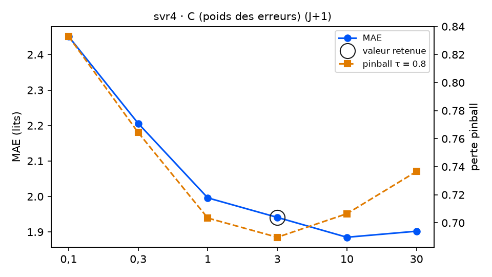

Amplitude de la MAE : 29.2 %. Aucune valeur ne fait significativement mieux que la valeur retenue.

### svr4 · ε (tube, niveaux quantiles)

| variante | MAE | RMSE | biais | pinball τ=0.8 | couverture 90 % | temps (s) | DM p (pinball τ=0.8) | p Holm | DM p (MAE) | vs choix retenu |
|---|---|---|---|---|---|---|---|---|---|---|
| epsilon_quantile = 0 (retenu) | 1.941 | 2.361 | -0.495 | 0.6897 | 85.8 | 9.4 |  |  |  | — choix retenu |
| epsilon_quantile = 0,25 | 1.923 | 2.348 | -0.483 | 0.707 | 82.0 | 7.4 | 0.0048 | 0.0088 | 0.0819 | moins bon |
| epsilon_quantile = 0,5 | 1.911 | 2.338 | -0.515 | 0.7192 | 78.1 | 11.3 | 0.0044 | 0.0088 | 0.0874 | moins bon |
| epsilon_quantile = 1 | 1.914 | 2.347 | -0.43 | 0.7645 | 72.1 | 10.5 | 0.0002 | 0.0006 | 0.247 | moins bon |

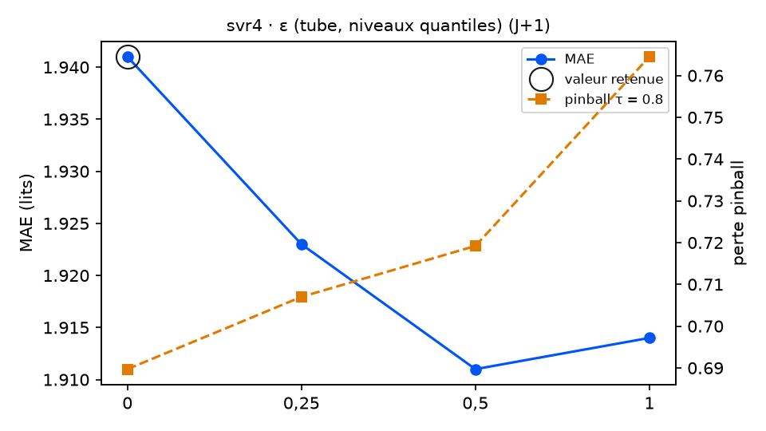

Amplitude de la MAE : 1.5 %. Aucune valeur ne fait significativement mieux que la valeur retenue.

### svr4 · γ₁ (portée, bloc occupation)

| variante | MAE | RMSE | biais | pinball τ=0.8 | couverture 90 % | temps (s) | DM p (pinball τ=0.8) | p Holm | DM p (MAE) | vs choix retenu |
|---|---|---|---|---|---|---|---|---|---|---|
| gamma1 = 0,01 | 2.052 | 2.486 | -0.656 | 0.7656 | 86.3 | 8.3 | 0.0029 | 0.0116 | 0.0611 | moins bon |
| gamma1 = 0,02 | 1.964 | 2.401 | -0.602 | 0.7124 | 86.3 | 8.8 | 0.2008 | 0.4016 | 0.6328 | équivalent |
| gamma1 = 0,05 | 1.907 | 2.345 | -0.526 | 0.6838 | 88.0 | 8.2 | 0.5779 | 0.5779 | 0.1037 | équivalent |
| gamma1 = 0,1 (retenu) | 1.941 | 2.361 | -0.495 | 0.6897 | 85.8 | 7.3 |  |  |  | — choix retenu |
| gamma1 = 0,2 | 1.985 | 2.422 | -0.479 | 0.7196 | 84.2 | 10.8 | 0.0095 | 0.0285 | 0.0877 | moins bon |
| gamma1 = 0,5 | 2.112 | 2.538 | -0.504 | 0.7917 | 79.8 | 8.4 | 0.0001 | 0.0005 | 0.0008 | moins bon |

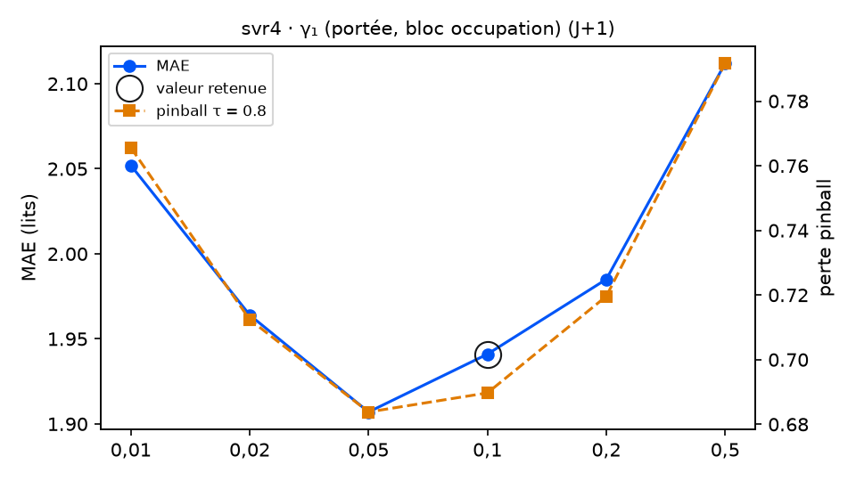

Amplitude de la MAE : 10.6 %. Aucune valeur ne fait significativement mieux que la valeur retenue.

### svr4 · γ₂ (portée, bloc flux et saison)

| variante | MAE | RMSE | biais | pinball τ=0.8 | couverture 90 % | temps (s) | DM p (pinball τ=0.8) | p Holm | DM p (MAE) | vs choix retenu |
|---|---|---|---|---|---|---|---|---|---|---|
| gamma2 = 0,02 | 1.931 | 2.357 | -0.46 | 0.6771 | 88.0 | 8.6 | 0.3231 | 0.3231 | 0.5819 | équivalent |
| gamma2 = 0,05 (retenu) | 1.941 | 2.361 | -0.495 | 0.6897 | 85.8 | 5.6 |  |  |  | — choix retenu |
| gamma2 = 0,1 | 1.963 | 2.38 | -0.518 | 0.7041 | 85.8 | 7.7 | 0.0921 | 0.1842 | 0.1695 | équivalent |
| gamma2 = 0,2 | 1.987 | 2.425 | -0.566 | 0.721 | 83.1 | 5.2 | 0.0318 | 0.0954 | 0.1439 | équivalent |
| gamma2 = 0,5 | 2.024 | 2.465 | -0.577 | 0.7397 | 82.5 | 6.4 | 0.0086 | 0.0344 | 0.0342 | moins bon |

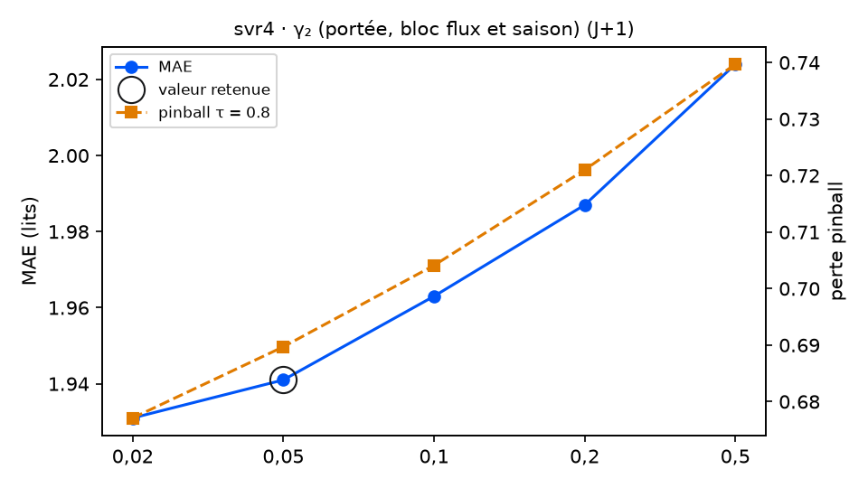

Amplitude de la MAE : 4.8 %. Aucune valeur ne fait significativement mieux que la valeur retenue.

### svr4 · τ (quantile décisionnel)

| variante | MAE | RMSE | biais | pinball τ=0.8 | couverture 90 % | temps (s) | DM p (pinball τ=0.8) | p Holm | DM p (MAE) | vs choix retenu |
|---|---|---|---|---|---|---|---|---|---|---|
| tau = 0,5 | 1.941 | 2.361 | -0.495 | 1.1191 | 85.8 | 3.3 | 0.0 | 0.0 |  | moins bon |
| tau = 0,6 | 1.942 | 2.36 | -0.496 | 1.1197 | 85.8 | 7.6 | 0.0 | 0.0 | 0.7528 | moins bon |
| tau = 0,7 | 1.941 | 2.361 | -0.495 | 1.1192 | 85.8 | 5.5 | 0.0 | 0.0 | 0.6183 | moins bon |
| tau = 0,8 (retenu) | 1.941 | 2.361 | -0.495 | 0.6897 | 85.8 | 4.2 |  |  |  | — choix retenu |
| tau = 0,9 | 1.941 | 2.361 | -0.495 | 1.1191 | 85.8 | 3.9 | 0.0 | 0.0 |  | moins bon |

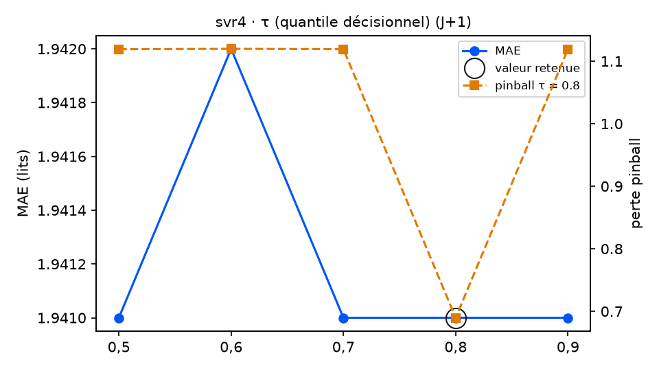

Amplitude de la MAE : 0.1 %. Aucune valeur ne fait significativement mieux que la valeur retenue.

### svr4 · η₀ (taux d'apprentissage d'Adam)

| variante | MAE | RMSE | biais | pinball τ=0.8 | couverture 90 % | temps (s) | DM p (pinball τ=0.8) | p Holm | DM p (MAE) | vs choix retenu |
|---|---|---|---|---|---|---|---|---|---|---|
| taux = 0,005 | 1.94 | 2.361 | -0.485 | 0.6722 | 89.6 | 6.7 | 0.0017 | 0.007 | 0.5016 | meilleur |
| taux = 0,01 | 1.94 | 2.36 | -0.487 | 0.6825 | 88.0 | 6.7 | 0.0014 | 0.007 | 0.3192 | meilleur |
| taux = 0,02 | 1.944 | 2.364 | -0.496 | 0.6879 | 85.8 | 5.5 | 0.0077 | 0.0231 | 0.0199 | meilleur |
| taux = 0,05 (retenu) | 1.941 | 2.361 | -0.495 | 0.6897 | 85.8 | 6.0 |  |  |  | — choix retenu |
| taux = 0,1 | 1.942 | 2.362 | -0.495 | 0.69 | 85.2 | 6.6 | 0.5351 | 0.5351 | 0.3036 | équivalent |
| taux = 0,2 | 1.941 | 2.36 | -0.489 | 0.6885 | 86.3 | 6.6 | 0.0567 | 0.1134 | 0.791 | équivalent |

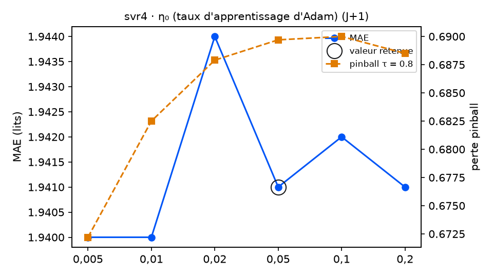

Amplitude de la MAE : 0.2 %. Valeur(s) significativement meilleure(s) : taux = 0,005, taux = 0,01, taux = 0,02 — réglage à revoir.

### svr4 · nombre maximal d'itérations

| variante | MAE | RMSE | biais | pinball τ=0.8 | couverture 90 % | temps (s) | DM p (pinball τ=0.8) | p Holm | DM p (MAE) | vs choix retenu |
|---|---|---|---|---|---|---|---|---|---|---|
| iterations = 300 | 1.94 | 2.359 | -0.489 | 0.6738 | 90.2 | 1.2 | 0.0011 | 0.0033 | 0.0597 | meilleur |
| iterations = 1000 | 1.941 | 2.361 | -0.495 | 0.6881 | 86.9 | 2.5 | 0.0066 | 0.0132 | 0.6347 | meilleur |
| iterations = 3000 (retenu) | 1.941 | 2.361 | -0.495 | 0.6897 | 85.8 | 6.1 |  |  |  | — choix retenu |
| iterations = 6000 | 1.941 | 2.361 | -0.495 | 0.6896 | 85.8 | 8.1 | 0.012 | 0.0132 | 0.2767 | meilleur |

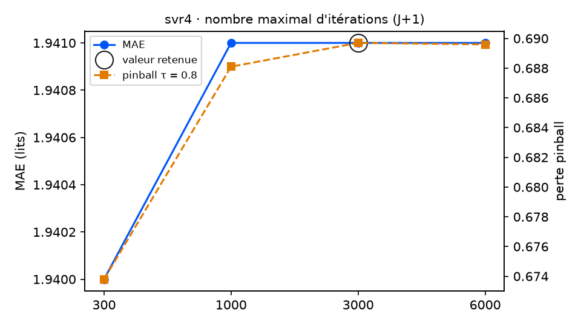

Amplitude de la MAE : 0.1 %. Valeur(s) significativement meilleure(s) : iterations = 300, iterations = 1000, iterations = 6000 — réglage à revoir.

### svr4 · T (décroissance du pas ; aucune = pas constant)

| variante | MAE | RMSE | biais | pinball τ=0.8 | couverture 90 % | temps (s) | DM p (pinball τ=0.8) | p Holm | DM p (MAE) | vs choix retenu |
|---|---|---|---|---|---|---|---|---|---|---|
| decroissance = aucune | 1.941 | 2.361 | -0.491 | 0.6901 | 86.3 | 8.0 | 0.4034 | 0.5355 | 0.6423 | équivalent |
| decroissance = 100 | 1.943 | 2.363 | -0.497 | 0.6884 | 85.8 | 5.1 | 0.1785 | 0.5355 | 0.0538 | équivalent |
| decroissance = 500 (retenu) | 1.941 | 2.361 | -0.495 | 0.6897 | 85.8 | 4.7 |  |  |  | — choix retenu |
| decroissance = 2000 | 1.943 | 2.363 | -0.497 | 0.6902 | 85.8 | 7.3 | 0.2456 | 0.5355 | 0.0736 | équivalent |

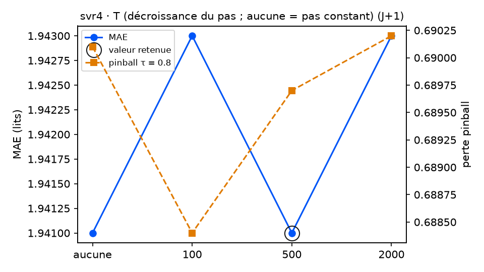

Amplitude de la MAE : 0.1 %. Aucune valeur ne fait significativement mieux que la valeur retenue.

### svr4 · part des pas moyennée (Polyak ; 0 = aucune)

| variante | MAE | RMSE | biais | pinball τ=0.8 | couverture 90 % | temps (s) | DM p (pinball τ=0.8) | p Holm | DM p (MAE) | vs choix retenu |
|---|---|---|---|---|---|---|---|---|---|---|
| moyenne_polyak = 0 | 1.941 | 2.361 | -0.495 | 0.6897 | 85.8 | 4.4 | 0.762 | 0.762 |  | équivalent |
| moyenne_polyak = 0,25 | 1.941 | 2.361 | -0.495 | 0.6896 | 85.8 | 6.4 | 0.2491 | 0.4982 |  | équivalent |
| moyenne_polyak = 0,5 (retenu) | 1.941 | 2.361 | -0.495 | 0.6897 | 85.8 | 6.5 |  |  |  | — choix retenu |
| moyenne_polyak = 0,75 | 1.941 | 2.361 | -0.495 | 0.6897 | 85.8 | 6.2 |  |  |  | identique |

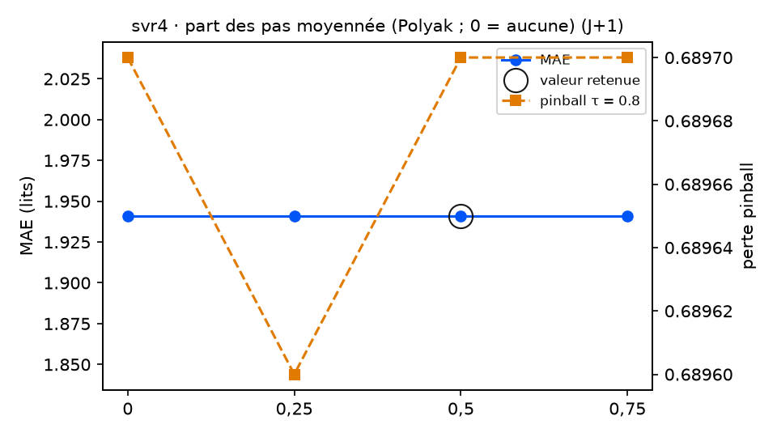

Amplitude de la MAE : 0.0 %. Aucune valeur ne fait significativement mieux que la valeur retenue.

### svr4 · tolérance d'arrêt anticipé

| variante | MAE | RMSE | biais | pinball τ=0.8 | couverture 90 % | temps (s) | DM p (pinball τ=0.8) | p Holm | DM p (MAE) | vs choix retenu |
|---|---|---|---|---|---|---|---|---|---|---|
| tolerance = 1e-05 | 1.941 | 2.361 | -0.489 | 0.6856 | 87.4 | 1.6 | 0.0055 | 0.011 | 0.8938 | meilleur |
| tolerance = 1e-07 (retenu) | 1.941 | 2.361 | -0.495 | 0.6897 | 85.8 | 5.5 |  |  |  | — choix retenu |
| tolerance = 1e-09 | 1.943 | 2.364 | -0.497 | 0.6909 | 85.8 | 7.8 | 0.0236 | 0.0236 | 0.0143 | moins bon |

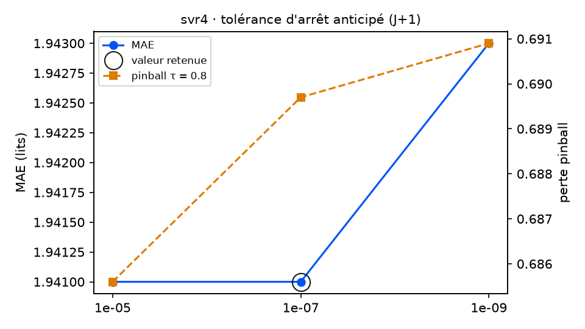

Amplitude de la MAE : 0.1 %. Valeur(s) significativement meilleure(s) : tolerance = 1e-05 — réglage à revoir.

### svr4 · direction préconditionnée α + Cg

| variante | MAE | RMSE | biais | pinball τ=0.8 | couverture 90 % | temps (s) | DM p (pinball τ=0.8) | p Holm | DM p (MAE) | vs choix retenu |
|---|---|---|---|---|---|---|---|---|---|---|
| preconditionne = True (retenu) | 1.941 | 2.361 | -0.495 | 0.6897 | 85.8 | 6.5 |  |  |  | — choix retenu |
| preconditionne = False | 1.943 | 2.369 | -0.499 | 0.6881 | 86.3 | 10.2 | 0.4898 | 0.4898 | 0.8269 | équivalent |

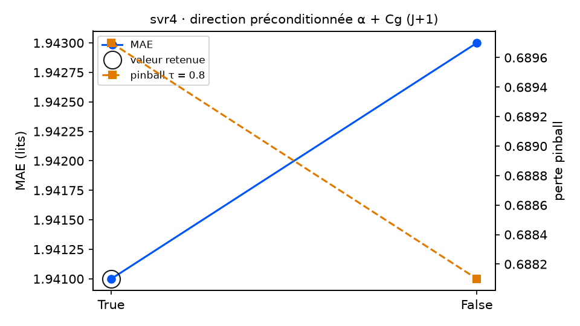

Amplitude de la MAE : 0.1 %. Aucune valeur ne fait significativement mieux que la valeur retenue.

### svr4 · optimiseur

| variante | MAE | RMSE | biais | pinball τ=0.8 | couverture 90 % | temps (s) | DM p (pinball τ=0.8) | p Holm | DM p (MAE) | vs choix retenu |
|---|---|---|---|---|---|---|---|---|---|---|
| optimiseur = adam (retenu) | 1.941 | 2.361 | -0.495 | 0.6897 | 85.8 | 5.8 |  |  |  | — choix retenu |
| optimiseur = momentum | 2.163 | 2.77 | -0.653 | 0.6776 | 90.2 | 5.4 | 0.5255 | 0.5255 | 0.0183 | équivalent |
| optimiseur = sgd | 2.428 | 2.911 | -0.779 | 0.6561 | 86.9 | 4.8 | 0.096 | 0.192 | 0.0 | équivalent |

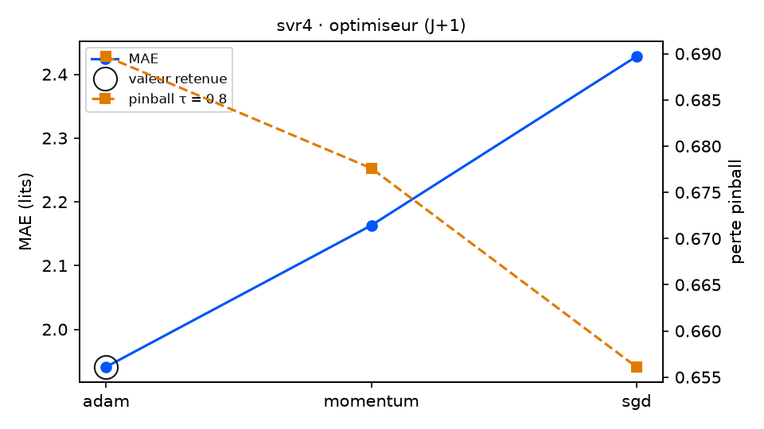

Amplitude de la MAE : 25.1 %. Aucune valeur ne fait significativement mieux que la valeur retenue.

### svr2 · C

| variante | MAE | RMSE | biais | pinball τ=0.8 | temps (s) | DM p (pinball τ=0.8) | p Holm | DM p (MAE) | vs choix retenu |
|---|---|---|---|---|---|---|---|---|---|
| C = 0,1 | 2.422 | 2.893 | -0.948 | 1.4956 | 0.9 | 0.0 | 0.0 | 0.0 | moins bon |
| C = 0,3 | 2.144 | 2.58 | -0.676 | 1.2744 | 1.5 | 0.0 | 0.0 | 0.0 | moins bon |
| C = 1 | 1.939 | 2.374 | -0.485 | 1.1152 | 2.0 | 0.0 | 0.0 | 0.0 | moins bon |
| C = 3 (retenu) | 1.799 | 2.24 | -0.32 | 0.9955 | 2.0 |  |  |  | — choix retenu |
| C = 10 | 1.757 | 2.221 | -0.299 | 0.9681 | 1.6 | 0.15 | 0.3 | 0.1816 | équivalent |
| C = 30 | 1.787 | 2.253 | -0.213 | 0.9577 | 2.2 | 0.276 | 0.3 | 0.8348 | équivalent |

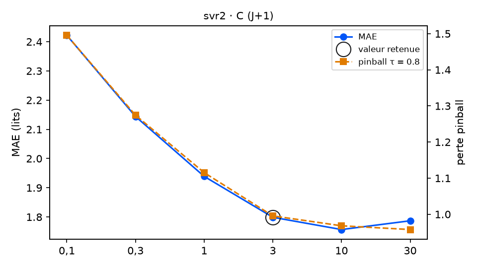

Amplitude de la MAE : 37.0 %. Aucune valeur ne fait significativement mieux que la valeur retenue.

### svr2 · ε (tube ε-insensible, en lits)

| variante | MAE | RMSE | biais | pinball τ=0.8 | temps (s) | DM p (pinball τ=0.8) | p Holm | DM p (MAE) | vs choix retenu |
|---|---|---|---|---|---|---|---|---|---|
| epsilon = 0 | 1.839 | 2.302 | -0.529 | 1.0784 | 1.1 | 0.0 | 0.0 | 0.1205 | moins bon |
| epsilon = 0,25 | 1.828 | 2.286 | -0.534 | 1.0744 | 2.0 | 0.0 | 0.0 | 0.2308 | moins bon |
| epsilon = 0,5 | 1.81 | 2.258 | -0.479 | 1.0488 | 1.6 | 0.0 | 0.0 | 0.5812 | moins bon |
| epsilon = 1 (retenu) | 1.799 | 2.24 | -0.32 | 0.9955 | 1.6 |  |  |  | — choix retenu |
| epsilon = 2 | 1.873 | 2.319 | -0.426 | 1.0642 | 1.0 | 0.0 | 0.0 | 0.0023 | moins bon |

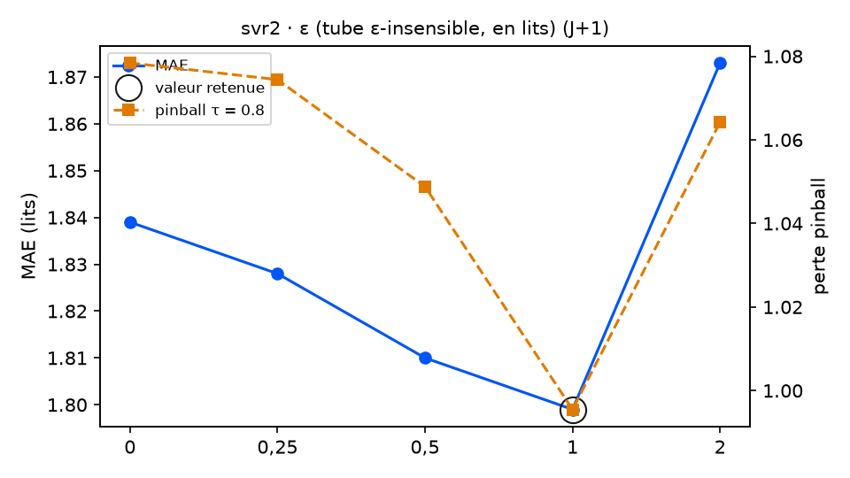

Amplitude de la MAE : 4.1 %. Aucune valeur ne fait significativement mieux que la valeur retenue.

### svr2 · γ (portée du noyau RBF)

| variante | MAE | RMSE | biais | pinball τ=0.8 | temps (s) | DM p (pinball τ=0.8) | p Holm | DM p (MAE) | vs choix retenu |
|---|---|---|---|---|---|---|---|---|---|
| gamma = 0,005 | 1.902 | 2.337 | -0.461 | 1.0891 | 1.0 | 0.0 | 0.0 | 0.0004 | moins bon |
| gamma = 0,01 | 1.831 | 2.273 | -0.403 | 1.0362 | 1.4 | 0.0002 | 0.0006 | 0.0751 | moins bon |
| gamma = 0,02 (retenu) | 1.799 | 2.24 | -0.32 | 0.9955 | 1.8 |  |  |  | — choix retenu |
| gamma = 0,05 | 1.83 | 2.297 | -0.283 | 0.9997 | 1.5 | 0.8168 | 0.8168 | 0.3767 | équivalent |
| gamma = 0,1 | 1.97 | 2.455 | -0.352 | 1.0905 | 1.2 | 0.0009 | 0.0018 | 0.0024 | moins bon |
| gamma = 0,2 | 2.16 | 2.646 | -0.598 | 1.2592 | 1.8 | 0.0 | 0.0 | 0.0 | moins bon |
| gamma = 0,5 | 2.506 | 3.023 | -0.959 | 1.5408 | 1.3 | 0.0 | 0.0 | 0.0 | moins bon |

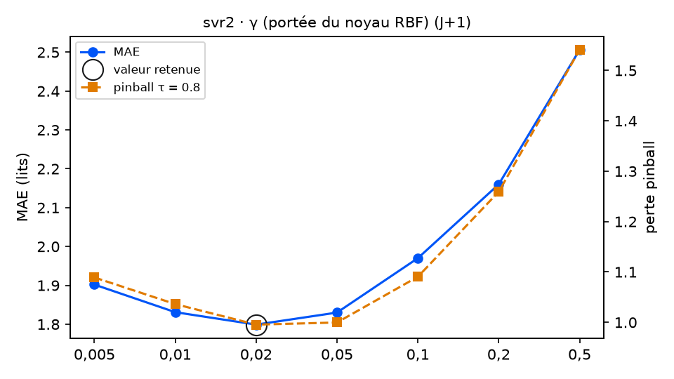

Amplitude de la MAE : 39.3 %. Aucune valeur ne fait significativement mieux que la valeur retenue.

### foret · nombre d'arbres

| variante | MAE | RMSE | biais | pinball τ=0.8 | couverture 90 % | temps (s) | DM p (pinball τ=0.8) | p Holm | DM p (MAE) | vs choix retenu |
|---|---|---|---|---|---|---|---|---|---|---|
| arbres = 25 | 1.851 | 2.364 | -0.341 | 0.6297 | 96.2 | 0.8 | 0.6635 | 1.0 | 0.1429 | équivalent |
| arbres = 50 | 1.859 | 2.341 | -0.389 | 0.6244 | 96.7 | 2.4 | 0.9056 | 1.0 | 0.1778 | équivalent |
| arbres = 100 | 1.863 | 2.334 | -0.401 | 0.6221 | 96.7 | 4.3 | 0.9354 | 1.0 | 0.0617 | équivalent |
| arbres = 300 (retenu) | 1.9 | 2.383 | -0.407 | 0.6229 | 95.1 | 8.0 |  |  |  | — choix retenu |
| arbres = 500 | 1.888 | 2.375 | -0.415 | 0.6175 | 95.1 | 15.7 | 0.4043 | 1.0 | 0.2748 | équivalent |

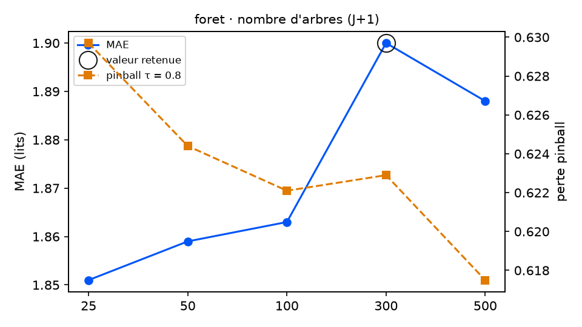

Amplitude de la MAE : 2.6 %. Aucune valeur ne fait significativement mieux que la valeur retenue.

### foret · profondeur maximale

| variante | MAE | RMSE | biais | pinball τ=0.8 | couverture 90 % | temps (s) | DM p (pinball τ=0.8) | p Holm | DM p (MAE) | vs choix retenu |
|---|---|---|---|---|---|---|---|---|---|---|
| profondeur_foret = 3 | 1.944 | 2.407 | -0.577 | 0.625 | 96.7 | 3.7 | 0.9048 | 1.0 | 0.3112 | équivalent |
| profondeur_foret = 5 | 1.884 | 2.356 | -0.49 | 0.6241 | 96.7 | 5.5 | 0.9255 | 1.0 | 0.4805 | équivalent |
| profondeur_foret = 8 | 1.87 | 2.357 | -0.436 | 0.6295 | 95.6 | 9.2 | 0.5453 | 1.0 | 0.0668 | équivalent |
| profondeur_foret = 12 (retenu) | 1.9 | 2.383 | -0.407 | 0.6229 | 95.1 | 12.1 |  |  |  | — choix retenu |
| profondeur_foret = 20 | 1.873 | 2.354 | -0.416 | 0.6111 | 95.1 | 8.4 | 0.1382 | 0.5528 | 0.0724 | équivalent |

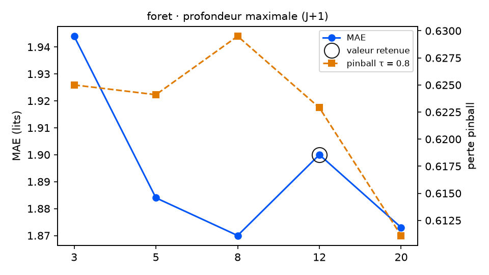

Amplitude de la MAE : 3.9 %. Aucune valeur ne fait significativement mieux que la valeur retenue.

### foret · taille minimale d'une feuille

| variante | MAE | RMSE | biais | pinball τ=0.8 | couverture 90 % | temps (s) | DM p (pinball τ=0.8) | p Holm | DM p (MAE) | vs choix retenu |
|---|---|---|---|---|---|---|---|---|---|---|
| min_feuille = 2 | 1.898 | 2.397 | -0.367 | 0.6509 | 94.5 | 21.8 | 0.0482 | 0.1446 | 0.9269 | équivalent |
| min_feuille = 5 (retenu) | 1.9 | 2.383 | -0.407 | 0.6229 | 95.1 | 8.7 |  |  |  | — choix retenu |
| min_feuille = 10 | 1.875 | 2.353 | -0.464 | 0.6215 | 96.2 | 6.5 | 0.8886 | 1.0 | 0.2816 | équivalent |
| min_feuille = 20 | 1.898 | 2.355 | -0.495 | 0.6167 | 96.7 | 2.9 | 0.6854 | 1.0 | 0.9584 | équivalent |

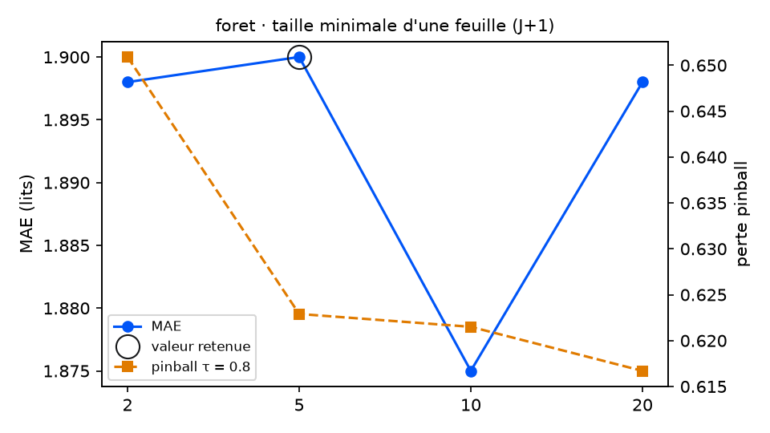

Amplitude de la MAE : 1.3 %. Aucune valeur ne fait significativement mieux que la valeur retenue.

### foret · part des variables tirées par nœud

| variante | MAE | RMSE | biais | pinball τ=0.8 | couverture 90 % | temps (s) | DM p (pinball τ=0.8) | p Holm | DM p (MAE) | vs choix retenu |
|---|---|---|---|---|---|---|---|---|---|---|
| part_variables = 0,15 | 1.984 | 2.429 | -0.512 | 0.6573 | 96.7 | 7.1 | 0.0154 | 0.0456 | 0.0203 | moins bon |
| part_variables = 0,333333 (retenu) | 1.9 | 2.383 | -0.407 | 0.6229 | 95.1 | 7.7 |  |  |  | — choix retenu |
| part_variables = 0,5 | 1.841 | 2.332 | -0.378 | 0.6027 | 93.4 | 9.5 | 0.0152 | 0.0456 | 0.0152 | meilleur |
| part_variables = 1 | 1.85 | 2.345 | -0.346 | 0.6022 | 94.0 | 11.0 | 0.1556 | 0.1556 | 0.1567 | équivalent |

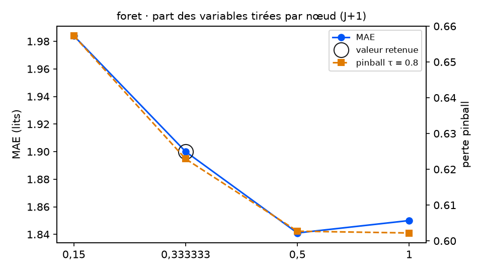

Amplitude de la MAE : 7.5 %. Valeur(s) significativement meilleure(s) : part_variables = 0,5 — réglage à revoir.

### boosting · nombre d'étapes

| variante | MAE | RMSE | biais | pinball τ=0.8 | couverture 90 % | temps (s) | DM p (pinball τ=0.8) | p Holm | DM p (MAE) | vs choix retenu |
|---|---|---|---|---|---|---|---|---|---|---|
| etapes = 50 | 1.871 | 2.333 | -0.522 | 0.6741 | 86.3 | 1.1 | 0.0034 | 0.0042 | 0.4614 | meilleur |
| etapes = 100 | 1.843 | 2.318 | -0.385 | 0.6905 | 81.4 | 2.7 | 0.0002 | 0.0006 | 0.0153 | meilleur |
| etapes = 300 (retenu) | 1.904 | 2.407 | -0.341 | 0.7442 | 74.3 | 7.3 |  |  |  | — choix retenu |
| etapes = 600 | 1.926 | 2.445 | -0.321 | 0.7794 | 66.1 | 14.7 | 0.0021 | 0.0042 | 0.0746 | moins bon |

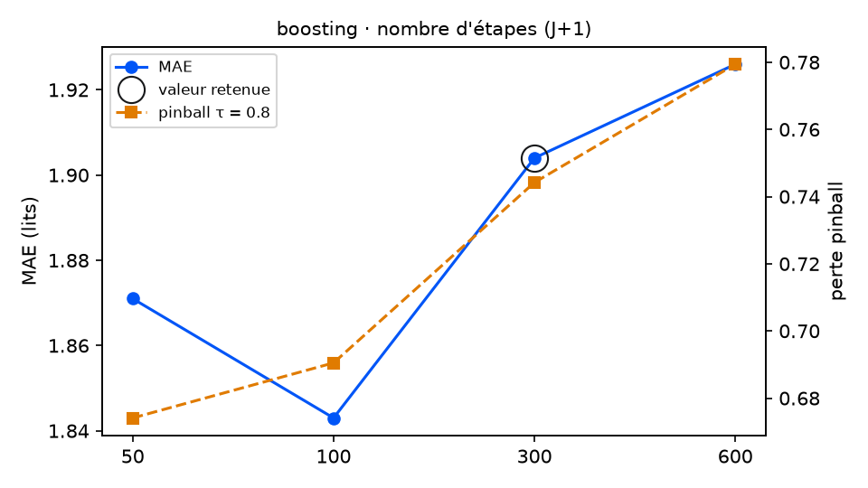

Amplitude de la MAE : 4.4 %. Valeur(s) significativement meilleure(s) : etapes = 50, etapes = 100 — réglage à revoir.

### boosting · taux ν (shrinkage)

| variante | MAE | RMSE | biais | pinball τ=0.8 | couverture 90 % | temps (s) | DM p (pinball τ=0.8) | p Holm | DM p (MAE) | vs choix retenu |
|---|---|---|---|---|---|---|---|---|---|---|
| taux_boosting = 0,01 | 1.845 | 2.323 | -0.51 | 0.6815 | 86.3 | 6.2 | 0.0042 | 0.0084 | 0.171 | meilleur |
| taux_boosting = 0,05 (retenu) | 1.904 | 2.407 | -0.341 | 0.7442 | 74.3 | 8.3 |  |  |  | — choix retenu |
| taux_boosting = 0,1 | 1.892 | 2.437 | -0.345 | 0.7552 | 70.5 | 7.1 | 0.5185 | 0.5185 | 0.6922 | équivalent |
| taux_boosting = 0,2 | 1.992 | 2.528 | -0.408 | 0.8164 | 62.3 | 5.6 | 0.0002 | 0.0006 | 0.0435 | moins bon |

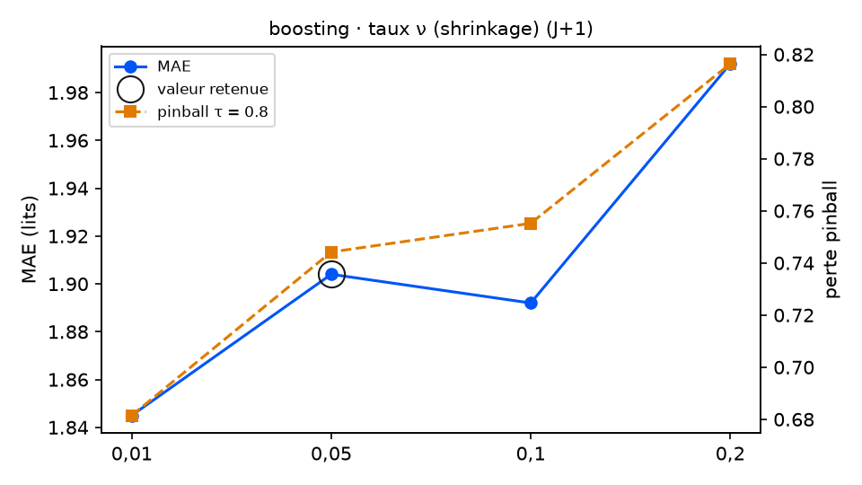

Amplitude de la MAE : 7.7 %. Valeur(s) significativement meilleure(s) : taux_boosting = 0,01 — réglage à revoir.

### boosting · profondeur des arbres

| variante | MAE | RMSE | biais | pinball τ=0.8 | couverture 90 % | temps (s) | DM p (pinball τ=0.8) | p Holm | DM p (MAE) | vs choix retenu |
|---|---|---|---|---|---|---|---|---|---|---|
| profondeur_boosting = 1 | 1.775 | 2.285 | -0.258 | 0.6591 | 85.8 | 2.5 | 0.0001 | 0.0003 | 0.0082 | meilleur |
| profondeur_boosting = 2 | 1.806 | 2.315 | -0.306 | 0.6966 | 80.9 | 3.8 | 0.0008 | 0.0016 | 0.0025 | meilleur |
| profondeur_boosting = 3 (retenu) | 1.904 | 2.407 | -0.341 | 0.7442 | 74.3 | 5.6 |  |  |  | — choix retenu |
| profondeur_boosting = 5 | 1.911 | 2.393 | -0.295 | 0.8002 | 60.7 | 11.3 | 0.0043 | 0.0043 | 0.827 | moins bon |

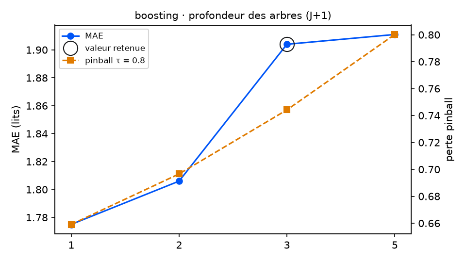

Amplitude de la MAE : 7.1 %. Valeur(s) significativement meilleure(s) : profondeur_boosting = 1, profondeur_boosting = 2 — réglage à revoir.

### boosting · part du sous-échantillon

| variante | MAE | RMSE | biais | pinball τ=0.8 | couverture 90 % | temps (s) | DM p (pinball τ=0.8) | p Holm | DM p (MAE) | vs choix retenu |
|---|---|---|---|---|---|---|---|---|---|---|
| sous_echantillon = 0,5 | 1.937 | 2.447 | -0.336 | 0.725 | 69.4 | 5.8 | 0.289 | 0.578 | 0.3434 | équivalent |
| sous_echantillon = 0,8 (retenu) | 1.904 | 2.407 | -0.341 | 0.7442 | 74.3 | 8.2 |  |  |  | — choix retenu |
| sous_echantillon = 1 | 1.853 | 2.369 | -0.315 | 0.7454 | 78.7 | 8.9 | 0.9471 | 0.9471 | 0.1271 | équivalent |

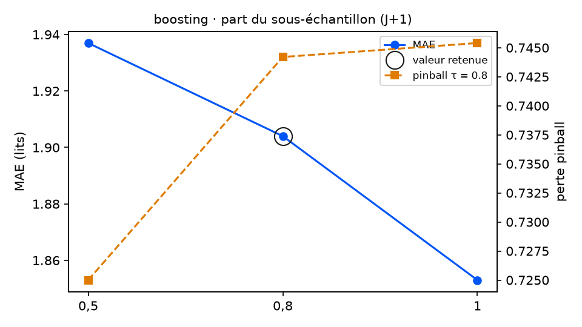

Amplitude de la MAE : 4.4 %. Aucune valeur ne fait significativement mieux que la valeur retenue.

### mlp · architecture (neurones par couche)

| variante | MAE | RMSE | biais | pinball τ=0.8 | couverture 90 % | temps (s) | DM p (pinball τ=0.8) | p Holm | DM p (MAE) | vs choix retenu |
|---|---|---|---|---|---|---|---|---|---|---|
| couches = 8 | 1.968 | 2.467 | -0.768 | 0.8748 | 77.0 | 0.8 | 0.0002 | 0.0008 | 0.9265 | moins bon |
| couches = 32 | 1.864 | 2.34 | -0.282 | 0.6612 | 87.4 | 1.1 | 0.0793 | 0.2379 | 0.1978 | équivalent |
| couches = 32×16 (retenu) | 1.962 | 2.395 | -0.689 | 0.7201 | 85.2 | 1.3 |  |  |  | — choix retenu |
| couches = 64×32 | 1.843 | 2.327 | -0.403 | 0.7658 | 88.5 | 1.8 | 0.2161 | 0.4322 | 0.0904 | équivalent |
| couches = 32×16×8 | 2.035 | 2.501 | -0.566 | 0.7127 | 82.0 | 1.6 | 0.8092 | 0.8092 | 0.2678 | équivalent |

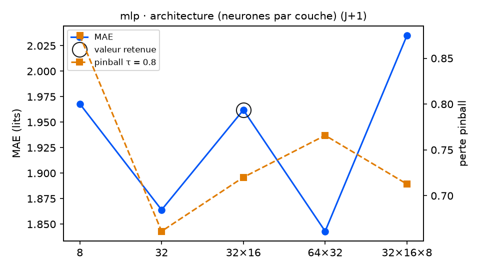

Amplitude de la MAE : 9.8 %. Aucune valeur ne fait significativement mieux que la valeur retenue.

### mlp · taux d'apprentissage

| variante | MAE | RMSE | biais | pinball τ=0.8 | couverture 90 % | temps (s) | DM p (pinball τ=0.8) | p Holm | DM p (MAE) | vs choix retenu |
|---|---|---|---|---|---|---|---|---|---|---|
| taux_reseau = 0,001 | 2.145 | 2.584 | -0.745 | 0.7625 | 76.0 | 2.9 | 0.0394 | 0.1182 | 0.0003 | équivalent |
| taux_reseau = 0,003 | 2.137 | 2.545 | -0.653 | 0.7259 | 81.4 | 1.8 | 0.7456 | 1.0 | 0.0001 | équivalent |
| taux_reseau = 0,01 (retenu) | 1.962 | 2.395 | -0.689 | 0.7201 | 85.2 | 1.2 |  |  |  | — choix retenu |
| taux_reseau = 0,03 | 1.937 | 2.393 | -0.73 | 0.7351 | 85.2 | 1.2 | 0.5481 | 1.0 | 0.5333 | équivalent |

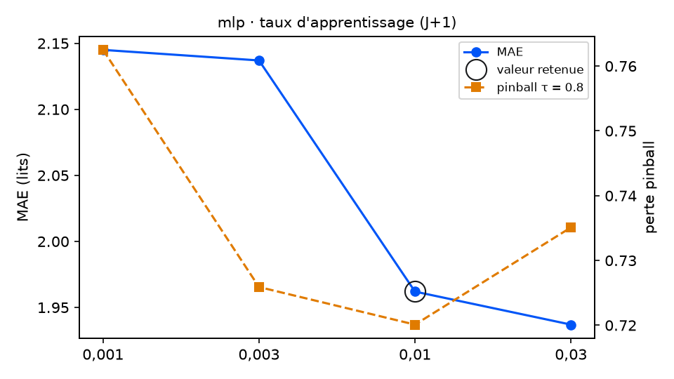

Amplitude de la MAE : 10.6 %. Aucune valeur ne fait significativement mieux que la valeur retenue.

### mlp · pénalité L2 λ

| variante | MAE | RMSE | biais | pinball τ=0.8 | couverture 90 % | temps (s) | DM p (pinball τ=0.8) | p Holm | DM p (MAE) | vs choix retenu |
|---|---|---|---|---|---|---|---|---|---|---|
| lambda_ = 0 | 1.947 | 2.37 | -0.644 | 0.7102 | 86.3 | 1.4 | 0.2194 | 0.4388 | 0.3587 | équivalent |
| lambda_ = 0,0001 | 1.967 | 2.392 | -0.626 | 0.6991 | 86.3 | 1.3 | 0.0315 | 0.1128 | 0.771 | équivalent |
| lambda_ = 0,001 (retenu) | 1.962 | 2.395 | -0.689 | 0.7201 | 85.2 | 1.1 |  |  |  | — choix retenu |
| lambda_ = 0,01 | 1.938 | 2.372 | -0.557 | 0.6889 | 80.9 | 1.4 | 0.0282 | 0.1128 | 0.394 | équivalent |
| lambda_ = 0,1 | 2.023 | 2.462 | -0.842 | 0.6855 | 88.5 | 2.7 | 0.3158 | 0.4388 | 0.312 | équivalent |

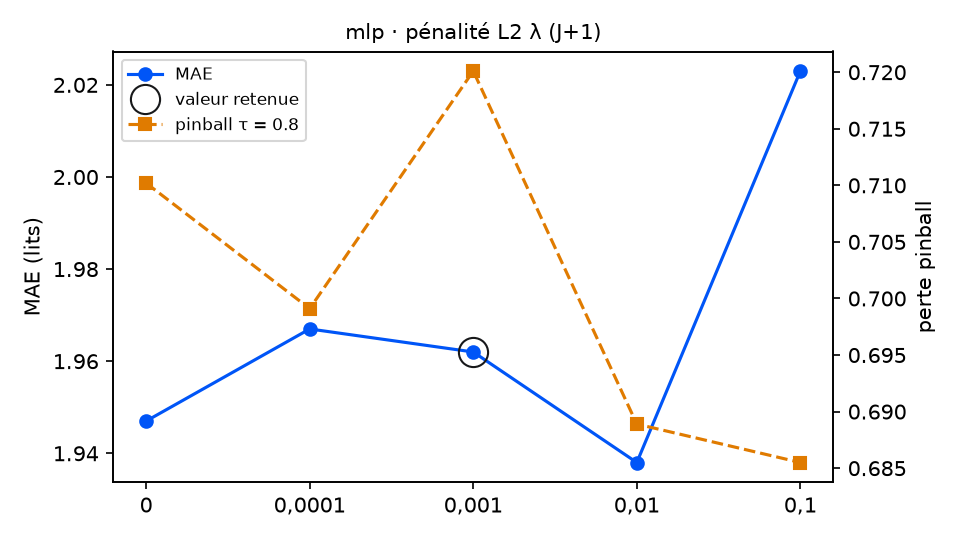

Amplitude de la MAE : 4.3 %. Aucune valeur ne fait significativement mieux que la valeur retenue.

### mlp · époques maximales

| variante | MAE | RMSE | biais | pinball τ=0.8 | couverture 90 % | temps (s) | DM p (pinball τ=0.8) | p Holm | DM p (MAE) | vs choix retenu |
|---|---|---|---|---|---|---|---|---|---|---|
| epoques = 300 | 1.962 | 2.395 | -0.689 | 0.7201 | 85.2 | 1.0 |  |  |  | identique |
| epoques = 800 | 1.962 | 2.395 | -0.689 | 0.7201 | 85.2 | 1.2 |  |  |  | identique |
| epoques = 1500 (retenu) | 1.962 | 2.395 | -0.689 | 0.7201 | 85.2 | 0.7 |  |  |  | — choix retenu |
| epoques = 3000 | 1.962 | 2.395 | -0.689 | 0.7201 | 85.2 | 1.2 |  |  |  | identique |

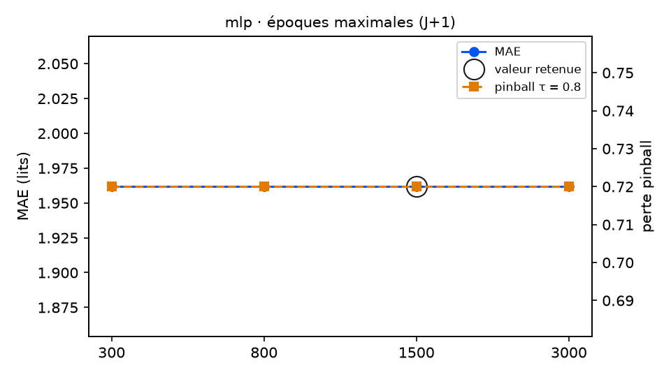

Amplitude de la MAE : 0.0 %. Aucune valeur ne fait significativement mieux que la valeur retenue.

### mlp · patience de l'arrêt anticipé

| variante | MAE | RMSE | biais | pinball τ=0.8 | couverture 90 % | temps (s) | DM p (pinball τ=0.8) | p Holm | DM p (MAE) | vs choix retenu |
|---|---|---|---|---|---|---|---|---|---|---|
| patience = 50 | 1.962 | 2.395 | -0.689 | 0.7201 | 85.2 | 0.8 |  |  |  | identique |
| patience = 150 (retenu) | 1.962 | 2.395 | -0.689 | 0.7201 | 85.2 | 1.2 |  |  |  | — choix retenu |
| patience = 300 | 1.962 | 2.395 | -0.689 | 0.7201 | 85.2 | 2.1 |  |  |  | identique |

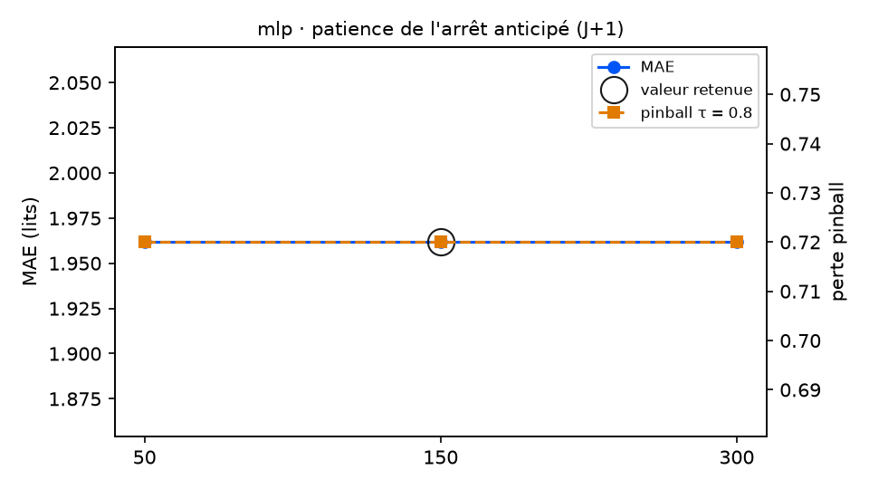

Amplitude de la MAE : 0.0 %. Aucune valeur ne fait significativement mieux que la valeur retenue.

### mlp · nombre d'initialisations moyennées

| variante | MAE | RMSE | biais | pinball τ=0.8 | couverture 90 % | temps (s) | DM p (pinball τ=0.8) | p Holm | DM p (MAE) | vs choix retenu |
|---|---|---|---|---|---|---|---|---|---|---|
| graines = 1 | 1.913 | 2.336 | -0.493 | 0.7551 | 83.1 | 0.5 | 0.2621 | 0.5242 | 0.4486 | équivalent |
| graines = 3 (retenu) | 1.962 | 2.395 | -0.689 | 0.7201 | 85.2 | 1.3 |  |  |  | — choix retenu |
| graines = 5 | 2.022 | 2.475 | -0.836 | 0.7001 | 85.2 | 1.5 | 0.2993 | 0.5242 | 0.0307 | équivalent |

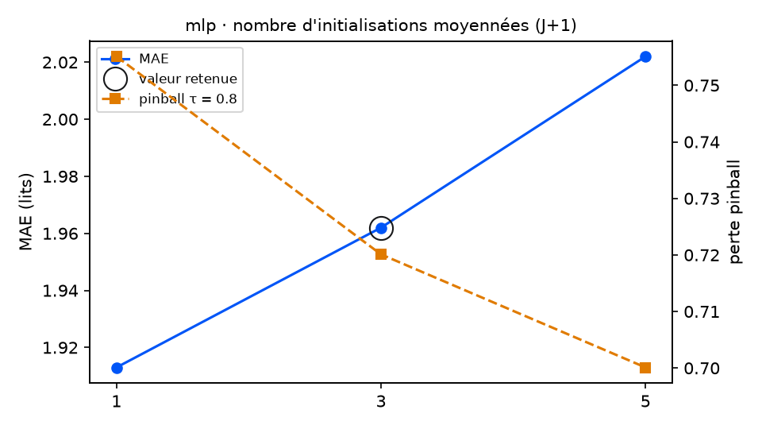

Amplitude de la MAE : 5.6 %. Aucune valeur ne fait significativement mieux que la valeur retenue.

### lstm · taille de l'état caché H

| variante | MAE | RMSE | biais | pinball τ=0.8 | couverture 90 % | temps (s) | DM p (pinball τ=0.8) | p Holm | DM p (MAE) | vs choix retenu |
|---|---|---|---|---|---|---|---|---|---|---|
| cache_lstm = 4 | 1.941 | 2.389 | -0.498 | 0.8095 | 74.9 | 6.6 | 0.0001 | 0.0003 | 0.2113 | moins bon |
| cache_lstm = 8 | 1.999 | 2.475 | -0.706 | 0.8067 | 74.9 | 7.9 | 0.0001 | 0.0003 | 0.7499 | moins bon |
| cache_lstm = 16 (retenu) | 1.987 | 2.431 | -0.665 | 0.714 | 78.1 | 7.7 |  |  |  | — choix retenu |
| cache_lstm = 32 | 1.983 | 2.442 | -0.598 | 0.7527 | 78.7 | 11.4 | 0.0878 | 0.0878 | 0.894 | équivalent |

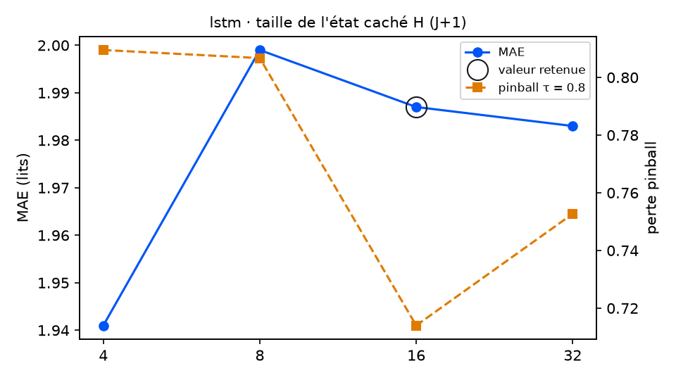

Amplitude de la MAE : 2.9 %. Aucune valeur ne fait significativement mieux que la valeur retenue.

### lstm · taux d'apprentissage

| variante | MAE | RMSE | biais | pinball τ=0.8 | couverture 90 % | temps (s) | DM p (pinball τ=0.8) | p Holm | DM p (MAE) | vs choix retenu |
|---|---|---|---|---|---|---|---|---|---|---|
| taux_reseau = 0,003 | 1.964 | 2.415 | -0.623 | 0.7176 | 74.3 | 12.3 | 0.8461 | 0.8461 | 0.4535 | équivalent |
| taux_reseau = 0,01 (retenu) | 1.987 | 2.431 | -0.665 | 0.714 | 78.1 | 7.6 |  |  |  | — choix retenu |
| taux_reseau = 0,03 | 1.996 | 2.457 | -0.712 | 0.76 | 77.0 | 6.4 | 0.0005 | 0.001 | 0.7079 | moins bon |

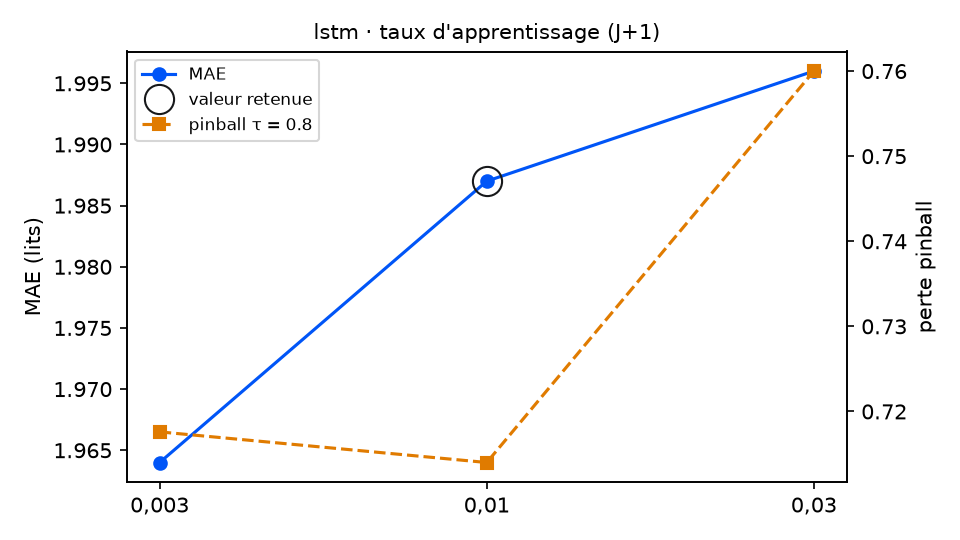

Amplitude de la MAE : 1.6 %. Aucune valeur ne fait significativement mieux que la valeur retenue.

### lstm · pénalité L2 λ

| variante | MAE | RMSE | biais | pinball τ=0.8 | couverture 90 % | temps (s) | DM p (pinball τ=0.8) | p Holm | DM p (MAE) | vs choix retenu |
|---|---|---|---|---|---|---|---|---|---|---|
| lambda_ = 0 | 2.013 | 2.471 | -0.708 | 0.7231 | 75.4 | 6.4 | 0.4848 | 0.9696 | 0.1573 | équivalent |
| lambda_ = 0,001 (retenu) | 1.987 | 2.431 | -0.665 | 0.714 | 78.1 | 6.3 |  |  |  | — choix retenu |
| lambda_ = 0,01 | 1.966 | 2.431 | -0.654 | 0.7091 | 76.0 | 12.9 | 0.7368 | 0.9696 | 0.574 | équivalent |

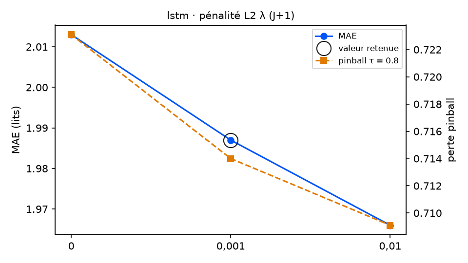

Amplitude de la MAE : 2.4 %. Aucune valeur ne fait significativement mieux que la valeur retenue.

### variables · jours d'occupation passée en entrée

| variante | MAE | RMSE | biais | pinball τ=0.8 | couverture 90 % | temps (s) | DM p (pinball τ=0.8) | p Holm | DM p (MAE) | vs choix retenu |
|---|---|---|---|---|---|---|---|---|---|---|
| retards = 3 | 1.873 | 2.328 | -0.459 | 0.664 | 86.3 | 4.2 | 0.0968 | 0.2904 | 0.0713 | équivalent |
| retards = 5 | 1.941 | 2.387 | -0.491 | 0.6791 | 84.7 | 5.0 | 0.383 | 0.766 | 0.9981 | équivalent |
| retards = 7 (retenu) | 1.941 | 2.361 | -0.495 | 0.6897 | 85.8 | 5.0 |  |  |  | — choix retenu |
| retards = 10 | 1.981 | 2.435 | -0.446 | 0.6978 | 85.2 | 5.2 | 0.6121 | 0.766 | 0.2784 | équivalent |
| retards = 14 | 2.04 | 2.529 | -0.68 | 0.7687 | 83.1 | 6.8 | 0.0004 | 0.0016 | 0.066 | moins bon |
| retards = 21 | 2.137 | 2.586 | -0.712 | 0.8706 | 76.5 | 5.5 | 0.0 | 0.0 | 0.0023 | moins bon |

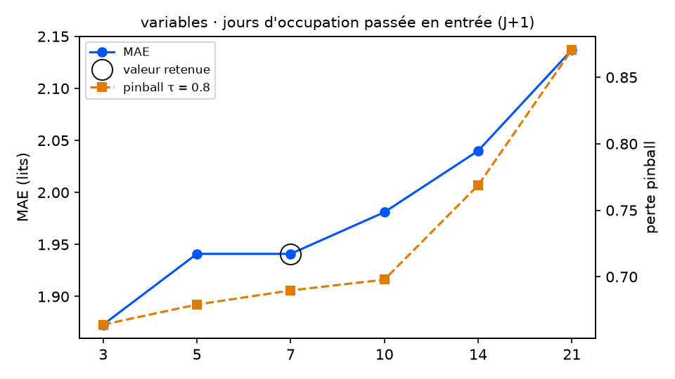

Amplitude de la MAE : 13.6 %. Aucune valeur ne fait significativement mieux que la valeur retenue.

## Horizon J+7

### svr4 · C (poids des erreurs)

| variante | MAE | RMSE | biais | pinball τ=0.8 | couverture 90 % | temps (s) | DM p (pinball τ=0.8) | p Holm | DM p (MAE) | vs choix retenu |
|---|---|---|---|---|---|---|---|---|---|---|
| C = 0,1 | 2.705 | 3.24 | -0.954 | 0.9269 | 87.6 | 3.4 | 0.0745 | 0.3725 | 0.6203 | équivalent |
| C = 0,3 (retenu) | 2.719 | 3.246 | -0.904 | 0.9447 | 87.6 | 3.6 |  |  |  | — choix retenu |
| C = 1 | 2.704 | 3.234 | -0.9 | 0.9654 | 87.6 | 3.9 | 0.3919 | 0.4908 | 0.6789 | équivalent |
| C = 3 | 2.708 | 3.256 | -0.918 | 1.0322 | 85.9 | 4.2 | 0.2157 | 0.4908 | 0.8653 | équivalent |
| C = 10 | 2.668 | 3.213 | -1.04 | 1.1104 | 79.1 | 5.2 | 0.1636 | 0.4908 | 0.6002 | équivalent |
| C = 30 | 2.792 | 3.389 | -1.376 | 1.1504 | 71.8 | 6.9 | 0.1218 | 0.4872 | 0.6368 | équivalent |

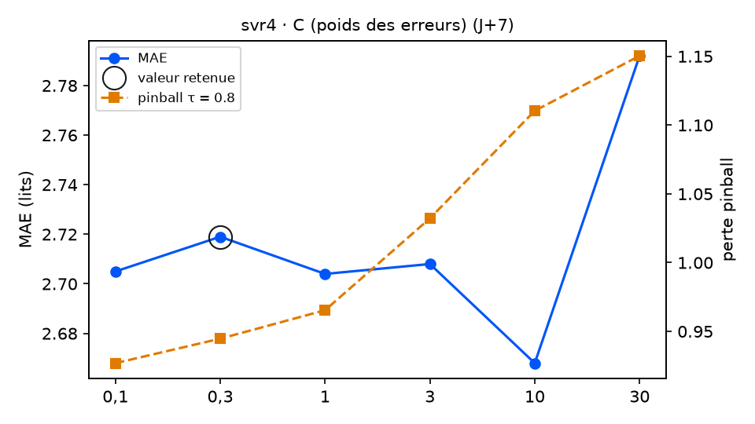

Amplitude de la MAE : 4.6 %. Aucune valeur ne fait significativement mieux que la valeur retenue.

### svr4 · ε (tube, niveaux quantiles)

| variante | MAE | RMSE | biais | pinball τ=0.8 | couverture 90 % | temps (s) | DM p (pinball τ=0.8) | p Holm | DM p (MAE) | vs choix retenu |
|---|---|---|---|---|---|---|---|---|---|---|
| epsilon_quantile = 0 (retenu) | 2.719 | 3.246 | -0.904 | 0.9447 | 87.6 | 3.6 |  |  |  | — choix retenu |
| epsilon_quantile = 0,25 | 2.715 | 3.238 | -0.954 | 0.9566 | 82.5 | 3.5 | 0.273 | 0.273 | 0.818 | équivalent |
| epsilon_quantile = 0,5 | 2.723 | 3.24 | -1.009 | 0.9778 | 80.8 | 3.0 | 0.1117 | 0.2234 | 0.8971 | équivalent |
| epsilon_quantile = 1 | 2.729 | 3.256 | -1.007 | 1.0256 | 79.1 | 3.7 | 0.0594 | 0.1782 | 0.7463 | équivalent |

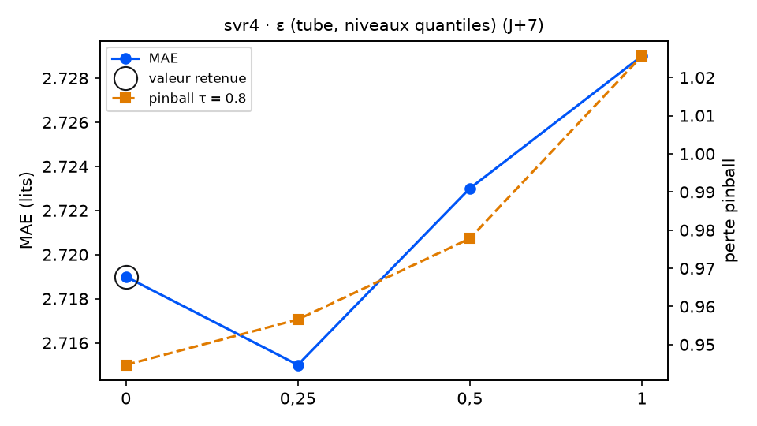

Amplitude de la MAE : 0.5 %. Aucune valeur ne fait significativement mieux que la valeur retenue.

### svr4 · γ₁ (portée, bloc occupation)

| variante | MAE | RMSE | biais | pinball τ=0.8 | couverture 90 % | temps (s) | DM p (pinball τ=0.8) | p Holm | DM p (MAE) | vs choix retenu |
|---|---|---|---|---|---|---|---|---|---|---|
| gamma1 = 0,01 | 2.72 | 3.247 | -0.906 | 0.9444 | 87.6 | 3.4 | 0.2665 | 1.0 | 0.0996 | équivalent |
| gamma1 = 0,02 (retenu) | 2.719 | 3.246 | -0.904 | 0.9447 | 87.6 | 3.4 |  |  |  | — choix retenu |
| gamma1 = 0,05 | 2.719 | 3.246 | -0.905 | 0.9443 | 88.1 | 2.8 | 0.7997 | 1.0 | 0.7263 | équivalent |
| gamma1 = 0,1 | 2.715 | 3.233 | -0.921 | 0.9443 | 89.3 | 2.7 | 0.9441 | 1.0 | 0.7324 | équivalent |
| gamma1 = 0,2 | 2.74 | 3.246 | -0.984 | 0.9524 | 88.1 | 4.6 | 0.3712 | 1.0 | 0.6013 | équivalent |
| gamma1 = 0,5 | 2.738 | 3.247 | -0.979 | 0.956 | 87.6 | 4.0 | 0.2984 | 1.0 | 0.6327 | équivalent |

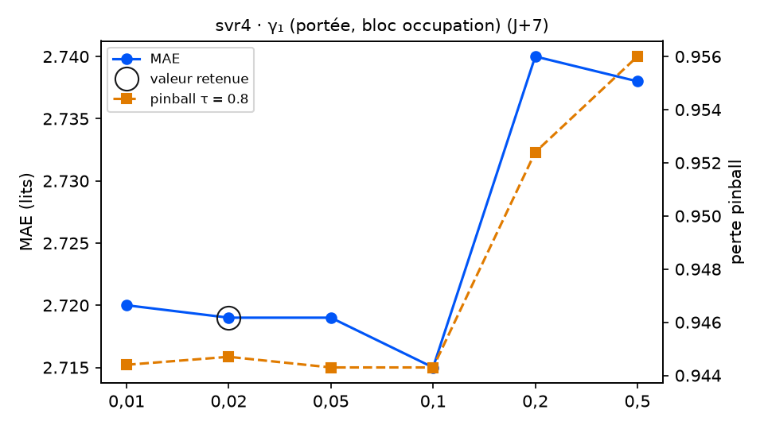

Amplitude de la MAE : 0.9 %. Aucune valeur ne fait significativement mieux que la valeur retenue.

### svr4 · γ₂ (portée, bloc flux et saison)

| variante | MAE | RMSE | biais | pinball τ=0.8 | couverture 90 % | temps (s) | DM p (pinball τ=0.8) | p Holm | DM p (MAE) | vs choix retenu |
|---|---|---|---|---|---|---|---|---|---|---|
| gamma2 = 0,02 | 2.736 | 3.272 | -0.945 | 0.9355 | 88.7 | 4.5 | 0.1519 | 0.6076 | 0.2975 | équivalent |
| gamma2 = 0,05 (retenu) | 2.719 | 3.246 | -0.904 | 0.9447 | 87.6 | 5.1 |  |  |  | — choix retenu |
| gamma2 = 0,1 | 2.694 | 3.213 | -0.889 | 0.9472 | 87.0 | 5.8 | 0.7459 | 1.0 | 0.1037 | équivalent |
| gamma2 = 0,2 | 2.672 | 3.173 | -0.868 | 0.9495 | 87.0 | 6.9 | 0.7232 | 1.0 | 0.0668 | équivalent |
| gamma2 = 0,5 | 2.678 | 3.191 | -0.938 | 0.941 | 85.9 | 5.9 | 0.8359 | 1.0 | 0.1385 | équivalent |

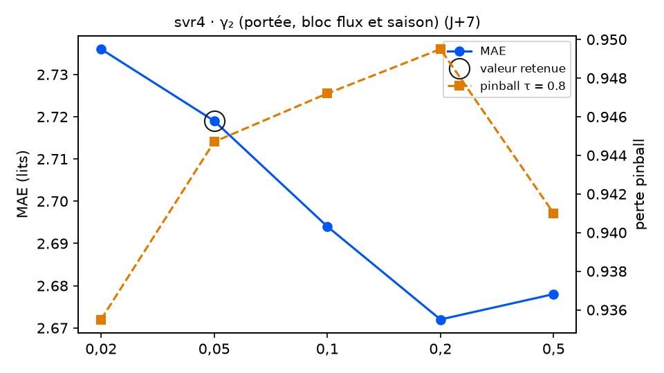

Amplitude de la MAE : 2.4 %. Aucune valeur ne fait significativement mieux que la valeur retenue.

### svr4 · τ (quantile décisionnel)

| variante | MAE | RMSE | biais | pinball τ=0.8 | couverture 90 % | temps (s) | DM p (pinball τ=0.8) | p Holm | DM p (MAE) | vs choix retenu |
|---|---|---|---|---|---|---|---|---|---|---|
| tau = 0,5 | 2.719 | 3.246 | -0.904 | 1.6307 | 87.6 | 4.3 | 0.0005 | 0.002 |  | moins bon |
| tau = 0,6 | 2.719 | 3.246 | -0.904 | 1.6307 | 87.6 | 3.5 | 0.0005 | 0.002 |  | moins bon |
| tau = 0,7 | 2.719 | 3.246 | -0.904 | 1.6307 | 87.6 | 3.4 | 0.0005 | 0.002 |  | moins bon |
| tau = 0,8 (retenu) | 2.719 | 3.246 | -0.904 | 0.9447 | 87.6 | 4.9 |  |  |  | — choix retenu |
| tau = 0,9 | 2.719 | 3.246 | -0.904 | 1.6307 | 87.6 | 3.6 | 0.0005 | 0.002 |  | moins bon |

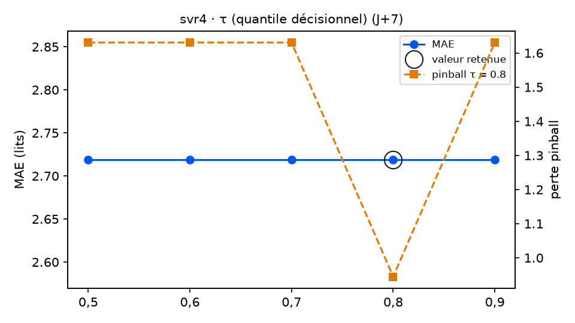

Amplitude de la MAE : 0.0 %. Aucune valeur ne fait significativement mieux que la valeur retenue.

### svr4 · η₀ (taux d'apprentissage d'Adam)

| variante | MAE | RMSE | biais | pinball τ=0.8 | couverture 90 % | temps (s) | DM p (pinball τ=0.8) | p Holm | DM p (MAE) | vs choix retenu |
|---|---|---|---|---|---|---|---|---|---|---|
| taux = 0,005 | 2.719 | 3.246 | -0.906 | 0.9433 | 87.6 | 8.0 | 0.3219 | 1.0 | 0.889 | équivalent |
| taux = 0,01 | 2.719 | 3.246 | -0.905 | 0.9438 | 87.6 | 6.1 | 0.2462 | 1.0 | 0.8821 | équivalent |
| taux = 0,02 | 2.719 | 3.246 | -0.906 | 0.9443 | 87.6 | 7.4 | 0.206 | 1.0 | 0.8902 | équivalent |
| taux = 0,05 (retenu) | 2.719 | 3.246 | -0.904 | 0.9447 | 87.6 | 3.9 |  |  |  | — choix retenu |
| taux = 0,1 | 2.719 | 3.247 | -0.907 | 0.9439 | 87.6 | 6.6 | 0.4824 | 1.0 | 0.978 | équivalent |
| taux = 0,2 | 2.722 | 3.249 | -0.909 | 0.9453 | 87.6 | 3.5 | 0.4142 | 1.0 | 0.0313 | équivalent |

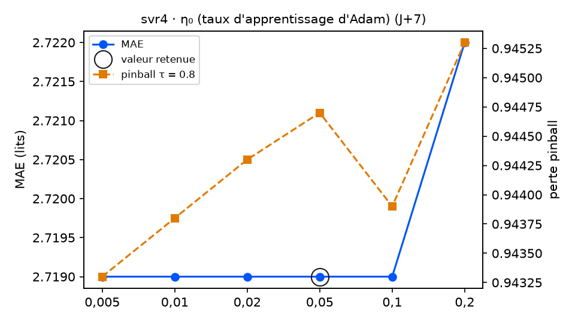

Amplitude de la MAE : 0.1 %. Aucune valeur ne fait significativement mieux que la valeur retenue.

### svr4 · nombre maximal d'itérations

| variante | MAE | RMSE | biais | pinball τ=0.8 | couverture 90 % | temps (s) | DM p (pinball τ=0.8) | p Holm | DM p (MAE) | vs choix retenu |
|---|---|---|---|---|---|---|---|---|---|---|
| iterations = 300 | 2.72 | 3.248 | -0.906 | 0.941 | 88.1 | 0.9 | 0.0651 | 0.1953 | 0.0741 | équivalent |
| iterations = 1000 | 2.72 | 3.247 | -0.905 | 0.9434 | 87.6 | 3.4 | 0.2729 | 0.5458 | 0.1287 | équivalent |
| iterations = 3000 (retenu) | 2.719 | 3.246 | -0.904 | 0.9447 | 87.6 | 5.7 |  |  |  | — choix retenu |
| iterations = 6000 | 2.719 | 3.246 | -0.904 | 0.9448 | 87.6 | 4.6 | 0.3984 | 0.5458 |  | équivalent |

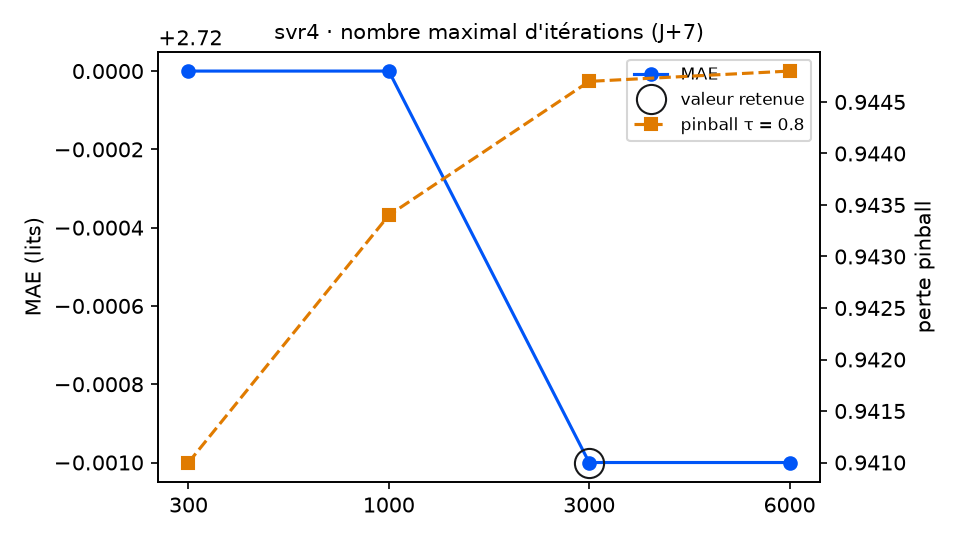

Amplitude de la MAE : 0.0 %. Aucune valeur ne fait significativement mieux que la valeur retenue.

### svr4 · T (décroissance du pas ; aucune = pas constant)

| variante | MAE | RMSE | biais | pinball τ=0.8 | couverture 90 % | temps (s) | DM p (pinball τ=0.8) | p Holm | DM p (MAE) | vs choix retenu |
|---|---|---|---|---|---|---|---|---|---|---|
| decroissance = aucune | 2.72 | 3.247 | -0.905 | 0.9448 | 87.6 | 5.8 | 0.9196 | 0.9196 | 0.2847 | équivalent |
| decroissance = 100 | 2.719 | 3.247 | -0.906 | 0.944 | 87.6 | 4.5 | 0.0817 | 0.2451 | 0.804 | équivalent |
| decroissance = 500 (retenu) | 2.719 | 3.246 | -0.904 | 0.9447 | 87.6 | 4.4 |  |  |  | — choix retenu |
| decroissance = 2000 | 2.719 | 3.247 | -0.906 | 0.9444 | 87.6 | 4.2 | 0.4308 | 0.8616 | 0.7882 | équivalent |

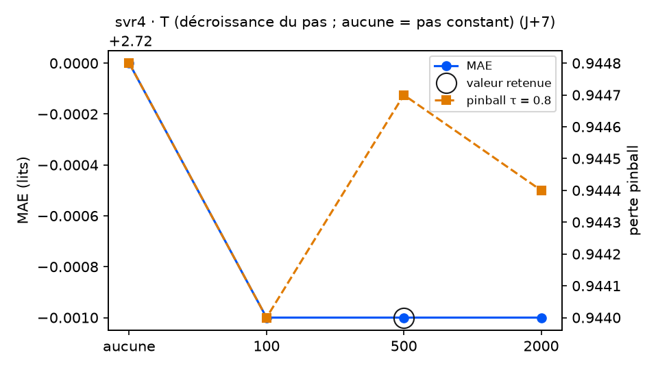

Amplitude de la MAE : 0.0 %. Aucune valeur ne fait significativement mieux que la valeur retenue.

### svr4 · part des pas moyennée (Polyak ; 0 = aucune)

| variante | MAE | RMSE | biais | pinball τ=0.8 | couverture 90 % | temps (s) | DM p (pinball τ=0.8) | p Holm | DM p (MAE) | vs choix retenu |
|---|---|---|---|---|---|---|---|---|---|---|
| moyenne_polyak = 0 | 2.719 | 3.246 | -0.904 | 0.9447 | 87.6 | 3.5 |  |  |  | identique |
| moyenne_polyak = 0,25 | 2.719 | 3.246 | -0.904 | 0.9447 | 87.6 | 6.0 |  |  |  | identique |
| moyenne_polyak = 0,5 (retenu) | 2.719 | 3.246 | -0.904 | 0.9447 | 87.6 | 4.0 |  |  |  | — choix retenu |
| moyenne_polyak = 0,75 | 2.719 | 3.246 | -0.904 | 0.9447 | 87.6 | 3.5 |  |  |  | identique |

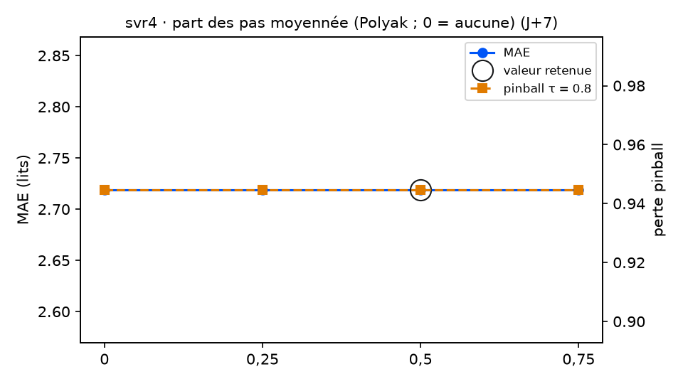

Amplitude de la MAE : 0.0 %. Aucune valeur ne fait significativement mieux que la valeur retenue.

### svr4 · tolérance d'arrêt anticipé

| variante | MAE | RMSE | biais | pinball τ=0.8 | couverture 90 % | temps (s) | DM p (pinball τ=0.8) | p Holm | DM p (MAE) | vs choix retenu |
|---|---|---|---|---|---|---|---|---|---|---|
| tolerance = 1e-05 | 2.719 | 3.246 | -0.908 | 0.944 | 87.6 | 4.1 | 0.4696 | 0.7572 | 0.9444 | équivalent |
| tolerance = 1e-07 (retenu) | 2.719 | 3.246 | -0.904 | 0.9447 | 87.6 | 4.7 |  |  |  | — choix retenu |
| tolerance = 1e-09 | 2.719 | 3.246 | -0.905 | 0.9445 | 87.6 | 8.8 | 0.3786 | 0.7572 | 0.963 | équivalent |

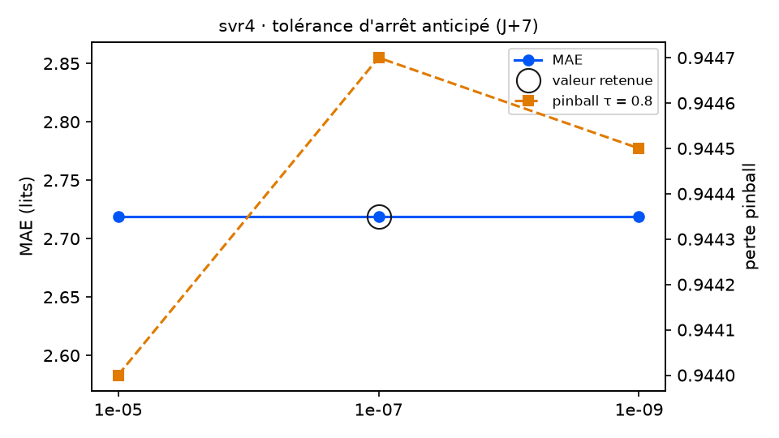

Amplitude de la MAE : 0.0 %. Aucune valeur ne fait significativement mieux que la valeur retenue.

### svr4 · direction préconditionnée α + Cg

| variante | MAE | RMSE | biais | pinball τ=0.8 | couverture 90 % | temps (s) | DM p (pinball τ=0.8) | p Holm | DM p (MAE) | vs choix retenu |
|---|---|---|---|---|---|---|---|---|---|---|
| preconditionne = True (retenu) | 2.719 | 3.246 | -0.904 | 0.9447 | 87.6 | 3.9 |  |  |  | — choix retenu |
| preconditionne = False | 2.719 | 3.247 | -0.907 | 0.9429 | 87.6 | 8.5 | 0.1223 | 0.1223 | 0.9373 | équivalent |

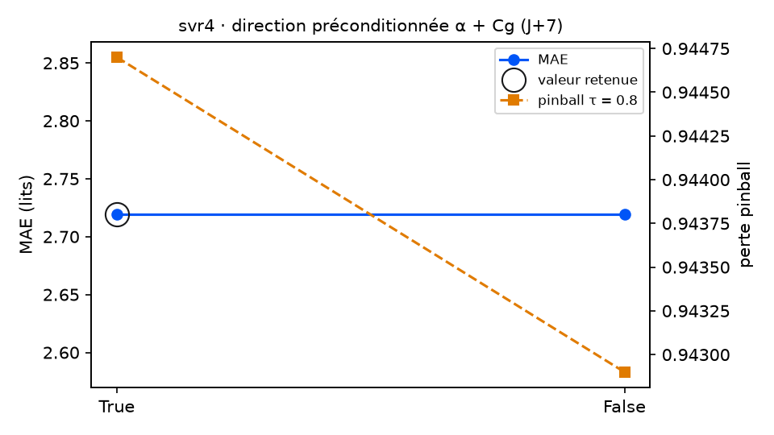

Amplitude de la MAE : 0.0 %. Aucune valeur ne fait significativement mieux que la valeur retenue.

### svr4 · optimiseur

| variante | MAE | RMSE | biais | pinball τ=0.8 | couverture 90 % | temps (s) | DM p (pinball τ=0.8) | p Holm | DM p (MAE) | vs choix retenu |
|---|---|---|---|---|---|---|---|---|---|---|
| optimiseur = adam (retenu) | 2.719 | 3.246 | -0.904 | 0.9447 | 87.6 | 4.8 |  |  |  | — choix retenu |
| optimiseur = momentum | 2.719 | 3.246 | -0.905 | 0.945 | 87.6 | 3.4 | 0.5874 | 0.667 | 0.4259 | équivalent |
| optimiseur = sgd | 2.719 | 3.247 | -0.905 | 0.945 | 87.6 | 4.5 | 0.3335 | 0.667 | 0.9651 | équivalent |

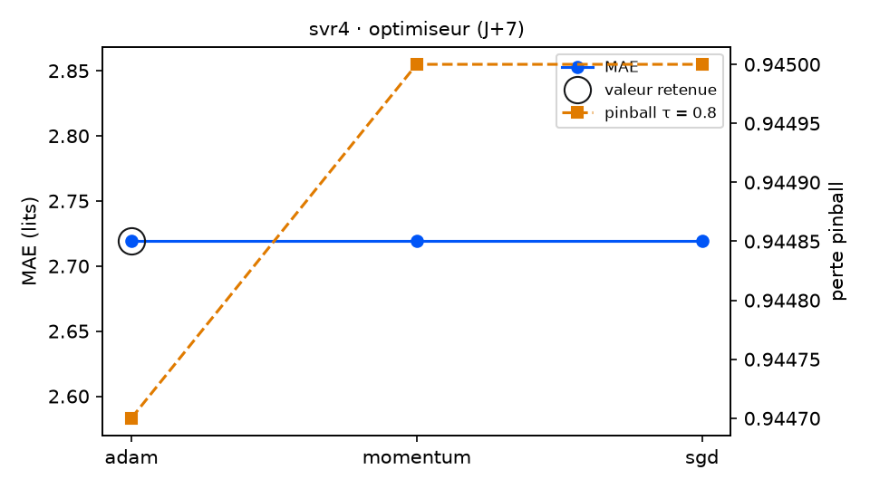

Amplitude de la MAE : 0.0 %. Aucune valeur ne fait significativement mieux que la valeur retenue.

### svr2 · C

| variante | MAE | RMSE | biais | pinball τ=0.8 | temps (s) | DM p (pinball τ=0.8) | p Holm | DM p (MAE) | vs choix retenu |
|---|---|---|---|---|---|---|---|---|---|
| C = 0,1 | 2.746 | 3.274 | -1.066 | 1.6928 | 0.5 | 0.6783 | 1.0 | 0.4964 | équivalent |
| C = 0,3 | 2.743 | 3.261 | -1.008 | 1.6738 | 0.4 | 0.7985 | 1.0 | 0.4387 | équivalent |
| C = 1 | 2.745 | 3.248 | -0.921 | 1.6487 | 1.1 | 0.9089 | 1.0 | 0.29 | équivalent |
| C = 3 (retenu) | 2.682 | 3.188 | -1.044 | 1.6544 | 1.7 |  |  |  | — choix retenu |
| C = 10 | 2.682 | 3.256 | -1.2 | 1.7009 | 1.5 | 0.1977 | 0.9885 | 0.995 | équivalent |
| C = 30 | 2.742 | 3.403 | -1.261 | 1.7493 | 2.0 | 0.2244 | 0.9885 | 0.6371 | équivalent |

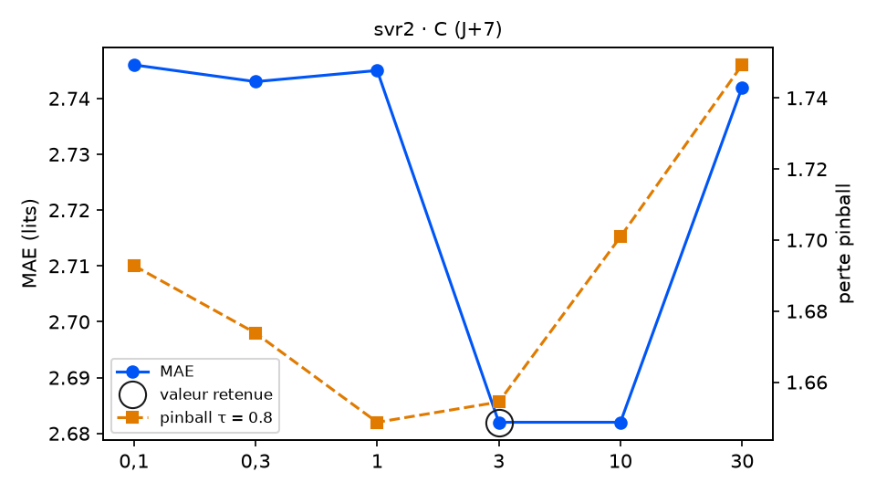

Amplitude de la MAE : 2.4 %. Aucune valeur ne fait significativement mieux que la valeur retenue.

### svr2 · ε (tube ε-insensible, en lits)

| variante | MAE | RMSE | biais | pinball τ=0.8 | temps (s) | DM p (pinball τ=0.8) | p Holm | DM p (MAE) | vs choix retenu |
|---|---|---|---|---|---|---|---|---|---|
| epsilon = 0 | 2.658 | 3.173 | -0.985 | 1.6242 | 1.1 | 0.0717 | 0.2868 | 0.3974 | équivalent |
| epsilon = 0,25 | 2.679 | 3.19 | -1.013 | 1.6432 | 0.8 | 0.3995 | 0.8385 | 0.8148 | équivalent |
| epsilon = 0,5 (retenu) | 2.682 | 3.188 | -1.044 | 1.6544 | 0.9 |  |  |  | — choix retenu |
| epsilon = 1 | 2.694 | 3.222 | -1.127 | 1.6851 | 1.0 | 0.2795 | 0.8385 | 0.7326 | équivalent |
| epsilon = 2 | 2.703 | 3.263 | -1.221 | 1.7178 | 1.4 | 0.2888 | 0.8385 | 0.7931 | équivalent |

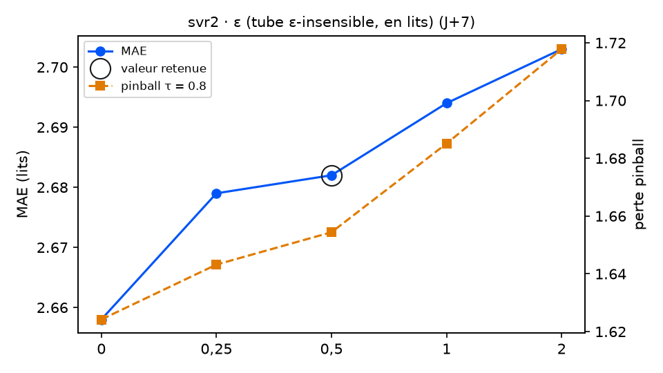

Amplitude de la MAE : 1.7 %. Aucune valeur ne fait significativement mieux que la valeur retenue.

### svr2 · γ (portée du noyau RBF)

| variante | MAE | RMSE | biais | pinball τ=0.8 | temps (s) | DM p (pinball τ=0.8) | p Holm | DM p (MAE) | vs choix retenu |
|---|---|---|---|---|---|---|---|---|---|
| gamma = 0,005 | 2.805 | 3.34 | -0.948 | 1.6868 | 1.4 | 0.6831 | 1.0 | 0.1738 | équivalent |
| gamma = 0,01 | 2.839 | 3.383 | -0.963 | 1.7085 | 1.6 | 0.4526 | 1.0 | 0.0573 | équivalent |
| gamma = 0,02 | 2.811 | 3.341 | -1.014 | 1.7096 | 1.8 | 0.2628 | 1.0 | 0.0194 | équivalent |
| gamma = 0,05 (retenu) | 2.682 | 3.188 | -1.044 | 1.6544 | 1.8 |  |  |  | — choix retenu |
| gamma = 0,1 | 2.667 | 3.201 | -1.113 | 1.6677 | 1.9 | 0.6394 | 1.0 | 0.6634 | équivalent |
| gamma = 0,2 | 2.66 | 3.205 | -1.065 | 1.6497 | 1.2 | 0.9271 | 1.0 | 0.7584 | équivalent |
| gamma = 0,5 | 2.71 | 3.228 | -1.088 | 1.6815 | 0.7 | 0.732 | 1.0 | 0.7515 | équivalent |

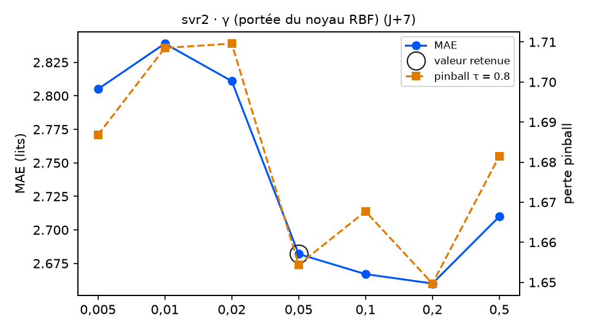

Amplitude de la MAE : 6.7 %. Aucune valeur ne fait significativement mieux que la valeur retenue.

### foret · nombre d'arbres

| variante | MAE | RMSE | biais | pinball τ=0.8 | couverture 90 % | temps (s) | DM p (pinball τ=0.8) | p Holm | DM p (MAE) | vs choix retenu |
|---|---|---|---|---|---|---|---|---|---|---|
| arbres = 25 | 2.67 | 3.183 | -1.007 | 0.9416 | 91.0 | 0.8 | 0.3246 | 1.0 | 0.6596 | équivalent |
| arbres = 50 | 2.676 | 3.203 | -1.017 | 0.9556 | 90.4 | 1.4 | 0.649 | 1.0 | 0.6796 | équivalent |
| arbres = 100 | 2.69 | 3.23 | -0.999 | 0.9606 | 91.0 | 5.0 | 0.7863 | 1.0 | 0.9681 | équivalent |
| arbres = 300 (retenu) | 2.691 | 3.236 | -1.059 | 0.9587 | 91.0 | 8.4 |  |  |  | — choix retenu |
| arbres = 500 | 2.697 | 3.234 | -1.05 | 0.9595 | 91.5 | 15.4 | 0.835 | 1.0 | 0.7205 | équivalent |

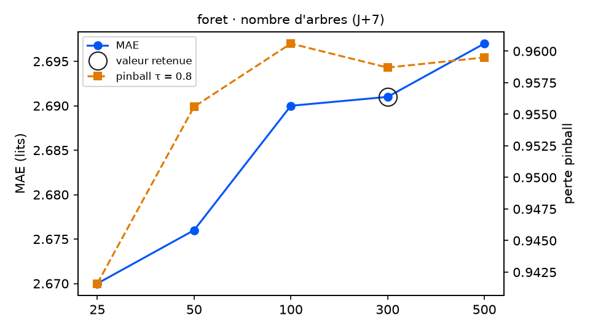

Amplitude de la MAE : 1.0 %. Aucune valeur ne fait significativement mieux que la valeur retenue.

### foret · profondeur maximale

| variante | MAE | RMSE | biais | pinball τ=0.8 | couverture 90 % | temps (s) | DM p (pinball τ=0.8) | p Holm | DM p (MAE) | vs choix retenu |
|---|---|---|---|---|---|---|---|---|---|---|
| profondeur_foret = 3 | 2.721 | 3.27 | -1.081 | 0.9119 | 93.2 | 1.4 | 0.2674 | 0.6068 | 0.6863 | équivalent |
| profondeur_foret = 5 | 2.706 | 3.247 | -1.058 | 0.9173 | 91.0 | 5.8 | 0.1576 | 0.6068 | 0.6104 | équivalent |
| profondeur_foret = 8 | 2.698 | 3.238 | -1.085 | 0.9479 | 91.0 | 7.9 | 0.3686 | 0.6068 | 0.7549 | équivalent |
| profondeur_foret = 12 (retenu) | 2.691 | 3.236 | -1.059 | 0.9587 | 91.0 | 11.0 |  |  |  | — choix retenu |
| profondeur_foret = 20 | 2.694 | 3.225 | -1.032 | 0.9461 | 91.0 | 9.5 | 0.1517 | 0.6068 | 0.9163 | équivalent |

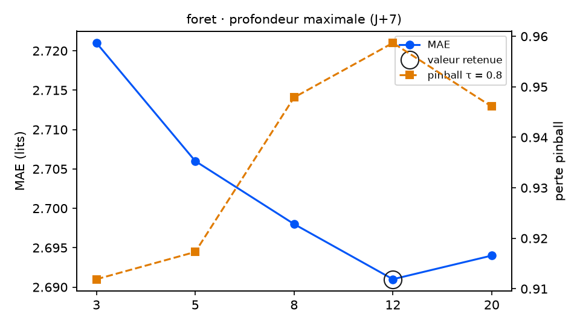

Amplitude de la MAE : 1.1 %. Aucune valeur ne fait significativement mieux que la valeur retenue.

### foret · taille minimale d'une feuille

| variante | MAE | RMSE | biais | pinball τ=0.8 | couverture 90 % | temps (s) | DM p (pinball τ=0.8) | p Holm | DM p (MAE) | vs choix retenu |
|---|---|---|---|---|---|---|---|---|---|---|
| min_feuille = 2 | 2.667 | 3.238 | -1.05 | 0.9556 | 91.5 | 22.4 | 0.7409 | 0.7409 | 0.5233 | équivalent |
| min_feuille = 5 (retenu) | 2.691 | 3.236 | -1.059 | 0.9587 | 91.0 | 10.7 |  |  |  | — choix retenu |
| min_feuille = 10 | 2.719 | 3.253 | -1.046 | 0.9395 | 91.5 | 7.8 | 0.129 | 0.3804 | 0.3531 | équivalent |
| min_feuille = 20 | 2.698 | 3.232 | -0.998 | 0.9033 | 92.1 | 2.7 | 0.1268 | 0.3804 | 0.9068 | équivalent |

Amplitude de la MAE : 1.9 %. Aucune valeur ne fait significativement mieux que la valeur retenue.

### foret · part des variables tirées par nœud

| variante | MAE | RMSE | biais | pinball τ=0.8 | couverture 90 % | temps (s) | DM p (pinball τ=0.8) | p Holm | DM p (MAE) | vs choix retenu |
|---|---|---|---|---|---|---|---|---|---|---|
| part_variables = 0,15 | 2.706 | 3.211 | -1.02 | 0.9458 | 91.0 | 9.9 | 0.4812 | 0.9624 | 0.7541 | équivalent |
| part_variables = 0,333333 (retenu) | 2.691 | 3.236 | -1.059 | 0.9587 | 91.0 | 10.1 |  |  |  | — choix retenu |
| part_variables = 0,5 | 2.69 | 3.217 | -1.045 | 0.9701 | 91.0 | 9.1 | 0.0765 | 0.2295 | 0.9609 | équivalent |
| part_variables = 1 | 2.637 | 3.191 | -1.073 | 0.959 | 91.0 | 10.7 | 0.9784 | 0.9784 | 0.2272 | équivalent |

Amplitude de la MAE : 2.6 %. Aucune valeur ne fait significativement mieux que la valeur retenue.

### boosting · nombre d'étapes

| variante | MAE | RMSE | biais | pinball τ=0.8 | couverture 90 % | temps (s) | DM p (pinball τ=0.8) | p Holm | DM p (MAE) | vs choix retenu |
|---|---|---|---|---|---|---|---|---|---|---|
| etapes = 50 | 2.712 | 3.26 | -1.107 | 1.0332 | 80.8 | 2.1 | 0.003 | 0.003 | 0.174 | meilleur |
| etapes = 100 | 2.736 | 3.281 | -1.15 | 1.0838 | 78.0 | 4.1 | 0.0006 | 0.0018 | 0.0454 | meilleur |
| etapes = 300 (retenu) | 2.817 | 3.386 | -1.163 | 1.2069 | 67.2 | 8.3 |  |  |  | — choix retenu |
| etapes = 600 | 2.875 | 3.453 | -1.211 | 1.2969 | 61.0 | 13.3 | 0.0009 | 0.0018 | 0.0267 | moins bon |

Amplitude de la MAE : 5.8 %. Valeur(s) significativement meilleure(s) : etapes = 50, etapes = 100 — réglage à revoir.

### boosting · taux ν (shrinkage)

| variante | MAE | RMSE | biais | pinball τ=0.8 | couverture 90 % | temps (s) | DM p (pinball τ=0.8) | p Holm | DM p (MAE) | vs choix retenu |
|---|---|---|---|---|---|---|---|---|---|---|
| taux_boosting = 0,01 | 2.723 | 3.257 | -1.206 | 1.0401 | 80.2 | 7.8 | 0.0019 | 0.0057 | 0.2268 | meilleur |
| taux_boosting = 0,05 (retenu) | 2.817 | 3.386 | -1.163 | 1.2069 | 67.2 | 8.0 |  |  |  | — choix retenu |
| taux_boosting = 0,1 | 2.96 | 3.551 | -1.364 | 1.259 | 62.1 | 9.1 | 0.166 | 0.166 | 0.0161 | équivalent |
| taux_boosting = 0,2 | 2.904 | 3.493 | -1.385 | 1.322 | 55.4 | 9.6 | 0.0025 | 0.0057 | 0.1027 | moins bon |

Amplitude de la MAE : 8.4 %. Valeur(s) significativement meilleure(s) : taux_boosting = 0,01 — réglage à revoir.

### boosting · profondeur des arbres

| variante | MAE | RMSE | biais | pinball τ=0.8 | couverture 90 % | temps (s) | DM p (pinball τ=0.8) | p Holm | DM p (MAE) | vs choix retenu |
|---|---|---|---|---|---|---|---|---|---|---|
| profondeur_boosting = 1 | 2.857 | 3.412 | -1.158 | 1.0438 | 84.2 | 3.5 | 0.0011 | 0.0033 | 0.6516 | meilleur |
| profondeur_boosting = 2 | 2.81 | 3.38 | -1.28 | 1.1272 | 78.0 | 4.9 | 0.0092 | 0.0184 | 0.9073 | meilleur |
| profondeur_boosting = 3 (retenu) | 2.817 | 3.386 | -1.163 | 1.2069 | 67.2 | 7.1 |  |  |  | — choix retenu |
| profondeur_boosting = 5 | 2.827 | 3.419 | -1.265 | 1.2809 | 53.1 | 17.3 | 0.0134 | 0.0184 | 0.6773 | moins bon |

Amplitude de la MAE : 1.7 %. Valeur(s) significativement meilleure(s) : profondeur_boosting = 1, profondeur_boosting = 2 — réglage à revoir.

### boosting · part du sous-échantillon

| variante | MAE | RMSE | biais | pinball τ=0.8 | couverture 90 % | temps (s) | DM p (pinball τ=0.8) | p Holm | DM p (MAE) | vs choix retenu |
|---|---|---|---|---|---|---|---|---|---|---|
| sous_echantillon = 0,5 | 2.852 | 3.441 | -1.318 | 1.1687 | 62.1 | 6.1 | 0.1702 | 0.1702 | 0.5028 | équivalent |
| sous_echantillon = 0,8 (retenu) | 2.817 | 3.386 | -1.163 | 1.2069 | 67.2 | 8.0 |  |  |  | — choix retenu |
| sous_echantillon = 1 | 2.863 | 3.441 | -1.266 | 1.135 | 73.4 | 9.4 | 0.0424 | 0.0848 | 0.3887 | équivalent |

Amplitude de la MAE : 1.6 %. Aucune valeur ne fait significativement mieux que la valeur retenue.

### mlp · architecture (neurones par couche)

| variante | MAE | RMSE | biais | pinball τ=0.8 | couverture 90 % | temps (s) | DM p (pinball τ=0.8) | p Holm | DM p (MAE) | vs choix retenu |
|---|---|---|---|---|---|---|---|---|---|---|
| couches = 8 | 3.034 | 3.698 | -1.536 | 1.5033 | 66.7 | 0.9 | 0.0073 | 0.0292 | 0.6412 | moins bon |
| couches = 32 | 3.647 | 4.292 | -1.999 | 1.2134 | 80.8 | 0.7 | 0.1078 | 0.2826 | 0.0006 | équivalent |
| couches = 32×16 (retenu) | 3.087 | 3.692 | -1.262 | 1.0586 | 79.1 | 1.1 |  |  |  | — choix retenu |
| couches = 64×32 | 3.127 | 3.69 | -1.606 | 1.1762 | 89.3 | 1.0 | 0.0942 | 0.2826 | 0.751 | équivalent |
| couches = 32×16×8 | 2.789 | 3.336 | -0.88 | 1.0051 | 78.5 | 1.3 | 0.2704 | 0.2826 | 0.0001 | équivalent |

Amplitude de la MAE : 27.8 %. Aucune valeur ne fait significativement mieux que la valeur retenue.

### mlp · taux d'apprentissage

| variante | MAE | RMSE | biais | pinball τ=0.8 | couverture 90 % | temps (s) | DM p (pinball τ=0.8) | p Holm | DM p (MAE) | vs choix retenu |
|---|---|---|---|---|---|---|---|---|---|---|
| taux_reseau = 0,001 | 3.033 | 3.615 | -0.98 | 1.0791 | 71.2 | 3.7 | 0.6309 | 1.0 | 0.5478 | équivalent |
| taux_reseau = 0,003 | 3.012 | 3.607 | -1.129 | 1.0445 | 72.9 | 1.9 | 0.7102 | 1.0 | 0.1299 | équivalent |
| taux_reseau = 0,01 (retenu) | 3.087 | 3.692 | -1.262 | 1.0586 | 79.1 | 1.0 |  |  |  | — choix retenu |
| taux_reseau = 0,03 | 3.028 | 3.647 | -1.332 | 1.0484 | 84.2 | 0.8 | 0.734 | 1.0 | 0.4448 | équivalent |

Amplitude de la MAE : 2.4 %. Aucune valeur ne fait significativement mieux que la valeur retenue.

### mlp · pénalité L2 λ

| variante | MAE | RMSE | biais | pinball τ=0.8 | couverture 90 % | temps (s) | DM p (pinball τ=0.8) | p Holm | DM p (MAE) | vs choix retenu |
|---|---|---|---|---|---|---|---|---|---|---|
| lambda_ = 0 | 3.027 | 3.624 | -1.251 | 1.0416 | 79.1 | 0.7 | 0.0288 | 0.1152 | 0.0037 | équivalent |
| lambda_ = 0,0001 | 2.992 | 3.592 | -1.217 | 1.0493 | 79.1 | 0.9 | 0.4435 | 0.887 | 0.0009 | équivalent |
| lambda_ = 0,001 (retenu) | 3.087 | 3.692 | -1.262 | 1.0586 | 79.1 | 1.4 |  |  |  | — choix retenu |
| lambda_ = 0,01 | 2.935 | 3.522 | -1.263 | 1.1453 | 75.1 | 1.7 | 0.1292 | 0.3876 | 0.0549 | équivalent |
| lambda_ = 0,1 | 2.769 | 3.336 | -1.099 | 1.0228 | 84.7 | 2.6 | 0.643 | 0.887 | 0.0001 | équivalent |

Amplitude de la MAE : 10.3 %. Aucune valeur ne fait significativement mieux que la valeur retenue.

### mlp · époques maximales

| variante | MAE | RMSE | biais | pinball τ=0.8 | couverture 90 % | temps (s) | DM p (pinball τ=0.8) | p Holm | DM p (MAE) | vs choix retenu |
|---|---|---|---|---|---|---|---|---|---|---|
| epoques = 300 | 3.087 | 3.692 | -1.262 | 1.0586 | 79.1 | 1.5 |  |  |  | identique |
| epoques = 800 | 3.087 | 3.692 | -1.262 | 1.0586 | 79.1 | 1.6 |  |  |  | identique |
| epoques = 1500 (retenu) | 3.087 | 3.692 | -1.262 | 1.0586 | 79.1 | 1.1 |  |  |  | — choix retenu |
| epoques = 3000 | 3.087 | 3.692 | -1.262 | 1.0586 | 79.1 | 1.0 |  |  |  | identique |

Amplitude de la MAE : 0.0 %. Aucune valeur ne fait significativement mieux que la valeur retenue.

### mlp · patience de l'arrêt anticipé

| variante | MAE | RMSE | biais | pinball τ=0.8 | couverture 90 % | temps (s) | DM p (pinball τ=0.8) | p Holm | DM p (MAE) | vs choix retenu |
|---|---|---|---|---|---|---|---|---|---|---|
| patience = 50 | 3.043 | 3.636 | -1.158 | 1.0492 | 79.1 | 0.7 | 0.2853 | 0.2853 | 0.1081 | équivalent |
| patience = 150 (retenu) | 3.087 | 3.692 | -1.262 | 1.0586 | 79.1 | 1.3 |  |  |  | — choix retenu |
| patience = 300 | 3.087 | 3.692 | -1.262 | 1.0586 | 79.1 | 1.9 |  |  |  | identique |

Amplitude de la MAE : 1.4 %. Aucune valeur ne fait significativement mieux que la valeur retenue.

### mlp · nombre d'initialisations moyennées

| variante | MAE | RMSE | biais | pinball τ=0.8 | couverture 90 % | temps (s) | DM p (pinball τ=0.8) | p Holm | DM p (MAE) | vs choix retenu |
|---|---|---|---|---|---|---|---|---|---|---|
| graines = 1 | 3.137 | 3.87 | -0.839 | 1.0339 | 83.1 | 0.5 | 0.634 | 1.0 | 0.7879 | équivalent |
| graines = 3 (retenu) | 3.087 | 3.692 | -1.262 | 1.0586 | 79.1 | 1.4 |  |  |  | — choix retenu |
| graines = 5 | 3.158 | 3.775 | -1.414 | 1.0495 | 76.8 | 1.6 | 0.7799 | 1.0 | 0.0954 | équivalent |

Amplitude de la MAE : 2.3 %. Aucune valeur ne fait significativement mieux que la valeur retenue.

### lstm · taille de l'état caché H

| variante | MAE | RMSE | biais | pinball τ=0.8 | couverture 90 % | temps (s) | DM p (pinball τ=0.8) | p Holm | DM p (MAE) | vs choix retenu |
|---|---|---|---|---|---|---|---|---|---|---|
| cache_lstm = 4 | 2.898 | 3.464 | -1.065 | 1.3262 | 61.6 | 4.1 | 0.0865 | 0.173 | 0.002 | équivalent |
| cache_lstm = 8 | 3.118 | 3.765 | -1.413 | 1.536 | 63.8 | 6.1 | 0.0001 | 0.0003 | 0.0897 | moins bon |
| cache_lstm = 16 (retenu) | 3.291 | 3.911 | -1.708 | 1.196 | 70.6 | 5.1 |  |  |  | — choix retenu |
| cache_lstm = 32 | 3.311 | 3.931 | -1.763 | 1.1707 | 74.6 | 10.7 | 0.7218 | 0.7218 | 0.7501 | équivalent |

Amplitude de la MAE : 12.5 %. Aucune valeur ne fait significativement mieux que la valeur retenue.

### lstm · taux d'apprentissage

| variante | MAE | RMSE | biais | pinball τ=0.8 | couverture 90 % | temps (s) | DM p (pinball τ=0.8) | p Holm | DM p (MAE) | vs choix retenu |
|---|---|---|---|---|---|---|---|---|---|---|
| taux_reseau = 0,003 | 3.284 | 3.919 | -1.662 | 1.1903 | 66.7 | 8.9 | 0.8861 | 0.8861 | 0.824 | équivalent |
| taux_reseau = 0,01 (retenu) | 3.291 | 3.911 | -1.708 | 1.196 | 70.6 | 5.5 |  |  |  | — choix retenu |
| taux_reseau = 0,03 | 3.289 | 3.904 | -1.626 | 1.2709 | 69.5 | 5.9 | 0.3854 | 0.7708 | 0.9773 | équivalent |

Amplitude de la MAE : 0.2 %. Aucune valeur ne fait significativement mieux que la valeur retenue.

### lstm · pénalité L2 λ

| variante | MAE | RMSE | biais | pinball τ=0.8 | couverture 90 % | temps (s) | DM p (pinball τ=0.8) | p Holm | DM p (MAE) | vs choix retenu |
|---|---|---|---|---|---|---|---|---|---|---|
| lambda_ = 0 | 3.318 | 3.943 | -1.687 | 1.1954 | 68.4 | 6.0 | 0.9513 | 0.9513 | 0.2393 | équivalent |
| lambda_ = 0,001 (retenu) | 3.291 | 3.911 | -1.708 | 1.196 | 70.6 | 7.2 |  |  |  | — choix retenu |
| lambda_ = 0,01 | 3.243 | 3.872 | -1.64 | 1.2413 | 63.8 | 9.2 | 0.3599 | 0.7198 | 0.2415 | équivalent |

Amplitude de la MAE : 2.3 %. Aucune valeur ne fait significativement mieux que la valeur retenue.

### variables · jours d'occupation passée en entrée

| variante | MAE | RMSE | biais | pinball τ=0.8 | couverture 90 % | temps (s) | DM p (pinball τ=0.8) | p Holm | DM p (MAE) | vs choix retenu |
|---|---|---|---|---|---|---|---|---|---|---|
| retards = 3 | 2.719 | 3.246 | -0.905 | 0.944 | 87.6 | 5.6 | 0.0021 | 0.0105 | 0.7071 | meilleur |
| retards = 5 | 2.72 | 3.248 | -0.906 | 0.9443 | 87.6 | 4.6 | 0.1918 | 0.7672 | 0.0046 | équivalent |
| retards = 7 (retenu) | 2.719 | 3.246 | -0.904 | 0.9447 | 87.6 | 4.4 |  |  |  | — choix retenu |
| retards = 10 | 2.719 | 3.247 | -0.905 | 0.9444 | 87.6 | 5.0 | 0.206 | 0.7672 | 0.4885 | équivalent |
| retards = 14 | 2.718 | 3.246 | -0.908 | 0.9448 | 88.1 | 4.0 | 0.9647 | 1.0 | 0.2672 | équivalent |
| retards = 21 | 2.753 | 3.291 | -0.97 | 0.9469 | 86.4 | 4.0 | 0.6748 | 1.0 | 0.2495 | équivalent |

Amplitude de la MAE : 1.3 %. Valeur(s) significativement meilleure(s) : retards = 3 — réglage à revoir.

