# Sensibilité de tous les paramètres — service MEDF_journee

Un paramètre varie à la fois, tout le reste au réglage retenu (marqué « retenu »). Mêmes jours, même validation glissante. Diebold-Mariano (perte absolue, HLN) contre la valeur retenue. Amplitude = (MAE max − MAE min) / MAE retenue.

## Synthèse

| paramètre | horizon | famille | valeur retenue | meilleure valeur (MAE) | amplitude MAE % | verdict |
|---|---|---|---|---|---|---|
| C (poids des erreurs) | 1 | svr4 | 3 | 10 | 50.2 | à revoir : 10 |
| ε (tube, niveaux quantiles) | 1 | svr4 | 0 | 0,25 | 2.1 | défendable |
| γ₁ (portée, bloc occupation) | 1 | svr4 | 0,1 | 0,05 | 14.3 | à revoir : 0,05 |
| γ₂ (portée, bloc flux et saison) | 1 | svr4 | 0,05 | 0,1 | 6.4 | défendable |
| τ (quantile décisionnel) | 1 | svr4 | 0,8 | 0,7 | 0.1 | défendable |
| η₀ (taux d'apprentissage d'Adam) | 1 | svr4 | 0,05 | 0,1 | 0.2 | défendable |
| nombre maximal d'itérations | 1 | svr4 | 3000 | 300 | 0.1 | défendable |
| T (décroissance du pas ; aucune = pas constant) | 1 | svr4 | 500 | aucune | 0.1 | défendable |
| part des pas moyennée (Polyak ; 0 = aucune) | 1 | svr4 | 0,5 | 0,75 | 0.0 | défendable |
| tolérance d'arrêt anticipé | 1 | svr4 | 1e-07 | 1e-05 | 0.0 | défendable |
| direction préconditionnée α + Cg | 1 | svr4 | True | True (retenu) | 0.5 | défendable |
| optimiseur | 1 | svr4 | adam | adam (retenu) | 24.5 | défendable |
| C | 1 | svr2 | 3 | 10 | 50.5 | à revoir : 10, 30 |
| ε (tube ε-insensible, en lits) | 1 | svr2 | 0,5 | 0,5 (retenu) | 2.7 | à revoir : 2 |
| γ (portée du noyau RBF) | 1 | svr2 | 0,02 | 0,02 (retenu) | 48.4 | défendable |
| nombre d'arbres | 1 | foret | 300 | 500 | 2.3 | défendable |
| profondeur maximale | 1 | foret | 12 | 20 | 7.0 | défendable |
| taille minimale d'une feuille | 1 | foret | 5 | 2 | 4.2 | défendable |
| part des variables tirées par nœud | 1 | foret | 0,333333 | 1 | 8.5 | défendable |
| nombre d'étapes | 1 | boosting | 300 | 300 (retenu) | 8.0 | défendable |
| taux ν (shrinkage) | 1 | boosting | 0,05 | 0,05 (retenu) | 6.5 | défendable |
| profondeur des arbres | 1 | boosting | 3 | 2 | 3.1 | à revoir : 1, 2 |
| part du sous-échantillon | 1 | boosting | 0,8 | 0,5 | 2.7 | défendable |
| architecture (neurones par couche) | 1 | mlp | 32×16 | 64×32 | 11.8 | à revoir : 32, 64×32, 32×16×8 |
| taux d'apprentissage | 1 | mlp | 0,01 | 0,03 | 10.4 | défendable |
| pénalité L2 λ | 1 | mlp | 0,001 | 0,01 | 3.9 | à revoir : 0 |
| époques maximales | 1 | mlp | 1500 | 300 | 0.0 | défendable |
| patience de l'arrêt anticipé | 1 | mlp | 150 | 50 | 0.0 | défendable |
| nombre d'initialisations moyennées | 1 | mlp | 3 | 5 | 2.0 | défendable |
| taille de l'état caché H | 1 | lstm | 16 | 4 | 11.8 | défendable |
| taux d'apprentissage | 1 | lstm | 0,01 | 0,03 | 6.7 | défendable |
| pénalité L2 λ | 1 | lstm | 0,001 | 0,01 | 6.6 | défendable |
| jours d'occupation passée en entrée | 1 | variables | 7 | 7 (retenu) | 14.7 | défendable |
| C (poids des erreurs) | 7 | svr4 | 1 | 3 | 6.8 | défendable |
| ε (tube, niveaux quantiles) | 7 | svr4 | 0 | 0 (retenu) | 1.4 | défendable |
| γ₁ (portée, bloc occupation) | 7 | svr4 | 0,1 | 0,01 | 1.2 | défendable |
| γ₂ (portée, bloc flux et saison) | 7 | svr4 | 0,05 | 0,2 | 6.8 | défendable |
| τ (quantile décisionnel) | 7 | svr4 | 0,8 | 0,5 | 0.0 | défendable |
| η₀ (taux d'apprentissage d'Adam) | 7 | svr4 | 0,05 | 0,005 | 0.2 | défendable |
| nombre maximal d'itérations | 7 | svr4 | 3000 | 300 | 0.1 | défendable |
| T (décroissance du pas ; aucune = pas constant) | 7 | svr4 | 500 | 100 | 0.0 | défendable |
| part des pas moyennée (Polyak ; 0 = aucune) | 7 | svr4 | 0,5 | 0 | 0.0 | défendable |
| tolérance d'arrêt anticipé | 7 | svr4 | 1e-07 | 1e-05 | 0.1 | défendable |
| direction préconditionnée α + Cg | 7 | svr4 | True | False | 0.1 | défendable |
| optimiseur | 7 | svr4 | adam | sgd | 0.4 | défendable |
| C | 7 | svr2 | 3 | 10 | 7.2 | défendable |
| ε (tube ε-insensible, en lits) | 7 | svr2 | 1 | 0 | 2.7 | défendable |
| γ (portée du noyau RBF) | 7 | svr2 | 0,05 | 0,2 | 7.1 | défendable |
| nombre d'arbres | 7 | foret | 300 | 500 | 3.1 | défendable |
| profondeur maximale | 7 | foret | 12 | 20 | 1.7 | défendable |
| taille minimale d'une feuille | 7 | foret | 5 | 10 | 0.7 | défendable |
| part des variables tirées par nœud | 7 | foret | 0,333333 | 0,15 | 2.4 | défendable |
| nombre d'étapes | 7 | boosting | 300 | 50 | 3.1 | à revoir : 50, 100 |
| taux ν (shrinkage) | 7 | boosting | 0,05 | 0,01 | 5.8 | à revoir : 0,01 |
| profondeur des arbres | 7 | boosting | 3 | 5 | 3.7 | à revoir : 1, 2 |
| part du sous-échantillon | 7 | boosting | 0,8 | 0,8 (retenu) | 1.7 | défendable |
| architecture (neurones par couche) | 7 | mlp | 32×16 | 32×16×8 | 12.2 | défendable |
| taux d'apprentissage | 7 | mlp | 0,01 | 0,01 (retenu) | 5.7 | défendable |
| pénalité L2 λ | 7 | mlp | 0,001 | 0,1 | 9.5 | défendable |
| époques maximales | 7 | mlp | 1500 | 300 | 0.0 | défendable |
| patience de l'arrêt anticipé | 7 | mlp | 150 | 50 | 0.0 | défendable |
| nombre d'initialisations moyennées | 7 | mlp | 3 | 1 | 4.7 | défendable |
| taille de l'état caché H | 7 | lstm | 16 | 4 | 13.1 | défendable |
| taux d'apprentissage | 7 | lstm | 0,01 | 0,01 (retenu) | 0.8 | défendable |
| pénalité L2 λ | 7 | lstm | 0,001 | 0,01 | 1.8 | défendable |
| jours d'occupation passée en entrée | 7 | variables | 7 | 3 | 3.6 | défendable |

## Horizon J+1

### svr4 · C (poids des erreurs)

| variante | MAE | RMSE | biais | pinball τ=0.8 | couverture 90 % | temps (s) | DM p (pinball τ=0.8) | p Holm | DM p (MAE) | vs choix retenu |
|---|---|---|---|---|---|---|---|---|---|---|
| C = 0,1 | 2.865 | 3.453 | -1.262 | 0.9601 | 89.6 | 6.3 | 0.0 | 0.0 | 0.0 | moins bon |
| C = 0,3 | 2.569 | 3.101 | -0.969 | 0.8642 | 90.7 | 5.8 | 0.0148 | 0.0444 | 0.0 | moins bon |
| C = 1 | 2.248 | 2.761 | -0.831 | 0.7935 | 90.2 | 6.3 | 0.4508 | 0.6038 | 0.0 | équivalent |
| C = 3 (retenu) | 2.004 | 2.51 | -0.745 | 0.7759 | 86.3 | 7.3 |  |  |  | — choix retenu |
| C = 10 | 1.858 | 2.352 | -0.576 | 0.7101 | 84.2 | 11.2 | 0.0088 | 0.0352 | 0.0003 | meilleur |
| C = 30 | 1.87 | 2.351 | -0.535 | 0.7358 | 76.5 | 11.1 | 0.3019 | 0.6038 | 0.0352 | équivalent |

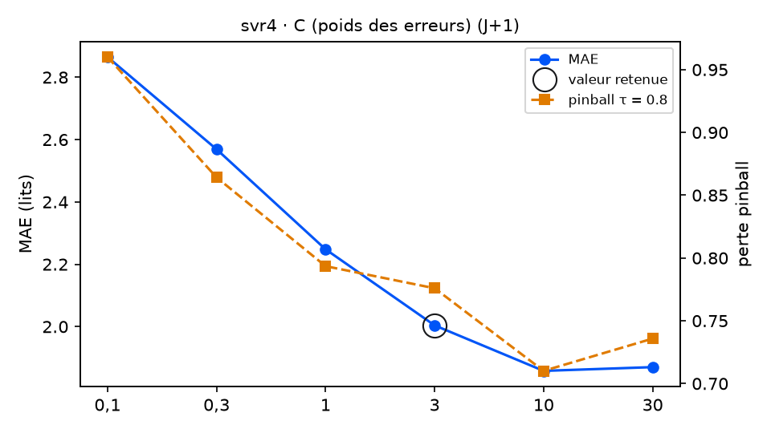

Amplitude de la MAE : 50.2 %. Valeur(s) significativement meilleure(s) : C = 10 — réglage à revoir.

### svr4 · ε (tube, niveaux quantiles)

| variante | MAE | RMSE | biais | pinball τ=0.8 | couverture 90 % | temps (s) | DM p (pinball τ=0.8) | p Holm | DM p (MAE) | vs choix retenu |
|---|---|---|---|---|---|---|---|---|---|---|
| epsilon_quantile = 0 (retenu) | 2.004 | 2.51 | -0.745 | 0.7759 | 86.3 | 8.9 |  |  |  | — choix retenu |
| epsilon_quantile = 0,25 | 1.989 | 2.501 | -0.727 | 0.791 | 85.2 | 8.6 | 0.0008 | 0.0016 | 0.1385 | moins bon |
| epsilon_quantile = 0,5 | 2.001 | 2.512 | -0.73 | 0.81 | 83.6 | 8.5 | 0.0009 | 0.0016 | 0.8613 | moins bon |
| epsilon_quantile = 1 | 2.032 | 2.533 | -0.802 | 0.8451 | 78.7 | 9.4 | 0.0001 | 0.0003 | 0.2775 | moins bon |

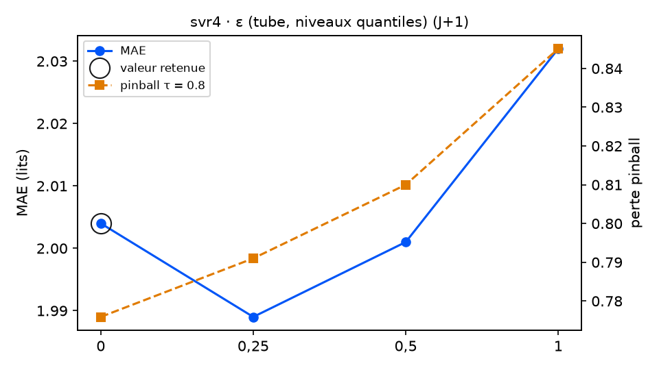

Amplitude de la MAE : 2.1 %. Aucune valeur ne fait significativement mieux que la valeur retenue.

### svr4 · γ₁ (portée, bloc occupation)

| variante | MAE | RMSE | biais | pinball τ=0.8 | couverture 90 % | temps (s) | DM p (pinball τ=0.8) | p Holm | DM p (MAE) | vs choix retenu |
|---|---|---|---|---|---|---|---|---|---|---|
| gamma1 = 0,01 | 2.222 | 2.702 | -0.786 | 0.8294 | 89.6 | 7.6 | 0.0248 | 0.0496 | 0.0004 | moins bon |
| gamma1 = 0,02 | 2.118 | 2.605 | -0.778 | 0.7865 | 89.6 | 8.6 | 0.5239 | 0.5239 | 0.0091 | équivalent |
| gamma1 = 0,05 | 1.994 | 2.51 | -0.772 | 0.7558 | 89.6 | 5.8 | 0.0058 | 0.0174 | 0.5971 | meilleur |
| gamma1 = 0,1 (retenu) | 2.004 | 2.51 | -0.745 | 0.7759 | 86.3 | 8.9 |  |  |  | — choix retenu |
| gamma1 = 0,2 | 2.073 | 2.575 | -0.687 | 0.8028 | 85.2 | 8.1 | 0.002 | 0.008 | 0.0031 | moins bon |
| gamma1 = 0,5 | 2.28 | 2.814 | -0.846 | 0.8582 | 83.1 | 5.7 | 0.0001 | 0.0005 | 0.0 | moins bon |

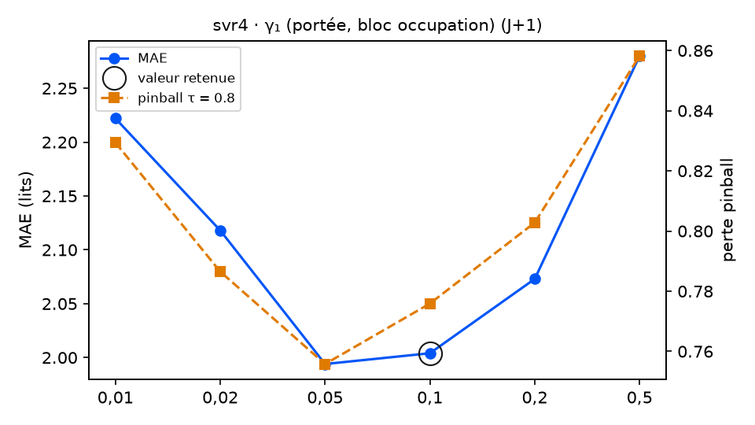

Amplitude de la MAE : 14.3 %. Valeur(s) significativement meilleure(s) : gamma1 = 0,05 — réglage à revoir.

### svr4 · γ₂ (portée, bloc flux et saison)

| variante | MAE | RMSE | biais | pinball τ=0.8 | couverture 90 % | temps (s) | DM p (pinball τ=0.8) | p Holm | DM p (MAE) | vs choix retenu |
|---|---|---|---|---|---|---|---|---|---|---|
| gamma2 = 0,02 | 2.043 | 2.565 | -0.703 | 0.7574 | 86.9 | 7.2 | 0.3643 | 0.7286 | 0.0593 | équivalent |
| gamma2 = 0,05 (retenu) | 2.004 | 2.51 | -0.745 | 0.7759 | 86.3 | 7.4 |  |  |  | — choix retenu |
| gamma2 = 0,1 | 1.976 | 2.479 | -0.706 | 0.7839 | 84.7 | 5.8 | 0.4834 | 0.7286 | 0.071 | équivalent |
| gamma2 = 0,2 | 2.026 | 2.528 | -0.708 | 0.8069 | 85.2 | 7.6 | 0.0914 | 0.3656 | 0.4791 | équivalent |
| gamma2 = 0,5 | 2.104 | 2.619 | -0.696 | 0.8046 | 85.8 | 6.6 | 0.2163 | 0.6489 | 0.016 | équivalent |

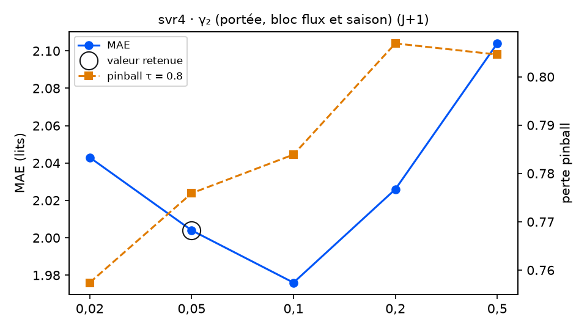

Amplitude de la MAE : 6.4 %. Aucune valeur ne fait significativement mieux que la valeur retenue.

### svr4 · τ (quantile décisionnel)

| variante | MAE | RMSE | biais | pinball τ=0.8 | couverture 90 % | temps (s) | DM p (pinball τ=0.8) | p Holm | DM p (MAE) | vs choix retenu |
|---|---|---|---|---|---|---|---|---|---|---|
| tau = 0,5 | 2.007 | 2.514 | -0.741 | 1.2258 | 86.3 | 5.4 | 0.0 | 0.0 | 0.2211 | moins bon |
| tau = 0,6 | 2.006 | 2.513 | -0.744 | 1.2264 | 86.3 | 5.3 | 0.0 | 0.0 | 0.2496 | moins bon |
| tau = 0,7 | 2.004 | 2.51 | -0.748 | 1.2264 | 86.3 | 6.0 | 0.0 | 0.0 | 0.9965 | moins bon |
| tau = 0,8 (retenu) | 2.004 | 2.51 | -0.745 | 0.7759 | 86.3 | 6.2 |  |  |  | — choix retenu |
| tau = 0,9 | 2.007 | 2.514 | -0.741 | 1.2258 | 86.3 | 6.3 | 0.0 | 0.0 | 0.2211 | moins bon |

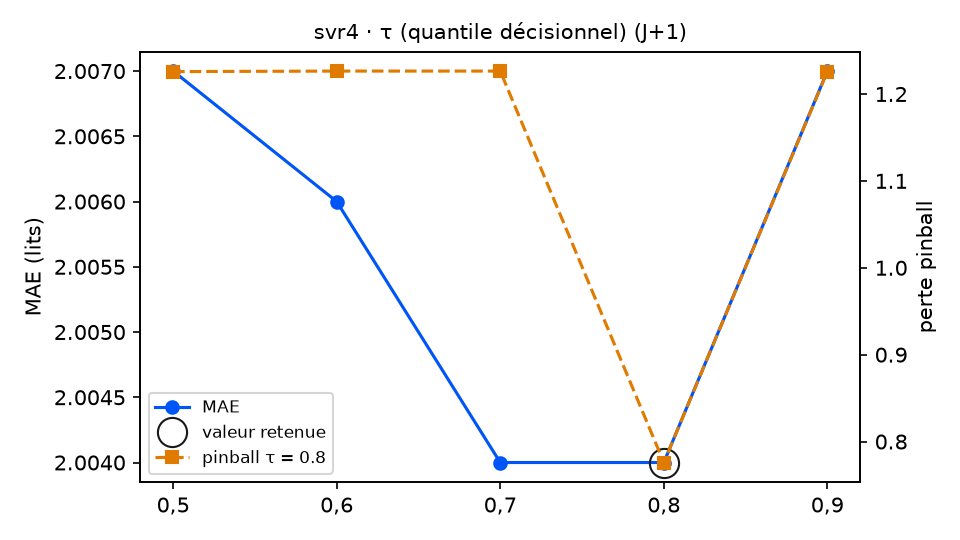

Amplitude de la MAE : 0.1 %. Aucune valeur ne fait significativement mieux que la valeur retenue.

### svr4 · η₀ (taux d'apprentissage d'Adam)

| variante | MAE | RMSE | biais | pinball τ=0.8 | couverture 90 % | temps (s) | DM p (pinball τ=0.8) | p Holm | DM p (MAE) | vs choix retenu |
|---|---|---|---|---|---|---|---|---|---|---|
| taux = 0,005 | 2.004 | 2.511 | -0.734 | 0.7621 | 87.4 | 8.0 | 0.104 | 0.52 | 0.9251 | équivalent |
| taux = 0,01 | 2.005 | 2.511 | -0.736 | 0.7697 | 86.3 | 7.2 | 0.1556 | 0.52 | 0.7368 | équivalent |
| taux = 0,02 | 2.002 | 2.508 | -0.739 | 0.7749 | 86.3 | 5.3 | 0.2851 | 0.52 | 0.0788 | équivalent |
| taux = 0,05 (retenu) | 2.004 | 2.51 | -0.745 | 0.7759 | 86.3 | 5.6 |  |  |  | — choix retenu |
| taux = 0,1 | 2.001 | 2.509 | -0.741 | 0.7752 | 86.3 | 6.6 | 0.1262 | 0.52 | 0.002 | équivalent |
| taux = 0,2 | 2.001 | 2.508 | -0.739 | 0.7748 | 86.3 | 7.2 | 0.1047 | 0.52 | 0.0974 | équivalent |

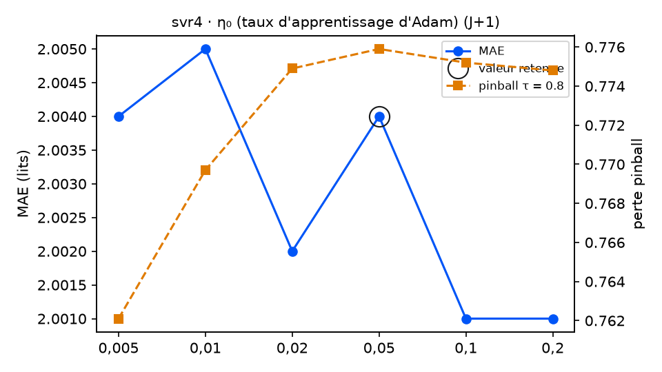

Amplitude de la MAE : 0.2 %. Aucune valeur ne fait significativement mieux que la valeur retenue.

### svr4 · nombre maximal d'itérations

| variante | MAE | RMSE | biais | pinball τ=0.8 | couverture 90 % | temps (s) | DM p (pinball τ=0.8) | p Holm | DM p (MAE) | vs choix retenu |
|---|---|---|---|---|---|---|---|---|---|---|
| iterations = 300 | 2.002 | 2.509 | -0.733 | 0.7631 | 87.4 | 0.9 | 0.0869 | 0.2607 | 0.4481 | équivalent |
| iterations = 1000 | 2.003 | 2.51 | -0.742 | 0.7742 | 86.3 | 2.8 | 0.0886 | 0.2607 | 0.4304 | équivalent |
| iterations = 3000 (retenu) | 2.004 | 2.51 | -0.745 | 0.7759 | 86.3 | 6.5 |  |  |  | — choix retenu |
| iterations = 6000 | 2.004 | 2.51 | -0.744 | 0.7759 | 86.3 | 5.7 | 0.6285 | 0.6285 | 0.0687 | équivalent |

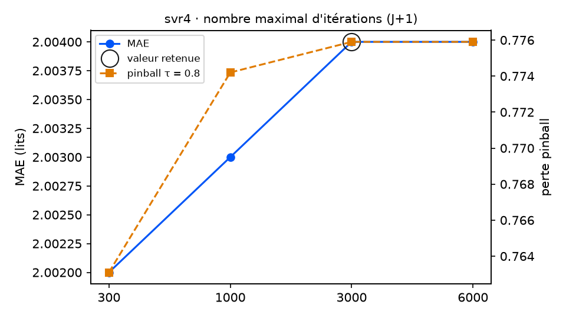

Amplitude de la MAE : 0.1 %. Aucune valeur ne fait significativement mieux que la valeur retenue.

### svr4 · T (décroissance du pas ; aucune = pas constant)

| variante | MAE | RMSE | biais | pinball τ=0.8 | couverture 90 % | temps (s) | DM p (pinball τ=0.8) | p Holm | DM p (MAE) | vs choix retenu |
|---|---|---|---|---|---|---|---|---|---|---|
| decroissance = aucune | 2.002 | 2.507 | -0.736 | 0.7751 | 86.3 | 6.5 | 0.0428 | 0.1284 | 0.1191 | équivalent |
| decroissance = 100 | 2.003 | 2.51 | -0.742 | 0.7756 | 86.3 | 4.9 | 0.6816 | 0.6816 | 0.2426 | équivalent |
| decroissance = 500 (retenu) | 2.004 | 2.51 | -0.745 | 0.7759 | 86.3 | 5.9 |  |  |  | — choix retenu |
| decroissance = 2000 | 2.002 | 2.509 | -0.741 | 0.7755 | 86.3 | 7.0 | 0.1386 | 0.2772 | 0.0081 | équivalent |

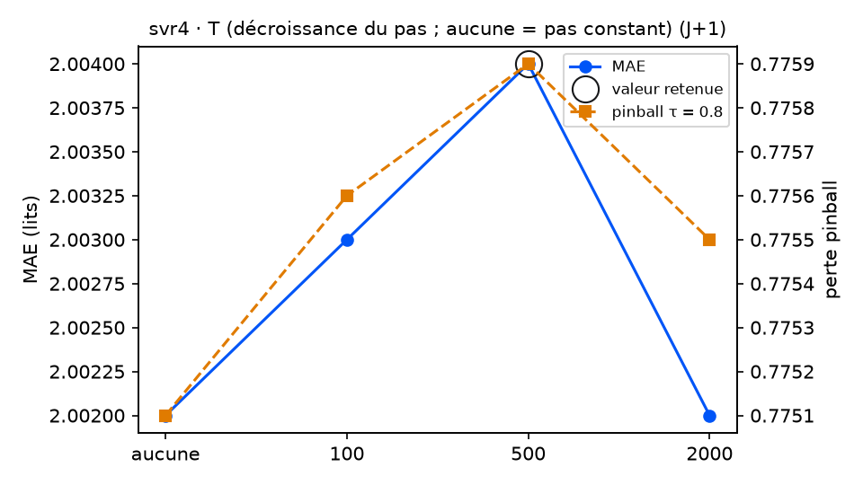

Amplitude de la MAE : 0.1 %. Aucune valeur ne fait significativement mieux que la valeur retenue.

### svr4 · part des pas moyennée (Polyak ; 0 = aucune)

| variante | MAE | RMSE | biais | pinball τ=0.8 | couverture 90 % | temps (s) | DM p (pinball τ=0.8) | p Holm | DM p (MAE) | vs choix retenu |
|---|---|---|---|---|---|---|---|---|---|---|
| moyenne_polyak = 0 | 2.004 | 2.51 | -0.745 | 0.7759 | 86.3 | 7.5 |  |  | 0.1953 | identique |
| moyenne_polyak = 0,25 | 2.004 | 2.51 | -0.745 | 0.7759 | 86.3 | 5.2 |  |  | 0.4844 | identique |
| moyenne_polyak = 0,5 (retenu) | 2.004 | 2.51 | -0.745 | 0.7759 | 86.3 | 5.9 |  |  |  | — choix retenu |
| moyenne_polyak = 0,75 | 2.003 | 2.51 | -0.744 | 0.7759 | 86.3 | 5.6 |  |  | 0.0612 | identique |

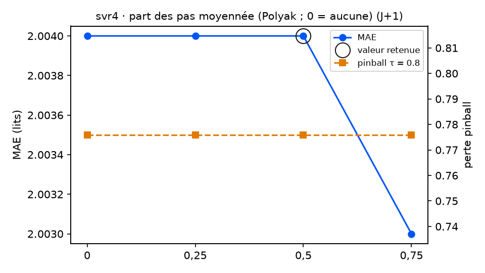

Amplitude de la MAE : 0.0 %. Aucune valeur ne fait significativement mieux que la valeur retenue.

### svr4 · tolérance d'arrêt anticipé

| variante | MAE | RMSE | biais | pinball τ=0.8 | couverture 90 % | temps (s) | DM p (pinball τ=0.8) | p Holm | DM p (MAE) | vs choix retenu |
|---|---|---|---|---|---|---|---|---|---|---|
| tolerance = 1e-05 | 2.003 | 2.51 | -0.74 | 0.7736 | 86.3 | 2.5 | 0.1647 | 0.2432 | 0.5735 | équivalent |
| tolerance = 1e-07 (retenu) | 2.004 | 2.51 | -0.745 | 0.7759 | 86.3 | 6.2 |  |  |  | — choix retenu |
| tolerance = 1e-09 | 2.003 | 2.51 | -0.742 | 0.7762 | 86.3 | 9.9 | 0.1216 | 0.2432 | 0.252 | équivalent |

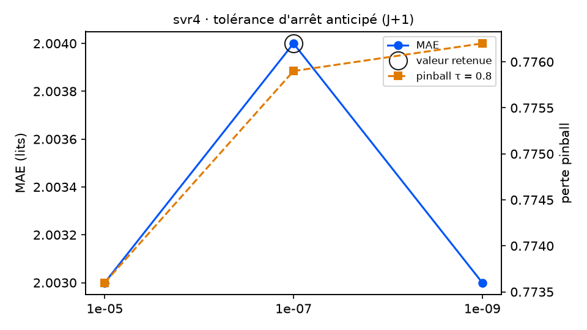

Amplitude de la MAE : 0.0 %. Aucune valeur ne fait significativement mieux que la valeur retenue.

### svr4 · direction préconditionnée α + Cg

| variante | MAE | RMSE | biais | pinball τ=0.8 | couverture 90 % | temps (s) | DM p (pinball τ=0.8) | p Holm | DM p (MAE) | vs choix retenu |
|---|---|---|---|---|---|---|---|---|---|---|
| preconditionne = True (retenu) | 2.004 | 2.51 | -0.745 | 0.7759 | 86.3 | 5.5 |  |  |  | — choix retenu |
| preconditionne = False | 2.015 | 2.523 | -0.757 | 0.7753 | 86.9 | 11.0 | 0.8243 | 0.8243 | 0.0762 | équivalent |

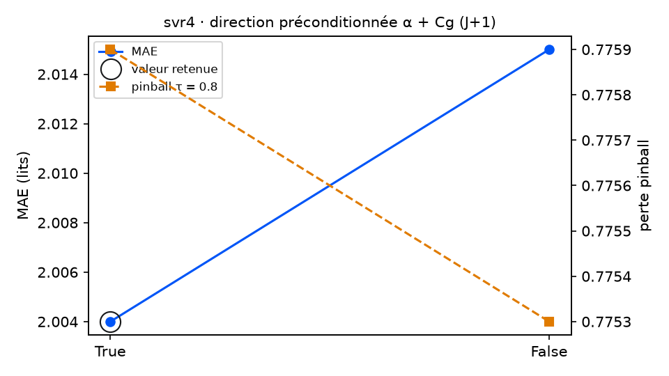

Amplitude de la MAE : 0.5 %. Aucune valeur ne fait significativement mieux que la valeur retenue.

### svr4 · optimiseur

| variante | MAE | RMSE | biais | pinball τ=0.8 | couverture 90 % | temps (s) | DM p (pinball τ=0.8) | p Holm | DM p (MAE) | vs choix retenu |
|---|---|---|---|---|---|---|---|---|---|---|
| optimiseur = adam (retenu) | 2.004 | 2.51 | -0.745 | 0.7759 | 86.3 | 6.7 |  |  |  | — choix retenu |
| optimiseur = momentum | 2.293 | 2.788 | -0.456 | 0.7102 | 86.9 | 5.7 | 0.0602 | 0.106 | 0.0003 | équivalent |
| optimiseur = sgd | 2.494 | 3.022 | -0.822 | 0.7231 | 86.9 | 4.2 | 0.053 | 0.106 | 0.0 | équivalent |

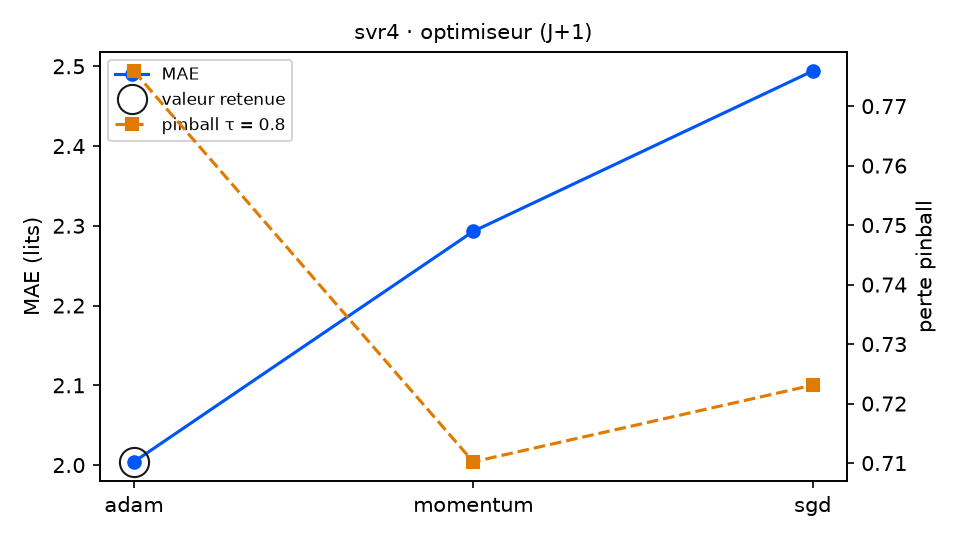

Amplitude de la MAE : 24.5 %. Aucune valeur ne fait significativement mieux que la valeur retenue.

### svr2 · C

| variante | MAE | RMSE | biais | pinball τ=0.8 | temps (s) | DM p (pinball τ=0.8) | p Holm | DM p (MAE) | vs choix retenu |
|---|---|---|---|---|---|---|---|---|---|
| C = 0,1 | 2.738 | 3.299 | -1.111 | 1.7021 | 0.4 | 0.0 | 0.0 | 0.0 | moins bon |
| C = 0,3 | 2.415 | 2.918 | -0.866 | 1.4673 | 0.7 | 0.0 | 0.0 | 0.0 | moins bon |
| C = 1 | 2.084 | 2.595 | -0.802 | 1.2824 | 1.3 | 0.0 | 0.0 | 0.0 | moins bon |
| C = 3 (retenu) | 1.852 | 2.358 | -0.712 | 1.1395 | 1.2 |  |  |  | — choix retenu |
| C = 10 | 1.802 | 2.273 | -0.554 | 1.0671 | 1.6 | 0.0006 | 0.0012 | 0.1277 | meilleur |
| C = 30 | 1.828 | 2.293 | -0.479 | 1.0577 | 1.8 | 0.0399 | 0.0399 | 0.6936 | meilleur |

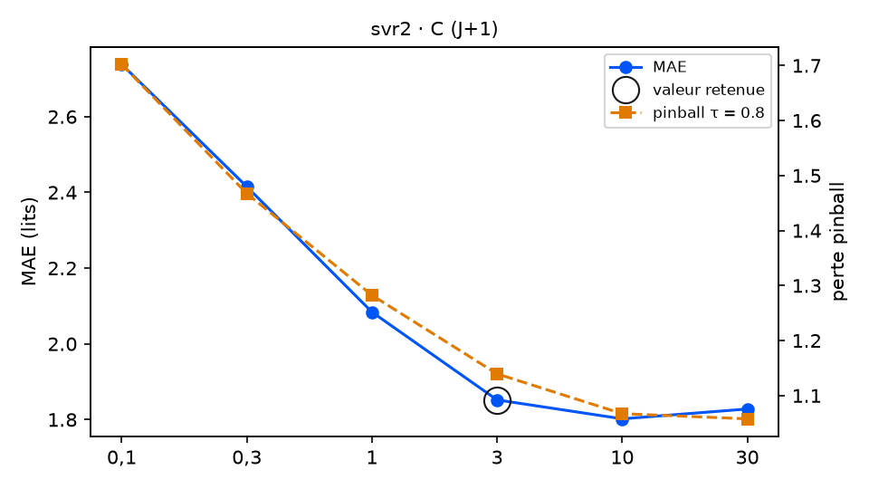

Amplitude de la MAE : 50.5 %. Valeur(s) significativement meilleure(s) : C = 10, C = 30 — réglage à revoir.

### svr2 · ε (tube ε-insensible, en lits)

| variante | MAE | RMSE | biais | pinball τ=0.8 | temps (s) | DM p (pinball τ=0.8) | p Holm | DM p (MAE) | vs choix retenu |
|---|---|---|---|---|---|---|---|---|---|
| epsilon = 0 | 1.882 | 2.379 | -0.746 | 1.1651 | 1.0 | 0.0679 | 0.1358 | 0.1436 | équivalent |
| epsilon = 0,25 | 1.861 | 2.367 | -0.711 | 1.1435 | 1.1 | 0.6473 | 0.6473 | 0.5019 | équivalent |
| epsilon = 0,5 (retenu) | 1.852 | 2.358 | -0.712 | 1.1395 | 1.7 |  |  |  | — choix retenu |
| epsilon = 1 | 1.902 | 2.408 | -0.77 | 1.1818 | 1.7 | 0.0001 | 0.0004 | 0.0019 | moins bon |
| epsilon = 2 | 1.87 | 2.359 | -0.486 | 1.0807 | 1.8 | 0.0019 | 0.0057 | 0.5708 | meilleur |

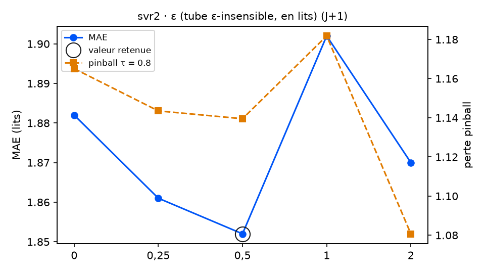

Amplitude de la MAE : 2.7 %. Valeur(s) significativement meilleure(s) : epsilon = 2 — réglage à revoir.

### svr2 · γ (portée du noyau RBF)

| variante | MAE | RMSE | biais | pinball τ=0.8 | temps (s) | DM p (pinball τ=0.8) | p Holm | DM p (MAE) | vs choix retenu |
|---|---|---|---|---|---|---|---|---|---|
| gamma = 0,005 | 2.043 | 2.539 | -0.753 | 1.2476 | 1.1 | 0.0 | 0.0 | 0.0 | moins bon |
| gamma = 0,01 | 1.941 | 2.445 | -0.757 | 1.1977 | 1.6 | 0.0001 | 0.0003 | 0.0 | moins bon |
| gamma = 0,02 (retenu) | 1.852 | 2.358 | -0.712 | 1.1395 | 1.5 |  |  |  | — choix retenu |
| gamma = 0,05 | 1.89 | 2.409 | -0.602 | 1.1257 | 1.3 | 0.4853 | 0.4853 | 0.2877 | équivalent |
| gamma = 0,1 | 2.063 | 2.631 | -0.676 | 1.2343 | 1.0 | 0.01 | 0.02 | 0.001 | moins bon |
| gamma = 0,2 | 2.276 | 2.856 | -0.829 | 1.3868 | 1.2 | 0.0 | 0.0 | 0.0 | moins bon |
| gamma = 0,5 | 2.749 | 3.33 | -1.122 | 1.7109 | 0.8 | 0.0 | 0.0 | 0.0 | moins bon |

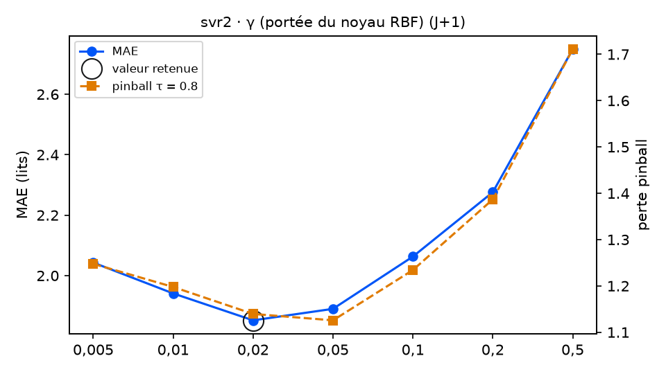

Amplitude de la MAE : 48.4 %. Aucune valeur ne fait significativement mieux que la valeur retenue.

### foret · nombre d'arbres

| variante | MAE | RMSE | biais | pinball τ=0.8 | couverture 90 % | temps (s) | DM p (pinball τ=0.8) | p Holm | DM p (MAE) | vs choix retenu |
|---|---|---|---|---|---|---|---|---|---|---|
| arbres = 25 | 2.064 | 2.588 | -0.551 | 0.6976 | 94.5 | 1.2 | 0.2908 | 0.8724 | 0.2994 | équivalent |
| arbres = 50 | 2.027 | 2.534 | -0.531 | 0.7095 | 94.5 | 1.6 | 0.7522 | 0.8724 | 0.9911 | équivalent |
| arbres = 100 | 2.032 | 2.553 | -0.523 | 0.7234 | 94.0 | 3.4 | 0.3044 | 0.8724 | 0.7891 | équivalent |
| arbres = 300 (retenu) | 2.027 | 2.562 | -0.51 | 0.7136 | 94.5 | 10.2 |  |  |  | — choix retenu |
| arbres = 500 | 2.018 | 2.553 | -0.491 | 0.6985 | 94.5 | 18.3 | 0.0403 | 0.1612 | 0.486 | équivalent |

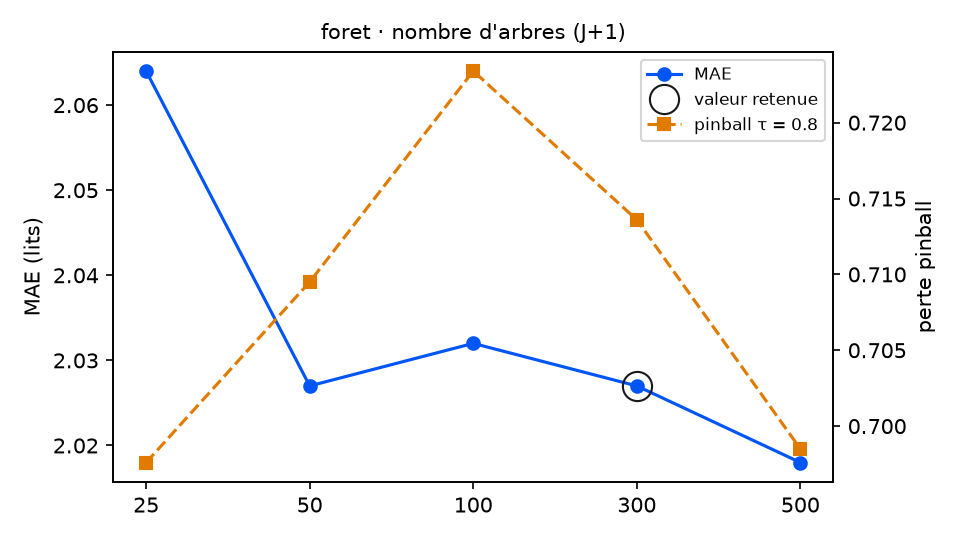

Amplitude de la MAE : 2.3 %. Aucune valeur ne fait significativement mieux que la valeur retenue.

### foret · profondeur maximale

| variante | MAE | RMSE | biais | pinball τ=0.8 | couverture 90 % | temps (s) | DM p (pinball τ=0.8) | p Holm | DM p (MAE) | vs choix retenu |
|---|---|---|---|---|---|---|---|---|---|---|
| profondeur_foret = 3 | 2.163 | 2.683 | -0.629 | 0.7072 | 96.2 | 2.3 | 0.7278 | 0.7278 | 0.0028 | équivalent |
| profondeur_foret = 5 | 2.08 | 2.632 | -0.577 | 0.693 | 95.6 | 4.2 | 0.1255 | 0.3765 | 0.0582 | équivalent |
| profondeur_foret = 8 | 2.033 | 2.559 | -0.502 | 0.7036 | 95.6 | 7.9 | 0.2862 | 0.5724 | 0.7208 | équivalent |
| profondeur_foret = 12 (retenu) | 2.027 | 2.562 | -0.51 | 0.7136 | 94.5 | 9.7 |  |  |  | — choix retenu |
| profondeur_foret = 20 | 2.021 | 2.547 | -0.515 | 0.6948 | 94.5 | 8.9 | 0.0503 | 0.2012 | 0.7382 | équivalent |

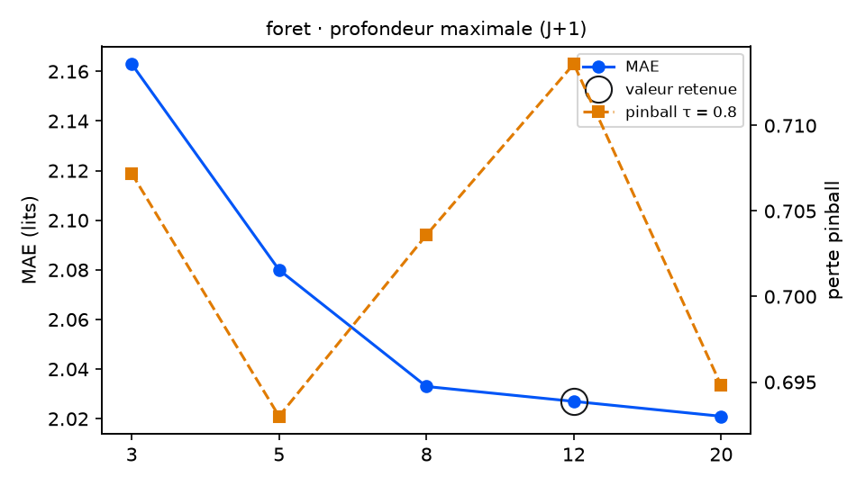

Amplitude de la MAE : 7.0 %. Aucune valeur ne fait significativement mieux que la valeur retenue.

### foret · taille minimale d'une feuille

| variante | MAE | RMSE | biais | pinball τ=0.8 | couverture 90 % | temps (s) | DM p (pinball τ=0.8) | p Holm | DM p (MAE) | vs choix retenu |
|---|---|---|---|---|---|---|---|---|---|---|
| min_feuille = 2 | 2.013 | 2.53 | -0.485 | 0.7093 | 92.3 | 19.1 | 0.7194 | 1.0 | 0.6377 | équivalent |
| min_feuille = 5 (retenu) | 2.027 | 2.562 | -0.51 | 0.7136 | 94.5 | 8.2 |  |  |  | — choix retenu |
| min_feuille = 10 | 2.043 | 2.573 | -0.537 | 0.7055 | 93.4 | 4.5 | 0.5085 | 1.0 | 0.5909 | équivalent |
| min_feuille = 20 | 2.098 | 2.627 | -0.579 | 0.7065 | 96.2 | 2.3 | 0.697 | 1.0 | 0.0855 | équivalent |

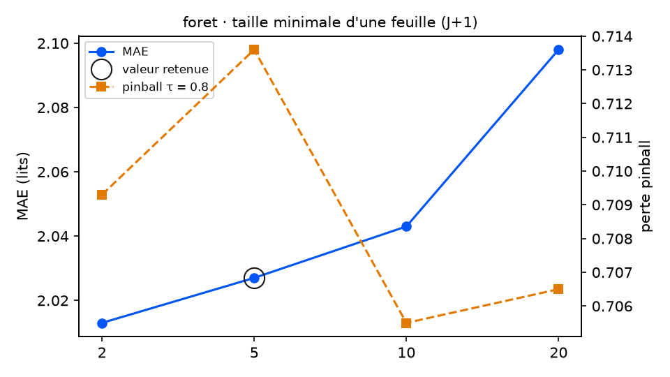

Amplitude de la MAE : 4.2 %. Aucune valeur ne fait significativement mieux que la valeur retenue.

### foret · part des variables tirées par nœud

| variante | MAE | RMSE | biais | pinball τ=0.8 | couverture 90 % | temps (s) | DM p (pinball τ=0.8) | p Holm | DM p (MAE) | vs choix retenu |
|---|---|---|---|---|---|---|---|---|---|---|
| part_variables = 0,15 | 2.149 | 2.652 | -0.601 | 0.7106 | 96.2 | 7.5 | 0.8612 | 0.8612 | 0.0048 | équivalent |
| part_variables = 0,333333 (retenu) | 2.027 | 2.562 | -0.51 | 0.7136 | 94.5 | 9.7 |  |  |  | — choix retenu |
| part_variables = 0,5 | 1.981 | 2.534 | -0.492 | 0.6995 | 94.0 | 8.7 | 0.1553 | 0.4659 | 0.0557 | équivalent |
| part_variables = 1 | 1.976 | 2.562 | -0.421 | 0.6886 | 91.8 | 8.6 | 0.2052 | 0.4659 | 0.2282 | équivalent |

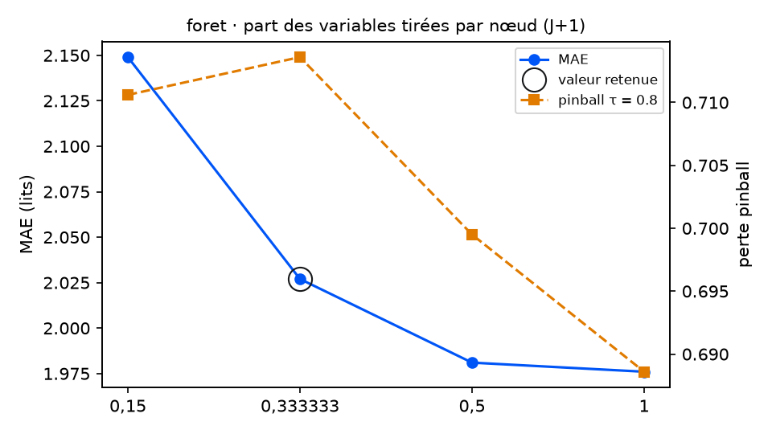

Amplitude de la MAE : 8.5 %. Aucune valeur ne fait significativement mieux que la valeur retenue.

### boosting · nombre d'étapes

| variante | MAE | RMSE | biais | pinball τ=0.8 | couverture 90 % | temps (s) | DM p (pinball τ=0.8) | p Holm | DM p (MAE) | vs choix retenu |
|---|---|---|---|---|---|---|---|---|---|---|
| etapes = 50 | 2.074 | 2.585 | -0.679 | 0.7481 | 86.9 | 1.7 | 0.1142 | 0.1142 | 0.0023 | équivalent |
| etapes = 100 | 1.94 | 2.464 | -0.61 | 0.7653 | 83.1 | 1.9 | 0.0526 | 0.1052 | 0.5218 | équivalent |
| etapes = 300 (retenu) | 1.921 | 2.429 | -0.587 | 0.8012 | 75.4 | 7.7 |  |  |  | — choix retenu |
| etapes = 600 | 1.931 | 2.441 | -0.612 | 0.827 | 72.1 | 14.5 | 0.0051 | 0.0153 | 0.4553 | moins bon |

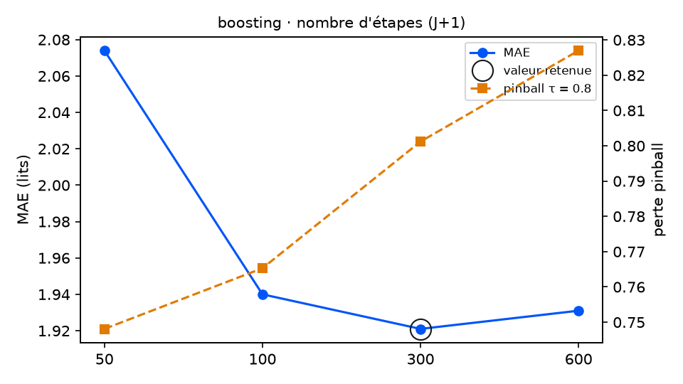

Amplitude de la MAE : 8.0 %. Aucune valeur ne fait significativement mieux que la valeur retenue.

### boosting · taux ν (shrinkage)

| variante | MAE | RMSE | biais | pinball τ=0.8 | couverture 90 % | temps (s) | DM p (pinball τ=0.8) | p Holm | DM p (MAE) | vs choix retenu |
|---|---|---|---|---|---|---|---|---|---|---|
| taux_boosting = 0,01 | 2.046 | 2.564 | -0.651 | 0.744 | 85.8 | 8.4 | 0.0595 | 0.1785 | 0.0052 | équivalent |
| taux_boosting = 0,05 (retenu) | 1.921 | 2.429 | -0.587 | 0.8012 | 75.4 | 7.1 |  |  |  | — choix retenu |
| taux_boosting = 0,1 | 1.952 | 2.466 | -0.633 | 0.7992 | 72.1 | 5.9 | 0.9077 | 0.9077 | 0.3728 | équivalent |
| taux_boosting = 0,2 | 2.005 | 2.499 | -0.755 | 0.8205 | 65.6 | 6.4 | 0.4134 | 0.8268 | 0.0934 | équivalent |

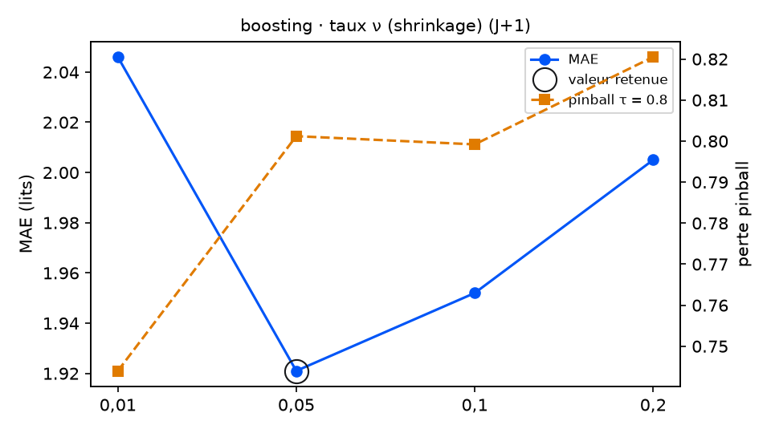

Amplitude de la MAE : 6.5 %. Aucune valeur ne fait significativement mieux que la valeur retenue.

### boosting · profondeur des arbres

| variante | MAE | RMSE | biais | pinball τ=0.8 | couverture 90 % | temps (s) | DM p (pinball τ=0.8) | p Holm | DM p (MAE) | vs choix retenu |
|---|---|---|---|---|---|---|---|---|---|---|
| profondeur_boosting = 1 | 1.925 | 2.462 | -0.565 | 0.6916 | 84.7 | 2.4 | 0.0002 | 0.0006 | 0.9149 | meilleur |
| profondeur_boosting = 2 | 1.907 | 2.437 | -0.624 | 0.7452 | 80.3 | 3.7 | 0.0012 | 0.0024 | 0.5891 | meilleur |
| profondeur_boosting = 3 (retenu) | 1.921 | 2.429 | -0.587 | 0.8012 | 75.4 | 5.7 |  |  |  | — choix retenu |
| profondeur_boosting = 5 | 1.966 | 2.488 | -0.51 | 0.8325 | 65.0 | 11.3 | 0.0646 | 0.0646 | 0.2243 | équivalent |

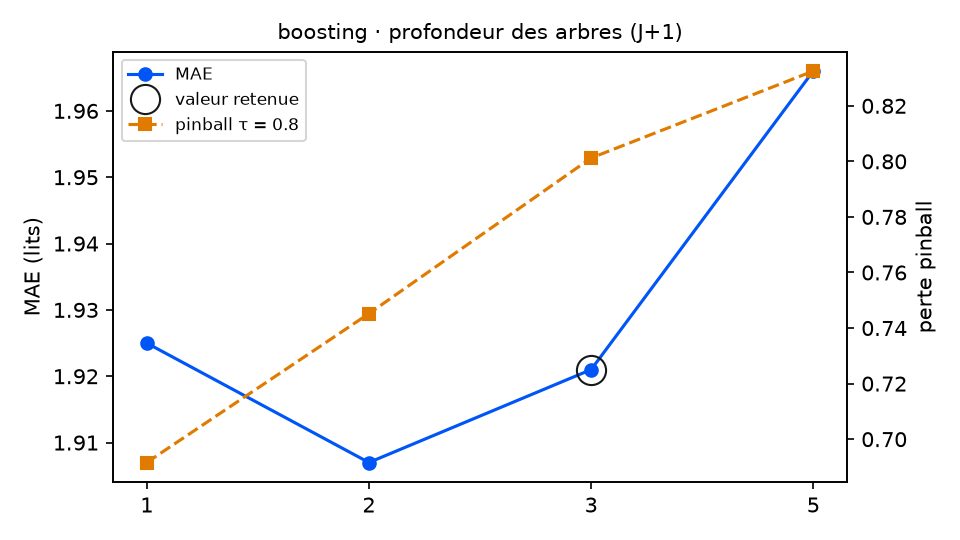

Amplitude de la MAE : 3.1 %. Valeur(s) significativement meilleure(s) : profondeur_boosting = 1, profondeur_boosting = 2 — réglage à revoir.

### boosting · part du sous-échantillon

| variante | MAE | RMSE | biais | pinball τ=0.8 | couverture 90 % | temps (s) | DM p (pinball τ=0.8) | p Holm | DM p (MAE) | vs choix retenu |
|---|---|---|---|---|---|---|---|---|---|---|
| sous_echantillon = 0,5 | 1.885 | 2.392 | -0.546 | 0.7681 | 70.5 | 7.7 | 0.0989 | 0.1978 | 0.2943 | équivalent |
| sous_echantillon = 0,8 (retenu) | 1.921 | 2.429 | -0.587 | 0.8012 | 75.4 | 8.7 |  |  |  | — choix retenu |
| sous_echantillon = 1 | 1.937 | 2.46 | -0.524 | 0.7855 | 76.5 | 9.6 | 0.4412 | 0.4412 | 0.5769 | équivalent |

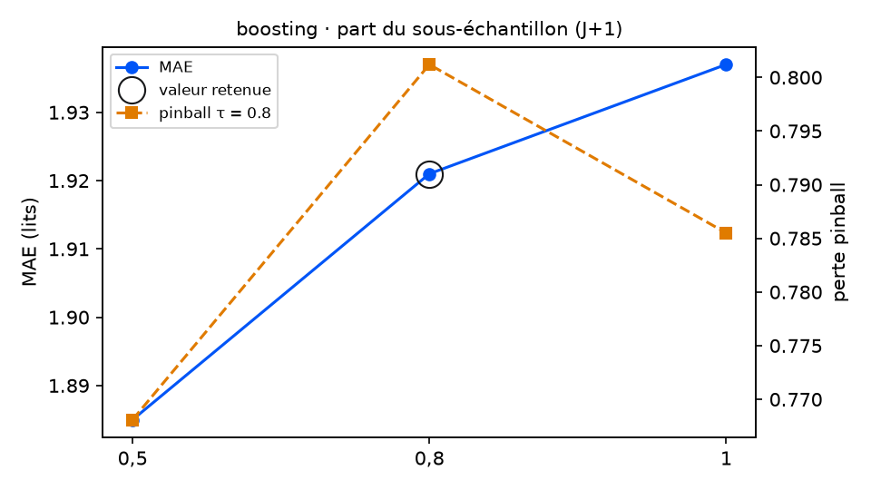

Amplitude de la MAE : 2.7 %. Aucune valeur ne fait significativement mieux que la valeur retenue.

### mlp · architecture (neurones par couche)

| variante | MAE | RMSE | biais | pinball τ=0.8 | couverture 90 % | temps (s) | DM p (pinball τ=0.8) | p Holm | DM p (MAE) | vs choix retenu |
|---|---|---|---|---|---|---|---|---|---|---|
| couches = 8 | 2.145 | 2.678 | -1.122 | 1.0558 | 82.0 | 1.8 | 0.0 | 0.0 | 0.6787 | moins bon |
| couches = 32 | 2.045 | 2.499 | -0.784 | 0.7286 | 85.8 | 1.0 | 0.0058 | 0.0174 | 0.2844 | meilleur |
| couches = 32×16 (retenu) | 2.116 | 2.577 | -1.156 | 0.8087 | 80.9 | 1.3 |  |  |  | — choix retenu |
| couches = 64×32 | 1.896 | 2.382 | -0.547 | 0.7303 | 88.5 | 1.6 | 0.0303 | 0.039 | 0.0049 | meilleur |
| couches = 32×16×8 | 2.035 | 2.507 | -0.763 | 0.7319 | 80.3 | 1.4 | 0.0195 | 0.039 | 0.268 | meilleur |

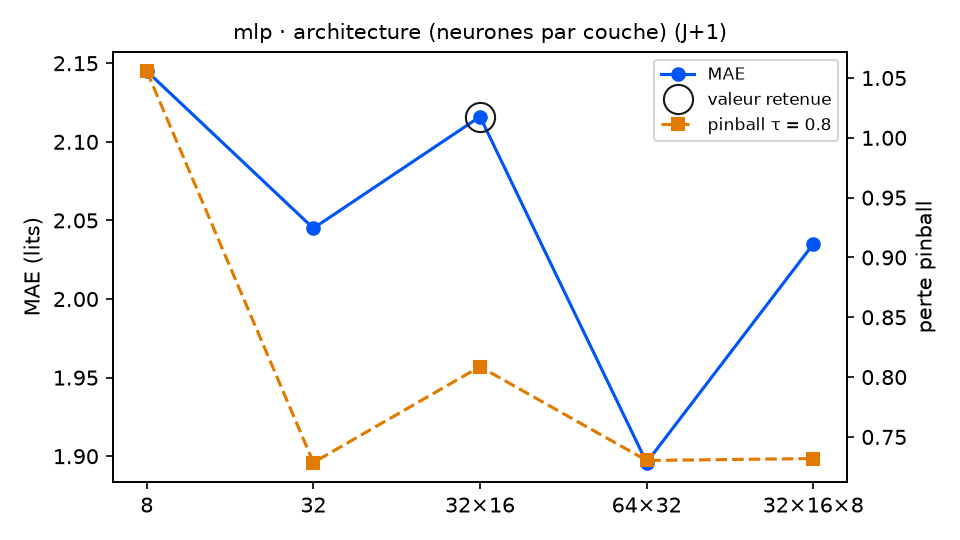

Amplitude de la MAE : 11.8 %. Valeur(s) significativement meilleure(s) : couches = 32, couches = 64×32, couches = 32×16×8 — réglage à revoir.

### mlp · taux d'apprentissage

| variante | MAE | RMSE | biais | pinball τ=0.8 | couverture 90 % | temps (s) | DM p (pinball τ=0.8) | p Holm | DM p (MAE) | vs choix retenu |
|---|---|---|---|---|---|---|---|---|---|---|
| taux_reseau = 0,001 | 2.252 | 2.706 | -1.05 | 0.7689 | 78.1 | 2.3 | 0.0823 | 0.1646 | 0.0154 | équivalent |
| taux_reseau = 0,003 | 2.234 | 2.68 | -1.107 | 0.7725 | 78.1 | 1.8 | 0.1426 | 0.1646 | 0.0115 | équivalent |
| taux_reseau = 0,01 (retenu) | 2.116 | 2.577 | -1.156 | 0.8087 | 80.9 | 1.2 |  |  |  | — choix retenu |
| taux_reseau = 0,03 | 2.032 | 2.475 | -1.084 | 0.7602 | 83.1 | 1.2 | 0.022 | 0.066 | 0.0343 | équivalent |

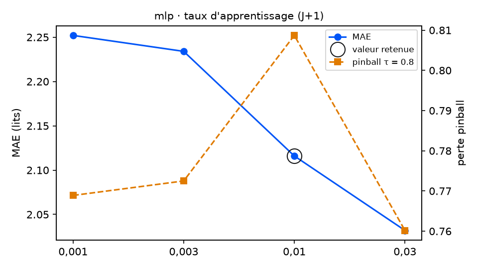

Amplitude de la MAE : 10.4 %. Aucune valeur ne fait significativement mieux que la valeur retenue.

### mlp · pénalité L2 λ

| variante | MAE | RMSE | biais | pinball τ=0.8 | couverture 90 % | temps (s) | DM p (pinball τ=0.8) | p Holm | DM p (MAE) | vs choix retenu |
|---|---|---|---|---|---|---|---|---|---|---|
| lambda_ = 0 | 2.146 | 2.586 | -1.191 | 0.7407 | 85.2 | 1.0 | 0.0002 | 0.0008 | 0.1075 | meilleur |
| lambda_ = 0,0001 | 2.143 | 2.582 | -1.153 | 0.8068 | 80.9 | 1.0 | 0.8025 | 0.8025 | 0.032 | équivalent |
| lambda_ = 0,001 (retenu) | 2.116 | 2.577 | -1.156 | 0.8087 | 80.9 | 1.4 |  |  |  | — choix retenu |
| lambda_ = 0,01 | 2.064 | 2.551 | -1.066 | 0.8464 | 73.2 | 1.2 | 0.0995 | 0.2985 | 0.234 | équivalent |
| lambda_ = 0,1 | 2.08 | 2.56 | -1.095 | 0.759 | 85.2 | 2.1 | 0.2805 | 0.561 | 0.6009 | équivalent |

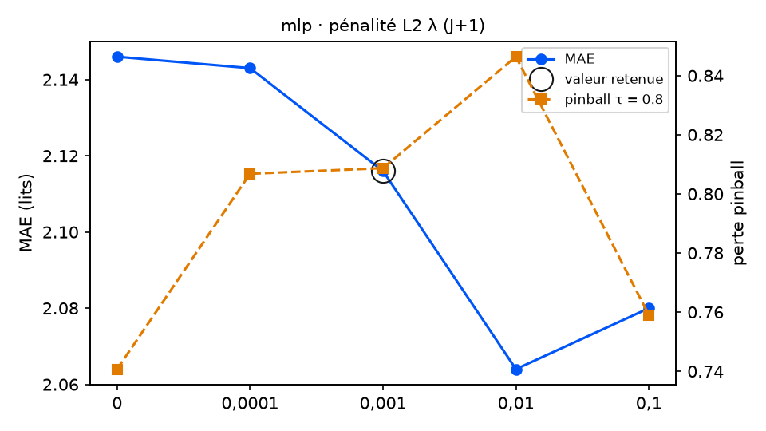

Amplitude de la MAE : 3.9 %. Valeur(s) significativement meilleure(s) : lambda_ = 0 — réglage à revoir.

### mlp · époques maximales

| variante | MAE | RMSE | biais | pinball τ=0.8 | couverture 90 % | temps (s) | DM p (pinball τ=0.8) | p Holm | DM p (MAE) | vs choix retenu |
|---|---|---|---|---|---|---|---|---|---|---|
| epoques = 300 | 2.116 | 2.577 | -1.156 | 0.8087 | 80.9 | 1.3 |  |  |  | identique |
| epoques = 800 | 2.116 | 2.577 | -1.156 | 0.8087 | 80.9 | 1.3 |  |  |  | identique |
| epoques = 1500 (retenu) | 2.116 | 2.577 | -1.156 | 0.8087 | 80.9 | 0.9 |  |  |  | — choix retenu |
| epoques = 3000 | 2.116 | 2.577 | -1.156 | 0.8087 | 80.9 | 0.9 |  |  |  | identique |

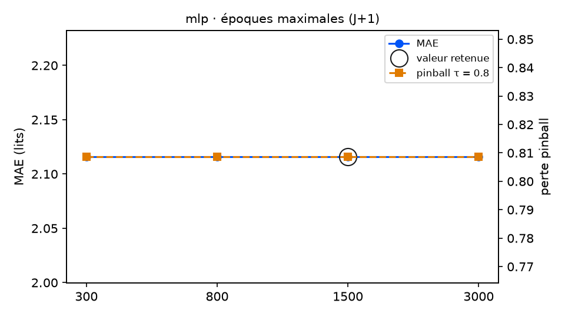

Amplitude de la MAE : 0.0 %. Aucune valeur ne fait significativement mieux que la valeur retenue.

### mlp · patience de l'arrêt anticipé

| variante | MAE | RMSE | biais | pinball τ=0.8 | couverture 90 % | temps (s) | DM p (pinball τ=0.8) | p Holm | DM p (MAE) | vs choix retenu |
|---|---|---|---|---|---|---|---|---|---|---|
| patience = 50 | 2.116 | 2.577 | -1.156 | 0.8087 | 80.9 | 0.8 |  |  |  | identique |
| patience = 150 (retenu) | 2.116 | 2.577 | -1.156 | 0.8087 | 80.9 | 1.0 |  |  |  | — choix retenu |
| patience = 300 | 2.116 | 2.577 | -1.156 | 0.8087 | 80.9 | 1.8 |  |  |  | identique |

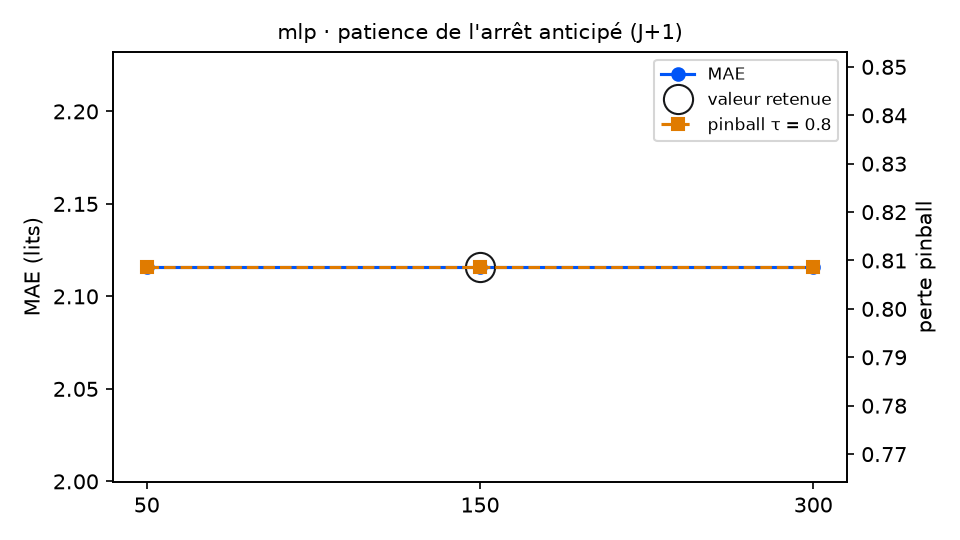

Amplitude de la MAE : 0.0 %. Aucune valeur ne fait significativement mieux que la valeur retenue.

### mlp · nombre d'initialisations moyennées

| variante | MAE | RMSE | biais | pinball τ=0.8 | couverture 90 % | temps (s) | DM p (pinball τ=0.8) | p Holm | DM p (MAE) | vs choix retenu |
|---|---|---|---|---|---|---|---|---|---|---|
| graines = 1 | 2.129 | 2.568 | -0.868 | 0.7987 | 87.4 | 0.5 | 0.7915 | 1.0 | 0.8494 | équivalent |
| graines = 3 (retenu) | 2.116 | 2.577 | -1.156 | 0.8087 | 80.9 | 1.5 |  |  |  | — choix retenu |
| graines = 5 | 2.087 | 2.562 | -1.119 | 0.8168 | 81.4 | 2.3 | 0.6252 | 1.0 | 0.3526 | équivalent |

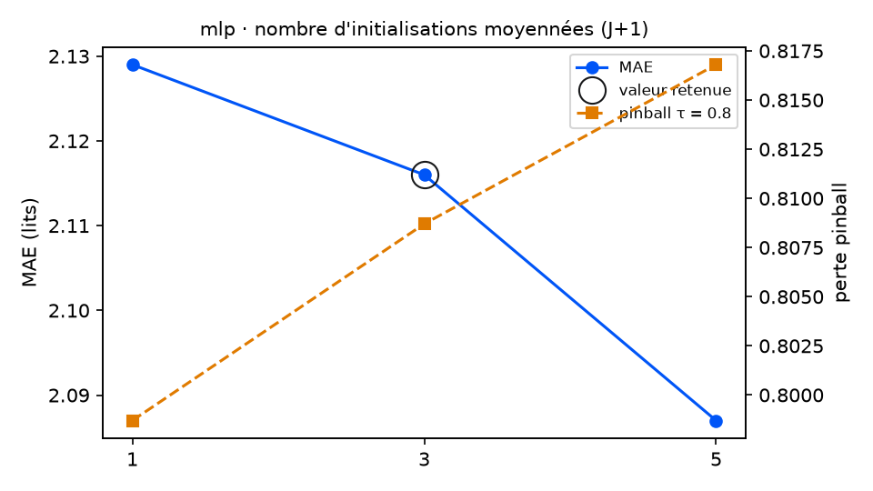

Amplitude de la MAE : 2.0 %. Aucune valeur ne fait significativement mieux que la valeur retenue.

### lstm · taille de l'état caché H

| variante | MAE | RMSE | biais | pinball τ=0.8 | couverture 90 % | temps (s) | DM p (pinball τ=0.8) | p Holm | DM p (MAE) | vs choix retenu |
|---|---|---|---|---|---|---|---|---|---|---|
| cache_lstm = 4 | 1.972 | 2.418 | -0.767 | 0.8722 | 80.3 | 9.4 | 0.0708 | 0.0708 | 0.0126 | équivalent |
| cache_lstm = 8 | 2.222 | 2.714 | -1.109 | 0.9432 | 81.4 | 6.4 | 0.0 | 0.0 | 0.0142 | moins bon |
| cache_lstm = 16 (retenu) | 2.12 | 2.618 | -1.027 | 0.8186 | 81.4 | 9.7 |  |  |  | — choix retenu |
| cache_lstm = 32 | 2.13 | 2.633 | -0.948 | 0.9171 | 82.5 | 18.0 | 0.0001 | 0.0002 | 0.7883 | moins bon |

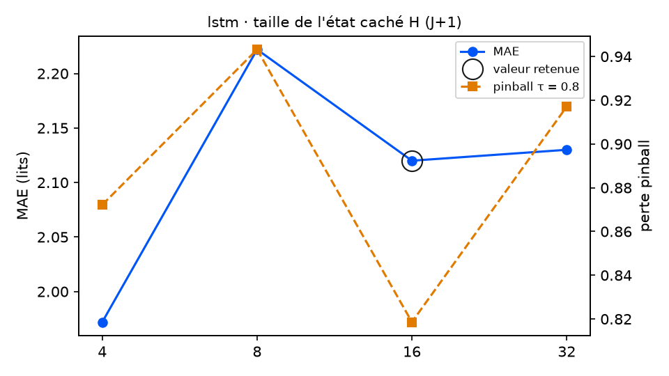

Amplitude de la MAE : 11.8 %. Aucune valeur ne fait significativement mieux que la valeur retenue.

### lstm · taux d'apprentissage

| variante | MAE | RMSE | biais | pinball τ=0.8 | couverture 90 % | temps (s) | DM p (pinball τ=0.8) | p Holm | DM p (MAE) | vs choix retenu |
|---|---|---|---|---|---|---|---|---|---|---|
| taux_reseau = 0,003 | 2.162 | 2.667 | -1.065 | 0.8154 | 79.2 | 18.0 | 0.8667 | 0.8667 | 0.1958 | équivalent |
| taux_reseau = 0,01 (retenu) | 2.12 | 2.618 | -1.027 | 0.8186 | 81.4 | 8.6 |  |  |  | — choix retenu |
| taux_reseau = 0,03 | 2.02 | 2.469 | -0.858 | 0.7782 | 79.8 | 6.4 | 0.0539 | 0.1078 | 0.0161 | équivalent |

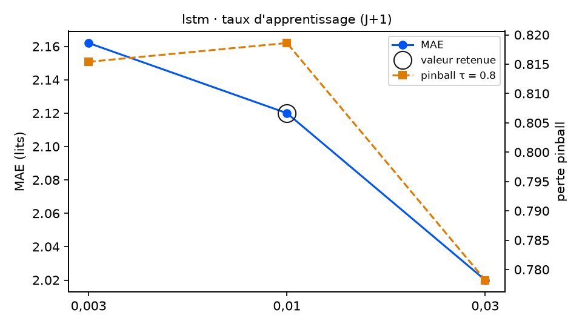

Amplitude de la MAE : 6.7 %. Aucune valeur ne fait significativement mieux que la valeur retenue.

### lstm · pénalité L2 λ

| variante | MAE | RMSE | biais | pinball τ=0.8 | couverture 90 % | temps (s) | DM p (pinball τ=0.8) | p Holm | DM p (MAE) | vs choix retenu |
|---|---|---|---|---|---|---|---|---|---|---|
| lambda_ = 0 | 2.221 | 2.715 | -1.179 | 0.7853 | 82.0 | 6.4 | 0.0717 | 0.0717 | 0.0003 | équivalent |
| lambda_ = 0,001 (retenu) | 2.12 | 2.618 | -1.027 | 0.8186 | 81.4 | 10.1 |  |  |  | — choix retenu |
| lambda_ = 0,01 | 2.081 | 2.596 | -1.022 | 0.8689 | 83.6 | 17.7 | 0.0317 | 0.0634 | 0.3134 | équivalent |

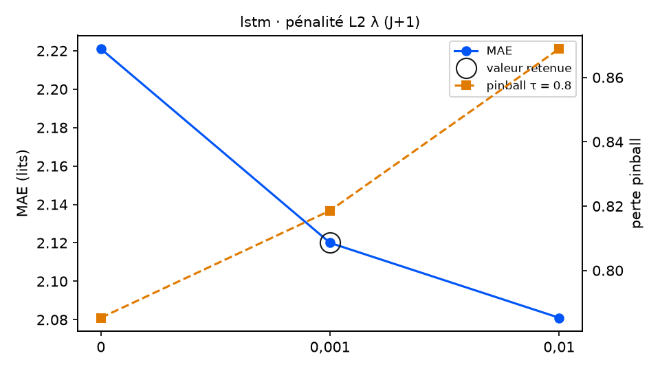

Amplitude de la MAE : 6.6 %. Aucune valeur ne fait significativement mieux que la valeur retenue.

### variables · jours d'occupation passée en entrée

| variante | MAE | RMSE | biais | pinball τ=0.8 | couverture 90 % | temps (s) | DM p (pinball τ=0.8) | p Holm | DM p (MAE) | vs choix retenu |
|---|---|---|---|---|---|---|---|---|---|---|
| retards = 3 | 2.125 | 2.637 | -0.927 | 0.7621 | 89.1 | 3.7 | 0.4178 | 0.8356 | 0.0044 | équivalent |
| retards = 5 | 2.131 | 2.633 | -0.841 | 0.779 | 88.5 | 4.6 | 0.7918 | 0.8356 | 0.0003 | équivalent |
| retards = 7 (retenu) | 2.004 | 2.51 | -0.745 | 0.7759 | 86.3 | 4.6 |  |  |  | — choix retenu |
| retards = 10 | 2.064 | 2.568 | -0.748 | 0.7999 | 87.4 | 4.8 | 0.0297 | 0.0891 | 0.0453 | équivalent |
| retards = 14 | 2.103 | 2.633 | -0.819 | 0.8186 | 88.0 | 6.1 | 0.0205 | 0.082 | 0.0542 | équivalent |
| retards = 21 | 2.298 | 2.814 | -0.895 | 0.9175 | 79.2 | 4.9 | 0.0 | 0.0 | 0.0 | moins bon |

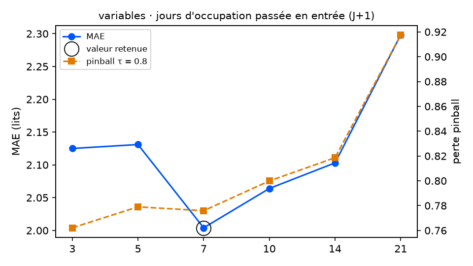

Amplitude de la MAE : 14.7 %. Aucune valeur ne fait significativement mieux que la valeur retenue.

## Horizon J+7

### svr4 · C (poids des erreurs)

| variante | MAE | RMSE | biais | pinball τ=0.8 | couverture 90 % | temps (s) | DM p (pinball τ=0.8) | p Holm | DM p (MAE) | vs choix retenu |
|---|---|---|---|---|---|---|---|---|---|---|
| C = 0,1 | 3.174 | 3.824 | -1.294 | 1.0378 | 87.6 | 3.1 | 0.8731 | 1.0 | 0.3535 | équivalent |
| C = 0,3 | 3.131 | 3.756 | -1.159 | 1.0302 | 88.7 | 3.8 | 0.6759 | 1.0 | 0.3507 | équivalent |
| C = 1 (retenu) | 3.066 | 3.677 | -1.108 | 1.0456 | 89.8 | 3.0 |  |  |  | — choix retenu |
| C = 3 | 2.964 | 3.614 | -1.187 | 1.0405 | 87.0 | 4.3 | 0.8977 | 1.0 | 0.0812 | équivalent |
| C = 10 | 2.975 | 3.696 | -1.449 | 1.1425 | 81.4 | 5.2 | 0.3695 | 1.0 | 0.4631 | équivalent |
| C = 30 | 2.995 | 3.744 | -1.622 | 1.2612 | 76.3 | 7.5 | 0.2139 | 1.0 | 0.6662 | équivalent |

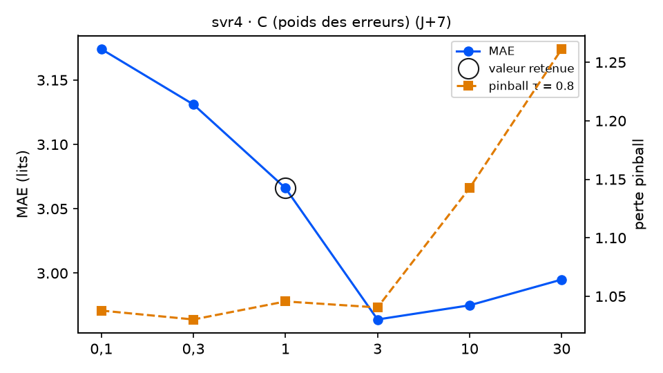

Amplitude de la MAE : 6.8 %. Aucune valeur ne fait significativement mieux que la valeur retenue.

### svr4 · ε (tube, niveaux quantiles)

| variante | MAE | RMSE | biais | pinball τ=0.8 | couverture 90 % | temps (s) | DM p (pinball τ=0.8) | p Holm | DM p (MAE) | vs choix retenu |
|---|---|---|---|---|---|---|---|---|---|---|
| epsilon_quantile = 0 (retenu) | 3.066 | 3.677 | -1.108 | 1.0456 | 89.8 | 4.2 |  |  |  | — choix retenu |
| epsilon_quantile = 0,25 | 3.077 | 3.689 | -1.075 | 1.0644 | 87.6 | 3.7 | 0.1218 | 0.1431 | 0.532 | équivalent |
| epsilon_quantile = 0,5 | 3.09 | 3.709 | -1.082 | 1.0838 | 85.9 | 5.5 | 0.064 | 0.1431 | 0.3006 | équivalent |
| epsilon_quantile = 1 | 3.11 | 3.726 | -1.069 | 1.121 | 82.5 | 3.9 | 0.0477 | 0.1431 | 0.3589 | équivalent |

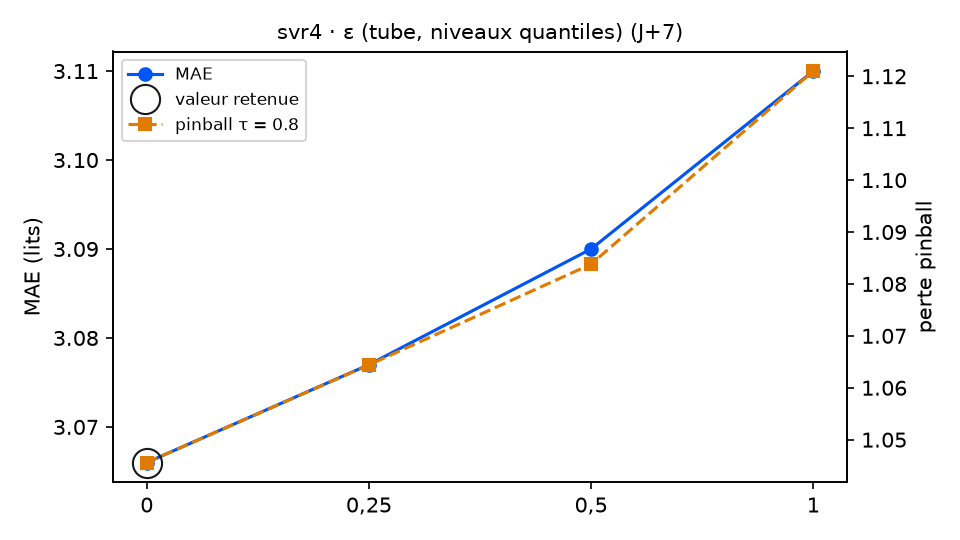

Amplitude de la MAE : 1.4 %. Aucune valeur ne fait significativement mieux que la valeur retenue.

### svr4 · γ₁ (portée, bloc occupation)

| variante | MAE | RMSE | biais | pinball τ=0.8 | couverture 90 % | temps (s) | DM p (pinball τ=0.8) | p Holm | DM p (MAE) | vs choix retenu |
|---|---|---|---|---|---|---|---|---|---|---|
| gamma1 = 0,01 | 3.044 | 3.663 | -1.013 | 1.0512 | 87.6 | 6.8 | 0.6092 | 1.0 | 0.5368 | équivalent |
| gamma1 = 0,02 | 3.044 | 3.662 | -1.011 | 1.0506 | 87.6 | 4.0 | 0.6465 | 1.0 | 0.5443 | équivalent |
| gamma1 = 0,05 | 3.061 | 3.68 | -1.038 | 1.0504 | 90.4 | 3.1 | 0.5968 | 1.0 | 0.8163 | équivalent |
| gamma1 = 0,1 (retenu) | 3.066 | 3.677 | -1.108 | 1.0456 | 89.8 | 4.9 |  |  |  | — choix retenu |
| gamma1 = 0,2 | 3.054 | 3.654 | -1.103 | 1.0179 | 88.7 | 4.9 | 0.2202 | 1.0 | 0.4667 | équivalent |
| gamma1 = 0,5 | 3.081 | 3.666 | -1.075 | 1.0617 | 88.1 | 5.4 | 0.5762 | 1.0 | 0.7542 | équivalent |

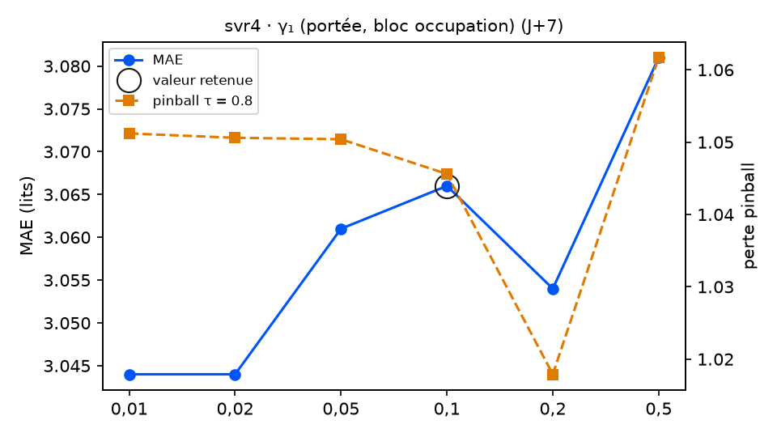

Amplitude de la MAE : 1.2 %. Aucune valeur ne fait significativement mieux que la valeur retenue.

### svr4 · γ₂ (portée, bloc flux et saison)

| variante | MAE | RMSE | biais | pinball τ=0.8 | couverture 90 % | temps (s) | DM p (pinball τ=0.8) | p Holm | DM p (MAE) | vs choix retenu |
|---|---|---|---|---|---|---|---|---|---|---|
| gamma2 = 0,02 | 3.118 | 3.726 | -1.112 | 0.9843 | 91.0 | 4.8 | 0.1095 | 0.438 | 0.2826 | équivalent |
| gamma2 = 0,05 (retenu) | 3.066 | 3.677 | -1.108 | 1.0456 | 89.8 | 5.0 |  |  |  | — choix retenu |
| gamma2 = 0,1 | 2.987 | 3.606 | -1.045 | 1.0444 | 89.8 | 4.6 | 0.9538 | 1.0 | 0.0264 | équivalent |
| gamma2 = 0,2 | 2.911 | 3.523 | -0.993 | 1.0505 | 88.1 | 3.4 | 0.8865 | 1.0 | 0.0311 | équivalent |
| gamma2 = 0,5 | 3.0 | 3.607 | -1.104 | 1.0757 | 86.4 | 6.1 | 0.5518 | 1.0 | 0.3851 | équivalent |

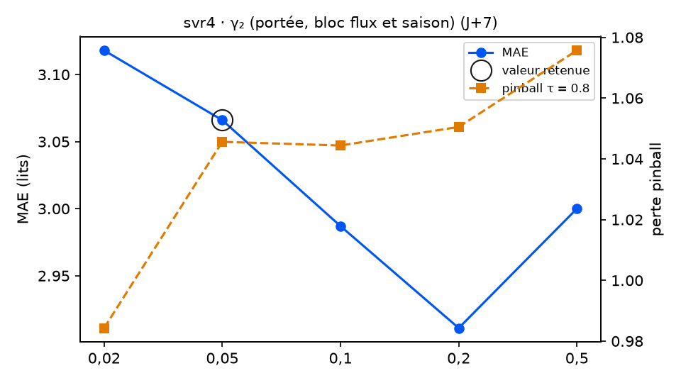

Amplitude de la MAE : 6.8 %. Aucune valeur ne fait significativement mieux que la valeur retenue.

### svr4 · τ (quantile décisionnel)

| variante | MAE | RMSE | biais | pinball τ=0.8 | couverture 90 % | temps (s) | DM p (pinball τ=0.8) | p Holm | DM p (MAE) | vs choix retenu |
|---|---|---|---|---|---|---|---|---|---|---|
| tau = 0,5 | 3.066 | 3.677 | -1.108 | 1.8656 | 89.8 | 3.2 | 0.0006 | 0.0024 |  | moins bon |
| tau = 0,6 | 3.066 | 3.677 | -1.108 | 1.8656 | 89.8 | 3.7 | 0.0006 | 0.0024 |  | moins bon |
| tau = 0,7 | 3.066 | 3.677 | -1.108 | 1.8656 | 89.8 | 5.5 | 0.0006 | 0.0024 |  | moins bon |
| tau = 0,8 (retenu) | 3.066 | 3.677 | -1.108 | 1.0456 | 89.8 | 3.5 |  |  |  | — choix retenu |
| tau = 0,9 | 3.066 | 3.677 | -1.108 | 1.8656 | 89.8 | 4.8 | 0.0006 | 0.0024 |  | moins bon |

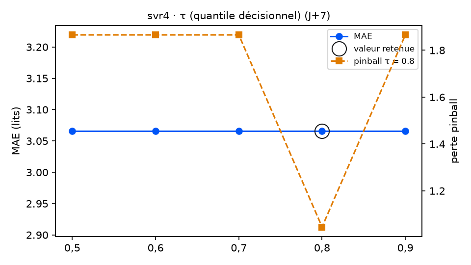

Amplitude de la MAE : 0.0 %. Aucune valeur ne fait significativement mieux que la valeur retenue.

### svr4 · η₀ (taux d'apprentissage d'Adam)

| variante | MAE | RMSE | biais | pinball τ=0.8 | couverture 90 % | temps (s) | DM p (pinball τ=0.8) | p Holm | DM p (MAE) | vs choix retenu |
|---|---|---|---|---|---|---|---|---|---|---|
| taux = 0,005 | 3.062 | 3.671 | -1.102 | 1.0343 | 89.8 | 5.7 | 0.0608 | 0.2432 | 0.0425 | équivalent |
| taux = 0,01 | 3.065 | 3.674 | -1.107 | 1.0441 | 89.8 | 5.2 | 0.4644 | 0.5896 | 0.243 | équivalent |
| taux = 0,02 | 3.065 | 3.676 | -1.111 | 1.0472 | 89.8 | 5.8 | 0.2948 | 0.5896 | 0.6227 | équivalent |
| taux = 0,05 (retenu) | 3.066 | 3.677 | -1.108 | 1.0456 | 89.8 | 4.5 |  |  |  | — choix retenu |
| taux = 0,1 | 3.067 | 3.677 | -1.105 | 1.0424 | 89.8 | 5.4 | 0.0188 | 0.094 | 0.8427 | équivalent |
| taux = 0,2 | 3.069 | 3.68 | -1.112 | 1.0421 | 91.0 | 5.2 | 0.1399 | 0.4197 | 0.1286 | équivalent |

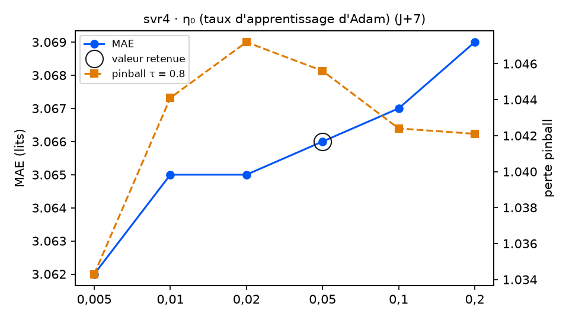

Amplitude de la MAE : 0.2 %. Aucune valeur ne fait significativement mieux que la valeur retenue.

### svr4 · nombre maximal d'itérations

| variante | MAE | RMSE | biais | pinball τ=0.8 | couverture 90 % | temps (s) | DM p (pinball τ=0.8) | p Holm | DM p (MAE) | vs choix retenu |
|---|---|---|---|---|---|---|---|---|---|---|
| iterations = 300 | 3.062 | 3.673 | -1.108 | 1.0016 | 89.8 | 1.6 | 0.1122 | 0.2182 | 0.0505 | équivalent |
| iterations = 1000 | 3.066 | 3.677 | -1.108 | 1.0406 | 89.8 | 2.5 | 0.1091 | 0.2182 | 0.1502 | équivalent |
| iterations = 3000 (retenu) | 3.066 | 3.677 | -1.108 | 1.0456 | 89.8 | 4.2 |  |  |  | — choix retenu |
| iterations = 6000 | 3.066 | 3.677 | -1.108 | 1.0456 | 89.8 | 4.5 |  |  | 0.146 | identique |

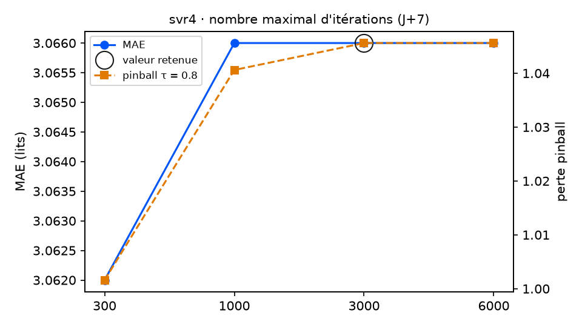

Amplitude de la MAE : 0.1 %. Aucune valeur ne fait significativement mieux que la valeur retenue.

### svr4 · T (décroissance du pas ; aucune = pas constant)

| variante | MAE | RMSE | biais | pinball τ=0.8 | couverture 90 % | temps (s) | DM p (pinball τ=0.8) | p Holm | DM p (MAE) | vs choix retenu |
|---|---|---|---|---|---|---|---|---|---|---|
| decroissance = aucune | 3.067 | 3.679 | -1.113 | 1.0461 | 89.8 | 5.3 | 0.6098 | 1.0 | 0.4026 | équivalent |
| decroissance = 100 | 3.066 | 3.677 | -1.111 | 1.0461 | 89.8 | 5.6 | 0.6884 | 1.0 | 0.3755 | équivalent |
| decroissance = 500 (retenu) | 3.066 | 3.677 | -1.108 | 1.0456 | 89.8 | 4.5 |  |  |  | — choix retenu |
| decroissance = 2000 | 3.066 | 3.677 | -1.109 | 1.0471 | 89.8 | 4.0 | 0.3658 | 1.0 | 0.9709 | équivalent |

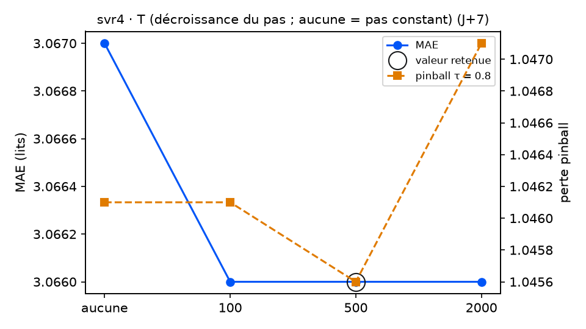

Amplitude de la MAE : 0.0 %. Aucune valeur ne fait significativement mieux que la valeur retenue.

### svr4 · part des pas moyennée (Polyak ; 0 = aucune)

| variante | MAE | RMSE | biais | pinball τ=0.8 | couverture 90 % | temps (s) | DM p (pinball τ=0.8) | p Holm | DM p (MAE) | vs choix retenu |
|---|---|---|---|---|---|---|---|---|---|---|
| moyenne_polyak = 0 | 3.066 | 3.677 | -1.108 | 1.0456 | 89.8 | 3.3 |  |  |  | identique |
| moyenne_polyak = 0,25 | 3.066 | 3.677 | -1.108 | 1.0456 | 89.8 | 5.2 |  |  |  | identique |
| moyenne_polyak = 0,5 (retenu) | 3.066 | 3.677 | -1.108 | 1.0456 | 89.8 | 4.1 |  |  |  | — choix retenu |
| moyenne_polyak = 0,75 | 3.066 | 3.677 | -1.108 | 1.0456 | 89.8 | 4.0 |  |  |  | identique |

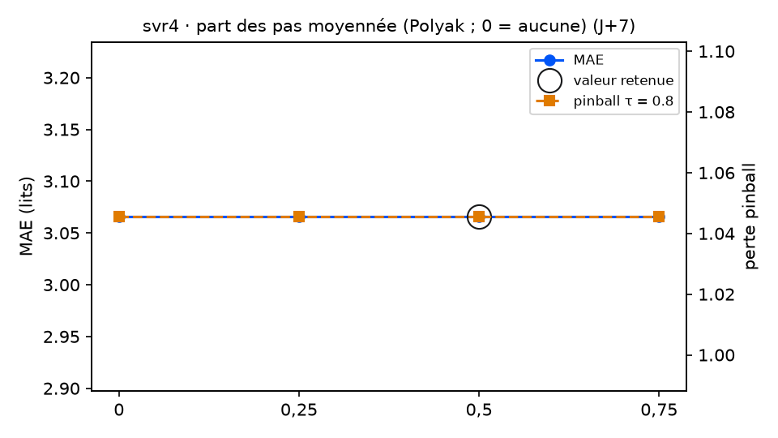

Amplitude de la MAE : 0.0 %. Aucune valeur ne fait significativement mieux que la valeur retenue.

### svr4 · tolérance d'arrêt anticipé

| variante | MAE | RMSE | biais | pinball τ=0.8 | couverture 90 % | temps (s) | DM p (pinball τ=0.8) | p Holm | DM p (MAE) | vs choix retenu |
|---|---|---|---|---|---|---|---|---|---|---|
| tolerance = 1e-05 | 3.063 | 3.674 | -1.11 | 1.0439 | 89.8 | 2.3 | 0.5785 | 0.5785 | 0.0817 | équivalent |
| tolerance = 1e-07 (retenu) | 3.066 | 3.677 | -1.108 | 1.0456 | 89.8 | 4.0 |  |  |  | — choix retenu |
| tolerance = 1e-09 | 3.067 | 3.678 | -1.111 | 1.0484 | 89.8 | 7.4 | 0.0188 | 0.0376 | 0.4914 | moins bon |

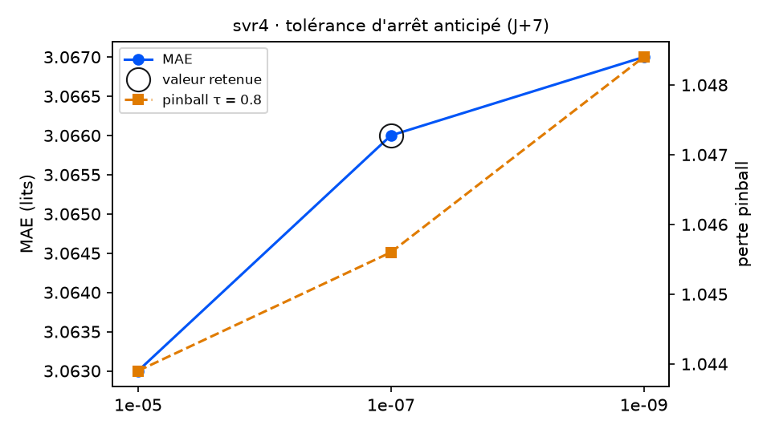

Amplitude de la MAE : 0.1 %. Aucune valeur ne fait significativement mieux que la valeur retenue.

### svr4 · direction préconditionnée α + Cg

| variante | MAE | RMSE | biais | pinball τ=0.8 | couverture 90 % | temps (s) | DM p (pinball τ=0.8) | p Holm | DM p (MAE) | vs choix retenu |
|---|---|---|---|---|---|---|---|---|---|---|
| preconditionne = True (retenu) | 3.066 | 3.677 | -1.108 | 1.0456 | 89.8 | 3.9 |  |  |  | — choix retenu |
| preconditionne = False | 3.062 | 3.671 | -1.096 | 1.0444 | 89.8 | 8.6 | 0.5281 | 0.5281 | 0.2151 | équivalent |

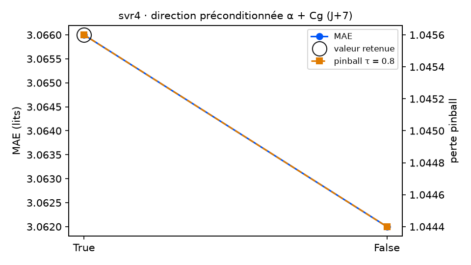

Amplitude de la MAE : 0.1 %. Aucune valeur ne fait significativement mieux que la valeur retenue.

### svr4 · optimiseur

| variante | MAE | RMSE | biais | pinball τ=0.8 | couverture 90 % | temps (s) | DM p (pinball τ=0.8) | p Holm | DM p (MAE) | vs choix retenu |
|---|---|---|---|---|---|---|---|---|---|---|
| optimiseur = adam (retenu) | 3.066 | 3.677 | -1.108 | 1.0456 | 89.8 | 5.1 |  |  |  | — choix retenu |
| optimiseur = momentum | 3.074 | 3.685 | -1.105 | 1.0464 | 89.8 | 4.0 | 0.6639 | 1.0 | 0.0953 | équivalent |
| optimiseur = sgd | 3.061 | 3.671 | -1.096 | 1.0443 | 89.8 | 5.4 | 0.636 | 1.0 | 0.3017 | équivalent |

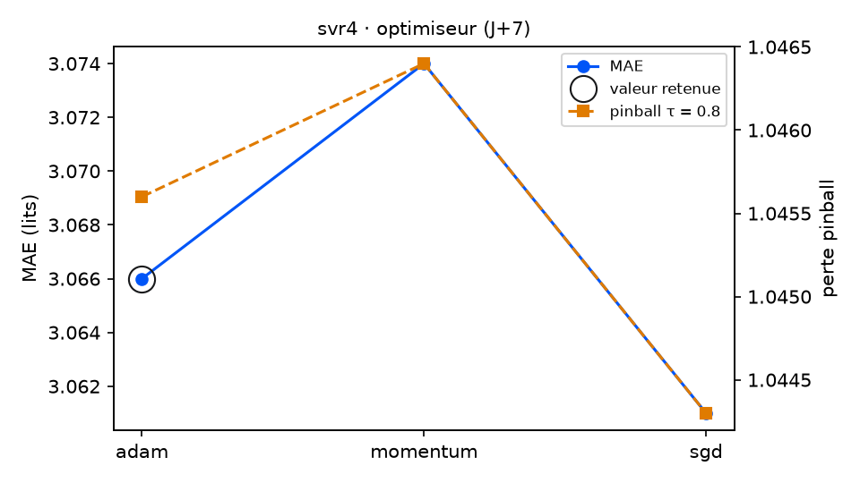

Amplitude de la MAE : 0.4 %. Aucune valeur ne fait significativement mieux que la valeur retenue.

### svr2 · C

| variante | MAE | RMSE | biais | pinball τ=0.8 | temps (s) | DM p (pinball τ=0.8) | p Holm | DM p (MAE) | vs choix retenu |
|---|---|---|---|---|---|---|---|---|---|
| C = 0,1 | 3.125 | 3.751 | -1.173 | 1.9145 | 0.5 | 0.7716 | 1.0 | 0.393 | équivalent |
| C = 0,3 | 3.128 | 3.743 | -1.086 | 1.8899 | 0.5 | 0.9266 | 1.0 | 0.2754 | équivalent |
| C = 1 | 3.054 | 3.684 | -1.076 | 1.8496 | 1.1 | 0.3767 | 1.0 | 0.5184 | équivalent |
| C = 3 (retenu) | 3.018 | 3.664 | -1.244 | 1.8823 | 1.0 |  |  |  | — choix retenu |
| C = 10 | 2.911 | 3.59 | -1.442 | 1.8881 | 0.9 | 0.9314 | 1.0 | 0.1784 | équivalent |
| C = 30 | 3.049 | 3.804 | -1.622 | 2.0112 | 1.9 | 0.2706 | 1.0 | 0.8301 | équivalent |

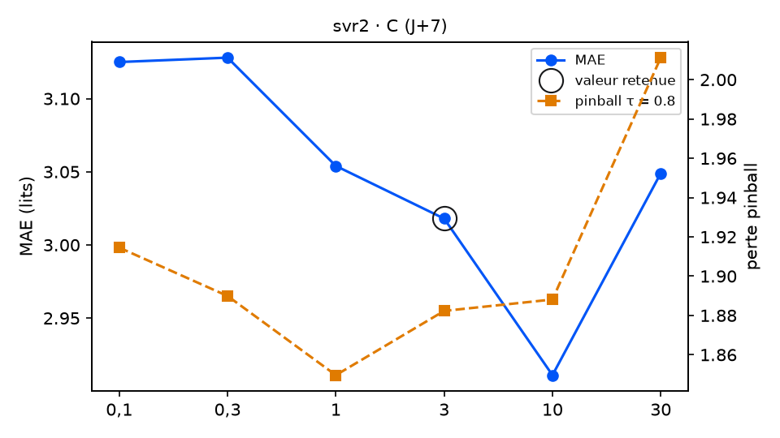

Amplitude de la MAE : 7.2 %. Aucune valeur ne fait significativement mieux que la valeur retenue.

### svr2 · ε (tube ε-insensible, en lits)

| variante | MAE | RMSE | biais | pinball τ=0.8 | temps (s) | DM p (pinball τ=0.8) | p Holm | DM p (MAE) | vs choix retenu |
|---|---|---|---|---|---|---|---|---|---|
| epsilon = 0 | 2.966 | 3.652 | -1.171 | 1.8344 | 2.2 | 0.4061 | 1.0 | 0.4372 | équivalent |
| epsilon = 0,25 | 2.983 | 3.662 | -1.214 | 1.8555 | 1.9 | 0.5169 | 1.0 | 0.4622 | équivalent |
| epsilon = 0,5 | 3.018 | 3.689 | -1.262 | 1.8875 | 1.4 | 0.8626 | 1.0 | 0.9873 | équivalent |
| epsilon = 1 (retenu) | 3.018 | 3.664 | -1.244 | 1.8823 | 1.4 |  |  |  | — choix retenu |
| epsilon = 2 | 3.048 | 3.698 | -1.341 | 1.9261 | 1.2 | 0.0618 | 0.2472 | 0.3479 | équivalent |

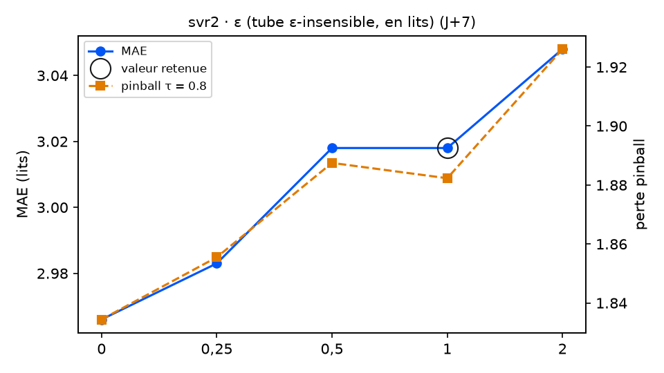

Amplitude de la MAE : 2.7 %. Aucune valeur ne fait significativement mieux que la valeur retenue.

### svr2 · γ (portée du noyau RBF)

| variante | MAE | RMSE | biais | pinball τ=0.8 | temps (s) | DM p (pinball τ=0.8) | p Holm | DM p (MAE) | vs choix retenu |
|---|---|---|---|---|---|---|---|---|---|
| gamma = 0,005 | 3.195 | 3.831 | -1.086 | 1.9237 | 0.6 | 0.5491 | 1.0 | 0.0495 | équivalent |
| gamma = 0,01 | 3.191 | 3.841 | -1.141 | 1.9376 | 1.4 | 0.2998 | 1.0 | 0.0059 | équivalent |
| gamma = 0,02 | 3.128 | 3.796 | -1.224 | 1.9312 | 1.5 | 0.1297 | 0.7782 | 0.0001 | équivalent |
| gamma = 0,05 (retenu) | 3.018 | 3.664 | -1.244 | 1.8823 | 1.8 |  |  |  | — choix retenu |
| gamma = 0,1 | 2.983 | 3.618 | -1.306 | 1.8836 | 1.3 | 0.9791 | 1.0 | 0.3916 | équivalent |
| gamma = 0,2 | 2.981 | 3.588 | -1.2 | 1.8505 | 0.9 | 0.7092 | 1.0 | 0.6812 | équivalent |
| gamma = 0,5 | 3.024 | 3.613 | -1.087 | 1.8382 | 0.9 | 0.6918 | 1.0 | 0.9653 | équivalent |

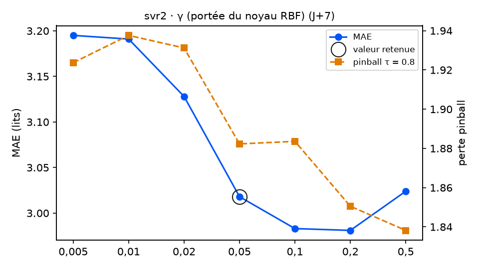

Amplitude de la MAE : 7.1 %. Aucune valeur ne fait significativement mieux que la valeur retenue.

### foret · nombre d'arbres

| variante | MAE | RMSE | biais | pinball τ=0.8 | couverture 90 % | temps (s) | DM p (pinball τ=0.8) | p Holm | DM p (MAE) | vs choix retenu |
|---|---|---|---|---|---|---|---|---|---|---|
| arbres = 25 | 3.124 | 3.793 | -1.331 | 1.165 | 92.1 | 0.8 | 0.1254 | 0.5016 | 0.1292 | équivalent |
| arbres = 50 | 3.078 | 3.756 | -1.3 | 1.1098 | 93.2 | 2.9 | 0.1735 | 0.5205 | 0.2686 | équivalent |
| arbres = 100 | 3.075 | 3.713 | -1.231 | 1.0618 | 94.9 | 3.7 | 0.4062 | 0.8124 | 0.1671 | équivalent |
| arbres = 300 (retenu) | 3.032 | 3.688 | -1.237 | 1.0699 | 94.9 | 9.5 |  |  |  | — choix retenu |
| arbres = 500 | 3.031 | 3.677 | -1.257 | 1.0716 | 94.9 | 15.5 | 0.7868 | 0.8124 | 0.9652 | équivalent |

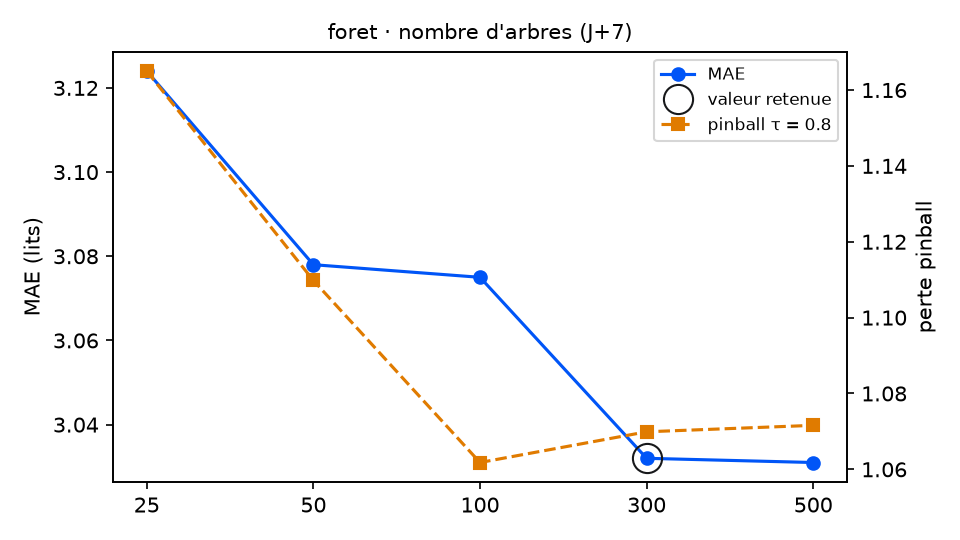

Amplitude de la MAE : 3.1 %. Aucune valeur ne fait significativement mieux que la valeur retenue.

### foret · profondeur maximale

| variante | MAE | RMSE | biais | pinball τ=0.8 | couverture 90 % | temps (s) | DM p (pinball τ=0.8) | p Holm | DM p (MAE) | vs choix retenu |
|---|---|---|---|---|---|---|---|---|---|---|
| profondeur_foret = 3 | 3.078 | 3.717 | -1.27 | 1.0203 | 93.2 | 2.9 | 0.3178 | 1.0 | 0.5491 | équivalent |
| profondeur_foret = 5 | 3.073 | 3.724 | -1.275 | 1.0519 | 93.8 | 4.6 | 0.4181 | 1.0 | 0.3558 | équivalent |
| profondeur_foret = 8 | 3.045 | 3.687 | -1.293 | 1.067 | 96.0 | 7.3 | 0.81 | 1.0 | 0.649 | équivalent |
| profondeur_foret = 12 (retenu) | 3.032 | 3.688 | -1.237 | 1.0699 | 94.9 | 10.1 |  |  |  | — choix retenu |
| profondeur_foret = 20 | 3.026 | 3.652 | -1.33 | 1.0785 | 94.9 | 10.0 | 0.6319 | 1.0 | 0.7198 | équivalent |

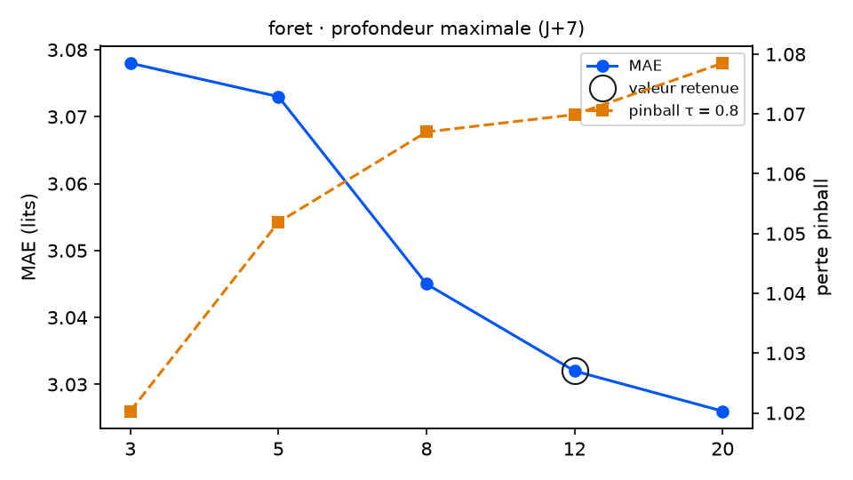

Amplitude de la MAE : 1.7 %. Aucune valeur ne fait significativement mieux que la valeur retenue.

### foret · taille minimale d'une feuille

| variante | MAE | RMSE | biais | pinball τ=0.8 | couverture 90 % | temps (s) | DM p (pinball τ=0.8) | p Holm | DM p (MAE) | vs choix retenu |
|---|---|---|---|---|---|---|---|---|---|---|
| min_feuille = 2 | 3.023 | 3.675 | -1.265 | 1.0811 | 91.5 | 21.3 | 0.5575 | 0.5575 | 0.7936 | équivalent |
| min_feuille = 5 (retenu) | 3.032 | 3.688 | -1.237 | 1.0699 | 94.9 | 9.3 |  |  |  | — choix retenu |
| min_feuille = 10 | 3.011 | 3.653 | -1.224 | 1.0476 | 95.5 | 4.7 | 0.1254 | 0.3762 | 0.3788 | équivalent |
| min_feuille = 20 | 3.015 | 3.652 | -1.199 | 1.0162 | 94.9 | 3.9 | 0.1573 | 0.3762 | 0.6987 | équivalent |

Amplitude de la MAE : 0.7 %. Aucune valeur ne fait significativement mieux que la valeur retenue.

### foret · part des variables tirées par nœud

| variante | MAE | RMSE | biais | pinball τ=0.8 | couverture 90 % | temps (s) | DM p (pinball τ=0.8) | p Holm | DM p (MAE) | vs choix retenu |
|---|---|---|---|---|---|---|---|---|---|---|
| part_variables = 0,15 | 3.027 | 3.676 | -1.302 | 1.0377 | 95.5 | 10.4 | 0.2749 | 0.414 | 0.9046 | équivalent |
| part_variables = 0,333333 (retenu) | 3.032 | 3.688 | -1.237 | 1.0699 | 94.9 | 10.7 |  |  |  | — choix retenu |
| part_variables = 0,5 | 3.1 | 3.745 | -1.349 | 1.1039 | 92.7 | 11.4 | 0.1625 | 0.414 | 0.0285 | équivalent |
| part_variables = 1 | 3.07 | 3.724 | -1.356 | 1.11 | 92.1 | 9.7 | 0.138 | 0.414 | 0.3673 | équivalent |

Amplitude de la MAE : 2.4 %. Aucune valeur ne fait significativement mieux que la valeur retenue.

### boosting · nombre d'étapes

| variante | MAE | RMSE | biais | pinball τ=0.8 | couverture 90 % | temps (s) | DM p (pinball τ=0.8) | p Holm | DM p (MAE) | vs choix retenu |
|---|---|---|---|---|---|---|---|---|---|---|
| etapes = 50 | 3.164 | 3.821 | -1.377 | 1.145 | 80.8 | 1.7 | 0.0241 | 0.028 | 0.2354 | meilleur |
| etapes = 100 | 3.207 | 3.885 | -1.493 | 1.2261 | 75.1 | 2.6 | 0.014 | 0.028 | 0.2005 | meilleur |
| etapes = 300 (retenu) | 3.261 | 3.991 | -1.541 | 1.3966 | 68.4 | 9.3 |  |  |  | — choix retenu |
| etapes = 600 | 3.264 | 4.018 | -1.554 | 1.5038 | 64.4 | 15.0 | 0.0044 | 0.0132 | 0.9199 | moins bon |

Amplitude de la MAE : 3.1 %. Valeur(s) significativement meilleure(s) : etapes = 50, etapes = 100 — réglage à revoir.

### boosting · taux ν (shrinkage)

| variante | MAE | RMSE | biais | pinball τ=0.8 | couverture 90 % | temps (s) | DM p (pinball τ=0.8) | p Holm | DM p (MAE) | vs choix retenu |
|---|---|---|---|---|---|---|---|---|---|---|
| taux_boosting = 0,01 | 3.175 | 3.844 | -1.433 | 1.1704 | 79.7 | 6.9 | 0.0228 | 0.0456 | 0.3546 | meilleur |
| taux_boosting = 0,05 (retenu) | 3.261 | 3.991 | -1.541 | 1.3966 | 68.4 | 7.3 |  |  |  | — choix retenu |
| taux_boosting = 0,1 | 3.284 | 4.03 | -1.594 | 1.4783 | 62.7 | 8.8 | 0.0245 | 0.0456 | 0.7165 | moins bon |
| taux_boosting = 0,2 | 3.364 | 4.177 | -1.75 | 1.5438 | 57.1 | 7.5 | 0.008 | 0.024 | 0.2014 | moins bon |

Amplitude de la MAE : 5.8 %. Valeur(s) significativement meilleure(s) : taux_boosting = 0,01 — réglage à revoir.

### boosting · profondeur des arbres

| variante | MAE | RMSE | biais | pinball τ=0.8 | couverture 90 % | temps (s) | DM p (pinball τ=0.8) | p Holm | DM p (MAE) | vs choix retenu |
|---|---|---|---|---|---|---|---|---|---|---|
| profondeur_boosting = 1 | 3.242 | 3.94 | -1.472 | 1.092 | 84.7 | 3.8 | 0.0123 | 0.0369 | 0.7804 | meilleur |
| profondeur_boosting = 2 | 3.265 | 3.966 | -1.597 | 1.2477 | 77.4 | 4.8 | 0.019 | 0.038 | 0.9485 | meilleur |
| profondeur_boosting = 3 (retenu) | 3.261 | 3.991 | -1.541 | 1.3966 | 68.4 | 7.6 |  |  |  | — choix retenu |
| profondeur_boosting = 5 | 3.145 | 3.885 | -1.492 | 1.4676 | 53.1 | 15.2 | 0.11 | 0.11 | 0.0637 | équivalent |

Amplitude de la MAE : 3.7 %. Valeur(s) significativement meilleure(s) : profondeur_boosting = 1, profondeur_boosting = 2 — réglage à revoir.

### boosting · part du sous-échantillon

| variante | MAE | RMSE | biais | pinball τ=0.8 | couverture 90 % | temps (s) | DM p (pinball τ=0.8) | p Holm | DM p (MAE) | vs choix retenu |
|---|---|---|---|---|---|---|---|---|---|---|
| sous_echantillon = 0,5 | 3.286 | 3.997 | -1.703 | 1.3438 | 61.6 | 6.2 | 0.0807 | 0.1614 | 0.7165 | équivalent |
| sous_echantillon = 0,8 (retenu) | 3.261 | 3.991 | -1.541 | 1.3966 | 68.4 | 6.3 |  |  |  | — choix retenu |
| sous_echantillon = 1 | 3.317 | 4.054 | -1.571 | 1.3924 | 72.9 | 9.3 | 0.8825 | 0.8825 | 0.5039 | équivalent |

Amplitude de la MAE : 1.7 %. Aucune valeur ne fait significativement mieux que la valeur retenue.

### mlp · architecture (neurones par couche)

| variante | MAE | RMSE | biais | pinball τ=0.8 | couverture 90 % | temps (s) | DM p (pinball τ=0.8) | p Holm | DM p (MAE) | vs choix retenu |
|---|---|---|---|---|---|---|---|---|---|---|
| couches = 8 | 3.603 | 4.337 | -1.985 | 1.8316 | 69.5 | 0.8 | 0.0024 | 0.0096 | 0.9794 | moins bon |
| couches = 32 | 3.765 | 4.486 | -1.756 | 1.1801 | 85.3 | 0.8 | 0.7227 | 1.0 | 0.2506 | équivalent |
| couches = 32×16 (retenu) | 3.6 | 4.266 | -1.612 | 1.1508 | 84.7 | 1.1 |  |  |  | — choix retenu |
| couches = 64×32 | 3.802 | 4.503 | -2.235 | 1.4069 | 89.8 | 1.7 | 0.0205 | 0.0615 | 0.4032 | équivalent |
| couches = 32×16×8 | 3.363 | 4.033 | -1.161 | 1.1244 | 75.7 | 1.3 | 0.5022 | 1.0 | 0.0268 | équivalent |

Amplitude de la MAE : 12.2 %. Aucune valeur ne fait significativement mieux que la valeur retenue.

### mlp · taux d'apprentissage

| variante | MAE | RMSE | biais | pinball τ=0.8 | couverture 90 % | temps (s) | DM p (pinball τ=0.8) | p Holm | DM p (MAE) | vs choix retenu |
|---|---|---|---|---|---|---|---|---|---|---|
| taux_reseau = 0,001 | 3.804 | 4.462 | -1.493 | 1.3481 | 67.2 | 2.4 | 0.0011 | 0.0033 | 0.0614 | moins bon |
| taux_reseau = 0,003 | 3.724 | 4.384 | -1.519 | 1.2854 | 75.7 | 1.4 | 0.0076 | 0.0152 | 0.1229 | moins bon |
| taux_reseau = 0,01 (retenu) | 3.6 | 4.266 | -1.612 | 1.1508 | 84.7 | 1.1 |  |  |  | — choix retenu |
| taux_reseau = 0,03 | 3.636 | 4.293 | -1.773 | 1.2038 | 88.1 | 1.2 | 0.3039 | 0.3039 | 0.6581 | équivalent |

Amplitude de la MAE : 5.7 %. Aucune valeur ne fait significativement mieux que la valeur retenue.

### mlp · pénalité L2 λ

| variante | MAE | RMSE | biais | pinball τ=0.8 | couverture 90 % | temps (s) | DM p (pinball τ=0.8) | p Holm | DM p (MAE) | vs choix retenu |
|---|---|---|---|---|---|---|---|---|---|---|
| lambda_ = 0 | 3.583 | 4.247 | -1.534 | 1.1058 | 84.2 | 1.6 | 0.0211 | 0.0633 | 0.4925 | équivalent |
| lambda_ = 0,0001 | 3.62 | 4.295 | -1.611 | 1.1211 | 83.6 | 1.6 | 0.3532 | 0.7064 | 0.5273 | équivalent |
| lambda_ = 0,001 (retenu) | 3.6 | 4.266 | -1.612 | 1.1508 | 84.7 | 1.4 |  |  |  | — choix retenu |
| lambda_ = 0,01 | 3.555 | 4.221 | -1.738 | 1.2519 | 82.5 | 1.2 | 0.0 | 0.0 | 0.2274 | moins bon |
| lambda_ = 0,1 | 3.278 | 3.948 | -1.453 | 1.0895 | 83.1 | 1.8 | 0.5353 | 0.7064 | 0.0596 | équivalent |

Amplitude de la MAE : 9.5 %. Aucune valeur ne fait significativement mieux que la valeur retenue.

### mlp · époques maximales

| variante | MAE | RMSE | biais | pinball τ=0.8 | couverture 90 % | temps (s) | DM p (pinball τ=0.8) | p Holm | DM p (MAE) | vs choix retenu |
|---|---|---|---|---|---|---|---|---|---|---|
| epoques = 300 | 3.6 | 4.266 | -1.612 | 1.1508 | 84.7 | 0.7 |  |  |  | identique |
| epoques = 800 | 3.6 | 4.266 | -1.612 | 1.1508 | 84.7 | 1.4 |  |  |  | identique |
| epoques = 1500 (retenu) | 3.6 | 4.266 | -1.612 | 1.1508 | 84.7 | 1.5 |  |  |  | — choix retenu |
| epoques = 3000 | 3.6 | 4.266 | -1.612 | 1.1508 | 84.7 | 1.5 |  |  |  | identique |

Amplitude de la MAE : 0.0 %. Aucune valeur ne fait significativement mieux que la valeur retenue.

### mlp · patience de l'arrêt anticipé

| variante | MAE | RMSE | biais | pinball τ=0.8 | couverture 90 % | temps (s) | DM p (pinball τ=0.8) | p Holm | DM p (MAE) | vs choix retenu |
|---|---|---|---|---|---|---|---|---|---|---|
| patience = 50 | 3.6 | 4.266 | -1.612 | 1.1508 | 84.7 | 1.0 |  |  |  | identique |
| patience = 150 (retenu) | 3.6 | 4.266 | -1.612 | 1.1508 | 84.7 | 1.3 |  |  |  | — choix retenu |
| patience = 300 | 3.6 | 4.266 | -1.612 | 1.1508 | 84.7 | 1.8 |  |  |  | identique |

Amplitude de la MAE : 0.0 %. Aucune valeur ne fait significativement mieux que la valeur retenue.

### mlp · nombre d'initialisations moyennées

| variante | MAE | RMSE | biais | pinball τ=0.8 | couverture 90 % | temps (s) | DM p (pinball τ=0.8) | p Holm | DM p (MAE) | vs choix retenu |
|---|---|---|---|---|---|---|---|---|---|---|
| graines = 1 | 3.482 | 4.174 | -1.584 | 1.1737 | 88.1 | 0.5 | 0.7626 | 0.7626 | 0.2802 | équivalent |
| graines = 3 (retenu) | 3.6 | 4.266 | -1.612 | 1.1508 | 84.7 | 1.3 |  |  |  | — choix retenu |
| graines = 5 | 3.652 | 4.319 | -1.772 | 1.0673 | 81.9 | 2.4 | 0.0493 | 0.0986 | 0.2819 | équivalent |

Amplitude de la MAE : 4.7 %. Aucune valeur ne fait significativement mieux que la valeur retenue.

### lstm · taille de l'état caché H

| variante | MAE | RMSE | biais | pinball τ=0.8 | couverture 90 % | temps (s) | DM p (pinball τ=0.8) | p Holm | DM p (MAE) | vs choix retenu |
|---|---|---|---|---|---|---|---|---|---|---|
| cache_lstm = 4 | 3.471 | 4.102 | -1.569 | 1.4264 | 65.5 | 4.1 | 0.2849 | 0.5698 | 0.0026 | équivalent |
| cache_lstm = 8 | 3.685 | 4.337 | -1.766 | 1.6027 | 58.2 | 5.0 | 0.0162 | 0.0486 | 0.0384 | moins bon |
| cache_lstm = 16 (retenu) | 3.993 | 4.704 | -2.003 | 1.3046 | 65.5 | 6.6 |  |  |  | — choix retenu |
| cache_lstm = 32 | 3.899 | 4.629 | -2.012 | 1.3222 | 75.1 | 10.2 | 0.8268 | 0.8268 | 0.4107 | équivalent |

Amplitude de la MAE : 13.1 %. Aucune valeur ne fait significativement mieux que la valeur retenue.

### lstm · taux d'apprentissage

| variante | MAE | RMSE | biais | pinball τ=0.8 | couverture 90 % | temps (s) | DM p (pinball τ=0.8) | p Holm | DM p (MAE) | vs choix retenu |
|---|---|---|---|---|---|---|---|---|---|---|
| taux_reseau = 0,003 | 4.002 | 4.733 | -2.169 | 1.3115 | 65.0 | 8.2 | 0.9153 | 1.0 | 0.9065 | équivalent |
| taux_reseau = 0,01 (retenu) | 3.993 | 4.704 | -2.003 | 1.3046 | 65.5 | 7.8 |  |  |  | — choix retenu |
| taux_reseau = 0,03 | 4.023 | 4.687 | -1.97 | 1.312 | 68.9 | 4.8 | 0.8871 | 1.0 | 0.6211 | équivalent |

Amplitude de la MAE : 0.8 %. Aucune valeur ne fait significativement mieux que la valeur retenue.

### lstm · pénalité L2 λ

| variante | MAE | RMSE | biais | pinball τ=0.8 | couverture 90 % | temps (s) | DM p (pinball τ=0.8) | p Holm | DM p (MAE) | vs choix retenu |
|---|---|---|---|---|---|---|---|---|---|---|
| lambda_ = 0 | 4.053 | 4.757 | -2.205 | 1.2785 | 66.1 | 6.9 | 0.1928 | 0.3856 | 0.5682 | équivalent |
| lambda_ = 0,001 (retenu) | 3.993 | 4.704 | -2.003 | 1.3046 | 65.5 | 7.9 |  |  |  | — choix retenu |
| lambda_ = 0,01 | 3.983 | 4.688 | -2.161 | 1.3018 | 65.0 | 8.7 | 0.9356 | 0.9356 | 0.9506 | équivalent |

Amplitude de la MAE : 1.8 %. Aucune valeur ne fait significativement mieux que la valeur retenue.

### variables · jours d'occupation passée en entrée

| variante | MAE | RMSE | biais | pinball τ=0.8 | couverture 90 % | temps (s) | DM p (pinball τ=0.8) | p Holm | DM p (MAE) | vs choix retenu |
|---|---|---|---|---|---|---|---|---|---|---|
| retards = 3 | 3.049 | 3.669 | -1.026 | 1.053 | 90.4 | 2.9 | 0.4596 | 1.0 | 0.5935 | équivalent |
| retards = 5 | 3.061 | 3.676 | -1.052 | 1.0492 | 89.8 | 3.6 | 0.6692 | 1.0 | 0.7937 | équivalent |
| retards = 7 (retenu) | 3.066 | 3.677 | -1.108 | 1.0456 | 89.8 | 4.6 |  |  |  | — choix retenu |
| retards = 10 | 3.081 | 3.704 | -1.169 | 1.0463 | 88.7 | 4.4 | 0.9762 | 1.0 | 0.719 | équivalent |
| retards = 14 | 3.095 | 3.722 | -1.191 | 1.0879 | 86.4 | 5.4 | 0.3281 | 1.0 | 0.636 | équivalent |
| retards = 21 | 3.158 | 3.775 | -1.119 | 1.126 | 84.7 | 4.9 | 0.131 | 0.655 | 0.2284 | équivalent |

Amplitude de la MAE : 3.6 %. Aucune valeur ne fait significativement mieux que la valeur retenue.

