# Sensibilité de tous les paramètres — service PED_journee

Un paramètre varie à la fois, tout le reste au réglage retenu (marqué « retenu »). Mêmes jours, même validation glissante. Diebold-Mariano (perte absolue, HLN) contre la valeur retenue. Amplitude = (MAE max − MAE min) / MAE retenue.

## Synthèse

| paramètre | horizon | famille | valeur retenue | meilleure valeur (MAE) | amplitude MAE % | verdict |
|---|---|---|---|---|---|---|
| C (poids des erreurs) | 1 | svr4 | 3 | 10 | 53.4 | défendable |
| ε (tube, niveaux quantiles) | 1 | svr4 | 0,25 | 0 | 1.2 | défendable |
| γ₁ (portée, bloc occupation) | 1 | svr4 | 0,02 | 0,05 | 7.4 | défendable |
| γ₂ (portée, bloc flux et saison) | 1 | svr4 | 0,05 | 0,1 | 10.0 | défendable |
| τ (quantile décisionnel) | 1 | svr4 | 0,8 | 0,5 | 0.0 | défendable |
| η₀ (taux d'apprentissage d'Adam) | 1 | svr4 | 0,05 | 0,2 | 0.2 | défendable |
| nombre maximal d'itérations | 1 | svr4 | 3000 | 300 | 0.1 | à revoir : 6000 |
| T (décroissance du pas ; aucune = pas constant) | 1 | svr4 | 500 | aucune | 0.1 | défendable |
| part des pas moyennée (Polyak ; 0 = aucune) | 1 | svr4 | 0,5 | 0 | 0.0 | défendable |
| tolérance d'arrêt anticipé | 1 | svr4 | 1e-07 | 1e-05 | 0.1 | défendable |
| direction préconditionnée α + Cg | 1 | svr4 | True | True (retenu) | 1.1 | défendable |
| optimiseur | 1 | svr4 | adam | adam (retenu) | 41.2 | défendable |
| C | 1 | svr2 | 3 | 10 | 44.3 | défendable |
| ε (tube ε-insensible, en lits) | 1 | svr2 | 1 | 1 (retenu) | 2.6 | défendable |
| γ (portée du noyau RBF) | 1 | svr2 | 0,02 | 0,02 (retenu) | 51.8 | défendable |
| nombre d'arbres | 1 | foret | 300 | 300 (retenu) | 1.3 | défendable |
| profondeur maximale | 1 | foret | 12 | 20 | 9.5 | défendable |
| taille minimale d'une feuille | 1 | foret | 5 | 2 | 3.6 | défendable |
| part des variables tirées par nœud | 1 | foret | 0,333333 | 1 | 3.4 | défendable |
| nombre d'étapes | 1 | boosting | 300 | 100 | 3.5 | défendable |
| taux ν (shrinkage) | 1 | boosting | 0,05 | 0,05 (retenu) | 3.3 | défendable |
| profondeur des arbres | 1 | boosting | 3 | 2 | 4.0 | défendable |
| part du sous-échantillon | 1 | boosting | 0,8 | 1 | 3.2 | défendable |
| architecture (neurones par couche) | 1 | mlp | 32×16 | 32×16 (retenu) | 3.0 | défendable |
| taux d'apprentissage | 1 | mlp | 0,01 | 0,01 (retenu) | 2.4 | défendable |
| pénalité L2 λ | 1 | mlp | 0,001 | 0,01 | 7.9 | défendable |
| époques maximales | 1 | mlp | 1500 | 300 | 0.0 | défendable |
| patience de l'arrêt anticipé | 1 | mlp | 150 | 50 | 0.0 | défendable |
| nombre d'initialisations moyennées | 1 | mlp | 3 | 3 (retenu) | 7.1 | défendable |
| taille de l'état caché H | 1 | lstm | 16 | 8 | 2.9 | défendable |
| taux d'apprentissage | 1 | lstm | 0,01 | 0,03 | 1.4 | défendable |
| pénalité L2 λ | 1 | lstm | 0,001 | 0,01 | 2.5 | défendable |
| jours d'occupation passée en entrée | 1 | variables | 7 | 5 | 2.2 | défendable |
| C (poids des erreurs) | 7 | svr4 | 3 | 3 (retenu) | 4.6 | défendable |
| ε (tube, niveaux quantiles) | 7 | svr4 | 0 | 1 | 1.8 | défendable |
| γ₁ (portée, bloc occupation) | 7 | svr4 | 0,02 | 0,01 | 3.6 | défendable |
| γ₂ (portée, bloc flux et saison) | 7 | svr4 | 0,05 | 0,05 (retenu) | 3.4 | défendable |
| τ (quantile décisionnel) | 7 | svr4 | 0,8 | 0,5 | 0.0 | défendable |
| η₀ (taux d'apprentissage d'Adam) | 7 | svr4 | 0,05 | 0,2 | 0.5 | défendable |
| nombre maximal d'itérations | 7 | svr4 | 3000 | 1000 | 0.1 | défendable |
| T (décroissance du pas ; aucune = pas constant) | 7 | svr4 | 500 | aucune | 0.1 | défendable |
| part des pas moyennée (Polyak ; 0 = aucune) | 7 | svr4 | 0,5 | 0 | 0.0 | défendable |
| tolérance d'arrêt anticipé | 7 | svr4 | 1e-07 | 1e-07 (retenu) | 0.1 | défendable |
| direction préconditionnée α + Cg | 7 | svr4 | True | False | 0.6 | défendable |
| optimiseur | 7 | svr4 | adam | adam (retenu) | 2.5 | défendable |
| C | 7 | svr2 | 1 | 1 (retenu) | 17.5 | défendable |
| ε (tube ε-insensible, en lits) | 7 | svr2 | 1 | 2 | 1.9 | défendable |
| γ (portée du noyau RBF) | 7 | svr2 | 0,05 | 0,05 (retenu) | 3.3 | défendable |
| nombre d'arbres | 7 | foret | 300 | 25 | 2.2 | défendable |
| profondeur maximale | 7 | foret | 12 | 5 | 1.5 | défendable |
| taille minimale d'une feuille | 7 | foret | 5 | 5 (retenu) | 1.4 | défendable |
| part des variables tirées par nœud | 7 | foret | 0,333333 | 0,333333 (retenu) | 1.3 | défendable |
| nombre d'étapes | 7 | boosting | 300 | 300 (retenu) | 1.6 | défendable |
| taux ν (shrinkage) | 7 | boosting | 0,05 | 0,05 (retenu) | 2.7 | défendable |
| profondeur des arbres | 7 | boosting | 3 | 5 | 5.7 | défendable |
| part du sous-échantillon | 7 | boosting | 0,8 | 1 | 3.0 | défendable |
| architecture (neurones par couche) | 7 | mlp | 32×16 | 32×16×8 | 4.3 | défendable |
| taux d'apprentissage | 7 | mlp | 0,01 | 0,01 (retenu) | 2.2 | défendable |
| pénalité L2 λ | 7 | mlp | 0,001 | 0,001 (retenu) | 2.4 | défendable |
| époques maximales | 7 | mlp | 1500 | 300 | 0.0 | défendable |
| patience de l'arrêt anticipé | 7 | mlp | 150 | 50 | 0.0 | défendable |
| nombre d'initialisations moyennées | 7 | mlp | 3 | 5 | 4.8 | à revoir : 5 |
| taille de l'état caché H | 7 | lstm | 16 | 16 (retenu) | 1.8 | défendable |
| taux d'apprentissage | 7 | lstm | 0,01 | 0,03 | 0.7 | défendable |
| pénalité L2 λ | 7 | lstm | 0,001 | 0,001 (retenu) | 1.6 | défendable |
| jours d'occupation passée en entrée | 7 | variables | 7 | 3 | 1.5 | défendable |

## Horizon J+1

### svr4 · C (poids des erreurs)

| variante | MAE | RMSE | biais | pinball τ=0.8 | couverture 90 % | temps (s) | DM p (pinball τ=0.8) | p Holm | DM p (MAE) | vs choix retenu |
|---|---|---|---|---|---|---|---|---|---|---|
| C = 0,1 | 2.708 | 3.354 | -0.211 | 0.976 | 92.9 | 7.9 | 0.0 | 0.0 | 0.0 | moins bon |
| C = 0,3 | 2.278 | 2.875 | -0.247 | 0.8668 | 92.3 | 5.8 | 0.0 | 0.0 | 0.0 | moins bon |
| C = 1 | 1.946 | 2.474 | -0.196 | 0.7255 | 90.7 | 6.8 | 0.0038 | 0.0114 | 0.0007 | moins bon |
| C = 3 (retenu) | 1.793 | 2.283 | -0.079 | 0.6614 | 89.1 | 6.9 |  |  |  | — choix retenu |
| C = 10 | 1.75 | 2.265 | -0.029 | 0.6591 | 87.4 | 9.5 | 0.9084 | 0.9084 | 0.2377 | équivalent |
| C = 30 | 1.781 | 2.288 | -0.005 | 0.6866 | 82.0 | 7.9 | 0.4324 | 0.8648 | 0.8258 | équivalent |

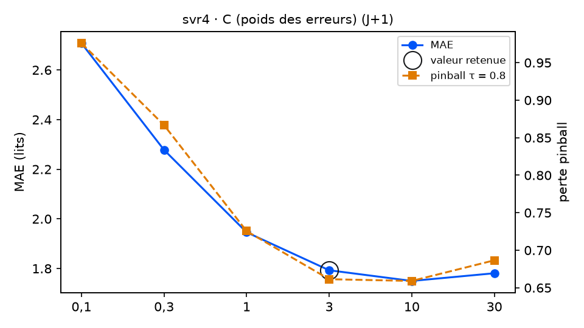

Amplitude de la MAE : 53.4 %. Aucune valeur ne fait significativement mieux que la valeur retenue.

### svr4 · ε (tube, niveaux quantiles)

| variante | MAE | RMSE | biais | pinball τ=0.8 | couverture 90 % | temps (s) | DM p (pinball τ=0.8) | p Holm | DM p (MAE) | vs choix retenu |
|---|---|---|---|---|---|---|---|---|---|---|
| epsilon_quantile = 0 | 1.782 | 2.275 | -0.074 | 0.6646 | 89.6 | 7.2 | 0.5735 | 0.9 | 0.042 | équivalent |
| epsilon_quantile = 0,25 (retenu) | 1.793 | 2.283 | -0.079 | 0.6614 | 89.1 | 7.5 |  |  |  | — choix retenu |
| epsilon_quantile = 0,5 | 1.803 | 2.291 | -0.111 | 0.6584 | 88.5 | 6.8 | 0.45 | 0.9 | 0.1862 | équivalent |
| epsilon_quantile = 1 | 1.802 | 2.287 | -0.069 | 0.6737 | 83.1 | 8.3 | 0.2609 | 0.7827 | 0.3743 | équivalent |

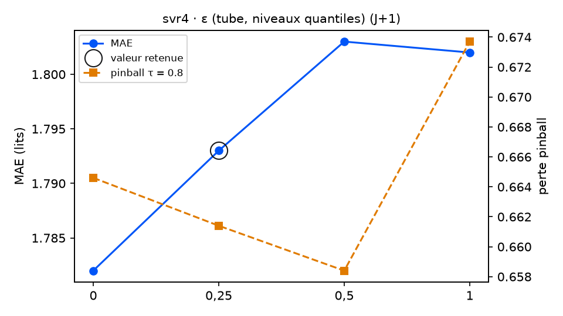

Amplitude de la MAE : 1.2 %. Aucune valeur ne fait significativement mieux que la valeur retenue.

### svr4 · γ₁ (portée, bloc occupation)

| variante | MAE | RMSE | biais | pinball τ=0.8 | couverture 90 % | temps (s) | DM p (pinball τ=0.8) | p Holm | DM p (MAE) | vs choix retenu |
|---|---|---|---|---|---|---|---|---|---|---|
| gamma1 = 0,01 | 1.811 | 2.288 | -0.137 | 0.6443 | 90.2 | 10.9 | 0.0617 | 0.2468 | 0.209 | équivalent |
| gamma1 = 0,02 (retenu) | 1.793 | 2.283 | -0.079 | 0.6614 | 89.1 | 12.6 |  |  |  | — choix retenu |
| gamma1 = 0,05 | 1.789 | 2.285 | -0.031 | 0.6679 | 89.1 | 11.0 | 0.4103 | 0.4454 | 0.8501 | équivalent |
| gamma1 = 0,1 | 1.812 | 2.308 | -0.003 | 0.6787 | 88.0 | 13.3 | 0.2227 | 0.4454 | 0.5172 | équivalent |
| gamma1 = 0,2 | 1.841 | 2.347 | -0.017 | 0.6929 | 87.4 | 11.8 | 0.0843 | 0.2529 | 0.1864 | équivalent |
| gamma1 = 0,5 | 1.921 | 2.427 | -0.079 | 0.7241 | 86.3 | 12.0 | 0.0131 | 0.0655 | 0.0065 | équivalent |

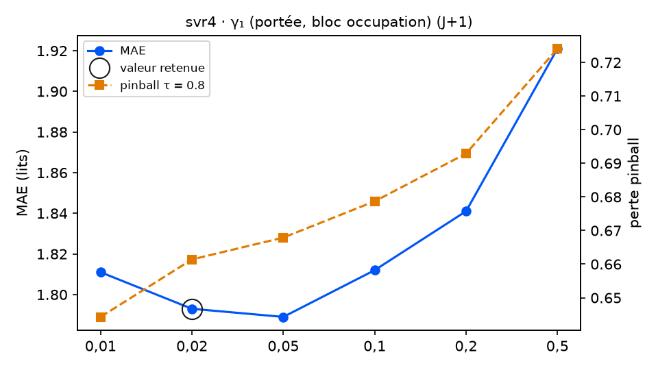

Amplitude de la MAE : 7.4 %. Aucune valeur ne fait significativement mieux que la valeur retenue.

### svr4 · γ₂ (portée, bloc flux et saison)

| variante | MAE | RMSE | biais | pinball τ=0.8 | couverture 90 % | temps (s) | DM p (pinball τ=0.8) | p Holm | DM p (MAE) | vs choix retenu |
|---|---|---|---|---|---|---|---|---|---|---|
| gamma2 = 0,02 | 1.856 | 2.36 | -0.08 | 0.6952 | 89.1 | 9.9 | 0.0032 | 0.0096 | 0.004 | moins bon |
| gamma2 = 0,05 (retenu) | 1.793 | 2.283 | -0.079 | 0.6614 | 89.1 | 12.3 |  |  |  | — choix retenu |
| gamma2 = 0,1 | 1.79 | 2.291 | -0.096 | 0.6534 | 89.1 | 10.3 | 0.3685 | 0.737 | 0.8853 | équivalent |
| gamma2 = 0,2 | 1.837 | 2.365 | -0.1 | 0.6678 | 89.1 | 13.3 | 0.6662 | 0.737 | 0.1632 | équivalent |
| gamma2 = 0,5 | 1.969 | 2.57 | -0.074 | 0.7543 | 86.9 | 14.6 | 0.0 | 0.0 | 0.001 | moins bon |

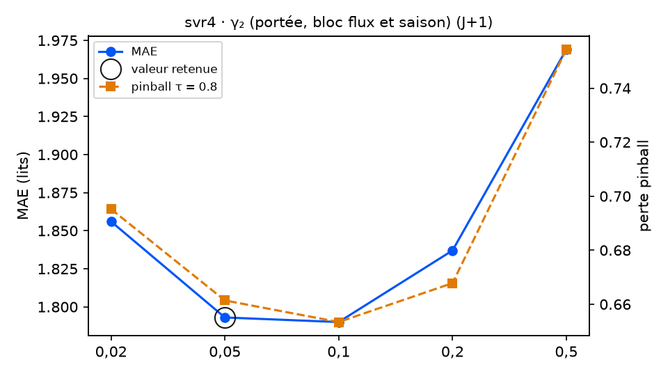

Amplitude de la MAE : 10.0 %. Aucune valeur ne fait significativement mieux que la valeur retenue.

### svr4 · τ (quantile décisionnel)

| variante | MAE | RMSE | biais | pinball τ=0.8 | couverture 90 % | temps (s) | DM p (pinball τ=0.8) | p Holm | DM p (MAE) | vs choix retenu |
|---|---|---|---|---|---|---|---|---|---|---|
| tau = 0,5 | 1.793 | 2.283 | -0.079 | 0.92 | 89.1 | 10.7 | 0.0 | 0.0 |  | moins bon |
| tau = 0,6 | 1.793 | 2.283 | -0.079 | 0.92 | 89.1 | 11.6 | 0.0 | 0.0 |  | moins bon |
| tau = 0,7 | 1.793 | 2.283 | -0.079 | 0.92 | 89.1 | 13.5 | 0.0 | 0.0 |  | moins bon |
| tau = 0,8 (retenu) | 1.793 | 2.283 | -0.079 | 0.6614 | 89.1 | 10.6 |  |  |  | — choix retenu |
| tau = 0,9 | 1.793 | 2.283 | -0.079 | 0.92 | 89.1 | 11.3 | 0.0 | 0.0 |  | moins bon |

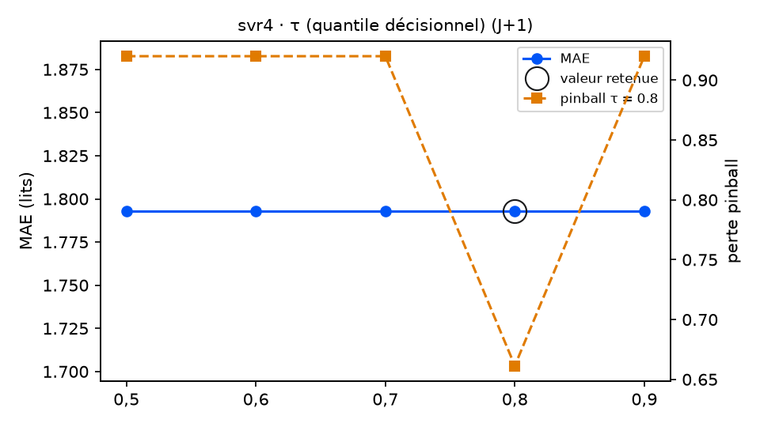

Amplitude de la MAE : 0.0 %. Aucune valeur ne fait significativement mieux que la valeur retenue.

### svr4 · η₀ (taux d'apprentissage d'Adam)

| variante | MAE | RMSE | biais | pinball τ=0.8 | couverture 90 % | temps (s) | DM p (pinball τ=0.8) | p Holm | DM p (MAE) | vs choix retenu |
|---|---|---|---|---|---|---|---|---|---|---|
| taux = 0,005 | 1.792 | 2.282 | -0.077 | 0.6625 | 89.1 | 12.0 | 0.3631 | 1.0 | 0.5683 | équivalent |
| taux = 0,01 | 1.792 | 2.282 | -0.077 | 0.6617 | 89.1 | 11.7 | 0.815 | 1.0 | 0.4003 | équivalent |
| taux = 0,02 | 1.792 | 2.283 | -0.077 | 0.6622 | 89.1 | 9.1 | 0.3638 | 1.0 | 0.5804 | équivalent |
| taux = 0,05 (retenu) | 1.793 | 2.283 | -0.079 | 0.6614 | 89.1 | 10.7 |  |  |  | — choix retenu |
| taux = 0,1 | 1.791 | 2.281 | -0.081 | 0.661 | 89.1 | 10.5 | 0.2604 | 1.0 | 0.1788 | équivalent |
| taux = 0,2 | 1.79 | 2.28 | -0.085 | 0.6607 | 89.1 | 15.6 | 0.2776 | 1.0 | 0.0286 | équivalent |

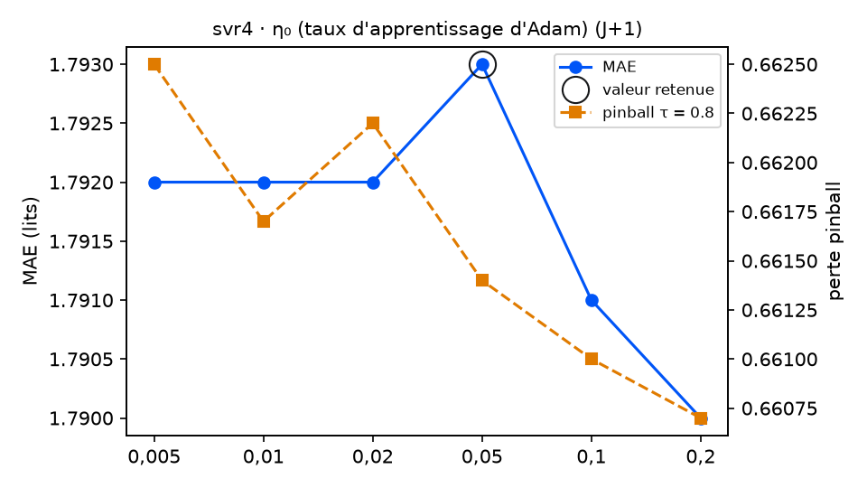

Amplitude de la MAE : 0.2 %. Aucune valeur ne fait significativement mieux que la valeur retenue.

### svr4 · nombre maximal d'itérations

| variante | MAE | RMSE | biais | pinball τ=0.8 | couverture 90 % | temps (s) | DM p (pinball τ=0.8) | p Holm | DM p (MAE) | vs choix retenu |
|---|---|---|---|---|---|---|---|---|---|---|
| iterations = 300 | 1.792 | 2.281 | -0.083 | 0.6606 | 89.6 | 2.2 | 0.0975 | 0.195 | 0.2651 | équivalent |
| iterations = 1000 | 1.793 | 2.284 | -0.077 | 0.6612 | 89.1 | 3.5 | 0.313 | 0.313 | 0.1578 | équivalent |
| iterations = 3000 (retenu) | 1.793 | 2.283 | -0.079 | 0.6614 | 89.1 | 9.1 |  |  |  | — choix retenu |
| iterations = 6000 | 1.793 | 2.284 | -0.078 | 0.6612 | 89.1 | 10.0 | 0.0143 | 0.0429 | 0.2359 | meilleur |

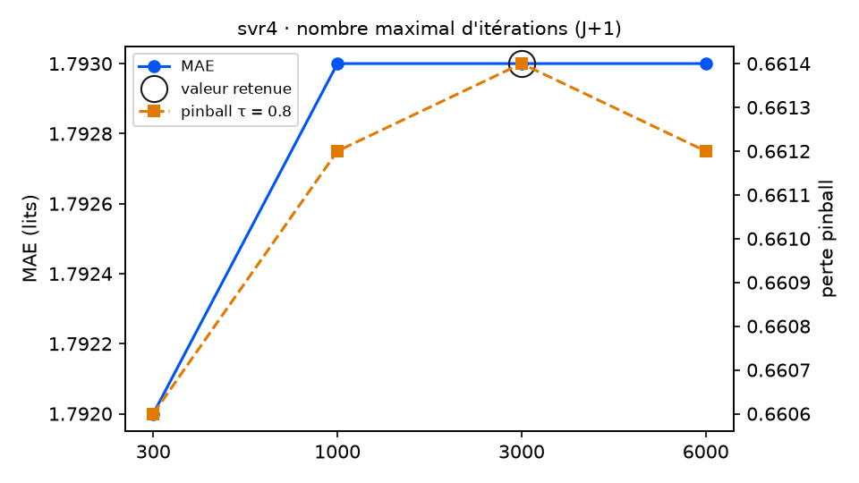

Amplitude de la MAE : 0.1 %. Valeur(s) significativement meilleure(s) : iterations = 6000 — réglage à revoir.

### svr4 · T (décroissance du pas ; aucune = pas constant)

| variante | MAE | RMSE | biais | pinball τ=0.8 | couverture 90 % | temps (s) | DM p (pinball τ=0.8) | p Holm | DM p (MAE) | vs choix retenu |
|---|---|---|---|---|---|---|---|---|---|---|
| decroissance = aucune | 1.791 | 2.282 | -0.079 | 0.661 | 89.1 | 11.4 | 0.4465 | 0.893 | 0.0484 | équivalent |
| decroissance = 100 | 1.793 | 2.283 | -0.076 | 0.6614 | 89.1 | 8.0 | 0.9746 | 0.9746 | 0.7302 | équivalent |
| decroissance = 500 (retenu) | 1.793 | 2.283 | -0.079 | 0.6614 | 89.1 | 9.1 |  |  |  | — choix retenu |
| decroissance = 2000 | 1.793 | 2.283 | -0.076 | 0.661 | 89.1 | 12.1 | 0.1399 | 0.4197 | 0.96 | équivalent |

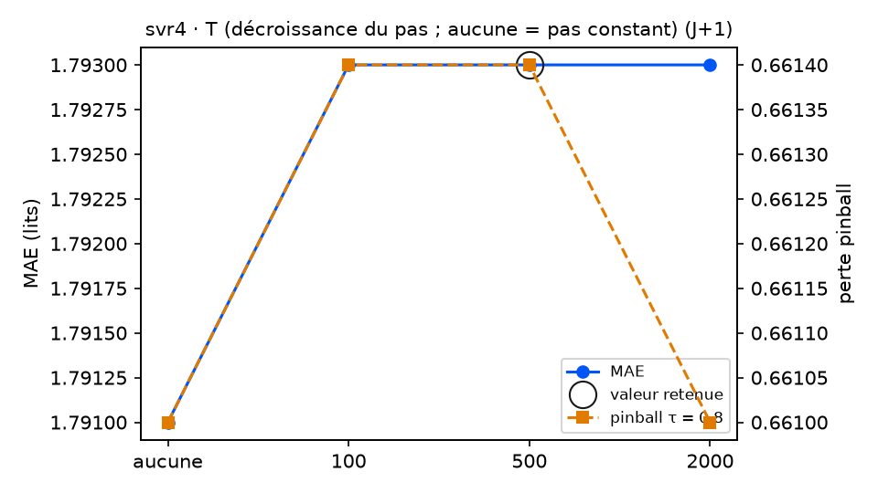

Amplitude de la MAE : 0.1 %. Aucune valeur ne fait significativement mieux que la valeur retenue.

### svr4 · part des pas moyennée (Polyak ; 0 = aucune)

| variante | MAE | RMSE | biais | pinball τ=0.8 | couverture 90 % | temps (s) | DM p (pinball τ=0.8) | p Holm | DM p (MAE) | vs choix retenu |
|---|---|---|---|---|---|---|---|---|---|---|
| moyenne_polyak = 0 | 1.793 | 2.283 | -0.079 | 0.6614 | 89.1 | 9.9 |  |  |  | identique |
| moyenne_polyak = 0,25 | 1.793 | 2.283 | -0.079 | 0.6614 | 89.1 | 8.7 |  |  |  | identique |
| moyenne_polyak = 0,5 (retenu) | 1.793 | 2.283 | -0.079 | 0.6614 | 89.1 | 9.4 |  |  |  | — choix retenu |
| moyenne_polyak = 0,75 | 1.793 | 2.283 | -0.079 | 0.6614 | 89.1 | 9.2 |  |  |  | identique |

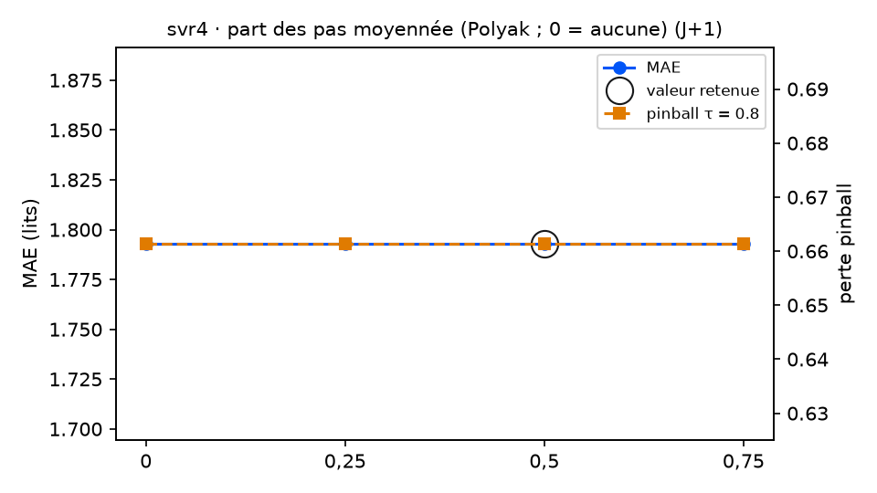

Amplitude de la MAE : 0.0 %. Aucune valeur ne fait significativement mieux que la valeur retenue.

### svr4 · tolérance d'arrêt anticipé

| variante | MAE | RMSE | biais | pinball τ=0.8 | couverture 90 % | temps (s) | DM p (pinball τ=0.8) | p Holm | DM p (MAE) | vs choix retenu |
|---|---|---|---|---|---|---|---|---|---|---|
| tolerance = 1e-05 | 1.791 | 2.281 | -0.079 | 0.6602 | 89.1 | 4.1 | 0.046 | 0.092 | 0.1953 | équivalent |
| tolerance = 1e-07 (retenu) | 1.793 | 2.283 | -0.079 | 0.6614 | 89.1 | 9.6 |  |  |  | — choix retenu |
| tolerance = 1e-09 | 1.792 | 2.283 | -0.078 | 0.6611 | 89.1 | 14.1 | 0.3373 | 0.3373 | 0.23 | équivalent |

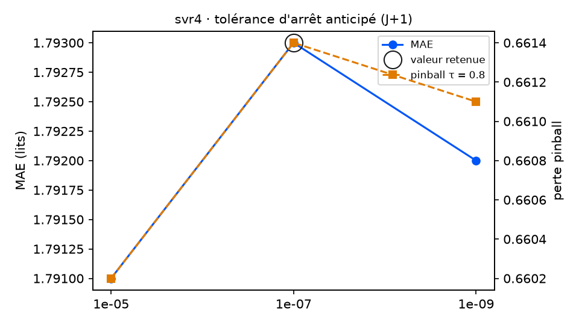

Amplitude de la MAE : 0.1 %. Aucune valeur ne fait significativement mieux que la valeur retenue.

### svr4 · direction préconditionnée α + Cg

| variante | MAE | RMSE | biais | pinball τ=0.8 | couverture 90 % | temps (s) | DM p (pinball τ=0.8) | p Holm | DM p (MAE) | vs choix retenu |
|---|---|---|---|---|---|---|---|---|---|---|
| preconditionne = True (retenu) | 1.793 | 2.283 | -0.079 | 0.6614 | 89.1 | 12.2 |  |  |  | — choix retenu |
| preconditionne = False | 1.812 | 2.301 | -0.072 | 0.6621 | 89.6 | 16.9 | 0.7372 | 0.7372 | 0.0538 | équivalent |

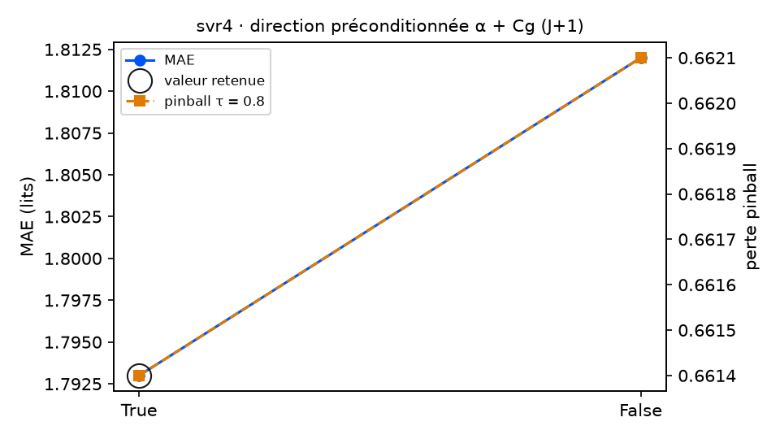

Amplitude de la MAE : 1.1 %. Aucune valeur ne fait significativement mieux que la valeur retenue.

### svr4 · optimiseur

| variante | MAE | RMSE | biais | pinball τ=0.8 | couverture 90 % | temps (s) | DM p (pinball τ=0.8) | p Holm | DM p (MAE) | vs choix retenu |
|---|---|---|---|---|---|---|---|---|---|---|
| optimiseur = adam (retenu) | 1.793 | 2.283 | -0.079 | 0.6614 | 89.1 | 9.2 |  |  |  | — choix retenu |
| optimiseur = momentum | 2.531 | 3.212 | 0.132 | 0.9485 | 90.7 | 12.5 | 0.0 | 0.0 | 0.0 | moins bon |
| optimiseur = sgd | 2.387 | 3.074 | -0.287 | 0.7281 | 89.6 | 12.3 | 0.0067 | 0.0067 | 0.0 | moins bon |

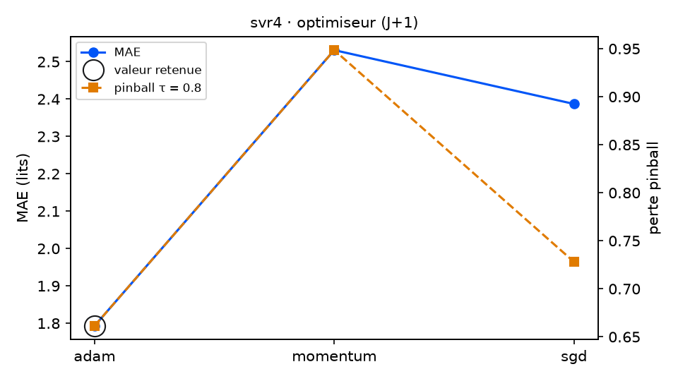

Amplitude de la MAE : 41.2 %. Aucune valeur ne fait significativement mieux que la valeur retenue.

### svr2 · C

| variante | MAE | RMSE | biais | pinball τ=0.8 | temps (s) | DM p (pinball τ=0.8) | p Holm | DM p (MAE) | vs choix retenu |
|---|---|---|---|---|---|---|---|---|---|
| C = 0,1 | 2.453 | 3.081 | -0.111 | 1.2598 | 1.0 | 0.0 | 0.0 | 0.0 | moins bon |
| C = 0,3 | 2.074 | 2.619 | -0.086 | 1.0626 | 1.1 | 0.0002 | 0.0008 | 0.0 | moins bon |
| C = 1 | 1.821 | 2.302 | -0.081 | 0.9346 | 1.9 | 0.0025 | 0.0075 | 0.0013 | moins bon |
| C = 3 (retenu) | 1.719 | 2.191 | -0.043 | 0.8724 | 2.7 |  |  |  | — choix retenu |
| C = 10 | 1.692 | 2.183 | -0.043 | 0.8588 | 2.9 | 0.4326 | 0.8652 | 0.3325 | équivalent |
| C = 30 | 1.706 | 2.191 | -0.1 | 0.8832 | 2.9 | 0.7081 | 0.8652 | 0.7832 | équivalent |

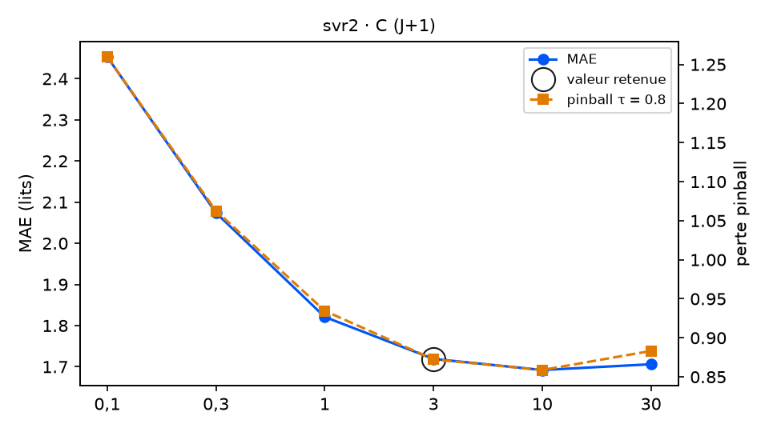

Amplitude de la MAE : 44.3 %. Aucune valeur ne fait significativement mieux que la valeur retenue.

### svr2 · ε (tube ε-insensible, en lits)

| variante | MAE | RMSE | biais | pinball τ=0.8 | temps (s) | DM p (pinball τ=0.8) | p Holm | DM p (MAE) | vs choix retenu |
|---|---|---|---|---|---|---|---|---|---|
| epsilon = 0 | 1.745 | 2.219 | -0.094 | 0.9006 | 2.6 | 0.0106 | 0.0336 | 0.1353 | moins bon |
| epsilon = 0,25 | 1.735 | 2.208 | -0.1 | 0.8976 | 1.4 | 0.0084 | 0.0336 | 0.3078 | moins bon |
| epsilon = 0,5 | 1.723 | 2.196 | -0.083 | 0.8865 | 1.7 | 0.0718 | 0.1436 | 0.7377 | équivalent |
| epsilon = 1 (retenu) | 1.719 | 2.191 | -0.043 | 0.8724 | 1.7 |  |  |  | — choix retenu |
| epsilon = 2 | 1.763 | 2.229 | 0.111 | 0.8481 | 1.5 | 0.0782 | 0.1436 | 0.0661 | équivalent |

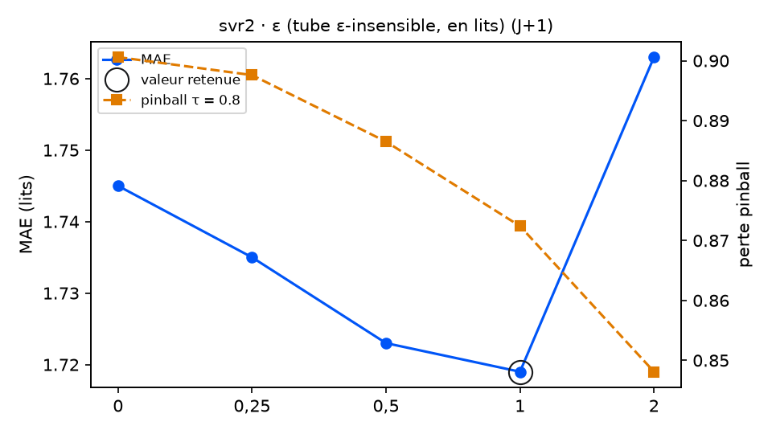

Amplitude de la MAE : 2.6 %. Aucune valeur ne fait significativement mieux que la valeur retenue.

### svr2 · γ (portée du noyau RBF)

| variante | MAE | RMSE | biais | pinball τ=0.8 | temps (s) | DM p (pinball τ=0.8) | p Holm | DM p (MAE) | vs choix retenu |
|---|---|---|---|---|---|---|---|---|---|
| gamma = 0,005 | 1.826 | 2.319 | -0.084 | 0.9382 | 3.4 | 0.0039 | 0.0156 | 0.0022 | moins bon |
| gamma = 0,01 | 1.764 | 2.249 | -0.051 | 0.897 | 1.7 | 0.058 | 0.116 | 0.0305 | équivalent |
| gamma = 0,02 (retenu) | 1.719 | 2.191 | -0.043 | 0.8724 | 2.0 |  |  |  | — choix retenu |
| gamma = 0,05 | 1.735 | 2.211 | -0.063 | 0.8862 | 1.4 | 0.434 | 0.434 | 0.6034 | équivalent |
| gamma = 0,1 | 1.832 | 2.312 | -0.063 | 0.9351 | 2.1 | 0.026 | 0.078 | 0.0265 | équivalent |
| gamma = 0,2 | 2.012 | 2.533 | -0.011 | 1.0094 | 2.5 | 0.002 | 0.01 | 0.0002 | moins bon |
| gamma = 0,5 | 2.61 | 3.273 | 0.073 | 1.2829 | 0.9 | 0.0 | 0.0 | 0.0 | moins bon |

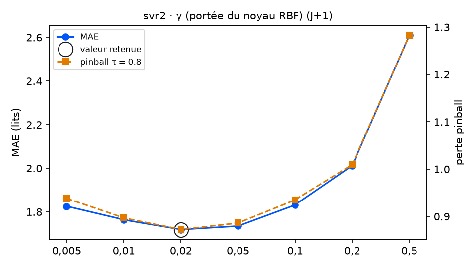

Amplitude de la MAE : 51.8 %. Aucune valeur ne fait significativement mieux que la valeur retenue.

### foret · nombre d'arbres

| variante | MAE | RMSE | biais | pinball τ=0.8 | couverture 90 % | temps (s) | DM p (pinball τ=0.8) | p Holm | DM p (MAE) | vs choix retenu |
|---|---|---|---|---|---|---|---|---|---|---|
| arbres = 25 | 1.942 | 2.552 | 0.064 | 0.7416 | 94.0 | 2.3 | 0.4161 | 1.0 | 0.5538 | équivalent |
| arbres = 50 | 1.941 | 2.558 | 0.057 | 0.7412 | 94.0 | 4.0 | 0.3841 | 1.0 | 0.5251 | équivalent |
| arbres = 100 | 1.93 | 2.566 | 0.05 | 0.7222 | 93.4 | 5.2 | 0.3612 | 1.0 | 0.6638 | équivalent |
| arbres = 300 (retenu) | 1.921 | 2.533 | 0.044 | 0.7303 | 94.0 | 16.5 |  |  |  | — choix retenu |
| arbres = 500 | 1.946 | 2.565 | 0.036 | 0.7251 | 94.0 | 26.4 | 0.5054 | 1.0 | 0.0302 | équivalent |

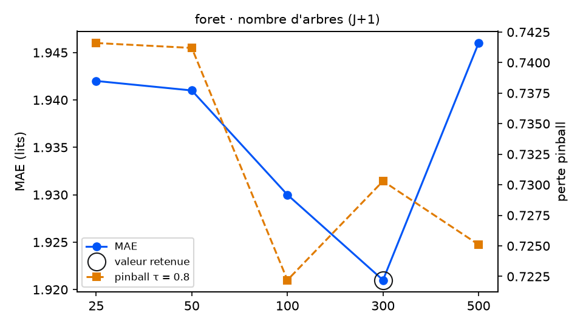

Amplitude de la MAE : 1.3 %. Aucune valeur ne fait significativement mieux que la valeur retenue.

### foret · profondeur maximale

| variante | MAE | RMSE | biais | pinball τ=0.8 | couverture 90 % | temps (s) | DM p (pinball τ=0.8) | p Holm | DM p (MAE) | vs choix retenu |
|---|---|---|---|---|---|---|---|---|---|---|
| profondeur_foret = 3 | 2.097 | 2.76 | -0.034 | 0.8007 | 96.2 | 2.0 | 0.0041 | 0.0164 | 0.004 | moins bon |
| profondeur_foret = 5 | 1.95 | 2.609 | -0.073 | 0.7441 | 94.5 | 6.4 | 0.3124 | 0.9372 | 0.4523 | équivalent |
| profondeur_foret = 8 | 1.936 | 2.559 | 0.006 | 0.7249 | 94.5 | 12.6 | 0.5967 | 0.9372 | 0.5119 | équivalent |
| profondeur_foret = 12 (retenu) | 1.921 | 2.533 | 0.044 | 0.7303 | 94.0 | 18.5 |  |  |  | — choix retenu |
| profondeur_foret = 20 | 1.915 | 2.53 | 0.027 | 0.7197 | 93.4 | 20.0 | 0.334 | 0.9372 | 0.7514 | équivalent |

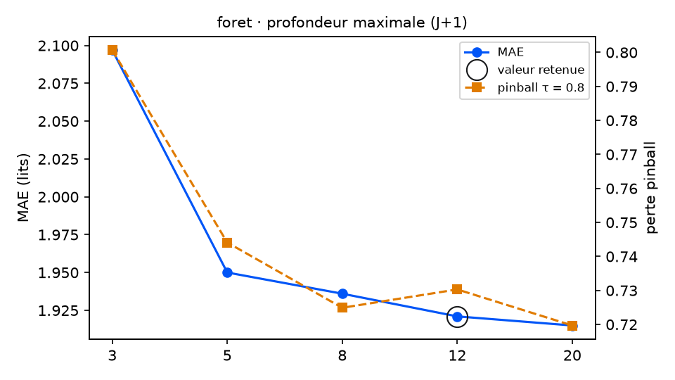

Amplitude de la MAE : 9.5 %. Aucune valeur ne fait significativement mieux que la valeur retenue.

### foret · taille minimale d'une feuille

| variante | MAE | RMSE | biais | pinball τ=0.8 | couverture 90 % | temps (s) | DM p (pinball τ=0.8) | p Holm | DM p (MAE) | vs choix retenu |
|---|---|---|---|---|---|---|---|---|---|---|
| min_feuille = 2 | 1.917 | 2.503 | 0.053 | 0.7105 | 94.5 | 35.2 | 0.1408 | 0.3975 | 0.906 | équivalent |
| min_feuille = 5 (retenu) | 1.921 | 2.533 | 0.044 | 0.7303 | 94.0 | 13.8 |  |  |  | — choix retenu |
| min_feuille = 10 | 1.939 | 2.575 | 0.02 | 0.7416 | 94.5 | 8.6 | 0.3275 | 0.3975 | 0.5246 | équivalent |
| min_feuille = 20 | 1.987 | 2.639 | 0.002 | 0.7535 | 95.1 | 6.2 | 0.1325 | 0.3975 | 0.0916 | équivalent |

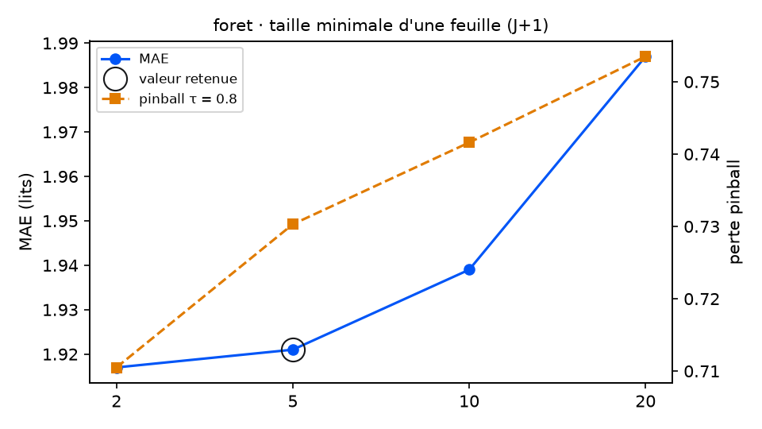

Amplitude de la MAE : 3.6 %. Aucune valeur ne fait significativement mieux que la valeur retenue.

### foret · part des variables tirées par nœud

| variante | MAE | RMSE | biais | pinball τ=0.8 | couverture 90 % | temps (s) | DM p (pinball τ=0.8) | p Holm | DM p (MAE) | vs choix retenu |
|---|---|---|---|---|---|---|---|---|---|---|
| part_variables = 0,15 | 1.956 | 2.599 | -0.053 | 0.7209 | 95.1 | 17.1 | 0.6368 | 0.9618 | 0.4564 | équivalent |
| part_variables = 0,333333 (retenu) | 1.921 | 2.533 | 0.044 | 0.7303 | 94.0 | 13.3 |  |  |  | — choix retenu |
| part_variables = 0,5 | 1.909 | 2.513 | 0.072 | 0.7174 | 94.0 | 13.5 | 0.1674 | 0.5022 | 0.7058 | équivalent |
| part_variables = 1 | 1.89 | 2.531 | 0.089 | 0.7174 | 93.4 | 17.6 | 0.4809 | 0.9618 | 0.5279 | équivalent |

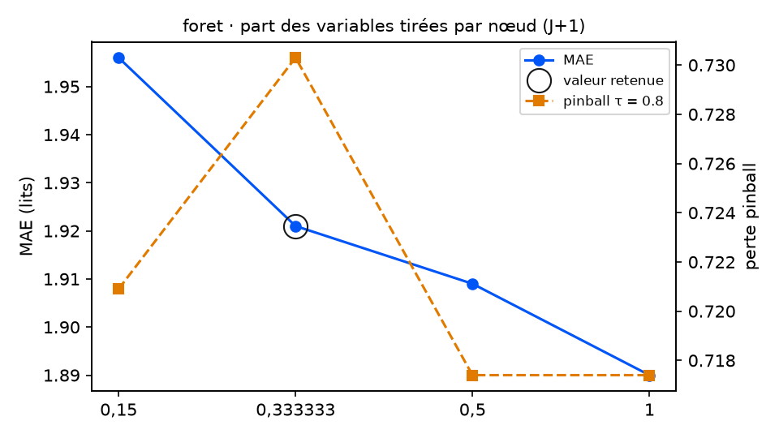

Amplitude de la MAE : 3.4 %. Aucune valeur ne fait significativement mieux que la valeur retenue.

### boosting · nombre d'étapes

| variante | MAE | RMSE | biais | pinball τ=0.8 | couverture 90 % | temps (s) | DM p (pinball τ=0.8) | p Holm | DM p (MAE) | vs choix retenu |
|---|---|---|---|---|---|---|---|---|---|---|
| etapes = 50 | 1.869 | 2.448 | 0.018 | 0.7355 | 89.6 | 1.2 | 0.1876 | 0.5628 | 0.3103 | équivalent |
| etapes = 100 | 1.806 | 2.38 | 0.043 | 0.7067 | 86.3 | 2.8 | 0.4887 | 0.9774 | 0.8216 | équivalent |
| etapes = 300 (retenu) | 1.812 | 2.375 | 0.053 | 0.6955 | 83.6 | 7.5 |  |  |  | — choix retenu |
| etapes = 600 | 1.821 | 2.387 | 0.037 | 0.696 | 80.9 | 13.5 | 0.948 | 0.9774 | 0.56 | équivalent |

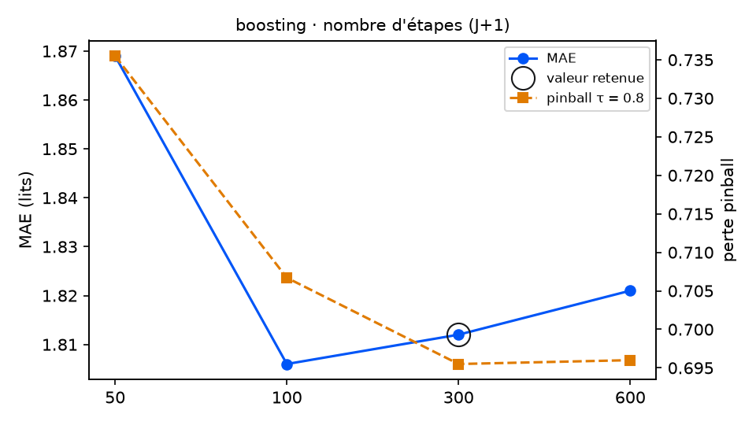

Amplitude de la MAE : 3.5 %. Aucune valeur ne fait significativement mieux que la valeur retenue.

### boosting · taux ν (shrinkage)

| variante | MAE | RMSE | biais | pinball τ=0.8 | couverture 90 % | temps (s) | DM p (pinball τ=0.8) | p Holm | DM p (MAE) | vs choix retenu |
|---|---|---|---|---|---|---|---|---|---|---|
| taux_boosting = 0,01 | 1.842 | 2.428 | 0.021 | 0.7119 | 89.6 | 7.9 | 0.5491 | 0.5491 | 0.5285 | équivalent |
| taux_boosting = 0,05 (retenu) | 1.812 | 2.375 | 0.053 | 0.6955 | 83.6 | 8.1 |  |  |  | — choix retenu |
| taux_boosting = 0,1 | 1.871 | 2.446 | 0.074 | 0.7291 | 82.5 | 7.4 | 0.0208 | 0.0624 | 0.0945 | équivalent |
| taux_boosting = 0,2 | 1.846 | 2.429 | -0.042 | 0.7477 | 77.6 | 8.3 | 0.0389 | 0.0778 | 0.4334 | équivalent |

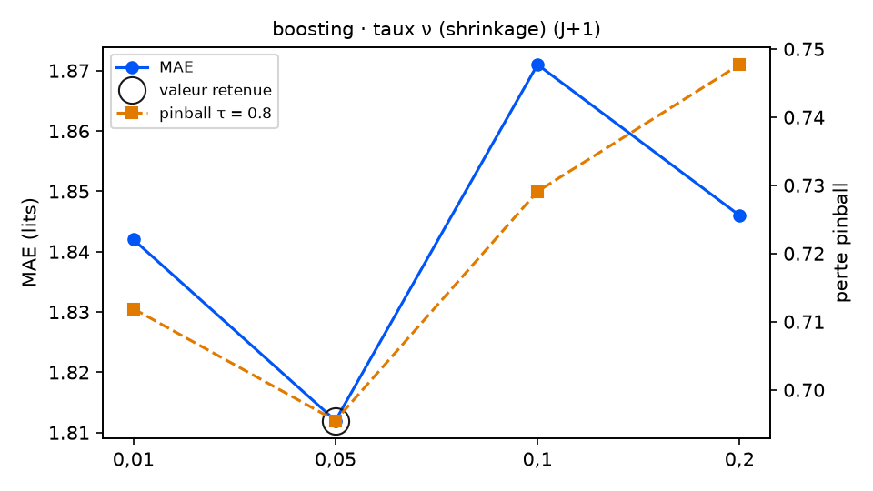

Amplitude de la MAE : 3.3 %. Aucune valeur ne fait significativement mieux que la valeur retenue.

### boosting · profondeur des arbres

| variante | MAE | RMSE | biais | pinball τ=0.8 | couverture 90 % | temps (s) | DM p (pinball τ=0.8) | p Holm | DM p (MAE) | vs choix retenu |
|---|---|---|---|---|---|---|---|---|---|---|
| profondeur_boosting = 1 | 1.877 | 2.452 | -0.013 | 0.6772 | 88.0 | 2.4 | 0.446 | 0.892 | 0.1099 | équivalent |
| profondeur_boosting = 2 | 1.805 | 2.376 | 0.068 | 0.6888 | 85.2 | 4.7 | 0.6414 | 0.892 | 0.7658 | équivalent |
| profondeur_boosting = 3 (retenu) | 1.812 | 2.375 | 0.053 | 0.6955 | 83.6 | 6.9 |  |  |  | — choix retenu |
| profondeur_boosting = 5 | 1.852 | 2.405 | 0.065 | 0.7374 | 74.9 | 14.5 | 0.0291 | 0.0873 | 0.2901 | équivalent |

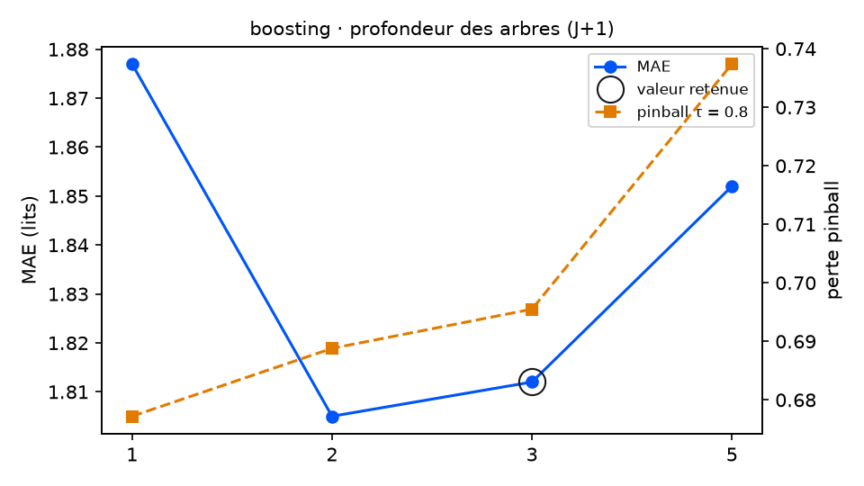

Amplitude de la MAE : 4.0 %. Aucune valeur ne fait significativement mieux que la valeur retenue.

### boosting · part du sous-échantillon

| variante | MAE | RMSE | biais | pinball τ=0.8 | couverture 90 % | temps (s) | DM p (pinball τ=0.8) | p Holm | DM p (MAE) | vs choix retenu |
|---|---|---|---|---|---|---|---|---|---|---|
| sous_echantillon = 0,5 | 1.84 | 2.403 | 0.015 | 0.6998 | 80.9 | 5.8 | 0.7853 | 0.7853 | 0.3477 | équivalent |
| sous_echantillon = 0,8 (retenu) | 1.812 | 2.375 | 0.053 | 0.6955 | 83.6 | 7.8 |  |  |  | — choix retenu |
| sous_echantillon = 1 | 1.782 | 2.374 | -0.009 | 0.7161 | 80.9 | 7.6 | 0.1849 | 0.3698 | 0.2831 | équivalent |

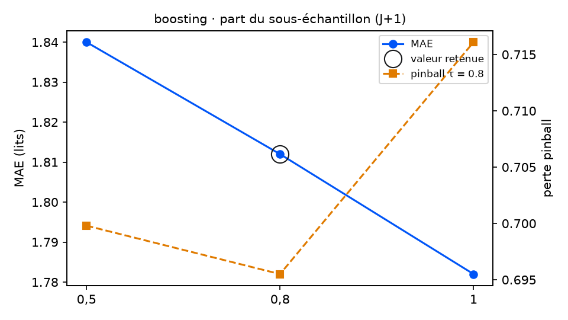

Amplitude de la MAE : 3.2 %. Aucune valeur ne fait significativement mieux que la valeur retenue.

### mlp · architecture (neurones par couche)

| variante | MAE | RMSE | biais | pinball τ=0.8 | couverture 90 % | temps (s) | DM p (pinball τ=0.8) | p Holm | DM p (MAE) | vs choix retenu |
|---|---|---|---|---|---|---|---|---|---|---|
| couches = 8 | 1.766 | 2.25 | 0.031 | 0.6601 | 86.9 | 0.8 | 0.2659 | 0.7977 | 0.5124 | équivalent |
| couches = 32 | 1.77 | 2.236 | -0.143 | 0.6745 | 89.1 | 0.8 | 0.049 | 0.196 | 0.4024 | équivalent |
| couches = 32×16 (retenu) | 1.738 | 2.226 | -0.042 | 0.6385 | 89.1 | 0.9 |  |  |  | — choix retenu |
| couches = 64×32 | 1.791 | 2.247 | 0.118 | 0.6449 | 85.8 | 1.9 | 0.7624 | 1.0 | 0.2574 | équivalent |
| couches = 32×16×8 | 1.772 | 2.257 | 0.0 | 0.6468 | 87.4 | 1.5 | 0.6893 | 1.0 | 0.4753 | équivalent |

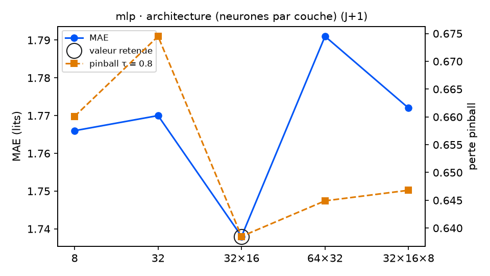

Amplitude de la MAE : 3.0 %. Aucune valeur ne fait significativement mieux que la valeur retenue.

### mlp · taux d'apprentissage

| variante | MAE | RMSE | biais | pinball τ=0.8 | couverture 90 % | temps (s) | DM p (pinball τ=0.8) | p Holm | DM p (MAE) | vs choix retenu |
|---|---|---|---|---|---|---|---|---|---|---|
| taux_reseau = 0,001 | 1.776 | 2.265 | 0.021 | 0.6711 | 86.3 | 2.3 | 0.1281 | 0.3843 | 0.339 | équivalent |
| taux_reseau = 0,003 | 1.779 | 2.278 | 0.023 | 0.6459 | 85.8 | 1.4 | 0.656 | 1.0 | 0.284 | équivalent |
| taux_reseau = 0,01 (retenu) | 1.738 | 2.226 | -0.042 | 0.6385 | 89.1 | 0.9 |  |  |  | — choix retenu |
| taux_reseau = 0,03 | 1.751 | 2.222 | 0.042 | 0.6404 | 84.7 | 0.8 | 0.9129 | 1.0 | 0.6978 | équivalent |

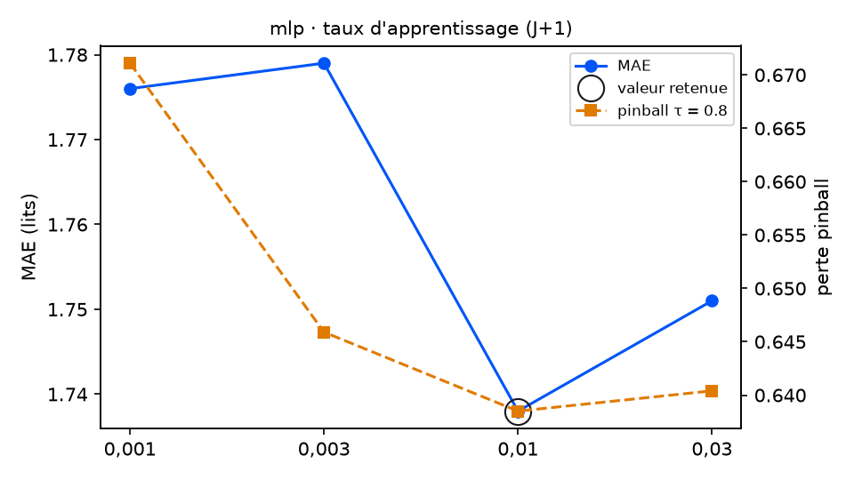

Amplitude de la MAE : 2.4 %. Aucune valeur ne fait significativement mieux que la valeur retenue.

### mlp · pénalité L2 λ

| variante | MAE | RMSE | biais | pinball τ=0.8 | couverture 90 % | temps (s) | DM p (pinball τ=0.8) | p Holm | DM p (MAE) | vs choix retenu |
|---|---|---|---|---|---|---|---|---|---|---|
| lambda_ = 0 | 1.749 | 2.235 | -0.087 | 0.6359 | 89.1 | 0.9 | 0.6937 | 1.0 | 0.4757 | équivalent |
| lambda_ = 0,0001 | 1.737 | 2.229 | -0.066 | 0.641 | 88.5 | 0.9 | 0.7127 | 1.0 | 0.9463 | équivalent |
| lambda_ = 0,001 (retenu) | 1.738 | 2.226 | -0.042 | 0.6385 | 89.1 | 1.3 |  |  |  | — choix retenu |
| lambda_ = 0,01 | 1.689 | 2.171 | 0.003 | 0.6335 | 84.7 | 1.5 | 0.7231 | 1.0 | 0.0783 | équivalent |
| lambda_ = 0,1 | 1.826 | 2.314 | -0.026 | 0.6726 | 88.5 | 2.6 | 0.1744 | 0.6976 | 0.1678 | équivalent |

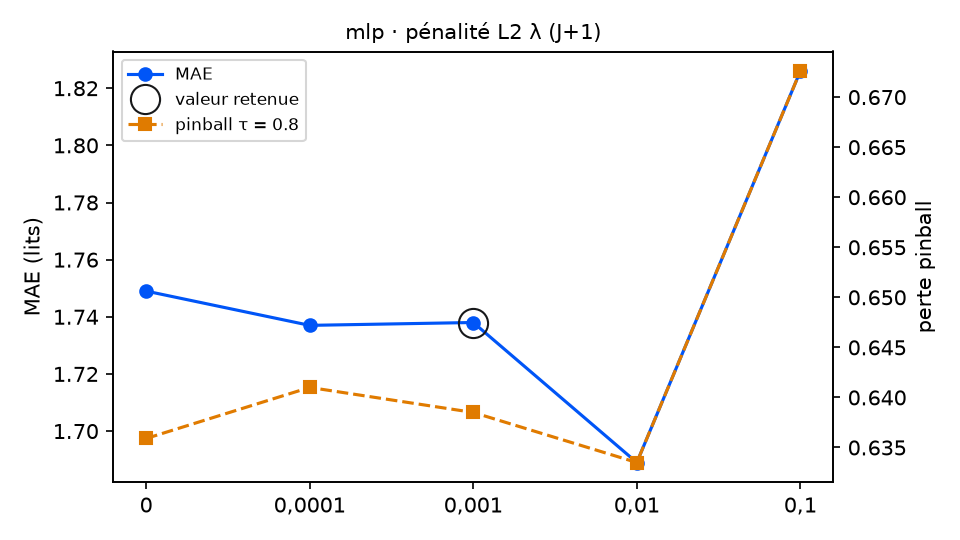

Amplitude de la MAE : 7.9 %. Aucune valeur ne fait significativement mieux que la valeur retenue.

### mlp · époques maximales

| variante | MAE | RMSE | biais | pinball τ=0.8 | couverture 90 % | temps (s) | DM p (pinball τ=0.8) | p Holm | DM p (MAE) | vs choix retenu |
|---|---|---|---|---|---|---|---|---|---|---|
| epoques = 300 | 1.738 | 2.226 | -0.042 | 0.6385 | 89.1 | 1.2 |  |  |  | identique |
| epoques = 800 | 1.738 | 2.226 | -0.042 | 0.6385 | 89.1 | 1.3 |  |  |  | identique |
| epoques = 1500 (retenu) | 1.738 | 2.226 | -0.042 | 0.6385 | 89.1 | 0.9 |  |  |  | — choix retenu |
| epoques = 3000 | 1.738 | 2.226 | -0.042 | 0.6385 | 89.1 | 0.9 |  |  |  | identique |

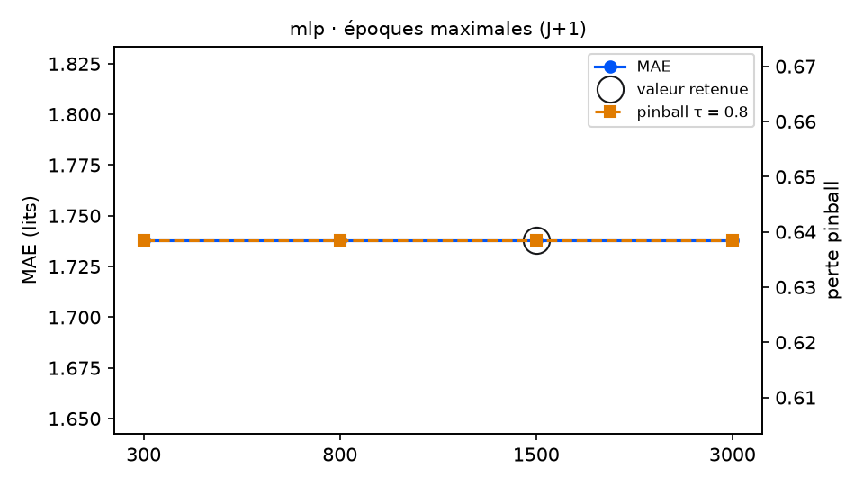

Amplitude de la MAE : 0.0 %. Aucune valeur ne fait significativement mieux que la valeur retenue.

### mlp · patience de l'arrêt anticipé

| variante | MAE | RMSE | biais | pinball τ=0.8 | couverture 90 % | temps (s) | DM p (pinball τ=0.8) | p Holm | DM p (MAE) | vs choix retenu |
|---|---|---|---|---|---|---|---|---|---|---|
| patience = 50 | 1.738 | 2.226 | -0.042 | 0.6385 | 89.1 | 0.6 |  |  |  | identique |
| patience = 150 (retenu) | 1.738 | 2.226 | -0.042 | 0.6385 | 89.1 | 0.9 |  |  |  | — choix retenu |
| patience = 300 | 1.738 | 2.226 | -0.042 | 0.6385 | 89.1 | 2.0 |  |  |  | identique |

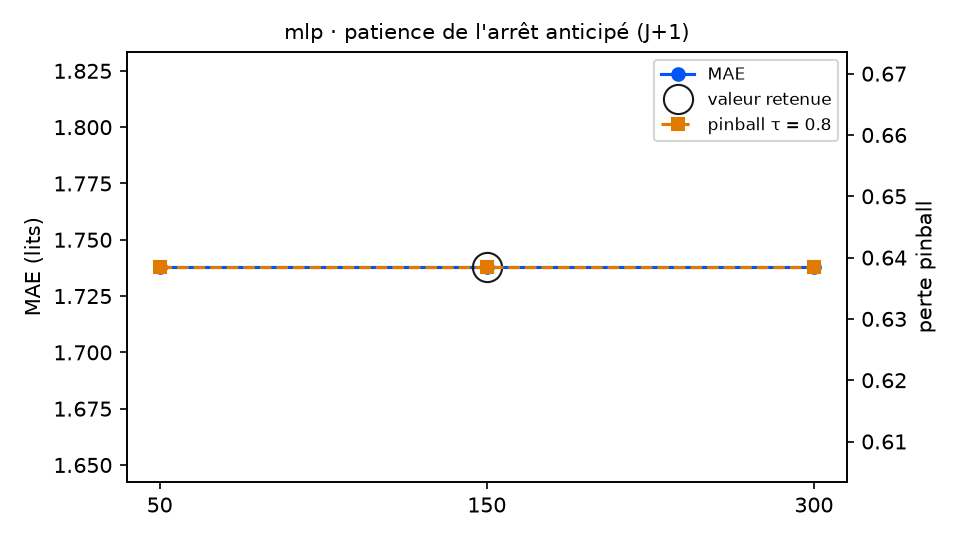

Amplitude de la MAE : 0.0 %. Aucune valeur ne fait significativement mieux que la valeur retenue.

### mlp · nombre d'initialisations moyennées

| variante | MAE | RMSE | biais | pinball τ=0.8 | couverture 90 % | temps (s) | DM p (pinball τ=0.8) | p Holm | DM p (MAE) | vs choix retenu |
|---|---|---|---|---|---|---|---|---|---|---|
| graines = 1 | 1.862 | 2.378 | 0.102 | 0.7135 | 86.9 | 0.5 | 0.0015 | 0.003 | 0.0078 | moins bon |
| graines = 3 (retenu) | 1.738 | 2.226 | -0.042 | 0.6385 | 89.1 | 1.3 |  |  |  | — choix retenu |
| graines = 5 | 1.764 | 2.249 | 0.023 | 0.6347 | 89.6 | 1.8 | 0.7165 | 0.7165 | 0.2011 | équivalent |

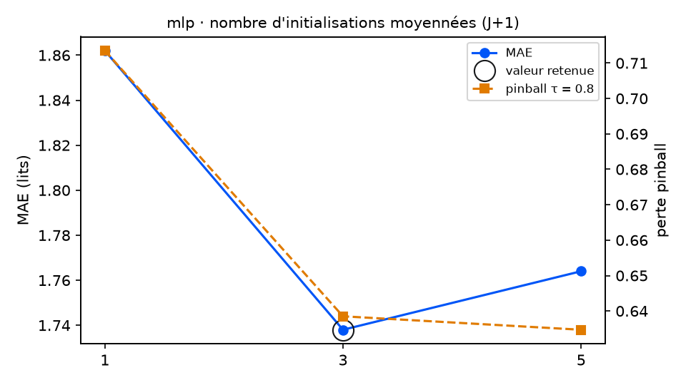

Amplitude de la MAE : 7.1 %. Aucune valeur ne fait significativement mieux que la valeur retenue.

### lstm · taille de l'état caché H

| variante | MAE | RMSE | biais | pinball τ=0.8 | couverture 90 % | temps (s) | DM p (pinball τ=0.8) | p Holm | DM p (MAE) | vs choix retenu |
|---|---|---|---|---|---|---|---|---|---|---|
| cache_lstm = 4 | 1.703 | 2.216 | 0.034 | 0.6382 | 89.6 | 11.0 | 0.9019 | 1.0 | 0.264 | équivalent |
| cache_lstm = 8 | 1.692 | 2.211 | 0.044 | 0.6351 | 89.1 | 8.1 | 0.7242 | 1.0 | 0.1676 | équivalent |
| cache_lstm = 16 (retenu) | 1.73 | 2.241 | 0.064 | 0.6398 | 89.6 | 9.1 |  |  |  | — choix retenu |
| cache_lstm = 32 | 1.743 | 2.281 | 0.036 | 0.6559 | 87.4 | 16.3 | 0.1524 | 0.4572 | 0.6031 | équivalent |

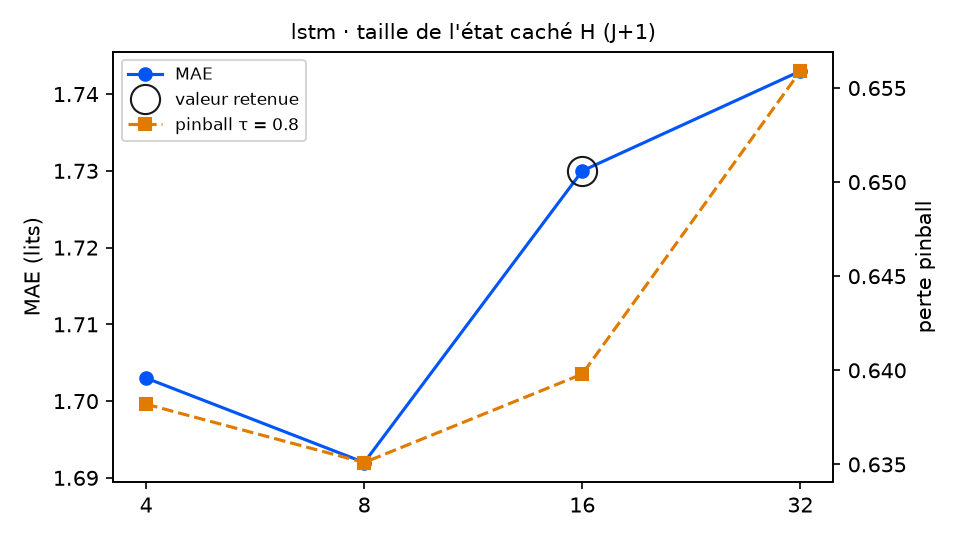

Amplitude de la MAE : 2.9 %. Aucune valeur ne fait significativement mieux que la valeur retenue.

### lstm · taux d'apprentissage

| variante | MAE | RMSE | biais | pinball τ=0.8 | couverture 90 % | temps (s) | DM p (pinball τ=0.8) | p Holm | DM p (MAE) | vs choix retenu |
|---|---|---|---|---|---|---|---|---|---|---|
| taux_reseau = 0,003 | 1.742 | 2.275 | 0.069 | 0.6499 | 91.3 | 14.6 | 0.3451 | 0.3451 | 0.5547 | équivalent |
| taux_reseau = 0,01 (retenu) | 1.73 | 2.241 | 0.064 | 0.6398 | 89.6 | 9.4 |  |  |  | — choix retenu |
| taux_reseau = 0,03 | 1.717 | 2.239 | 0.054 | 0.6637 | 90.2 | 8.1 | 0.0822 | 0.1644 | 0.6881 | équivalent |

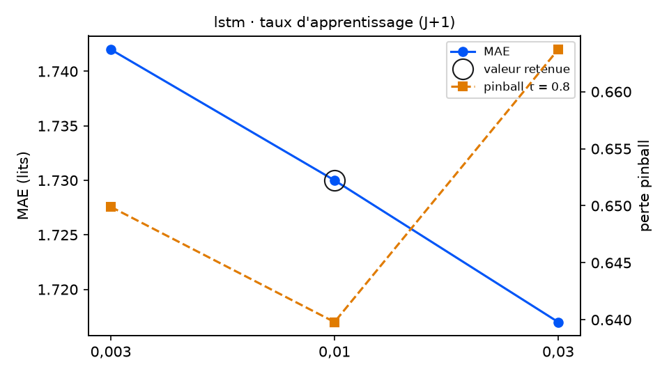

Amplitude de la MAE : 1.4 %. Aucune valeur ne fait significativement mieux que la valeur retenue.

### lstm · pénalité L2 λ

| variante | MAE | RMSE | biais | pinball τ=0.8 | couverture 90 % | temps (s) | DM p (pinball τ=0.8) | p Holm | DM p (MAE) | vs choix retenu |
|---|---|---|---|---|---|---|---|---|---|---|
| lambda_ = 0 | 1.761 | 2.268 | 0.132 | 0.6456 | 90.2 | 8.9 | 0.6163 | 0.8742 | 0.137 | équivalent |
| lambda_ = 0,001 (retenu) | 1.73 | 2.241 | 0.064 | 0.6398 | 89.6 | 9.3 |  |  |  | — choix retenu |
| lambda_ = 0,01 | 1.717 | 2.187 | 0.073 | 0.6272 | 90.7 | 17.0 | 0.4371 | 0.8742 | 0.7143 | équivalent |

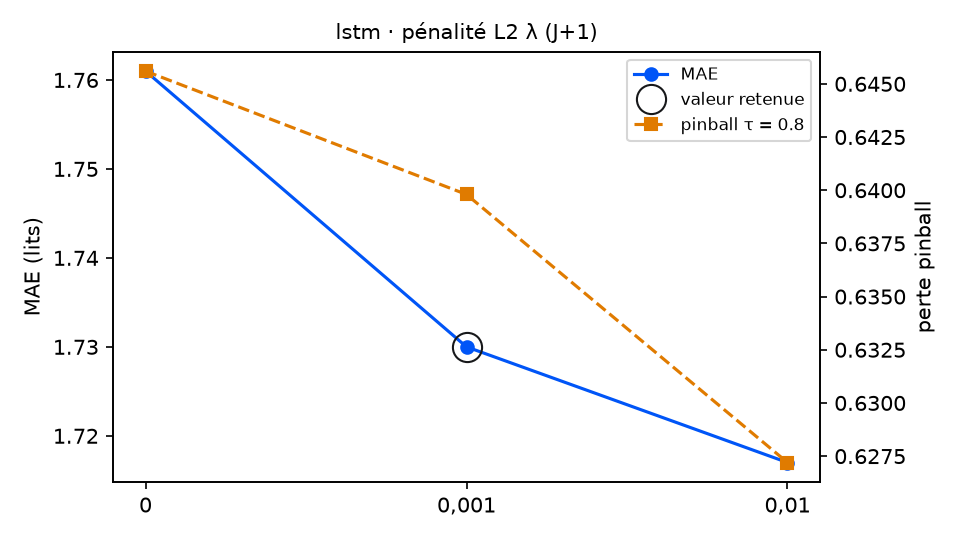

Amplitude de la MAE : 2.5 %. Aucune valeur ne fait significativement mieux que la valeur retenue.

### variables · jours d'occupation passée en entrée

| variante | MAE | RMSE | biais | pinball τ=0.8 | couverture 90 % | temps (s) | DM p (pinball τ=0.8) | p Holm | DM p (MAE) | vs choix retenu |
|---|---|---|---|---|---|---|---|---|---|---|
| retards = 3 | 1.795 | 2.324 | -0.244 | 0.6454 | 90.2 | 5.4 | 0.3225 | 1.0 | 0.9596 | équivalent |
| retards = 5 | 1.774 | 2.303 | -0.216 | 0.6489 | 89.6 | 5.8 | 0.3897 | 1.0 | 0.6121 | équivalent |
| retards = 7 (retenu) | 1.793 | 2.283 | -0.079 | 0.6614 | 89.1 | 7.7 |  |  |  | — choix retenu |
| retards = 10 | 1.793 | 2.291 | -0.097 | 0.661 | 89.1 | 7.3 | 0.9123 | 1.0 | 0.99 | équivalent |
| retards = 14 | 1.813 | 2.304 | -0.033 | 0.6543 | 89.1 | 7.0 | 0.5536 | 1.0 | 0.3895 | équivalent |
| retards = 21 | 1.813 | 2.299 | -0.041 | 0.6549 | 89.6 | 9.2 | 0.7043 | 1.0 | 0.468 | équivalent |

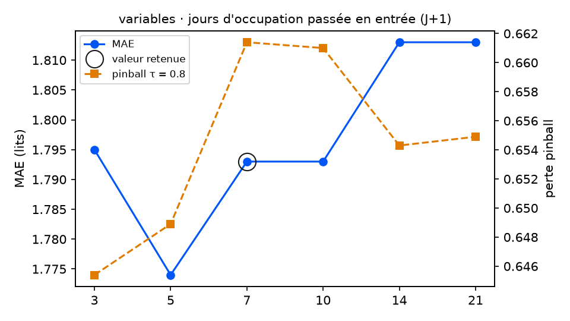

Amplitude de la MAE : 2.2 %. Aucune valeur ne fait significativement mieux que la valeur retenue.

## Horizon J+7

### svr4 · C (poids des erreurs)

| variante | MAE | RMSE | biais | pinball τ=0.8 | couverture 90 % | temps (s) | DM p (pinball τ=0.8) | p Holm | DM p (MAE) | vs choix retenu |
|---|---|---|---|---|---|---|---|---|---|---|
| C = 0,1 | 3.274 | 3.98 | 0.004 | 1.0983 | 93.2 | 6.7 | 0.3146 | 0.9438 | 0.7105 | équivalent |
| C = 0,3 | 3.276 | 4.028 | -0.117 | 1.0944 | 91.5 | 6.2 | 0.0985 | 0.394 | 0.5846 | équivalent |
| C = 1 | 3.264 | 4.037 | -0.235 | 1.0825 | 88.1 | 5.6 | 0.0451 | 0.2255 | 0.5306 | équivalent |
| C = 3 (retenu) | 3.227 | 3.949 | -0.331 | 1.0548 | 84.2 | 6.6 |  |  |  | — choix retenu |
| C = 10 | 3.261 | 3.967 | -0.391 | 1.0632 | 83.6 | 7.6 | 0.7751 | 0.9438 | 0.684 | équivalent |
| C = 30 | 3.375 | 4.113 | -0.373 | 1.106 | 83.6 | 8.5 | 0.3521 | 0.9438 | 0.4058 | équivalent |

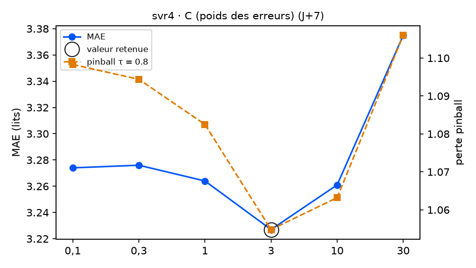

Amplitude de la MAE : 4.6 %. Aucune valeur ne fait significativement mieux que la valeur retenue.

### svr4 · ε (tube, niveaux quantiles)

| variante | MAE | RMSE | biais | pinball τ=0.8 | couverture 90 % | temps (s) | DM p (pinball τ=0.8) | p Holm | DM p (MAE) | vs choix retenu |
|---|---|---|---|---|---|---|---|---|---|---|
| epsilon_quantile = 0 (retenu) | 3.227 | 3.949 | -0.331 | 1.0548 | 84.2 | 6.1 |  |  |  | — choix retenu |
| epsilon_quantile = 0,25 | 3.219 | 3.945 | -0.305 | 1.0651 | 82.5 | 7.4 | 0.2458 | 0.29 | 0.4242 | équivalent |
| epsilon_quantile = 0,5 | 3.201 | 3.927 | -0.323 | 1.0794 | 80.8 | 5.8 | 0.145 | 0.29 | 0.0257 | équivalent |
| epsilon_quantile = 1 | 3.169 | 3.894 | -0.348 | 1.1123 | 78.0 | 6.4 | 0.0751 | 0.2253 | 0.0387 | équivalent |

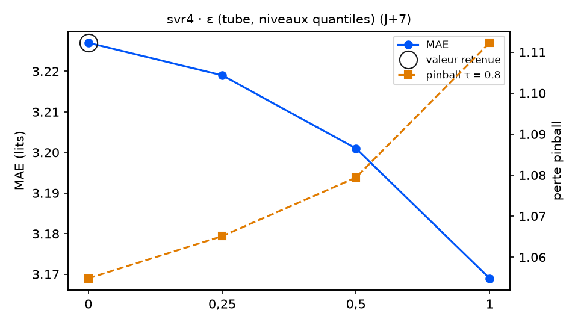

Amplitude de la MAE : 1.8 %. Aucune valeur ne fait significativement mieux que la valeur retenue.

### svr4 · γ₁ (portée, bloc occupation)

| variante | MAE | RMSE | biais | pinball τ=0.8 | couverture 90 % | temps (s) | DM p (pinball τ=0.8) | p Holm | DM p (MAE) | vs choix retenu |
|---|---|---|---|---|---|---|---|---|---|---|
| gamma1 = 0,01 | 3.21 | 3.94 | -0.351 | 1.0538 | 84.7 | 7.7 | 0.0956 | 0.0956 | 0.2271 | équivalent |
| gamma1 = 0,02 (retenu) | 3.227 | 3.949 | -0.331 | 1.0548 | 84.2 | 6.0 |  |  |  | — choix retenu |
| gamma1 = 0,05 | 3.288 | 4.001 | -0.195 | 1.0711 | 83.6 | 5.7 | 0.0273 | 0.0864 | 0.1065 | équivalent |
| gamma1 = 0,1 | 3.299 | 4.002 | -0.145 | 1.0916 | 83.1 | 5.9 | 0.0005 | 0.0025 | 0.3367 | moins bon |
| gamma1 = 0,2 | 3.304 | 3.981 | -0.065 | 1.1019 | 82.5 | 8.4 | 0.0216 | 0.0864 | 0.4201 | équivalent |
| gamma1 = 0,5 | 3.325 | 4.002 | 0.087 | 1.1277 | 83.6 | 8.0 | 0.0339 | 0.0864 | 0.4244 | équivalent |

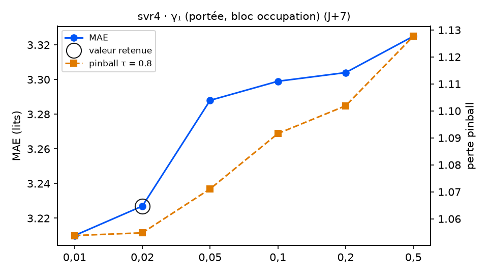

Amplitude de la MAE : 3.6 %. Aucune valeur ne fait significativement mieux que la valeur retenue.

### svr4 · γ₂ (portée, bloc flux et saison)

| variante | MAE | RMSE | biais | pinball τ=0.8 | couverture 90 % | temps (s) | DM p (pinball τ=0.8) | p Holm | DM p (MAE) | vs choix retenu |
|---|---|---|---|---|---|---|---|---|---|---|
| gamma2 = 0,02 | 3.336 | 4.118 | -0.226 | 1.1021 | 85.9 | 5.5 | 0.0391 | 0.1173 | 0.0997 | équivalent |
| gamma2 = 0,05 (retenu) | 3.227 | 3.949 | -0.331 | 1.0548 | 84.2 | 6.1 |  |  |  | — choix retenu |
| gamma2 = 0,1 | 3.236 | 3.976 | -0.43 | 1.0589 | 85.9 | 8.6 | 0.8317 | 0.9402 | 0.8814 | équivalent |
| gamma2 = 0,2 | 3.247 | 4.042 | -0.415 | 1.0762 | 84.7 | 9.3 | 0.4701 | 0.9402 | 0.8454 | équivalent |
| gamma2 = 0,5 | 3.299 | 4.143 | -0.208 | 1.1139 | 83.1 | 9.4 | 0.0155 | 0.062 | 0.6294 | équivalent |

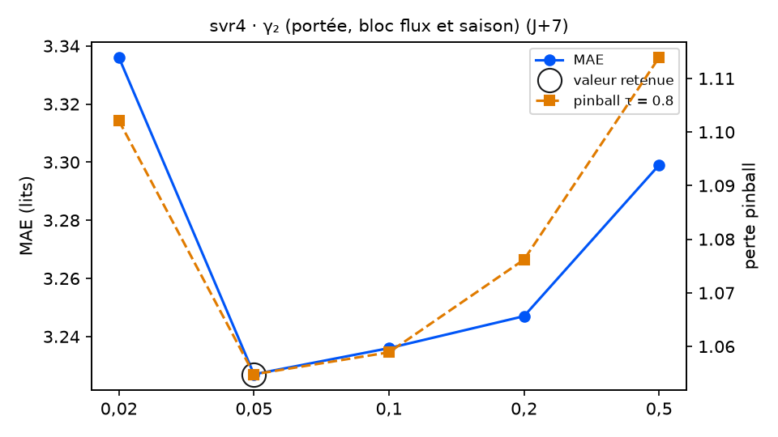

Amplitude de la MAE : 3.4 %. Aucune valeur ne fait significativement mieux que la valeur retenue.

### svr4 · τ (quantile décisionnel)

| variante | MAE | RMSE | biais | pinball τ=0.8 | couverture 90 % | temps (s) | DM p (pinball τ=0.8) | p Holm | DM p (MAE) | vs choix retenu |
|---|---|---|---|---|---|---|---|---|---|---|
| tau = 0,5 | 3.227 | 3.949 | -0.331 | 1.713 | 84.2 | 4.5 | 0.0031 | 0.0124 |  | moins bon |
| tau = 0,6 | 3.227 | 3.949 | -0.331 | 1.713 | 84.2 | 5.1 | 0.0031 | 0.0124 |  | moins bon |
| tau = 0,7 | 3.227 | 3.949 | -0.331 | 1.713 | 84.2 | 6.4 | 0.0031 | 0.0124 |  | moins bon |
| tau = 0,8 (retenu) | 3.227 | 3.949 | -0.331 | 1.0548 | 84.2 | 6.5 |  |  |  | — choix retenu |
| tau = 0,9 | 3.227 | 3.949 | -0.331 | 1.713 | 84.2 | 6.5 | 0.0031 | 0.0124 |  | moins bon |

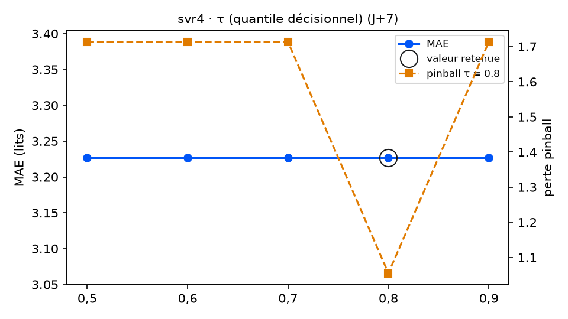

Amplitude de la MAE : 0.0 %. Aucune valeur ne fait significativement mieux que la valeur retenue.

### svr4 · η₀ (taux d'apprentissage d'Adam)

| variante | MAE | RMSE | biais | pinball τ=0.8 | couverture 90 % | temps (s) | DM p (pinball τ=0.8) | p Holm | DM p (MAE) | vs choix retenu |
|---|---|---|---|---|---|---|---|---|---|---|
| taux = 0,005 | 3.233 | 3.954 | -0.32 | 1.0543 | 84.2 | 11.1 | 0.8832 | 1.0 | 0.2447 | équivalent |
| taux = 0,01 | 3.23 | 3.951 | -0.327 | 1.0529 | 84.7 | 9.5 | 0.5119 | 1.0 | 0.309 | équivalent |
| taux = 0,02 | 3.23 | 3.951 | -0.327 | 1.0535 | 84.7 | 8.3 | 0.5068 | 1.0 | 0.2048 | équivalent |
| taux = 0,05 (retenu) | 3.227 | 3.949 | -0.331 | 1.0548 | 84.2 | 6.2 |  |  |  | — choix retenu |
| taux = 0,1 | 3.227 | 3.949 | -0.336 | 1.0562 | 84.7 | 6.8 | 0.0031 | 0.0155 | 0.6209 | moins bon |
| taux = 0,2 | 3.217 | 3.942 | -0.35 | 1.0554 | 84.7 | 8.9 | 0.5004 | 1.0 | 0.1893 | équivalent |

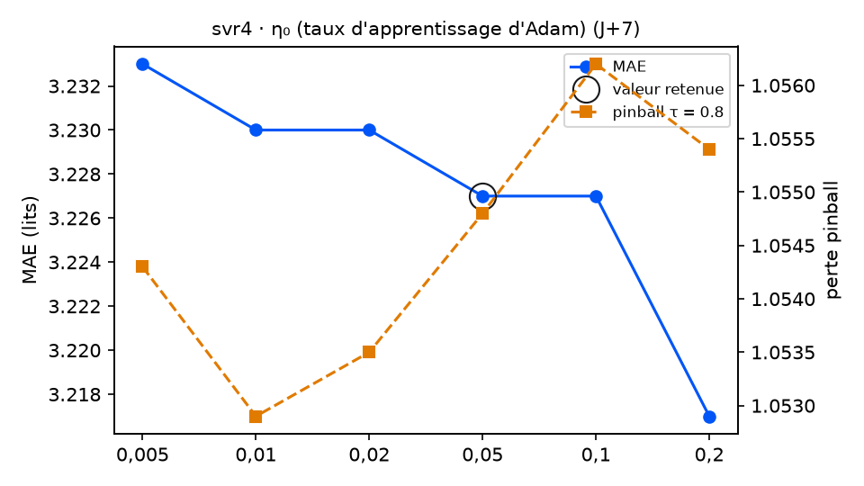

Amplitude de la MAE : 0.5 %. Aucune valeur ne fait significativement mieux que la valeur retenue.

### svr4 · nombre maximal d'itérations

| variante | MAE | RMSE | biais | pinball τ=0.8 | couverture 90 % | temps (s) | DM p (pinball τ=0.8) | p Holm | DM p (MAE) | vs choix retenu |
|---|---|---|---|---|---|---|---|---|---|---|
| iterations = 300 | 3.229 | 3.95 | -0.325 | 1.0626 | 84.2 | 1.4 | 0.0622 | 0.1866 | 0.4602 | équivalent |
| iterations = 1000 | 3.227 | 3.949 | -0.331 | 1.056 | 84.2 | 3.1 | 0.2244 | 0.4488 | 0.9381 | équivalent |
| iterations = 3000 (retenu) | 3.227 | 3.949 | -0.331 | 1.0548 | 84.2 | 6.6 |  |  |  | — choix retenu |
| iterations = 6000 | 3.227 | 3.949 | -0.331 | 1.0547 | 84.2 | 7.9 | 0.875 | 0.875 |  | équivalent |

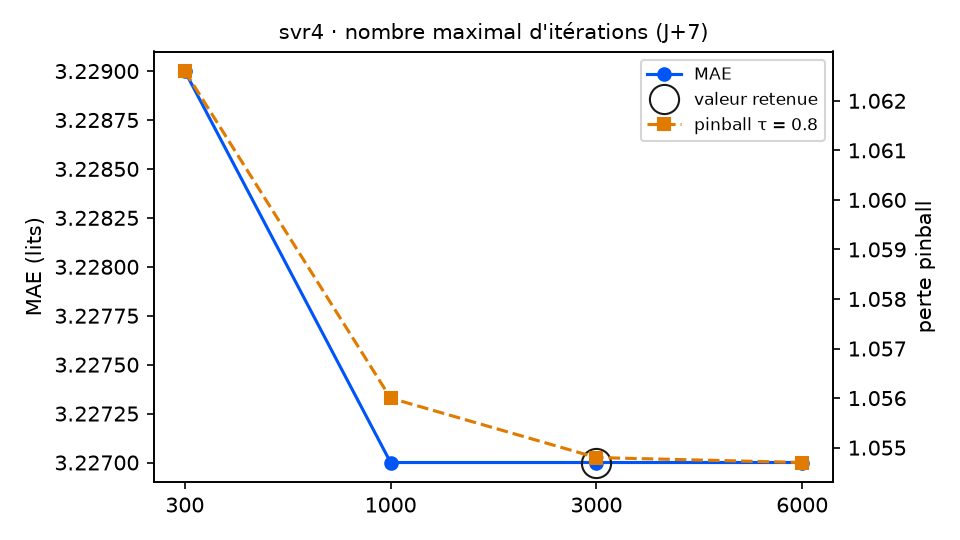

Amplitude de la MAE : 0.1 %. Aucune valeur ne fait significativement mieux que la valeur retenue.

### svr4 · T (décroissance du pas ; aucune = pas constant)

| variante | MAE | RMSE | biais | pinball τ=0.8 | couverture 90 % | temps (s) | DM p (pinball τ=0.8) | p Holm | DM p (MAE) | vs choix retenu |
|---|---|---|---|---|---|---|---|---|---|---|
| decroissance = aucune | 3.226 | 3.948 | -0.335 | 1.0541 | 84.2 | 7.3 | 0.5488 | 0.5488 | 0.3262 | équivalent |
| decroissance = 100 | 3.227 | 3.949 | -0.331 | 1.0556 | 84.2 | 7.8 | 0.0204 | 0.0612 | 0.8068 | équivalent |
| decroissance = 500 (retenu) | 3.227 | 3.949 | -0.331 | 1.0548 | 84.2 | 6.2 |  |  |  | — choix retenu |
| decroissance = 2000 | 3.228 | 3.95 | -0.335 | 1.0543 | 84.2 | 7.8 | 0.1323 | 0.2646 | 0.708 | équivalent |

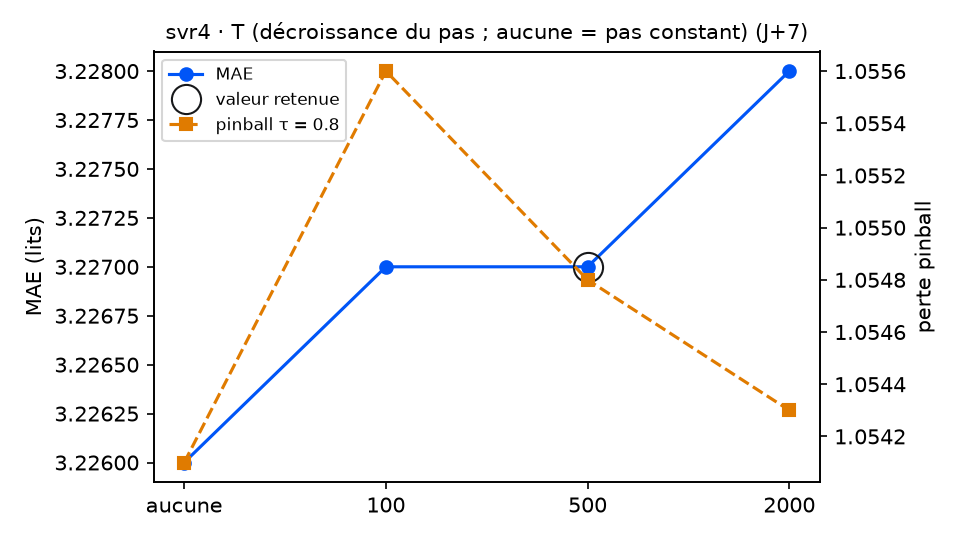

Amplitude de la MAE : 0.1 %. Aucune valeur ne fait significativement mieux que la valeur retenue.

### svr4 · part des pas moyennée (Polyak ; 0 = aucune)

| variante | MAE | RMSE | biais | pinball τ=0.8 | couverture 90 % | temps (s) | DM p (pinball τ=0.8) | p Holm | DM p (MAE) | vs choix retenu |
|---|---|---|---|---|---|---|---|---|---|---|
| moyenne_polyak = 0 | 3.227 | 3.949 | -0.332 | 1.0548 | 84.2 | 6.1 | 0.6224 | 1.0 | 0.7346 | équivalent |
| moyenne_polyak = 0,25 | 3.227 | 3.949 | -0.331 | 1.0548 | 84.2 | 6.6 | 0.6224 | 1.0 |  | équivalent |
| moyenne_polyak = 0,5 (retenu) | 3.227 | 3.949 | -0.331 | 1.0548 | 84.2 | 6.6 |  |  |  | — choix retenu |
| moyenne_polyak = 0,75 | 3.227 | 3.949 | -0.331 | 1.0548 | 84.2 | 5.9 | 0.6224 | 1.0 |  | équivalent |

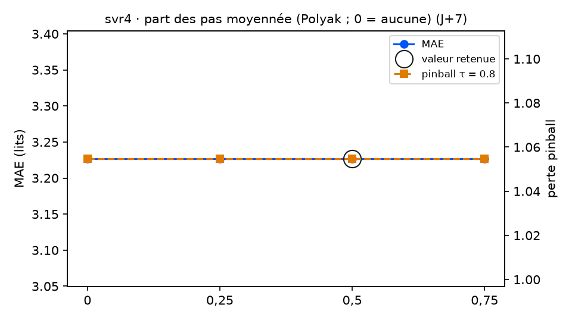

Amplitude de la MAE : 0.0 %. Aucune valeur ne fait significativement mieux que la valeur retenue.

### svr4 · tolérance d'arrêt anticipé

| variante | MAE | RMSE | biais | pinball τ=0.8 | couverture 90 % | temps (s) | DM p (pinball τ=0.8) | p Holm | DM p (MAE) | vs choix retenu |
|---|---|---|---|---|---|---|---|---|---|---|
| tolerance = 1e-05 | 3.231 | 3.952 | -0.326 | 1.0573 | 84.2 | 3.3 | 0.0296 | 0.0592 | 0.1504 | équivalent |
| tolerance = 1e-07 (retenu) | 3.227 | 3.949 | -0.331 | 1.0548 | 84.2 | 6.3 |  |  |  | — choix retenu |
| tolerance = 1e-09 | 3.227 | 3.948 | -0.334 | 1.0547 | 84.7 | 10.4 | 0.9496 | 0.9496 | 0.649 | équivalent |

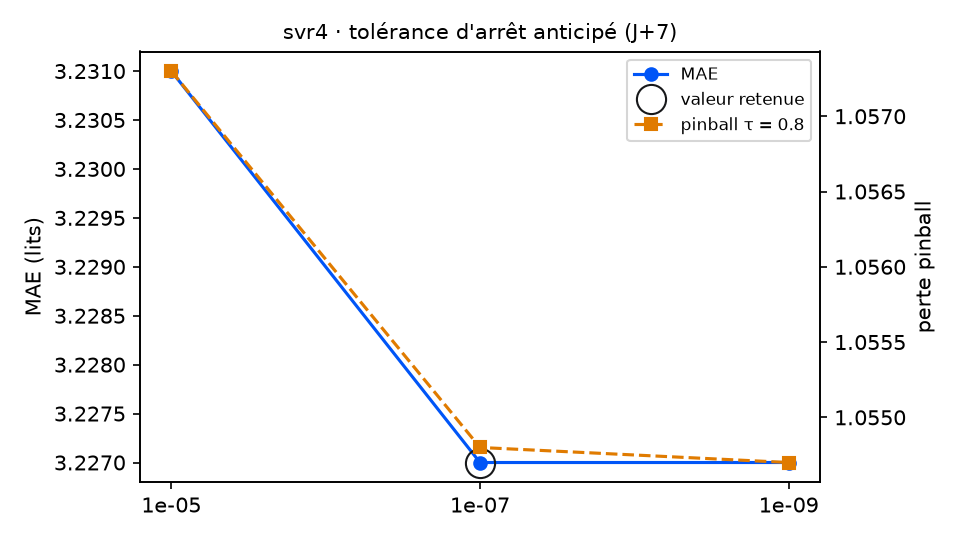

Amplitude de la MAE : 0.1 %. Aucune valeur ne fait significativement mieux que la valeur retenue.

### svr4 · direction préconditionnée α + Cg

| variante | MAE | RMSE | biais | pinball τ=0.8 | couverture 90 % | temps (s) | DM p (pinball τ=0.8) | p Holm | DM p (MAE) | vs choix retenu |
|---|---|---|---|---|---|---|---|---|---|---|
| preconditionne = True (retenu) | 3.227 | 3.949 | -0.331 | 1.0548 | 84.2 | 6.2 |  |  |  | — choix retenu |
| preconditionne = False | 3.208 | 3.937 | -0.356 | 1.0484 | 83.6 | 15.2 | 0.1101 | 0.1101 | 0.1596 | équivalent |

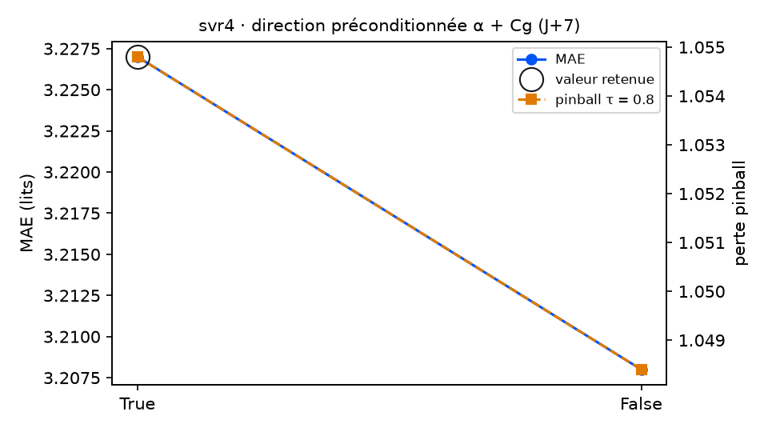

Amplitude de la MAE : 0.6 %. Aucune valeur ne fait significativement mieux que la valeur retenue.

### svr4 · optimiseur

| variante | MAE | RMSE | biais | pinball τ=0.8 | couverture 90 % | temps (s) | DM p (pinball τ=0.8) | p Holm | DM p (MAE) | vs choix retenu |
|---|---|---|---|---|---|---|---|---|---|---|
| optimiseur = adam (retenu) | 3.227 | 3.949 | -0.331 | 1.0548 | 84.2 | 7.0 |  |  |  | — choix retenu |
| optimiseur = momentum | 3.307 | 4.021 | 0.134 | 1.0931 | 84.7 | 9.7 | 0.5349 | 0.5349 | 0.6516 | équivalent |
| optimiseur = sgd | 3.307 | 4.021 | 0.134 | 1.0955 | 83.6 | 8.2 | 0.0901 | 0.1802 | 0.6516 | équivalent |

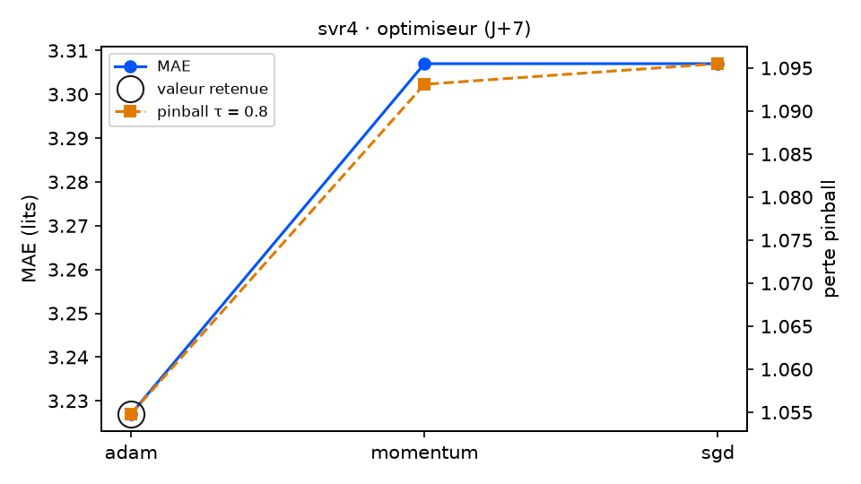

Amplitude de la MAE : 2.5 %. Aucune valeur ne fait significativement mieux que la valeur retenue.

### svr2 · C

| variante | MAE | RMSE | biais | pinball τ=0.8 | temps (s) | DM p (pinball τ=0.8) | p Holm | DM p (MAE) | vs choix retenu |
|---|---|---|---|---|---|---|---|---|---|
| C = 0,1 | 3.297 | 4.014 | 0.09 | 1.6213 | 0.3 | 0.2091 | 0.8364 | 0.362 | équivalent |
| C = 0,3 | 3.279 | 4.007 | -0.021 | 1.6461 | 0.4 | 0.376 | 1.0 | 0.3513 | équivalent |
| C = 1 (retenu) | 3.233 | 3.939 | -0.193 | 1.6744 | 0.8 |  |  |  | — choix retenu |
| C = 3 | 3.29 | 3.968 | -0.236 | 1.7161 | 1.3 | 0.4438 | 1.0 | 0.4212 | équivalent |
| C = 10 | 3.469 | 4.18 | -0.199 | 1.7941 | 1.4 | 0.389 | 1.0 | 0.1641 | équivalent |
| C = 30 | 3.798 | 4.553 | -0.214 | 1.9634 | 1.4 | 0.1488 | 0.744 | 0.01 | équivalent |

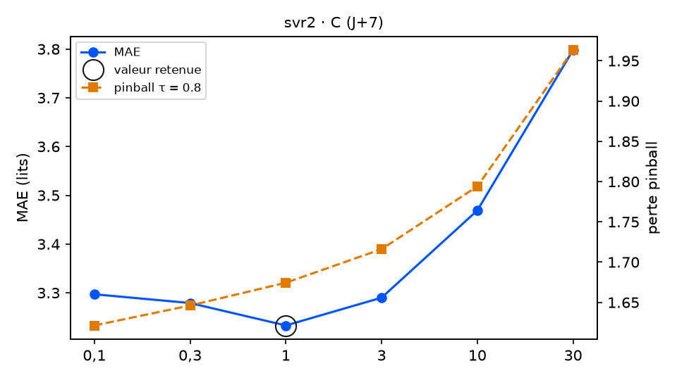

Amplitude de la MAE : 17.5 %. Aucune valeur ne fait significativement mieux que la valeur retenue.

### svr2 · ε (tube ε-insensible, en lits)

| variante | MAE | RMSE | biais | pinball τ=0.8 | temps (s) | DM p (pinball τ=0.8) | p Holm | DM p (MAE) | vs choix retenu |
|---|---|---|---|---|---|---|---|---|---|
| epsilon = 0 | 3.27 | 3.981 | -0.147 | 1.6792 | 1.1 | 0.7919 | 0.888 | 0.3119 | équivalent |
| epsilon = 0,25 | 3.27 | 3.978 | -0.163 | 1.684 | 0.4 | 0.444 | 0.888 | 0.2228 | équivalent |
| epsilon = 0,5 | 3.257 | 3.972 | -0.193 | 1.6862 | 0.7 | 0.193 | 0.772 | 0.2727 | équivalent |
| epsilon = 1 (retenu) | 3.233 | 3.939 | -0.193 | 1.6744 | 0.8 |  |  |  | — choix retenu |
| epsilon = 2 | 3.207 | 3.902 | -0.135 | 1.6442 | 1.2 | 0.2297 | 0.772 | 0.531 | équivalent |

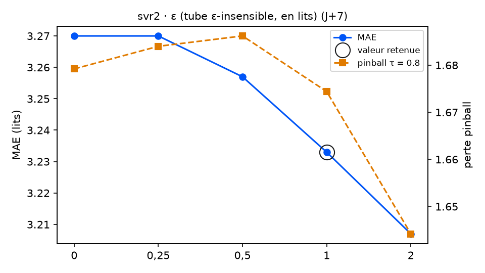

Amplitude de la MAE : 1.9 %. Aucune valeur ne fait significativement mieux que la valeur retenue.

### svr2 · γ (portée du noyau RBF)

| variante | MAE | RMSE | biais | pinball τ=0.8 | temps (s) | DM p (pinball τ=0.8) | p Holm | DM p (MAE) | vs choix retenu |
|---|---|---|---|---|---|---|---|---|---|
| gamma = 0,005 | 3.34 | 4.115 | -0.003 | 1.6707 | 0.4 | 0.9519 | 1.0 | 0.1982 | équivalent |
| gamma = 0,01 | 3.337 | 4.113 | -0.057 | 1.6856 | 0.5 | 0.8471 | 1.0 | 0.1788 | équivalent |
| gamma = 0,02 | 3.299 | 4.056 | -0.118 | 1.6849 | 0.9 | 0.7975 | 1.0 | 0.228 | équivalent |
| gamma = 0,05 (retenu) | 3.233 | 3.939 | -0.193 | 1.6744 | 0.7 |  |  |  | — choix retenu |
| gamma = 0,1 | 3.244 | 3.918 | -0.082 | 1.6467 | 0.6 | 0.3289 | 1.0 | 0.7756 | équivalent |
| gamma = 0,2 | 3.262 | 3.924 | 0.13 | 1.5918 | 0.5 | 0.0529 | 0.3174 | 0.7118 | équivalent |
| gamma = 0,5 | 3.281 | 3.943 | 0.217 | 1.5755 | 0.3 | 0.0746 | 0.373 | 0.6486 | équivalent |

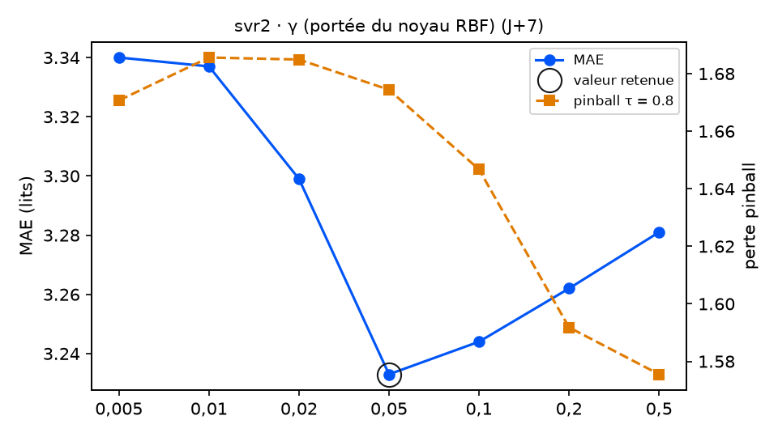

Amplitude de la MAE : 3.3 %. Aucune valeur ne fait significativement mieux que la valeur retenue.

### foret · nombre d'arbres

| variante | MAE | RMSE | biais | pinball τ=0.8 | couverture 90 % | temps (s) | DM p (pinball τ=0.8) | p Holm | DM p (MAE) | vs choix retenu |
|---|---|---|---|---|---|---|---|---|---|---|
| arbres = 25 | 3.206 | 3.921 | -0.188 | 1.1086 | 93.8 | 1.1 | 0.3858 | 1.0 | 0.5809 | équivalent |
| arbres = 50 | 3.212 | 3.89 | -0.204 | 1.1089 | 92.7 | 2.2 | 0.464 | 1.0 | 0.6311 | équivalent |
| arbres = 100 | 3.276 | 3.919 | -0.259 | 1.1118 | 93.8 | 4.0 | 0.3372 | 1.0 | 0.4717 | équivalent |
| arbres = 300 (retenu) | 3.244 | 3.915 | -0.259 | 1.1275 | 93.2 | 12.1 |  |  |  | — choix retenu |
| arbres = 500 | 3.249 | 3.914 | -0.247 | 1.1258 | 93.8 | 20.0 | 0.8061 | 1.0 | 0.8954 | équivalent |

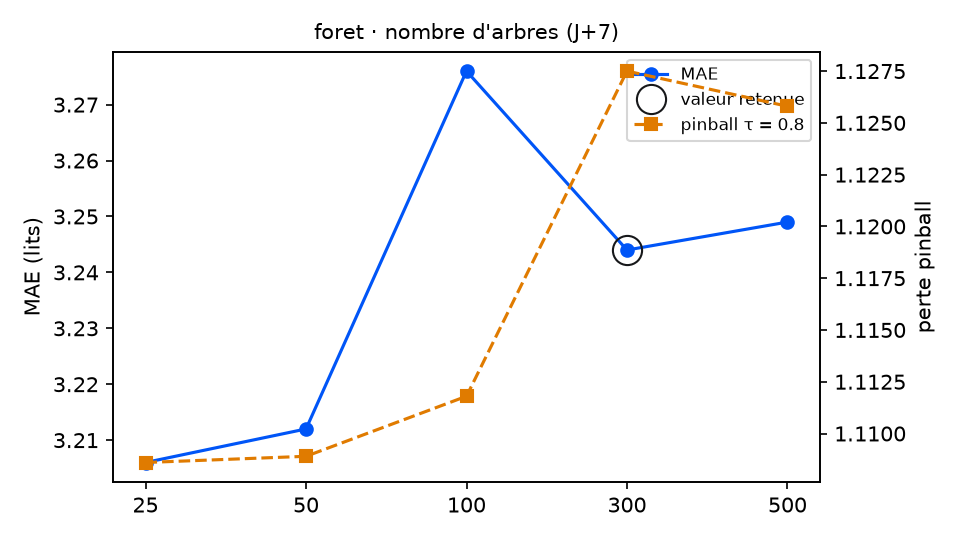

Amplitude de la MAE : 2.2 %. Aucune valeur ne fait significativement mieux que la valeur retenue.

### foret · profondeur maximale

| variante | MAE | RMSE | biais | pinball τ=0.8 | couverture 90 % | temps (s) | DM p (pinball τ=0.8) | p Holm | DM p (MAE) | vs choix retenu |
|---|---|---|---|---|---|---|---|---|---|---|
| profondeur_foret = 3 | 3.25 | 3.995 | -0.248 | 1.1424 | 93.2 | 1.4 | 0.5636 | 1.0 | 0.9481 | équivalent |
| profondeur_foret = 5 | 3.23 | 3.948 | -0.334 | 1.1389 | 93.2 | 3.2 | 0.6395 | 1.0 | 0.8271 | équivalent |
| profondeur_foret = 8 | 3.237 | 3.918 | -0.28 | 1.1178 | 93.8 | 7.4 | 0.548 | 1.0 | 0.8595 | équivalent |
| profondeur_foret = 12 (retenu) | 3.244 | 3.915 | -0.259 | 1.1275 | 93.2 | 11.8 |  |  |  | — choix retenu |
| profondeur_foret = 20 | 3.28 | 3.955 | -0.259 | 1.1171 | 93.8 | 13.7 | 0.5388 | 1.0 | 0.2914 | équivalent |

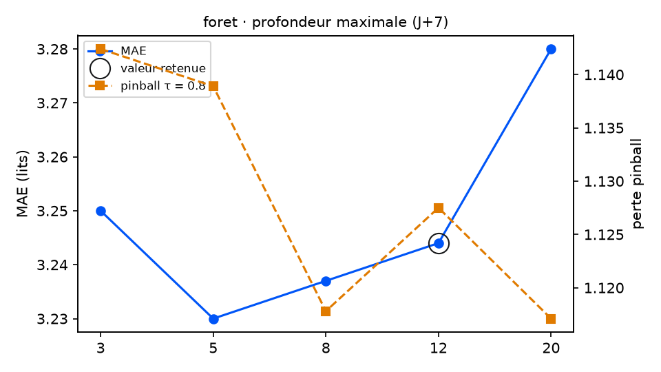

Amplitude de la MAE : 1.5 %. Aucune valeur ne fait significativement mieux que la valeur retenue.

### foret · taille minimale d'une feuille

| variante | MAE | RMSE | biais | pinball τ=0.8 | couverture 90 % | temps (s) | DM p (pinball τ=0.8) | p Holm | DM p (MAE) | vs choix retenu |
|---|---|---|---|---|---|---|---|---|---|---|
| min_feuille = 2 | 3.263 | 3.89 | -0.203 | 1.1227 | 94.4 | 23.1 | 0.8426 | 1.0 | 0.7271 | équivalent |
| min_feuille = 5 (retenu) | 3.244 | 3.915 | -0.259 | 1.1275 | 93.2 | 12.0 |  |  |  | — choix retenu |
| min_feuille = 10 | 3.289 | 3.967 | -0.285 | 1.1248 | 93.2 | 7.0 | 0.8799 | 1.0 | 0.2789 | équivalent |
| min_feuille = 20 | 3.278 | 4.007 | -0.217 | 1.1243 | 93.2 | 4.0 | 0.8963 | 1.0 | 0.6303 | équivalent |

Amplitude de la MAE : 1.4 %. Aucune valeur ne fait significativement mieux que la valeur retenue.

### foret · part des variables tirées par nœud

| variante | MAE | RMSE | biais | pinball τ=0.8 | couverture 90 % | temps (s) | DM p (pinball τ=0.8) | p Holm | DM p (MAE) | vs choix retenu |
|---|---|---|---|---|---|---|---|---|---|---|
| part_variables = 0,15 | 3.285 | 3.974 | -0.16 | 1.1166 | 92.7 | 10.8 | 0.6301 | 1.0 | 0.473 | équivalent |
| part_variables = 0,333333 (retenu) | 3.244 | 3.915 | -0.259 | 1.1275 | 93.2 | 11.4 |  |  |  | — choix retenu |
| part_variables = 0,5 | 3.251 | 3.924 | -0.3 | 1.1276 | 93.2 | 11.8 | 0.9947 | 1.0 | 0.836 | équivalent |
| part_variables = 1 | 3.268 | 3.934 | -0.301 | 1.1153 | 92.7 | 12.5 | 0.4355 | 1.0 | 0.7168 | équivalent |

Amplitude de la MAE : 1.3 %. Aucune valeur ne fait significativement mieux que la valeur retenue.

### boosting · nombre d'étapes

| variante | MAE | RMSE | biais | pinball τ=0.8 | couverture 90 % | temps (s) | DM p (pinball τ=0.8) | p Holm | DM p (MAE) | vs choix retenu |
|---|---|---|---|---|---|---|---|---|---|---|
| etapes = 50 | 3.211 | 3.928 | -0.218 | 1.1265 | 87.6 | 1.1 | 0.1993 | 0.4656 | 0.6291 | équivalent |
| etapes = 100 | 3.204 | 3.914 | -0.316 | 1.1434 | 82.5 | 2.1 | 0.1552 | 0.4656 | 0.5176 | équivalent |
| etapes = 300 (retenu) | 3.161 | 3.886 | -0.525 | 1.1944 | 78.5 | 6.0 |  |  |  | — choix retenu |
| etapes = 600 | 3.209 | 3.926 | -0.511 | 1.2201 | 77.4 | 11.8 | 0.3462 | 0.4656 | 0.2953 | équivalent |

Amplitude de la MAE : 1.6 %. Aucune valeur ne fait significativement mieux que la valeur retenue.

### boosting · taux ν (shrinkage)

| variante | MAE | RMSE | biais | pinball τ=0.8 | couverture 90 % | temps (s) | DM p (pinball τ=0.8) | p Holm | DM p (MAE) | vs choix retenu |
|---|---|---|---|---|---|---|---|---|---|---|
| taux_boosting = 0,01 | 3.232 | 3.942 | -0.247 | 1.1384 | 85.3 | 6.2 | 0.2271 | 0.5508 | 0.4675 | équivalent |
| taux_boosting = 0,05 (retenu) | 3.161 | 3.886 | -0.525 | 1.1944 | 78.5 | 6.2 |  |  |  | — choix retenu |
| taux_boosting = 0,1 | 3.246 | 4.083 | -0.737 | 1.2075 | 78.0 | 6.2 | 0.7689 | 0.7689 | 0.2074 | équivalent |
| taux_boosting = 0,2 | 3.217 | 3.998 | -0.649 | 1.2909 | 73.4 | 6.0 | 0.1836 | 0.5508 | 0.6205 | équivalent |

Amplitude de la MAE : 2.7 %. Aucune valeur ne fait significativement mieux que la valeur retenue.

### boosting · profondeur des arbres

| variante | MAE | RMSE | biais | pinball τ=0.8 | couverture 90 % | temps (s) | DM p (pinball τ=0.8) | p Holm | DM p (MAE) | vs choix retenu |
|---|---|---|---|---|---|---|---|---|---|---|
| profondeur_boosting = 1 | 3.316 | 4.045 | -0.302 | 1.124 | 81.9 | 2.1 | 0.1806 | 0.5418 | 0.1576 | équivalent |
| profondeur_boosting = 2 | 3.146 | 3.882 | -0.474 | 1.148 | 82.5 | 4.0 | 0.1963 | 0.5418 | 0.7794 | équivalent |
| profondeur_boosting = 3 (retenu) | 3.161 | 3.886 | -0.525 | 1.1944 | 78.5 | 6.4 |  |  |  | — choix retenu |
| profondeur_boosting = 5 | 3.137 | 3.839 | -0.343 | 1.2112 | 74.6 | 12.4 | 0.6585 | 0.6585 | 0.7761 | équivalent |

Amplitude de la MAE : 5.7 %. Aucune valeur ne fait significativement mieux que la valeur retenue.

### boosting · part du sous-échantillon

| variante | MAE | RMSE | biais | pinball τ=0.8 | couverture 90 % | temps (s) | DM p (pinball τ=0.8) | p Holm | DM p (MAE) | vs choix retenu |
|---|---|---|---|---|---|---|---|---|---|---|
| sous_echantillon = 0,5 | 3.209 | 3.944 | -0.596 | 1.1713 | 78.0 | 5.3 | 0.6271 | 0.9882 | 0.5565 | équivalent |
| sous_echantillon = 0,8 (retenu) | 3.161 | 3.886 | -0.525 | 1.1944 | 78.5 | 6.2 |  |  |  | — choix retenu |
| sous_echantillon = 1 | 3.114 | 3.912 | -0.581 | 1.1756 | 83.1 | 6.6 | 0.4941 | 0.9882 | 0.4428 | équivalent |

Amplitude de la MAE : 3.0 %. Aucune valeur ne fait significativement mieux que la valeur retenue.

### mlp · architecture (neurones par couche)

| variante | MAE | RMSE | biais | pinball τ=0.8 | couverture 90 % | temps (s) | DM p (pinball τ=0.8) | p Holm | DM p (MAE) | vs choix retenu |
|---|---|---|---|---|---|---|---|---|---|---|
| couches = 8 | 3.242 | 3.97 | -0.212 | 1.039 | 80.8 | 0.6 | 0.051 | 0.153 | 0.9431 | équivalent |
| couches = 32 | 3.35 | 4.097 | -0.313 | 1.1358 | 88.1 | 0.7 | 0.4243 | 0.8486 | 0.291 | équivalent |
| couches = 32×16 (retenu) | 3.23 | 3.999 | -0.289 | 1.1661 | 88.7 | 0.7 |  |  |  | — choix retenu |
| couches = 64×32 | 3.263 | 4.018 | -0.712 | 1.1854 | 85.9 | 1.0 | 0.6846 | 0.8486 | 0.7672 | équivalent |
| couches = 32×16×8 | 3.211 | 3.911 | 0.147 | 1.048 | 83.6 | 0.9 | 0.0254 | 0.1016 | 0.8454 | équivalent |

Amplitude de la MAE : 4.3 %. Aucune valeur ne fait significativement mieux que la valeur retenue.

### mlp · taux d'apprentissage

| variante | MAE | RMSE | biais | pinball τ=0.8 | couverture 90 % | temps (s) | DM p (pinball τ=0.8) | p Holm | DM p (MAE) | vs choix retenu |
|---|---|---|---|---|---|---|---|---|---|---|
| taux_reseau = 0,001 | 3.302 | 4.087 | -0.147 | 1.1616 | 84.7 | 1.5 | 0.875 | 1.0 | 0.3209 | équivalent |
| taux_reseau = 0,003 | 3.281 | 4.05 | -0.203 | 1.1608 | 86.4 | 0.9 | 0.7318 | 1.0 | 0.4031 | équivalent |
| taux_reseau = 0,01 (retenu) | 3.23 | 3.999 | -0.289 | 1.1661 | 88.7 | 0.8 |  |  |  | — choix retenu |
| taux_reseau = 0,03 | 3.26 | 4.0 | -0.22 | 1.157 | 87.6 | 0.7 | 0.5837 | 1.0 | 0.685 | équivalent |

Amplitude de la MAE : 2.2 %. Aucune valeur ne fait significativement mieux que la valeur retenue.

### mlp · pénalité L2 λ

| variante | MAE | RMSE | biais | pinball τ=0.8 | couverture 90 % | temps (s) | DM p (pinball τ=0.8) | p Holm | DM p (MAE) | vs choix retenu |
|---|---|---|---|---|---|---|---|---|---|---|
| lambda_ = 0 | 3.237 | 4.009 | -0.295 | 1.171 | 88.1 | 0.7 | 0.1732 | 0.6928 | 0.249 | équivalent |
| lambda_ = 0,0001 | 3.231 | 4.002 | -0.293 | 1.169 | 88.1 | 0.7 | 0.3743 | 1.0 | 0.9856 | équivalent |
| lambda_ = 0,001 (retenu) | 3.23 | 3.999 | -0.289 | 1.1661 | 88.7 | 0.7 |  |  |  | — choix retenu |
| lambda_ = 0,01 | 3.243 | 3.999 | -0.3 | 1.17 | 85.9 | 0.8 | 0.7935 | 1.0 | 0.784 | équivalent |
| lambda_ = 0,1 | 3.308 | 4.046 | 0.063 | 1.1487 | 88.7 | 1.8 | 0.8111 | 1.0 | 0.5063 | équivalent |

Amplitude de la MAE : 2.4 %. Aucune valeur ne fait significativement mieux que la valeur retenue.

### mlp · époques maximales

| variante | MAE | RMSE | biais | pinball τ=0.8 | couverture 90 % | temps (s) | DM p (pinball τ=0.8) | p Holm | DM p (MAE) | vs choix retenu |
|---|---|---|---|---|---|---|---|---|---|---|
| epoques = 300 | 3.23 | 3.999 | -0.289 | 1.1661 | 88.7 | 0.8 |  |  |  | identique |
| epoques = 800 | 3.23 | 3.999 | -0.289 | 1.1661 | 88.7 | 0.8 |  |  |  | identique |
| epoques = 1500 (retenu) | 3.23 | 3.999 | -0.289 | 1.1661 | 88.7 | 0.8 |  |  |  | — choix retenu |
| epoques = 3000 | 3.23 | 3.999 | -0.289 | 1.1661 | 88.7 | 0.8 |  |  |  | identique |

Amplitude de la MAE : 0.0 %. Aucune valeur ne fait significativement mieux que la valeur retenue.

### mlp · patience de l'arrêt anticipé

| variante | MAE | RMSE | biais | pinball τ=0.8 | couverture 90 % | temps (s) | DM p (pinball τ=0.8) | p Holm | DM p (MAE) | vs choix retenu |
|---|---|---|---|---|---|---|---|---|---|---|
| patience = 50 | 3.23 | 3.999 | -0.289 | 1.1661 | 88.7 | 0.4 |  |  |  | identique |
| patience = 150 (retenu) | 3.23 | 3.999 | -0.289 | 1.1661 | 88.7 | 0.8 |  |  |  | — choix retenu |
| patience = 300 | 3.23 | 3.999 | -0.289 | 1.1661 | 88.7 | 1.3 |  |  |  | identique |

Amplitude de la MAE : 0.0 %. Aucune valeur ne fait significativement mieux que la valeur retenue.

### mlp · nombre d'initialisations moyennées

| variante | MAE | RMSE | biais | pinball τ=0.8 | couverture 90 % | temps (s) | DM p (pinball τ=0.8) | p Holm | DM p (MAE) | vs choix retenu |
|---|---|---|---|---|---|---|---|---|---|---|
| graines = 1 | 3.374 | 4.18 | -0.725 | 1.3089 | 88.1 | 0.3 | 0.0071 | 0.0142 | 0.155 | moins bon |
| graines = 3 (retenu) | 3.23 | 3.999 | -0.289 | 1.1661 | 88.7 | 0.8 |  |  |  | — choix retenu |
| graines = 5 | 3.22 | 3.961 | -0.465 | 1.082 | 88.7 | 1.2 | 0.0134 | 0.0142 | 0.8851 | meilleur |

Amplitude de la MAE : 4.8 %. Valeur(s) significativement meilleure(s) : graines = 5 — réglage à revoir.

### lstm · taille de l'état caché H

| variante | MAE | RMSE | biais | pinball τ=0.8 | couverture 90 % | temps (s) | DM p (pinball τ=0.8) | p Holm | DM p (MAE) | vs choix retenu |
|---|---|---|---|---|---|---|---|---|---|---|
| cache_lstm = 4 | 3.35 | 4.142 | 0.119 | 1.1327 | 84.7 | 8.0 | 0.2292 | 0.4584 | 0.5356 | équivalent |
| cache_lstm = 8 | 3.355 | 4.058 | 0.045 | 1.1633 | 79.7 | 6.8 | 0.443 | 0.4584 | 0.4819 | équivalent |
| cache_lstm = 16 (retenu) | 3.295 | 4.043 | -0.091 | 1.1959 | 82.5 | 9.1 |  |  |  | — choix retenu |
| cache_lstm = 32 | 3.355 | 4.093 | -0.075 | 1.2655 | 80.2 | 15.2 | 0.1246 | 0.3738 | 0.3977 | équivalent |

Amplitude de la MAE : 1.8 %. Aucune valeur ne fait significativement mieux que la valeur retenue.

### lstm · taux d'apprentissage

| variante | MAE | RMSE | biais | pinball τ=0.8 | couverture 90 % | temps (s) | DM p (pinball τ=0.8) | p Holm | DM p (MAE) | vs choix retenu |
|---|---|---|---|---|---|---|---|---|---|---|
| taux_reseau = 0,003 | 3.302 | 4.008 | -0.107 | 1.1474 | 84.2 | 15.7 | 0.1283 | 0.1283 | 0.874 | équivalent |
| taux_reseau = 0,01 (retenu) | 3.295 | 4.043 | -0.091 | 1.1959 | 82.5 | 9.7 |  |  |  | — choix retenu |
| taux_reseau = 0,03 | 3.28 | 4.031 | -0.06 | 1.149 | 80.8 | 7.8 | 0.0561 | 0.1122 | 0.7095 | équivalent |

Amplitude de la MAE : 0.7 %. Aucune valeur ne fait significativement mieux que la valeur retenue.

### lstm · pénalité L2 λ

| variante | MAE | RMSE | biais | pinball τ=0.8 | couverture 90 % | temps (s) | DM p (pinball τ=0.8) | p Holm | DM p (MAE) | vs choix retenu |
|---|---|---|---|---|---|---|---|---|---|---|
| lambda_ = 0 | 3.341 | 4.064 | 0.093 | 1.1996 | 84.2 | 8.0 | 0.8872 | 0.8872 | 0.4954 | équivalent |
| lambda_ = 0,001 (retenu) | 3.295 | 4.043 | -0.091 | 1.1959 | 82.5 | 9.8 |  |  |  | — choix retenu |
| lambda_ = 0,01 | 3.349 | 4.094 | -0.036 | 1.1523 | 81.9 | 12.4 | 0.3829 | 0.7658 | 0.5025 | équivalent |

Amplitude de la MAE : 1.6 %. Aucune valeur ne fait significativement mieux que la valeur retenue.

### variables · jours d'occupation passée en entrée

| variante | MAE | RMSE | biais | pinball τ=0.8 | couverture 90 % | temps (s) | DM p (pinball τ=0.8) | p Holm | DM p (MAE) | vs choix retenu |
|---|---|---|---|---|---|---|---|---|---|---|
| retards = 3 | 3.21 | 3.94 | -0.348 | 1.0541 | 84.2 | 5.2 | 0.4943 | 1.0 | 0.2378 | équivalent |
| retards = 5 | 3.21 | 3.94 | -0.35 | 1.0544 | 84.2 | 6.1 | 0.6088 | 1.0 | 0.2172 | équivalent |
| retards = 7 (retenu) | 3.227 | 3.949 | -0.331 | 1.0548 | 84.2 | 6.9 |  |  |  | — choix retenu |
| retards = 10 | 3.241 | 3.995 | -0.265 | 1.0707 | 84.2 | 6.3 | 0.2485 | 1.0 | 0.786 | équivalent |
| retards = 14 | 3.258 | 4.047 | -0.369 | 1.0847 | 87.6 | 4.9 | 0.2514 | 1.0 | 0.6105 | équivalent |
| retards = 21 | 3.224 | 3.978 | -0.225 | 1.1109 | 86.4 | 5.8 | 0.394 | 1.0 | 0.9729 | équivalent |

Amplitude de la MAE : 1.5 %. Aucune valeur ne fait significativement mieux que la valeur retenue.

