# Sensibilité de tous les paramètres — service PED_pic

Un paramètre varie à la fois, tout le reste au réglage retenu (marqué « retenu »). Mêmes jours, même validation glissante. Diebold-Mariano (perte absolue, HLN) contre la valeur retenue. Amplitude = (MAE max − MAE min) / MAE retenue.

## Synthèse

| paramètre | horizon | famille | valeur retenue | meilleure valeur (MAE) | amplitude MAE % | verdict |
|---|---|---|---|---|---|---|
| C (poids des erreurs) | 1 | svr4 | 3 | 10 | 73.7 | défendable |
| ε (tube, niveaux quantiles) | 1 | svr4 | 0,25 | 0,5 | 2.1 | défendable |
| γ₁ (portée, bloc occupation) | 1 | svr4 | 0,02 | 0,02 (retenu) | 11.8 | défendable |
| γ₂ (portée, bloc flux et saison) | 1 | svr4 | 0,2 | 0,1 | 11.3 | défendable |
| τ (quantile décisionnel) | 1 | svr4 | 0,8 | 0,5 | 0.1 | défendable |
| η₀ (taux d'apprentissage d'Adam) | 1 | svr4 | 0,05 | 0,2 | 0.4 | défendable |
| nombre maximal d'itérations | 1 | svr4 | 3000 | 1000 | 0.1 | défendable |
| T (décroissance du pas ; aucune = pas constant) | 1 | svr4 | 500 | aucune | 0.1 | défendable |
| part des pas moyennée (Polyak ; 0 = aucune) | 1 | svr4 | 0,5 | 0 | 0.0 | défendable |
| tolérance d'arrêt anticipé | 1 | svr4 | 1e-07 | 1e-05 | 0.0 | défendable |
| direction préconditionnée α + Cg | 1 | svr4 | True | True (retenu) | 1.6 | défendable |
| optimiseur | 1 | svr4 | adam | adam (retenu) | 72.9 | défendable |
| C | 1 | svr2 | 3 | 3 (retenu) | 53.1 | défendable |
| ε (tube ε-insensible, en lits) | 1 | svr2 | 0,5 | 0,25 | 8.0 | défendable |
| γ (portée du noyau RBF) | 1 | svr2 | 0,02 | 0,02 (retenu) | 67.2 | défendable |
| nombre d'arbres | 1 | foret | 300 | 50 | 1.5 | défendable |
| profondeur maximale | 1 | foret | 12 | 20 | 10.2 | défendable |
| taille minimale d'une feuille | 1 | foret | 5 | 2 | 3.5 | à revoir : 2 |
| part des variables tirées par nœud | 1 | foret | 0,333333 | 0,5 | 6.4 | défendable |
| nombre d'étapes | 1 | boosting | 300 | 600 | 9.2 | défendable |
| taux ν (shrinkage) | 1 | boosting | 0,05 | 0,05 (retenu) | 8.1 | défendable |
| profondeur des arbres | 1 | boosting | 3 | 3 (retenu) | 6.2 | défendable |
| part du sous-échantillon | 1 | boosting | 0,8 | 0,5 | 2.8 | défendable |
| architecture (neurones par couche) | 1 | mlp | 32×16 | 8 | 6.3 | défendable |
| taux d'apprentissage | 1 | mlp | 0,01 | 0,001 | 2.4 | défendable |
| pénalité L2 λ | 1 | mlp | 0,001 | 0,01 | 5.6 | défendable |
| époques maximales | 1 | mlp | 1500 | 300 | 0.0 | défendable |
| patience de l'arrêt anticipé | 1 | mlp | 150 | 50 | 0.2 | défendable |
| nombre d'initialisations moyennées | 1 | mlp | 3 | 3 (retenu) | 7.8 | défendable |
| taille de l'état caché H | 1 | lstm | 16 | 4 | 2.8 | défendable |
| taux d'apprentissage | 1 | lstm | 0,01 | 0,03 | 1.6 | défendable |
| pénalité L2 λ | 1 | lstm | 0,001 | 0,01 | 1.1 | défendable |
| jours d'occupation passée en entrée | 1 | variables | 7 | 5 | 3.8 | défendable |
| C (poids des erreurs) | 7 | svr4 | 0,3 | 1 | 17.4 | défendable |
| ε (tube, niveaux quantiles) | 7 | svr4 | 0 | 0,25 | 0.8 | défendable |
| γ₁ (portée, bloc occupation) | 7 | svr4 | 0,02 | 0,01 | 2.1 | défendable |
| γ₂ (portée, bloc flux et saison) | 7 | svr4 | 0,2 | 0,2 (retenu) | 3.1 | défendable |
| τ (quantile décisionnel) | 7 | svr4 | 0,8 | 0,5 | 0.0 | défendable |
| η₀ (taux d'apprentissage d'Adam) | 7 | svr4 | 0,05 | 0,02 | 0.1 | défendable |
| nombre maximal d'itérations | 7 | svr4 | 3000 | 1000 | 0.0 | défendable |
| T (décroissance du pas ; aucune = pas constant) | 7 | svr4 | 500 | aucune | 0.0 | défendable |
| part des pas moyennée (Polyak ; 0 = aucune) | 7 | svr4 | 0,5 | 0 | 0.0 | défendable |
| tolérance d'arrêt anticipé | 7 | svr4 | 1e-07 | 1e-09 | 0.1 | défendable |
| direction préconditionnée α + Cg | 7 | svr4 | True | True (retenu) | 0.4 | défendable |
| optimiseur | 7 | svr4 | adam | momentum | 0.1 | défendable |
| C | 7 | svr2 | 0,3 | 0,1 | 15.1 | défendable |
| ε (tube ε-insensible, en lits) | 7 | svr2 | 1 | 0,5 | 0.4 | défendable |
| γ (portée du noyau RBF) | 7 | svr2 | 0,2 | 0,5 | 2.8 | défendable |
| nombre d'arbres | 7 | foret | 300 | 50 | 2.5 | défendable |
| profondeur maximale | 7 | foret | 12 | 3 | 1.5 | défendable |
| taille minimale d'une feuille | 7 | foret | 5 | 10 | 2.4 | défendable |
| part des variables tirées par nœud | 7 | foret | 0,333333 | 0,333333 (retenu) | 0.8 | défendable |
| nombre d'étapes | 7 | boosting | 300 | 50 | 2.9 | défendable |
| taux ν (shrinkage) | 7 | boosting | 0,05 | 0,01 | 2.0 | défendable |
| profondeur des arbres | 7 | boosting | 3 | 2 | 1.5 | défendable |
| part du sous-échantillon | 7 | boosting | 0,8 | 0,5 | 0.4 | défendable |
| architecture (neurones par couche) | 7 | mlp | 32×16 | 32×16×8 | 2.1 | défendable |
| taux d'apprentissage | 7 | mlp | 0,01 | 0,003 | 1.1 | défendable |
| pénalité L2 λ | 7 | mlp | 0,001 | 0 | 1.4 | défendable |
| époques maximales | 7 | mlp | 1500 | 300 | 0.0 | défendable |
| patience de l'arrêt anticipé | 7 | mlp | 150 | 50 | 0.0 | défendable |
| nombre d'initialisations moyennées | 7 | mlp | 3 | 5 | 2.1 | défendable |
| taille de l'état caché H | 7 | lstm | 16 | 4 | 5.4 | défendable |
| taux d'apprentissage | 7 | lstm | 0,01 | 0,003 | 2.2 | défendable |
| pénalité L2 λ | 7 | lstm | 0,001 | 0,01 | 2.5 | défendable |
| jours d'occupation passée en entrée | 7 | variables | 7 | 3 | 0.8 | défendable |

## Horizon J+1

### svr4 · C (poids des erreurs)

| variante | MAE | RMSE | biais | pinball τ=0.8 | couverture 90 % | temps (s) | DM p (pinball τ=0.8) | p Holm | DM p (MAE) | vs choix retenu |
|---|---|---|---|---|---|---|---|---|---|---|
| C = 0,1 | 2.296 | 2.803 | -0.027 | 0.7981 | 89.6 | 6.8 | 0.0 | 0.0 | 0.0 | moins bon |
| C = 0,3 | 1.868 | 2.318 | -0.053 | 0.6819 | 88.5 | 5.8 | 0.0 | 0.0 | 0.0 | moins bon |
| C = 1 | 1.5 | 1.931 | 0.006 | 0.5509 | 87.4 | 9.8 | 0.01 | 0.0267 | 0.0 | moins bon |
| C = 3 (retenu) | 1.336 | 1.823 | 0.039 | 0.4993 | 89.1 | 13.2 |  |  |  | — choix retenu |
| C = 10 | 1.311 | 1.805 | 0.01 | 0.5177 | 83.1 | 17.6 | 0.3081 | 0.3081 | 0.386 | équivalent |
| C = 30 | 1.447 | 1.947 | 0.008 | 0.5818 | 63.4 | 16.6 | 0.0089 | 0.0267 | 0.0235 | moins bon |

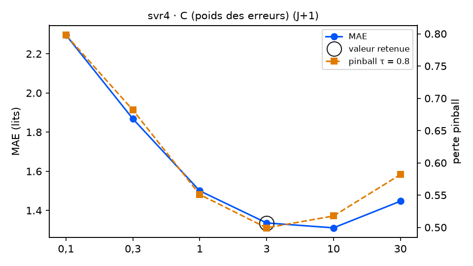

Amplitude de la MAE : 73.7 %. Aucune valeur ne fait significativement mieux que la valeur retenue.

### svr4 · ε (tube, niveaux quantiles)

| variante | MAE | RMSE | biais | pinball τ=0.8 | couverture 90 % | temps (s) | DM p (pinball τ=0.8) | p Holm | DM p (MAE) | vs choix retenu |
|---|---|---|---|---|---|---|---|---|---|---|
| epsilon_quantile = 0 | 1.337 | 1.827 | 0.036 | 0.5049 | 91.3 | 12.2 | 0.1588 | 0.3176 | 0.9405 | équivalent |
| epsilon_quantile = 0,25 (retenu) | 1.336 | 1.823 | 0.039 | 0.4993 | 89.1 | 16.3 |  |  |  | — choix retenu |
| epsilon_quantile = 0,5 | 1.329 | 1.81 | 0.011 | 0.4983 | 85.2 | 12.6 | 0.7908 | 0.7908 | 0.4283 | équivalent |
| epsilon_quantile = 1 | 1.357 | 1.815 | -0.01 | 0.5278 | 81.4 | 16.6 | 0.0097 | 0.0291 | 0.2586 | moins bon |

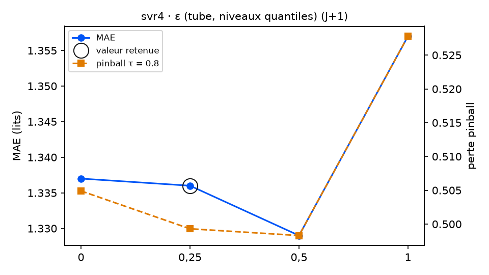

Amplitude de la MAE : 2.1 %. Aucune valeur ne fait significativement mieux que la valeur retenue.

### svr4 · γ₁ (portée, bloc occupation)

| variante | MAE | RMSE | biais | pinball τ=0.8 | couverture 90 % | temps (s) | DM p (pinball τ=0.8) | p Holm | DM p (MAE) | vs choix retenu |
|---|---|---|---|---|---|---|---|---|---|---|
| gamma1 = 0,01 | 1.376 | 1.845 | 0.003 | 0.4942 | 89.1 | 15.9 | 0.5738 | 0.5738 | 0.0564 | équivalent |
| gamma1 = 0,02 (retenu) | 1.336 | 1.823 | 0.039 | 0.4993 | 89.1 | 14.0 |  |  |  | — choix retenu |
| gamma1 = 0,05 | 1.336 | 1.818 | 0.023 | 0.5107 | 88.0 | 13.5 | 0.1115 | 0.223 | 0.998 | équivalent |
| gamma1 = 0,1 | 1.37 | 1.849 | 0.045 | 0.5252 | 85.8 | 14.2 | 0.0275 | 0.0825 | 0.2238 | équivalent |
| gamma1 = 0,2 | 1.424 | 1.888 | 0.07 | 0.5517 | 84.2 | 14.1 | 0.0002 | 0.0008 | 0.0123 | moins bon |
| gamma1 = 0,5 | 1.494 | 1.941 | 0.067 | 0.5912 | 83.6 | 13.6 | 0.0 | 0.0 | 0.0004 | moins bon |

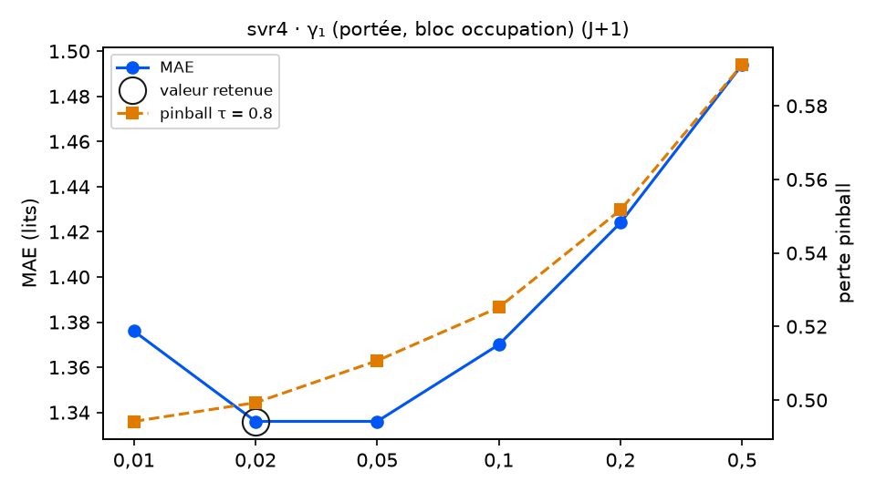

Amplitude de la MAE : 11.8 %. Aucune valeur ne fait significativement mieux que la valeur retenue.

### svr4 · γ₂ (portée, bloc flux et saison)

| variante | MAE | RMSE | biais | pinball τ=0.8 | couverture 90 % | temps (s) | DM p (pinball τ=0.8) | p Holm | DM p (MAE) | vs choix retenu |
|---|---|---|---|---|---|---|---|---|---|---|
| gamma2 = 0,02 | 1.376 | 1.849 | 0.013 | 0.546 | 88.5 | 11.2 | 0.0015 | 0.0045 | 0.1995 | moins bon |
| gamma2 = 0,05 | 1.321 | 1.805 | 0.03 | 0.521 | 88.5 | 10.3 | 0.0454 | 0.0908 | 0.5078 | équivalent |
| gamma2 = 0,1 | 1.31 | 1.801 | 0.032 | 0.5023 | 89.1 | 10.8 | 0.6189 | 0.6189 | 0.0699 | équivalent |
| gamma2 = 0,2 (retenu) | 1.336 | 1.823 | 0.039 | 0.4993 | 89.1 | 12.7 |  |  |  | — choix retenu |
| gamma2 = 0,5 | 1.461 | 1.946 | 0.051 | 0.5469 | 82.5 | 11.8 | 0.0 | 0.0 | 0.0 | moins bon |

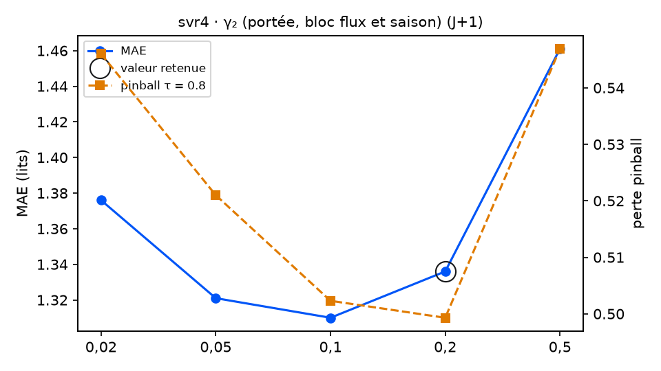

Amplitude de la MAE : 11.3 %. Aucune valeur ne fait significativement mieux que la valeur retenue.

### svr4 · τ (quantile décisionnel)

| variante | MAE | RMSE | biais | pinball τ=0.8 | couverture 90 % | temps (s) | DM p (pinball τ=0.8) | p Holm | DM p (MAE) | vs choix retenu |
|---|---|---|---|---|---|---|---|---|---|---|
| tau = 0,5 | 1.335 | 1.823 | 0.04 | 0.6558 | 89.1 | 8.3 | 0.0001 | 0.0004 | 0.3123 | moins bon |
| tau = 0,6 | 1.336 | 1.824 | 0.039 | 0.6564 | 89.1 | 8.8 | 0.0001 | 0.0004 | 0.6624 | moins bon |
| tau = 0,7 | 1.335 | 1.823 | 0.04 | 0.6558 | 89.1 | 10.2 | 0.0001 | 0.0004 | 0.3123 | moins bon |
| tau = 0,8 (retenu) | 1.336 | 1.823 | 0.039 | 0.4993 | 89.1 | 12.9 |  |  |  | — choix retenu |
| tau = 0,9 | 1.336 | 1.823 | 0.039 | 0.6564 | 89.1 | 11.3 | 0.0001 | 0.0004 | 0.7108 | moins bon |

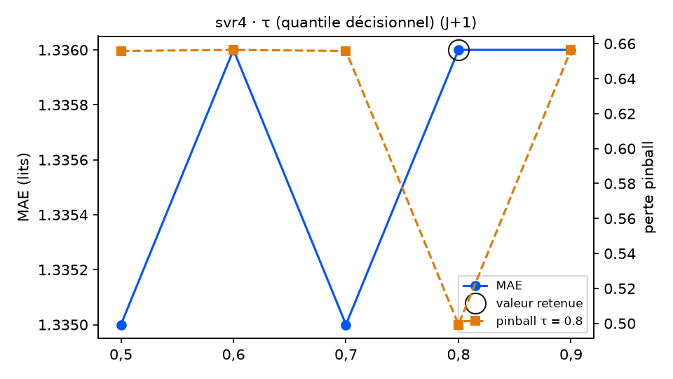

Amplitude de la MAE : 0.1 %. Aucune valeur ne fait significativement mieux que la valeur retenue.

### svr4 · η₀ (taux d'apprentissage d'Adam)

| variante | MAE | RMSE | biais | pinball τ=0.8 | couverture 90 % | temps (s) | DM p (pinball τ=0.8) | p Holm | DM p (MAE) | vs choix retenu |
|---|---|---|---|---|---|---|---|---|---|---|
| taux = 0,005 | 1.337 | 1.825 | 0.041 | 0.4971 | 88.5 | 12.4 | 0.182 | 0.91 | 0.1394 | équivalent |
| taux = 0,01 | 1.337 | 1.824 | 0.039 | 0.4978 | 89.6 | 14.8 | 0.2472 | 0.9888 | 0.094 | équivalent |
| taux = 0,02 | 1.336 | 1.824 | 0.041 | 0.499 | 89.1 | 11.5 | 0.5818 | 1.0 | 0.7476 | équivalent |
| taux = 0,05 (retenu) | 1.336 | 1.823 | 0.039 | 0.4993 | 89.1 | 12.6 |  |  |  | — choix retenu |
| taux = 0,1 | 1.333 | 1.821 | 0.033 | 0.4991 | 88.5 | 10.8 | 0.4865 | 1.0 | 0.0043 | équivalent |
| taux = 0,2 | 1.331 | 1.821 | 0.03 | 0.4995 | 89.6 | 13.8 | 0.9174 | 1.0 | 0.238 | équivalent |

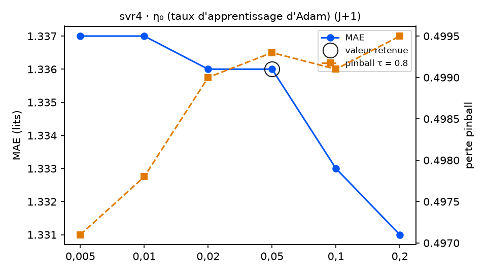

Amplitude de la MAE : 0.4 %. Aucune valeur ne fait significativement mieux que la valeur retenue.

### svr4 · nombre maximal d'itérations

| variante | MAE | RMSE | biais | pinball τ=0.8 | couverture 90 % | temps (s) | DM p (pinball τ=0.8) | p Holm | DM p (MAE) | vs choix retenu |
|---|---|---|---|---|---|---|---|---|---|---|
| iterations = 300 | 1.337 | 1.824 | 0.034 | 0.493 | 89.1 | 1.6 | 0.0351 | 0.1053 | 0.3304 | équivalent |
| iterations = 1000 | 1.336 | 1.823 | 0.037 | 0.4991 | 89.6 | 5.7 | 0.6669 | 1.0 | 0.4878 | équivalent |
| iterations = 3000 (retenu) | 1.336 | 1.823 | 0.039 | 0.4993 | 89.1 | 15.3 |  |  |  | — choix retenu |
| iterations = 6000 | 1.336 | 1.823 | 0.04 | 0.4994 | 89.1 | 20.8 | 0.7449 | 1.0 | 0.6619 | équivalent |

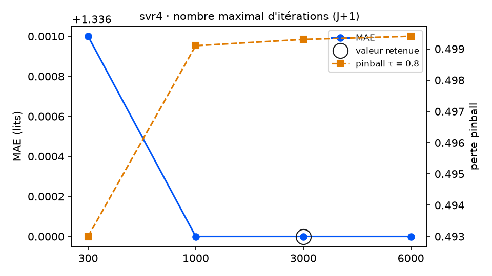

Amplitude de la MAE : 0.1 %. Aucune valeur ne fait significativement mieux que la valeur retenue.

### svr4 · T (décroissance du pas ; aucune = pas constant)

| variante | MAE | RMSE | biais | pinball τ=0.8 | couverture 90 % | temps (s) | DM p (pinball τ=0.8) | p Holm | DM p (MAE) | vs choix retenu |
|---|---|---|---|---|---|---|---|---|---|---|
| decroissance = aucune | 1.335 | 1.822 | 0.036 | 0.4995 | 88.5 | 14.7 | 0.7515 | 0.9195 | 0.4778 | équivalent |
| decroissance = 100 | 1.336 | 1.823 | 0.042 | 0.4988 | 89.1 | 9.7 | 0.3065 | 0.9195 | 0.9595 | équivalent |
| decroissance = 500 (retenu) | 1.336 | 1.823 | 0.039 | 0.4993 | 89.1 | 9.6 |  |  |  | — choix retenu |
| decroissance = 2000 | 1.335 | 1.823 | 0.035 | 0.499 | 89.1 | 11.5 | 0.439 | 0.9195 | 0.2768 | équivalent |

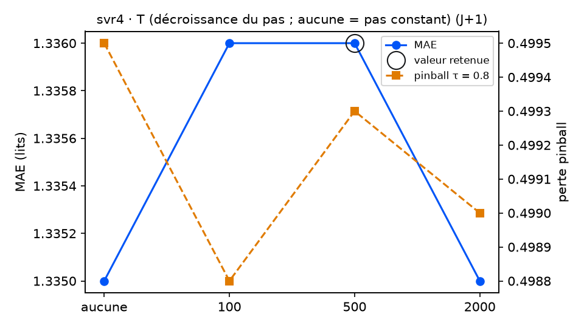

Amplitude de la MAE : 0.1 %. Aucune valeur ne fait significativement mieux que la valeur retenue.

### svr4 · part des pas moyennée (Polyak ; 0 = aucune)

| variante | MAE | RMSE | biais | pinball τ=0.8 | couverture 90 % | temps (s) | DM p (pinball τ=0.8) | p Holm | DM p (MAE) | vs choix retenu |
|---|---|---|---|---|---|---|---|---|---|---|
| moyenne_polyak = 0 | 1.336 | 1.824 | 0.039 | 0.4993 | 89.1 | 10.8 | 0.3173 | 0.6346 | 0.5672 | équivalent |
| moyenne_polyak = 0,25 | 1.336 | 1.823 | 0.039 | 0.4993 | 89.1 | 11.9 | 0.3173 | 0.6346 | 0.3356 | équivalent |
| moyenne_polyak = 0,5 (retenu) | 1.336 | 1.823 | 0.039 | 0.4993 | 89.1 | 9.3 |  |  |  | — choix retenu |
| moyenne_polyak = 0,75 | 1.336 | 1.823 | 0.039 | 0.4993 | 89.1 | 12.8 |  |  |  | identique |

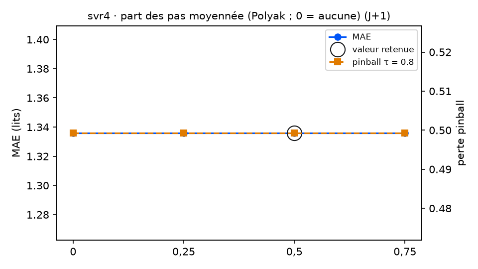

Amplitude de la MAE : 0.0 %. Aucune valeur ne fait significativement mieux que la valeur retenue.

### svr4 · tolérance d'arrêt anticipé

| variante | MAE | RMSE | biais | pinball τ=0.8 | couverture 90 % | temps (s) | DM p (pinball τ=0.8) | p Holm | DM p (MAE) | vs choix retenu |
|---|---|---|---|---|---|---|---|---|---|---|
| tolerance = 1e-05 | 1.336 | 1.823 | 0.033 | 0.4963 | 89.1 | 4.6 | 0.0265 | 0.053 | 0.7605 | équivalent |
| tolerance = 1e-07 (retenu) | 1.336 | 1.823 | 0.039 | 0.4993 | 89.1 | 9.7 |  |  |  | — choix retenu |
| tolerance = 1e-09 | 1.336 | 1.824 | 0.04 | 0.4993 | 88.5 | 10.5 | 0.6598 | 0.6598 | 0.9525 | équivalent |

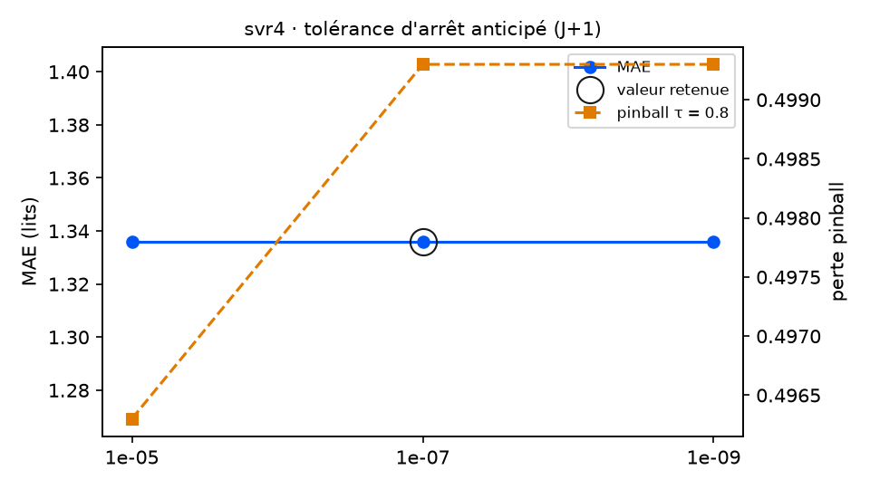

Amplitude de la MAE : 0.0 %. Aucune valeur ne fait significativement mieux que la valeur retenue.

### svr4 · direction préconditionnée α + Cg

| variante | MAE | RMSE | biais | pinball τ=0.8 | couverture 90 % | temps (s) | DM p (pinball τ=0.8) | p Holm | DM p (MAE) | vs choix retenu |
|---|---|---|---|---|---|---|---|---|---|---|
| preconditionne = True (retenu) | 1.336 | 1.823 | 0.039 | 0.4993 | 89.1 | 13.1 |  |  |  | — choix retenu |
| preconditionne = False | 1.357 | 1.843 | 0.029 | 0.5043 | 89.6 | 15.7 | 0.1228 | 0.1228 | 0.0556 | équivalent |

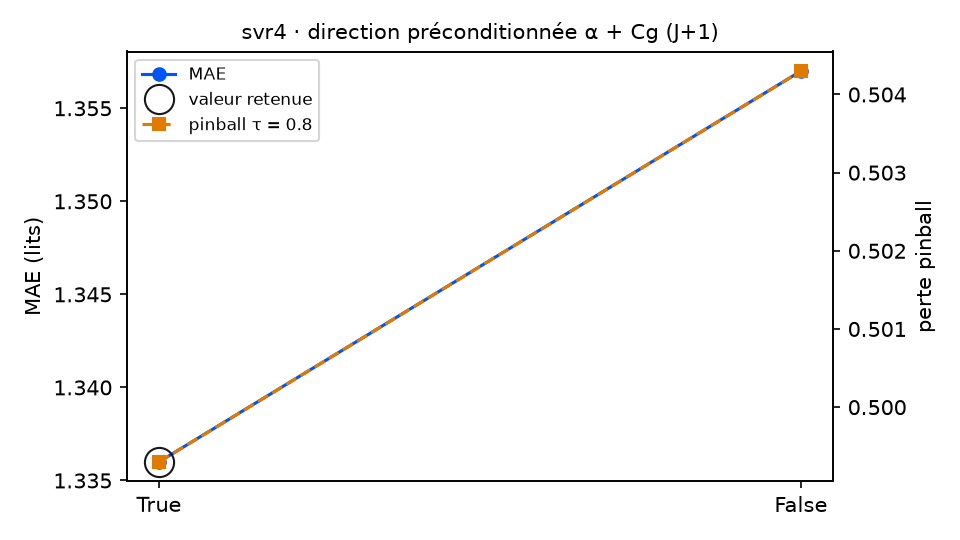

Amplitude de la MAE : 1.6 %. Aucune valeur ne fait significativement mieux que la valeur retenue.

### svr4 · optimiseur

| variante | MAE | RMSE | biais | pinball τ=0.8 | couverture 90 % | temps (s) | DM p (pinball τ=0.8) | p Holm | DM p (MAE) | vs choix retenu |
|---|---|---|---|---|---|---|---|---|---|---|
| optimiseur = adam (retenu) | 1.336 | 1.823 | 0.039 | 0.4993 | 89.1 | 11.8 |  |  |  | — choix retenu |
| optimiseur = momentum | 2.31 | 2.951 | -1.026 | 0.7749 | 88.5 | 9.2 | 0.0 | 0.0 | 0.0 | moins bon |
| optimiseur = sgd | 2.258 | 2.873 | -1.114 | 0.5379 | 88.0 | 8.8 | 0.2241 | 0.2241 | 0.0 | équivalent |

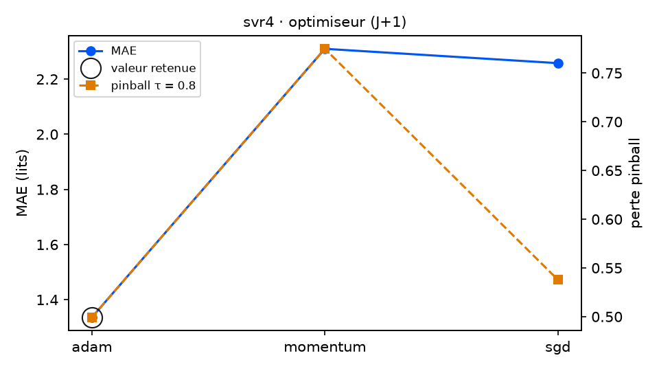

Amplitude de la MAE : 72.9 %. Aucune valeur ne fait significativement mieux que la valeur retenue.

### svr2 · C

| variante | MAE | RMSE | biais | pinball τ=0.8 | temps (s) | DM p (pinball τ=0.8) | p Holm | DM p (MAE) | vs choix retenu |
|---|---|---|---|---|---|---|---|---|---|
| C = 0,1 | 1.923 | 2.372 | -0.042 | 0.9738 | 0.5 | 0.0 | 0.0 | 0.0 | moins bon |
| C = 0,3 | 1.558 | 1.973 | -0.014 | 0.7831 | 0.7 | 0.0001 | 0.0004 | 0.0 | moins bon |
| C = 1 | 1.315 | 1.768 | -0.025 | 0.6649 | 1.2 | 0.0101 | 0.0303 | 0.0064 | moins bon |
| C = 3 (retenu) | 1.256 | 1.724 | -0.008 | 0.6302 | 2.1 |  |  |  | — choix retenu |
| C = 10 | 1.257 | 1.728 | -0.016 | 0.6333 | 2.8 | 0.7643 | 0.7643 | 0.9448 | équivalent |
| C = 30 | 1.272 | 1.737 | -0.087 | 0.6622 | 2.2 | 0.099 | 0.198 | 0.605 | équivalent |

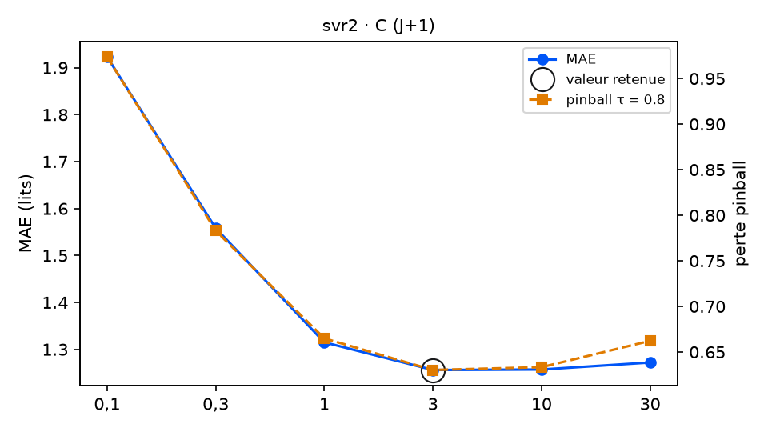

Amplitude de la MAE : 53.1 %. Aucune valeur ne fait significativement mieux que la valeur retenue.

### svr2 · ε (tube ε-insensible, en lits)

| variante | MAE | RMSE | biais | pinball τ=0.8 | temps (s) | DM p (pinball τ=0.8) | p Holm | DM p (MAE) | vs choix retenu |
|---|---|---|---|---|---|---|---|---|---|
| epsilon = 0 | 1.257 | 1.755 | -0.047 | 0.6429 | 2.3 | 0.1494 | 0.2988 | 0.9025 | équivalent |
| epsilon = 0,25 | 1.256 | 1.738 | -0.05 | 0.6426 | 2.3 | 0.0273 | 0.0819 | 0.9799 | équivalent |
| epsilon = 0,5 (retenu) | 1.256 | 1.724 | -0.008 | 0.6302 | 2.6 |  |  |  | — choix retenu |
| epsilon = 1 | 1.295 | 1.733 | 0.001 | 0.6474 | 2.3 | 0.0152 | 0.0608 | 0.0011 | équivalent |
| epsilon = 2 | 1.357 | 1.781 | 0.093 | 0.6509 | 1.4 | 0.2509 | 0.2988 | 0.0008 | équivalent |

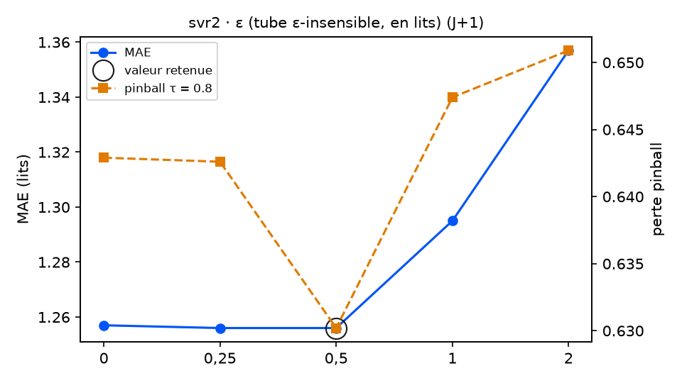

Amplitude de la MAE : 8.0 %. Aucune valeur ne fait significativement mieux que la valeur retenue.

### svr2 · γ (portée du noyau RBF)

| variante | MAE | RMSE | biais | pinball τ=0.8 | temps (s) | DM p (pinball τ=0.8) | p Holm | DM p (MAE) | vs choix retenu |
|---|---|---|---|---|---|---|---|---|---|
| gamma = 0,005 | 1.313 | 1.78 | -0.014 | 0.6608 | 2.4 | 0.0354 | 0.0708 | 0.016 | équivalent |
| gamma = 0,01 | 1.266 | 1.744 | -0.005 | 0.6347 | 2.3 | 0.5133 | 0.5133 | 0.4235 | équivalent |
| gamma = 0,02 (retenu) | 1.256 | 1.724 | -0.008 | 0.6302 | 2.0 |  |  |  | — choix retenu |
| gamma = 0,05 | 1.29 | 1.749 | -0.056 | 0.6621 | 1.7 | 0.0117 | 0.0351 | 0.1395 | moins bon |
| gamma = 0,1 | 1.412 | 1.852 | -0.054 | 0.722 | 2.2 | 0.0006 | 0.0024 | 0.0013 | moins bon |
| gamma = 0,2 | 1.579 | 2.03 | -0.037 | 0.8007 | 2.4 | 0.0 | 0.0 | 0.0 | moins bon |
| gamma = 0,5 | 2.1 | 2.628 | 0.07 | 1.0293 | 1.3 | 0.0 | 0.0 | 0.0 | moins bon |

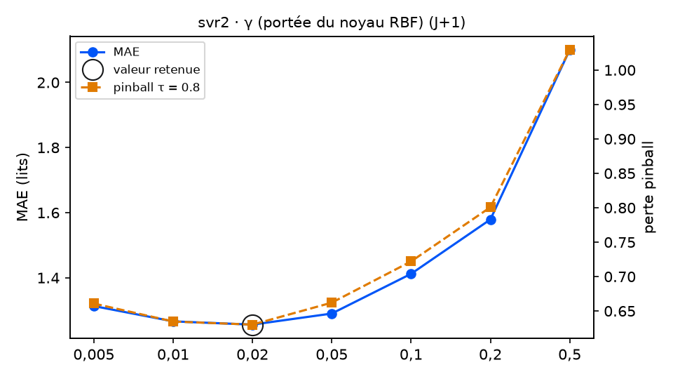

Amplitude de la MAE : 67.2 %. Aucune valeur ne fait significativement mieux que la valeur retenue.

### foret · nombre d'arbres

| variante | MAE | RMSE | biais | pinball τ=0.8 | couverture 90 % | temps (s) | DM p (pinball τ=0.8) | p Holm | DM p (MAE) | vs choix retenu |
|---|---|---|---|---|---|---|---|---|---|---|
| arbres = 25 | 1.538 | 2.047 | 0.083 | 0.5772 | 93.4 | 1.2 | 0.8615 | 1.0 | 0.4192 | équivalent |
| arbres = 50 | 1.515 | 2.012 | 0.04 | 0.5733 | 93.4 | 3.4 | 0.8101 | 1.0 | 0.7579 | équivalent |
| arbres = 100 | 1.521 | 2.008 | 0.046 | 0.5762 | 92.9 | 5.3 | 0.7854 | 1.0 | 0.9015 | équivalent |
| arbres = 300 (retenu) | 1.52 | 2.011 | 0.052 | 0.575 | 94.0 | 14.5 |  |  |  | — choix retenu |
| arbres = 500 | 1.517 | 2.002 | 0.055 | 0.5729 | 94.0 | 29.2 | 0.3411 | 1.0 | 0.62 | équivalent |

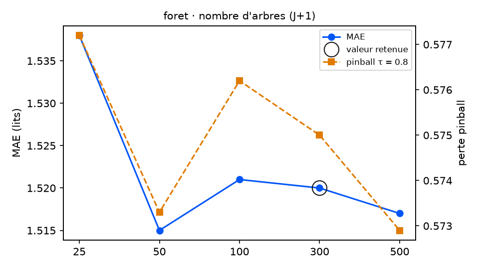

Amplitude de la MAE : 1.5 %. Aucune valeur ne fait significativement mieux que la valeur retenue.

### foret · profondeur maximale

| variante | MAE | RMSE | biais | pinball τ=0.8 | couverture 90 % | temps (s) | DM p (pinball τ=0.8) | p Holm | DM p (MAE) | vs choix retenu |
|---|---|---|---|---|---|---|---|---|---|---|
| profondeur_foret = 3 | 1.661 | 2.13 | 0.032 | 0.6126 | 94.5 | 2.6 | 0.0619 | 0.2476 | 0.0025 | équivalent |
| profondeur_foret = 5 | 1.535 | 2.023 | 0.018 | 0.5832 | 92.9 | 4.4 | 0.4043 | 0.7814 | 0.5172 | équivalent |
| profondeur_foret = 8 | 1.51 | 1.994 | 0.029 | 0.5716 | 94.0 | 12.8 | 0.3907 | 0.7814 | 0.4298 | équivalent |
| profondeur_foret = 12 (retenu) | 1.52 | 2.011 | 0.052 | 0.575 | 94.0 | 18.6 |  |  |  | — choix retenu |
| profondeur_foret = 20 | 1.506 | 1.993 | 0.043 | 0.5694 | 94.5 | 15.1 | 0.0979 | 0.2937 | 0.1894 | équivalent |

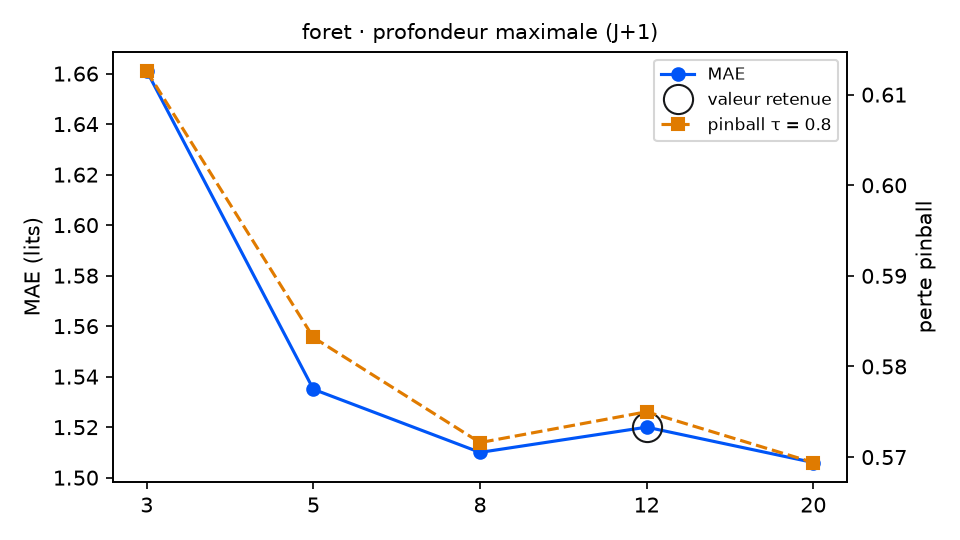

Amplitude de la MAE : 10.2 %. Aucune valeur ne fait significativement mieux que la valeur retenue.

### foret · taille minimale d'une feuille

| variante | MAE | RMSE | biais | pinball τ=0.8 | couverture 90 % | temps (s) | DM p (pinball τ=0.8) | p Holm | DM p (MAE) | vs choix retenu |
|---|---|---|---|---|---|---|---|---|---|---|
| min_feuille = 2 | 1.507 | 1.987 | 0.058 | 0.5571 | 93.4 | 29.6 | 0.0078 | 0.0234 | 0.4226 | meilleur |
| min_feuille = 5 (retenu) | 1.52 | 2.011 | 0.052 | 0.575 | 94.0 | 14.4 |  |  |  | — choix retenu |
| min_feuille = 10 | 1.527 | 2.016 | 0.039 | 0.577 | 94.5 | 7.5 | 0.7311 | 0.7311 | 0.6159 | équivalent |
| min_feuille = 20 | 1.56 | 2.037 | 0.038 | 0.5892 | 94.0 | 4.5 | 0.1307 | 0.2614 | 0.0873 | équivalent |

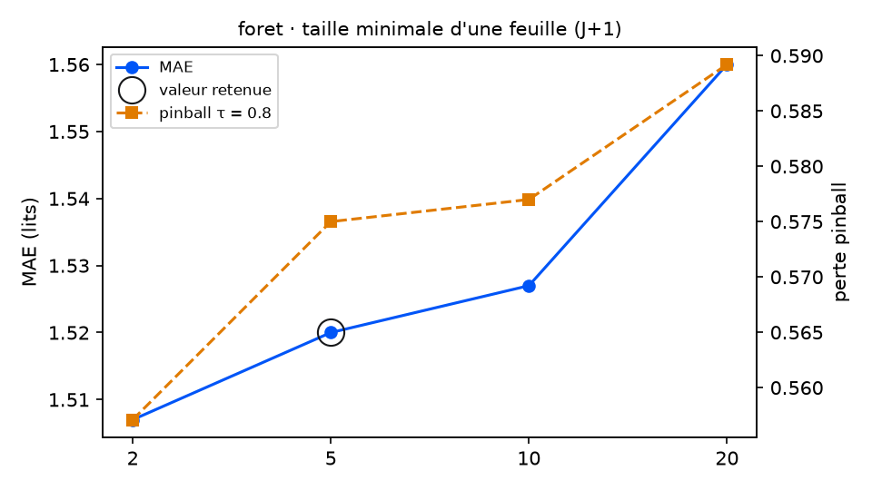

Amplitude de la MAE : 3.5 %. Valeur(s) significativement meilleure(s) : min_feuille = 2 — réglage à revoir.

### foret · part des variables tirées par nœud

| variante | MAE | RMSE | biais | pinball τ=0.8 | couverture 90 % | temps (s) | DM p (pinball τ=0.8) | p Holm | DM p (MAE) | vs choix retenu |
|---|---|---|---|---|---|---|---|---|---|---|
| part_variables = 0,15 | 1.594 | 2.042 | 0.035 | 0.5839 | 95.6 | 14.7 | 0.5371 | 1.0 | 0.0324 | équivalent |
| part_variables = 0,333333 (retenu) | 1.52 | 2.011 | 0.052 | 0.575 | 94.0 | 13.3 |  |  |  | — choix retenu |
| part_variables = 0,5 | 1.496 | 1.996 | 0.039 | 0.5622 | 92.3 | 14.6 | 0.0609 | 0.1827 | 0.1655 | équivalent |
| part_variables = 1 | 1.5 | 2.009 | 0.033 | 0.5748 | 88.5 | 14.3 | 0.9856 | 1.0 | 0.4771 | équivalent |

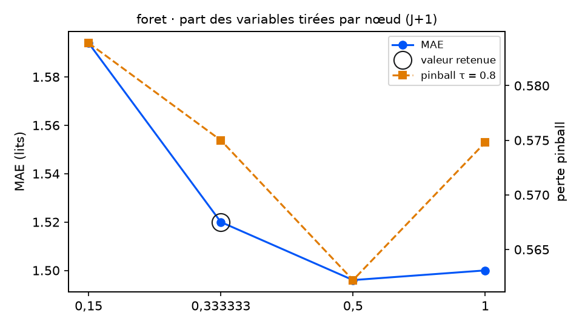

Amplitude de la MAE : 6.4 %. Aucune valeur ne fait significativement mieux que la valeur retenue.

### boosting · nombre d'étapes

| variante | MAE | RMSE | biais | pinball τ=0.8 | couverture 90 % | temps (s) | DM p (pinball τ=0.8) | p Holm | DM p (MAE) | vs choix retenu |
|---|---|---|---|---|---|---|---|---|---|---|
| etapes = 50 | 1.502 | 1.991 | 0.078 | 0.5838 | 89.1 | 1.6 | 0.0586 | 0.1758 | 0.0003 | équivalent |
| etapes = 100 | 1.402 | 1.919 | 0.07 | 0.5478 | 87.4 | 2.3 | 0.4527 | 0.9054 | 0.135 | équivalent |
| etapes = 300 (retenu) | 1.377 | 1.907 | 0.067 | 0.5388 | 80.3 | 6.7 |  |  |  | — choix retenu |
| etapes = 600 | 1.375 | 1.902 | 0.068 | 0.54 | 78.7 | 13.1 | 0.8429 | 0.9054 | 0.8172 | équivalent |

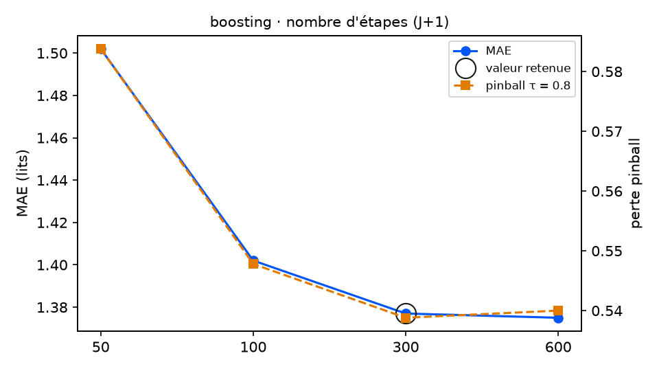

Amplitude de la MAE : 9.2 %. Aucune valeur ne fait significativement mieux que la valeur retenue.

### boosting · taux ν (shrinkage)

| variante | MAE | RMSE | biais | pinball τ=0.8 | couverture 90 % | temps (s) | DM p (pinball τ=0.8) | p Holm | DM p (MAE) | vs choix retenu |
|---|---|---|---|---|---|---|---|---|---|---|
| taux_boosting = 0,01 | 1.489 | 1.971 | 0.068 | 0.5736 | 87.4 | 6.5 | 0.0966 | 0.2079 | 0.0002 | équivalent |
| taux_boosting = 0,05 (retenu) | 1.377 | 1.907 | 0.067 | 0.5388 | 80.3 | 6.6 |  |  |  | — choix retenu |
| taux_boosting = 0,1 | 1.4 | 1.89 | 0.063 | 0.5429 | 76.5 | 6.7 | 0.7171 | 0.7171 | 0.3134 | équivalent |
| taux_boosting = 0,2 | 1.392 | 1.852 | 0.049 | 0.5665 | 71.0 | 6.6 | 0.0693 | 0.2079 | 0.6397 | équivalent |

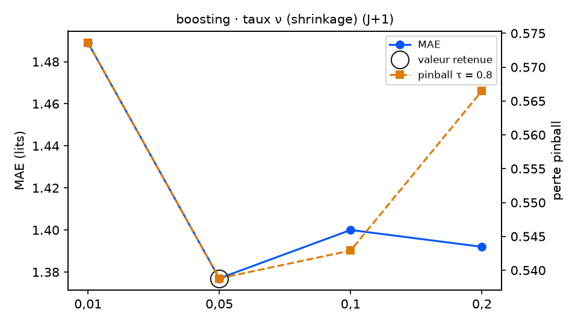

Amplitude de la MAE : 8.1 %. Aucune valeur ne fait significativement mieux que la valeur retenue.

### boosting · profondeur des arbres

| variante | MAE | RMSE | biais | pinball τ=0.8 | couverture 90 % | temps (s) | DM p (pinball τ=0.8) | p Holm | DM p (MAE) | vs choix retenu |
|---|---|---|---|---|---|---|---|---|---|---|
| profondeur_boosting = 1 | 1.462 | 1.983 | 0.042 | 0.5616 | 88.0 | 2.2 | 0.1187 | 0.3561 | 0.0212 | équivalent |
| profondeur_boosting = 2 | 1.394 | 1.912 | 0.068 | 0.5357 | 84.2 | 4.2 | 0.7664 | 0.7664 | 0.4177 | équivalent |
| profondeur_boosting = 3 (retenu) | 1.377 | 1.907 | 0.067 | 0.5388 | 80.3 | 6.8 |  |  |  | — choix retenu |
| profondeur_boosting = 5 | 1.394 | 1.896 | 0.077 | 0.5518 | 73.8 | 13.4 | 0.3168 | 0.6336 | 0.4766 | équivalent |

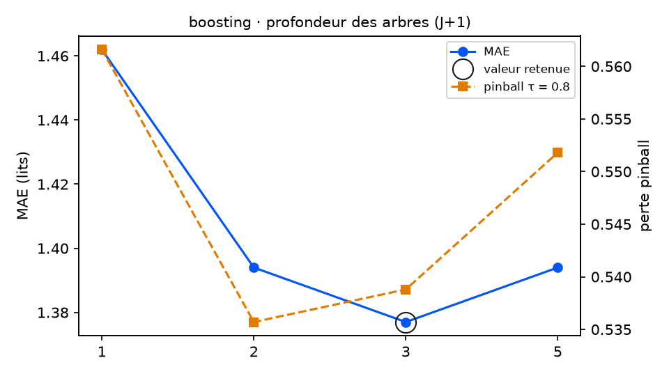

Amplitude de la MAE : 6.2 %. Aucune valeur ne fait significativement mieux que la valeur retenue.

### boosting · part du sous-échantillon

| variante | MAE | RMSE | biais | pinball τ=0.8 | couverture 90 % | temps (s) | DM p (pinball τ=0.8) | p Holm | DM p (MAE) | vs choix retenu |
|---|---|---|---|---|---|---|---|---|---|---|
| sous_echantillon = 0,5 | 1.366 | 1.86 | 0.096 | 0.5309 | 77.0 | 5.7 | 0.5507 | 0.7818 | 0.6347 | équivalent |
| sous_echantillon = 0,8 (retenu) | 1.377 | 1.907 | 0.067 | 0.5388 | 80.3 | 6.6 |  |  |  | — choix retenu |
| sous_echantillon = 1 | 1.405 | 1.92 | 0.053 | 0.548 | 82.0 | 7.4 | 0.3909 | 0.7818 | 0.1347 | équivalent |

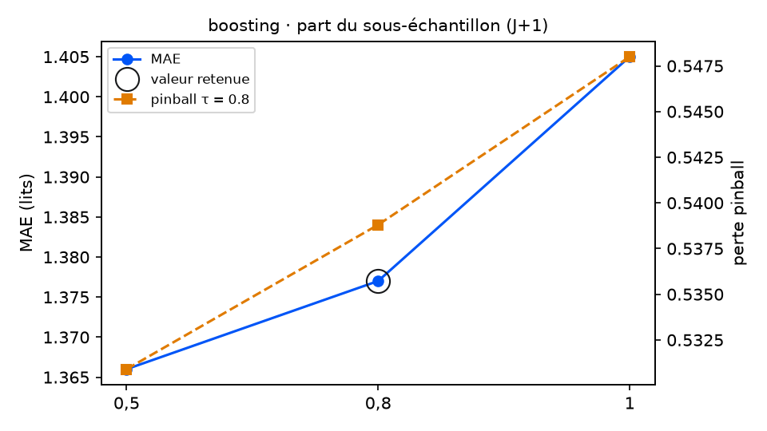

Amplitude de la MAE : 2.8 %. Aucune valeur ne fait significativement mieux que la valeur retenue.

### mlp · architecture (neurones par couche)

| variante | MAE | RMSE | biais | pinball τ=0.8 | couverture 90 % | temps (s) | DM p (pinball τ=0.8) | p Holm | DM p (MAE) | vs choix retenu |
|---|---|---|---|---|---|---|---|---|---|---|
| couches = 8 | 1.258 | 1.72 | 0.012 | 0.47 | 90.2 | 1.0 | 0.9076 | 0.9076 | 0.1816 | équivalent |
| couches = 32 | 1.292 | 1.732 | -0.091 | 0.5057 | 88.5 | 1.0 | 0.0141 | 0.0564 | 0.5151 | équivalent |
| couches = 32×16 (retenu) | 1.314 | 1.761 | -0.045 | 0.4678 | 90.7 | 1.2 |  |  |  | — choix retenu |
| couches = 64×32 | 1.329 | 1.772 | 0.04 | 0.4956 | 87.4 | 1.1 | 0.1043 | 0.3093 | 0.6531 | équivalent |
| couches = 32×16×8 | 1.341 | 1.738 | 0.024 | 0.4974 | 88.5 | 1.1 | 0.1031 | 0.3093 | 0.5235 | équivalent |

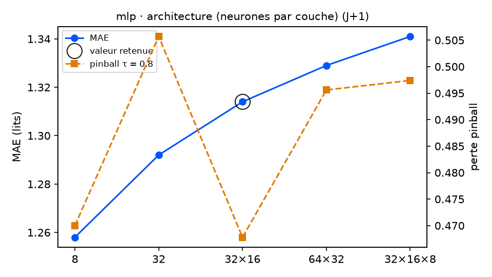

Amplitude de la MAE : 6.3 %. Aucune valeur ne fait significativement mieux que la valeur retenue.

### mlp · taux d'apprentissage

| variante | MAE | RMSE | biais | pinball τ=0.8 | couverture 90 % | temps (s) | DM p (pinball τ=0.8) | p Holm | DM p (MAE) | vs choix retenu |
|---|---|---|---|---|---|---|---|---|---|---|
| taux_reseau = 0,001 | 1.306 | 1.794 | -0.025 | 0.4915 | 89.6 | 2.4 | 0.072 | 0.216 | 0.7874 | équivalent |
| taux_reseau = 0,003 | 1.306 | 1.76 | -0.024 | 0.4762 | 88.5 | 1.3 | 0.4827 | 0.9654 | 0.748 | équivalent |
| taux_reseau = 0,01 (retenu) | 1.314 | 1.761 | -0.045 | 0.4678 | 90.7 | 0.9 |  |  |  | — choix retenu |
| taux_reseau = 0,03 | 1.338 | 1.754 | -0.072 | 0.4714 | 89.1 | 0.8 | 0.7819 | 0.9654 | 0.3801 | équivalent |

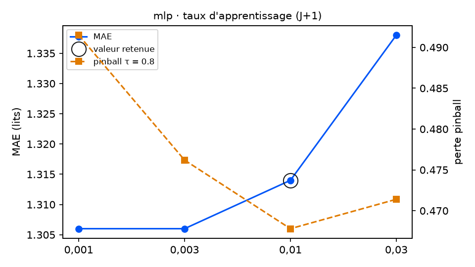

Amplitude de la MAE : 2.4 %. Aucune valeur ne fait significativement mieux que la valeur retenue.

### mlp · pénalité L2 λ

| variante | MAE | RMSE | biais | pinball τ=0.8 | couverture 90 % | temps (s) | DM p (pinball τ=0.8) | p Holm | DM p (MAE) | vs choix retenu |
|---|---|---|---|---|---|---|---|---|---|---|
| lambda_ = 0 | 1.314 | 1.763 | -0.04 | 0.4689 | 88.0 | 0.9 | 0.8253 | 1.0 | 0.9426 | équivalent |
| lambda_ = 0,0001 | 1.314 | 1.761 | -0.049 | 0.4693 | 87.4 | 0.9 | 0.7325 | 1.0 | 0.9858 | équivalent |
| lambda_ = 0,001 (retenu) | 1.314 | 1.761 | -0.045 | 0.4678 | 90.7 | 0.9 |  |  |  | — choix retenu |
| lambda_ = 0,01 | 1.294 | 1.723 | -0.066 | 0.483 | 87.4 | 1.2 | 0.2086 | 0.6258 | 0.437 | équivalent |
| lambda_ = 0,1 | 1.368 | 1.827 | 0.024 | 0.5121 | 89.6 | 2.3 | 0.0122 | 0.0488 | 0.2786 | moins bon |

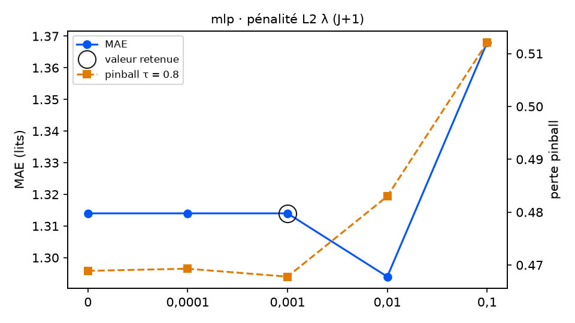

Amplitude de la MAE : 5.6 %. Aucune valeur ne fait significativement mieux que la valeur retenue.

### mlp · époques maximales

| variante | MAE | RMSE | biais | pinball τ=0.8 | couverture 90 % | temps (s) | DM p (pinball τ=0.8) | p Holm | DM p (MAE) | vs choix retenu |
|---|---|---|---|---|---|---|---|---|---|---|
| epoques = 300 | 1.314 | 1.761 | -0.045 | 0.4678 | 90.7 | 0.9 |  |  |  | identique |
| epoques = 800 | 1.314 | 1.761 | -0.045 | 0.4678 | 90.7 | 0.9 |  |  |  | identique |
| epoques = 1500 (retenu) | 1.314 | 1.761 | -0.045 | 0.4678 | 90.7 | 0.9 |  |  |  | — choix retenu |
| epoques = 3000 | 1.314 | 1.761 | -0.045 | 0.4678 | 90.7 | 0.9 |  |  |  | identique |

Amplitude de la MAE : 0.0 %. Aucune valeur ne fait significativement mieux que la valeur retenue.

### mlp · patience de l'arrêt anticipé

| variante | MAE | RMSE | biais | pinball τ=0.8 | couverture 90 % | temps (s) | DM p (pinball τ=0.8) | p Holm | DM p (MAE) | vs choix retenu |
|---|---|---|---|---|---|---|---|---|---|---|
| patience = 50 | 1.312 | 1.768 | -0.058 | 0.469 | 90.7 | 0.5 | 0.6104 | 0.6104 | 0.7472 | équivalent |
| patience = 150 (retenu) | 1.314 | 1.761 | -0.045 | 0.4678 | 90.7 | 0.9 |  |  |  | — choix retenu |
| patience = 300 | 1.314 | 1.761 | -0.045 | 0.4678 | 90.7 | 1.4 |  |  |  | identique |

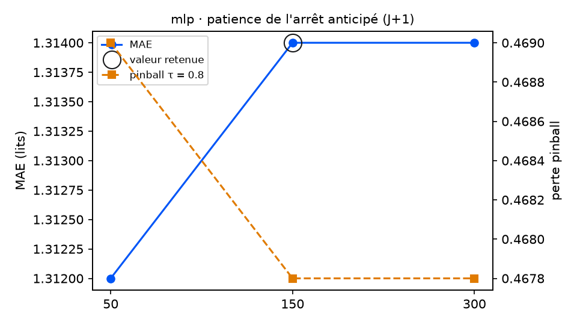

Amplitude de la MAE : 0.2 %. Aucune valeur ne fait significativement mieux que la valeur retenue.

### mlp · nombre d'initialisations moyennées

| variante | MAE | RMSE | biais | pinball τ=0.8 | couverture 90 % | temps (s) | DM p (pinball τ=0.8) | p Holm | DM p (MAE) | vs choix retenu |
|---|---|---|---|---|---|---|---|---|---|---|
| graines = 1 | 1.416 | 1.895 | 0.087 | 0.5335 | 82.5 | 0.4 | 0.0012 | 0.0024 | 0.0128 | moins bon |
| graines = 3 (retenu) | 1.314 | 1.761 | -0.045 | 0.4678 | 90.7 | 0.9 |  |  |  | — choix retenu |
| graines = 5 | 1.323 | 1.768 | -0.03 | 0.4719 | 88.5 | 1.5 | 0.6287 | 0.6287 | 0.5695 | équivalent |

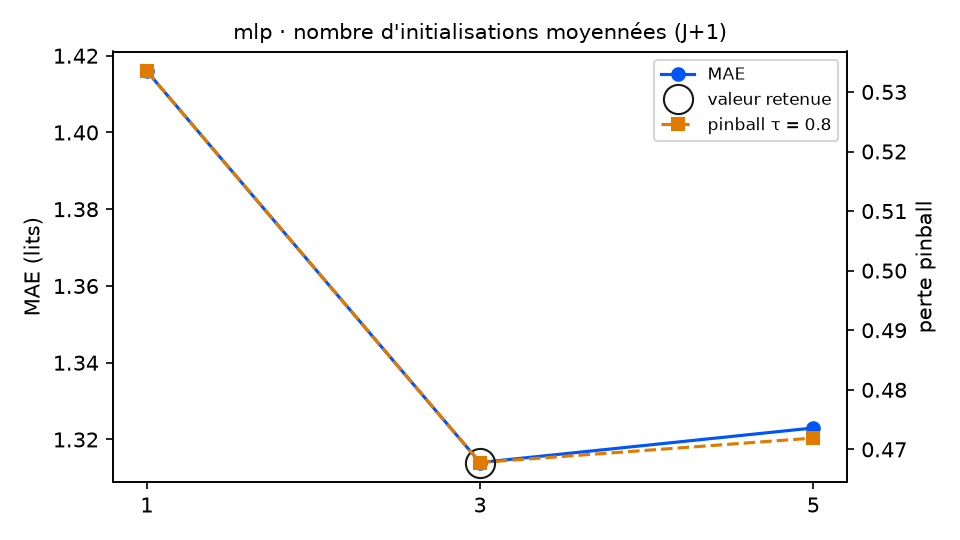

Amplitude de la MAE : 7.8 %. Aucune valeur ne fait significativement mieux que la valeur retenue.

### lstm · taille de l'état caché H

| variante | MAE | RMSE | biais | pinball τ=0.8 | couverture 90 % | temps (s) | DM p (pinball τ=0.8) | p Holm | DM p (MAE) | vs choix retenu |
|---|---|---|---|---|---|---|---|---|---|---|
| cache_lstm = 4 | 1.271 | 1.762 | -0.041 | 0.5028 | 89.1 | 13.2 | 0.7895 | 1.0 | 0.3989 | équivalent |
| cache_lstm = 8 | 1.307 | 1.777 | -0.081 | 0.5016 | 87.4 | 9.5 | 0.8908 | 1.0 | 0.2652 | équivalent |
| cache_lstm = 16 (retenu) | 1.287 | 1.761 | -0.029 | 0.5004 | 89.1 | 9.4 |  |  |  | — choix retenu |
| cache_lstm = 32 | 1.303 | 1.769 | -0.046 | 0.5016 | 85.8 | 16.8 | 0.8852 | 1.0 | 0.4165 | équivalent |

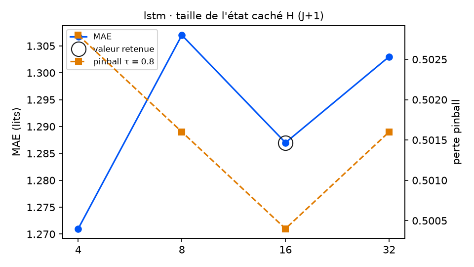

Amplitude de la MAE : 2.8 %. Aucune valeur ne fait significativement mieux que la valeur retenue.

### lstm · taux d'apprentissage

| variante | MAE | RMSE | biais | pinball τ=0.8 | couverture 90 % | temps (s) | DM p (pinball τ=0.8) | p Holm | DM p (MAE) | vs choix retenu |
|---|---|---|---|---|---|---|---|---|---|---|
| taux_reseau = 0,003 | 1.299 | 1.767 | 0.003 | 0.5118 | 90.2 | 15.1 | 0.1113 | 0.2226 | 0.3502 | équivalent |
| taux_reseau = 0,01 (retenu) | 1.287 | 1.761 | -0.029 | 0.5004 | 89.1 | 9.5 |  |  |  | — choix retenu |
| taux_reseau = 0,03 | 1.278 | 1.755 | -0.07 | 0.4874 | 88.5 | 9.3 | 0.1626 | 0.2226 | 0.644 | équivalent |

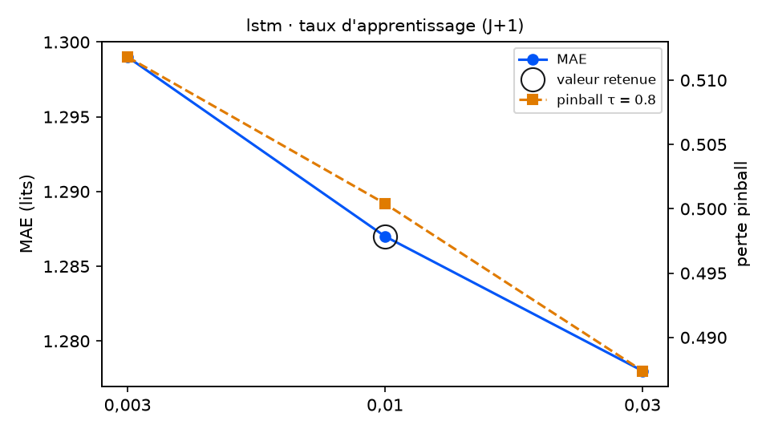

Amplitude de la MAE : 1.6 %. Aucune valeur ne fait significativement mieux que la valeur retenue.

### lstm · pénalité L2 λ

| variante | MAE | RMSE | biais | pinball τ=0.8 | couverture 90 % | temps (s) | DM p (pinball τ=0.8) | p Holm | DM p (MAE) | vs choix retenu |
|---|---|---|---|---|---|---|---|---|---|---|
| lambda_ = 0 | 1.3 | 1.771 | -0.013 | 0.5088 | 86.3 | 9.0 | 0.1611 | 0.3222 | 0.4188 | équivalent |
| lambda_ = 0,001 (retenu) | 1.287 | 1.761 | -0.029 | 0.5004 | 89.1 | 9.4 |  |  |  | — choix retenu |
| lambda_ = 0,01 | 1.286 | 1.759 | -0.042 | 0.4962 | 87.4 | 25.7 | 0.6494 | 0.6494 | 0.963 | équivalent |

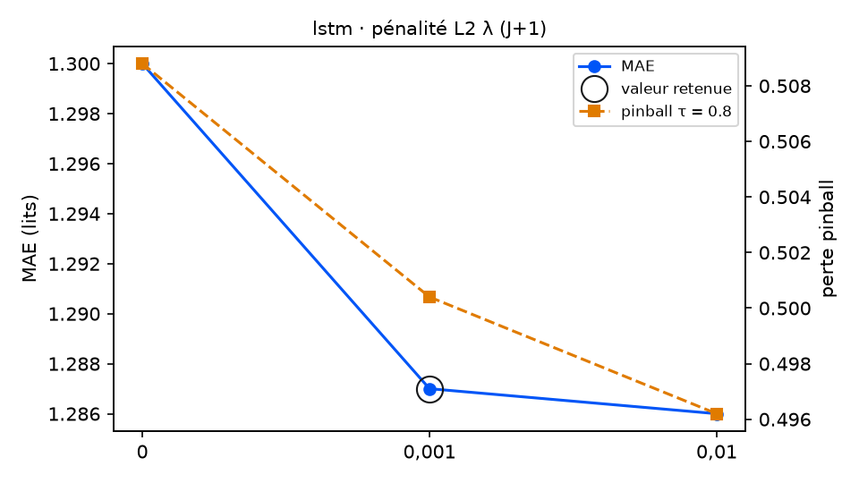

Amplitude de la MAE : 1.1 %. Aucune valeur ne fait significativement mieux que la valeur retenue.

### variables · jours d'occupation passée en entrée

| variante | MAE | RMSE | biais | pinball τ=0.8 | couverture 90 % | temps (s) | DM p (pinball τ=0.8) | p Holm | DM p (MAE) | vs choix retenu |
|---|---|---|---|---|---|---|---|---|---|---|
| retards = 3 | 1.324 | 1.811 | -0.063 | 0.4947 | 89.6 | 8.9 | 0.7457 | 1.0 | 0.7166 | équivalent |
| retards = 5 | 1.317 | 1.802 | -0.034 | 0.4889 | 90.2 | 9.5 | 0.2289 | 1.0 | 0.4677 | équivalent |
| retards = 7 (retenu) | 1.336 | 1.823 | 0.039 | 0.4993 | 89.1 | 10.8 |  |  |  | — choix retenu |
| retards = 10 | 1.332 | 1.822 | 0.034 | 0.5033 | 88.0 | 9.4 | 0.3331 | 1.0 | 0.7783 | équivalent |
| retards = 14 | 1.334 | 1.813 | 0.08 | 0.496 | 88.0 | 10.0 | 0.752 | 1.0 | 0.9094 | équivalent |
| retards = 21 | 1.368 | 1.817 | 0.113 | 0.5064 | 87.4 | 7.6 | 0.6295 | 1.0 | 0.2181 | équivalent |

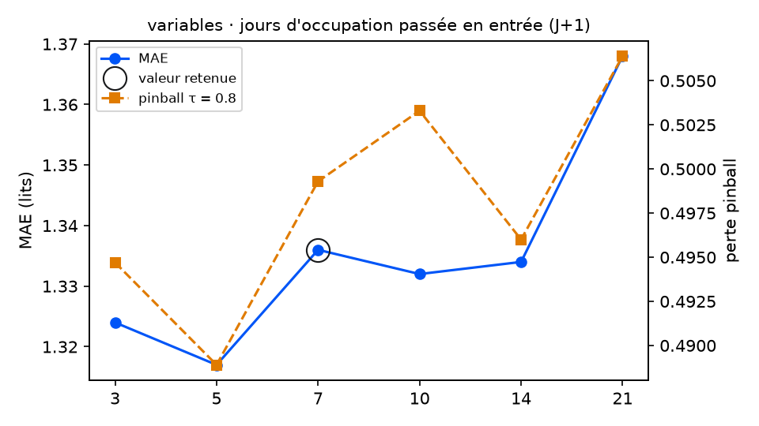

Amplitude de la MAE : 3.8 %. Aucune valeur ne fait significativement mieux que la valeur retenue.

## Horizon J+7

### svr4 · C (poids des erreurs)

| variante | MAE | RMSE | biais | pinball τ=0.8 | couverture 90 % | temps (s) | DM p (pinball τ=0.8) | p Holm | DM p (MAE) | vs choix retenu |
|---|---|---|---|---|---|---|---|---|---|---|
| C = 0,1 | 2.752 | 3.332 | -0.033 | 0.9204 | 91.0 | 6.0 | 0.9281 | 1.0 | 0.929 | équivalent |
| C = 0,3 (retenu) | 2.756 | 3.338 | -0.134 | 0.9227 | 89.3 | 7.1 |  |  |  | — choix retenu |
| C = 1 | 2.731 | 3.319 | -0.192 | 0.9399 | 85.3 | 9.3 | 0.4662 | 1.0 | 0.481 | équivalent |
| C = 3 | 2.793 | 3.41 | -0.291 | 0.955 | 83.1 | 8.9 | 0.3398 | 1.0 | 0.6783 | équivalent |
| C = 10 | 2.971 | 3.664 | -0.351 | 1.0368 | 79.1 | 9.2 | 0.1191 | 0.4764 | 0.1193 | équivalent |
| C = 30 | 3.21 | 3.997 | -0.52 | 1.1871 | 66.1 | 10.3 | 0.022 | 0.11 | 0.0251 | équivalent |

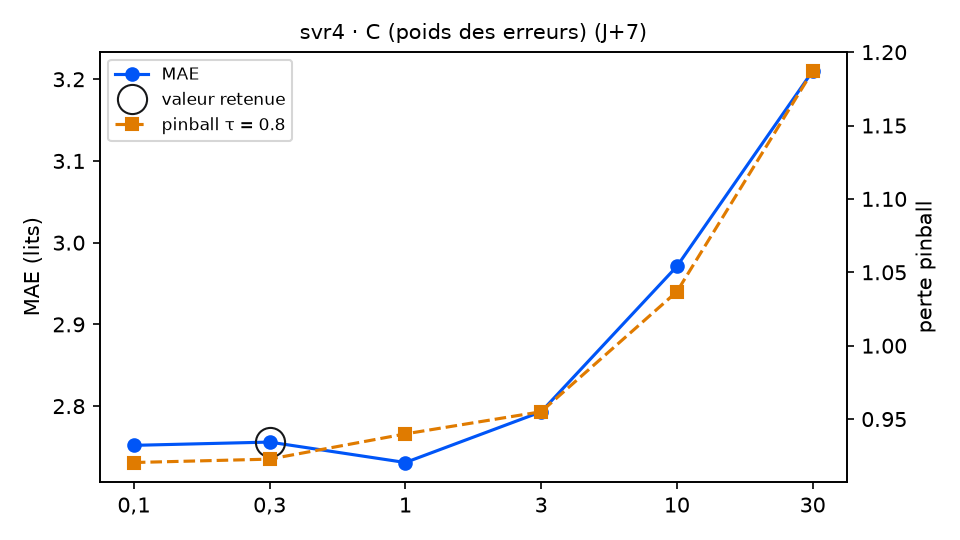

Amplitude de la MAE : 17.4 %. Aucune valeur ne fait significativement mieux que la valeur retenue.

### svr4 · ε (tube, niveaux quantiles)

| variante | MAE | RMSE | biais | pinball τ=0.8 | couverture 90 % | temps (s) | DM p (pinball τ=0.8) | p Holm | DM p (MAE) | vs choix retenu |
|---|---|---|---|---|---|---|---|---|---|---|
| epsilon_quantile = 0 (retenu) | 2.756 | 3.338 | -0.134 | 0.9227 | 89.3 | 6.7 |  |  |  | — choix retenu |
| epsilon_quantile = 0,25 | 2.744 | 3.327 | -0.126 | 0.9263 | 87.6 | 8.3 | 0.668 | 1.0 | 0.217 | équivalent |
| epsilon_quantile = 0,5 | 2.754 | 3.337 | -0.121 | 0.9312 | 85.3 | 7.4 | 0.6045 | 1.0 | 0.8507 | équivalent |
| epsilon_quantile = 1 | 2.766 | 3.334 | -0.182 | 0.9416 | 81.9 | 7.9 | 0.5305 | 1.0 | 0.5393 | équivalent |

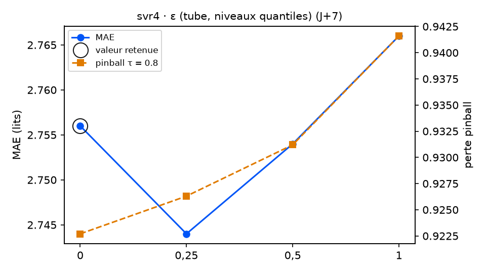

Amplitude de la MAE : 0.8 %. Aucune valeur ne fait significativement mieux que la valeur retenue.

### svr4 · γ₁ (portée, bloc occupation)

| variante | MAE | RMSE | biais | pinball τ=0.8 | couverture 90 % | temps (s) | DM p (pinball τ=0.8) | p Holm | DM p (MAE) | vs choix retenu |
|---|---|---|---|---|---|---|---|---|---|---|
| gamma1 = 0,01 | 2.755 | 3.337 | -0.132 | 0.9226 | 89.3 | 8.9 | 0.5733 | 0.7488 | 0.2069 | équivalent |
| gamma1 = 0,02 (retenu) | 2.756 | 3.338 | -0.134 | 0.9227 | 89.3 | 7.4 |  |  |  | — choix retenu |
| gamma1 = 0,05 | 2.772 | 3.351 | -0.103 | 0.9229 | 88.7 | 7.3 | 0.3663 | 0.7488 | 0.1868 | équivalent |
| gamma1 = 0,1 | 2.807 | 3.385 | -0.059 | 0.9234 | 88.1 | 6.1 | 0.2135 | 0.7488 | 0.0757 | équivalent |
| gamma1 = 0,2 | 2.813 | 3.389 | -0.025 | 0.9222 | 88.1 | 4.9 | 0.1872 | 0.7488 | 0.1321 | équivalent |
| gamma1 = 0,5 | 2.78 | 3.346 | -0.051 | 0.9221 | 88.7 | 5.5 | 0.1152 | 0.576 | 0.3628 | équivalent |

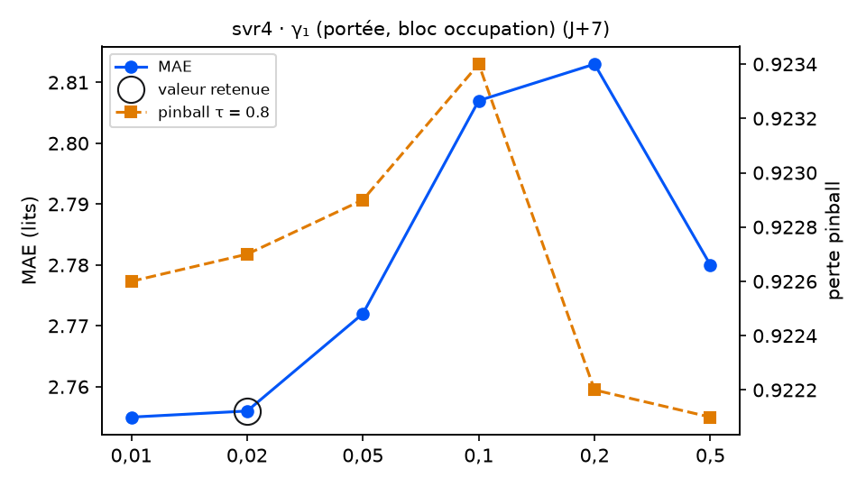

Amplitude de la MAE : 2.1 %. Aucune valeur ne fait significativement mieux que la valeur retenue.

### svr4 · γ₂ (portée, bloc flux et saison)

| variante | MAE | RMSE | biais | pinball τ=0.8 | couverture 90 % | temps (s) | DM p (pinball τ=0.8) | p Holm | DM p (MAE) | vs choix retenu |
|---|---|---|---|---|---|---|---|---|---|---|
| gamma2 = 0,02 | 2.841 | 3.458 | 0.045 | 0.9466 | 89.3 | 5.8 | 0.3192 | 0.6384 | 0.2249 | équivalent |
| gamma2 = 0,05 | 2.791 | 3.413 | -0.107 | 0.9485 | 89.3 | 6.7 | 0.0654 | 0.2616 | 0.4897 | équivalent |
| gamma2 = 0,1 | 2.769 | 3.369 | -0.147 | 0.9393 | 88.1 | 7.5 | 0.0884 | 0.2652 | 0.6112 | équivalent |
| gamma2 = 0,2 (retenu) | 2.756 | 3.338 | -0.134 | 0.9227 | 89.3 | 7.4 |  |  |  | — choix retenu |
| gamma2 = 0,5 | 2.765 | 3.341 | -0.0 | 0.9147 | 89.8 | 7.6 | 0.7255 | 0.7255 | 0.7976 | équivalent |

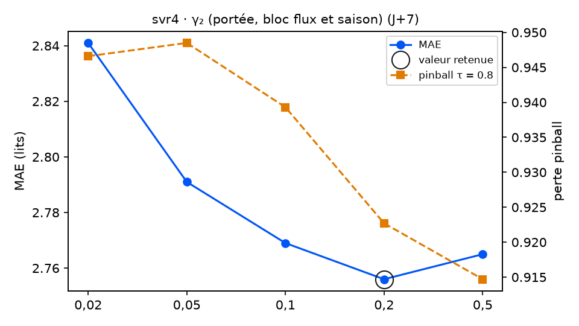

Amplitude de la MAE : 3.1 %. Aucune valeur ne fait significativement mieux que la valeur retenue.

### svr4 · τ (quantile décisionnel)

| variante | MAE | RMSE | biais | pinball τ=0.8 | couverture 90 % | temps (s) | DM p (pinball τ=0.8) | p Holm | DM p (MAE) | vs choix retenu |
|---|---|---|---|---|---|---|---|---|---|---|
| tau = 0,5 | 2.756 | 3.338 | -0.134 | 1.4183 | 89.3 | 4.4 | 0.0091 | 0.0364 |  | moins bon |
| tau = 0,6 | 2.756 | 3.338 | -0.134 | 1.4183 | 89.3 | 6.6 | 0.0091 | 0.0364 |  | moins bon |
| tau = 0,7 | 2.756 | 3.338 | -0.134 | 1.4183 | 89.3 | 7.3 | 0.0091 | 0.0364 |  | moins bon |
| tau = 0,8 (retenu) | 2.756 | 3.338 | -0.134 | 0.9227 | 89.3 | 7.4 |  |  |  | — choix retenu |
| tau = 0,9 | 2.756 | 3.338 | -0.134 | 1.4183 | 89.3 | 8.7 | 0.0091 | 0.0364 |  | moins bon |

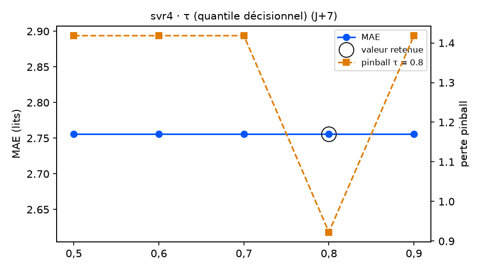

Amplitude de la MAE : 0.0 %. Aucune valeur ne fait significativement mieux que la valeur retenue.

### svr4 · η₀ (taux d'apprentissage d'Adam)

| variante | MAE | RMSE | biais | pinball τ=0.8 | couverture 90 % | temps (s) | DM p (pinball τ=0.8) | p Holm | DM p (MAE) | vs choix retenu |
|---|---|---|---|---|---|---|---|---|---|---|
| taux = 0,005 | 2.759 | 3.341 | -0.13 | 0.9242 | 88.7 | 10.7 | 0.4112 | 1.0 | 0.0336 | équivalent |
| taux = 0,01 | 2.757 | 3.338 | -0.131 | 0.9233 | 89.3 | 12.2 | 0.5027 | 1.0 | 0.5918 | équivalent |
| taux = 0,02 | 2.756 | 3.338 | -0.132 | 0.9229 | 89.3 | 9.7 | 0.4459 | 1.0 | 0.8724 | équivalent |
| taux = 0,05 (retenu) | 2.756 | 3.338 | -0.134 | 0.9227 | 89.3 | 6.8 |  |  |  | — choix retenu |
| taux = 0,1 | 2.757 | 3.339 | -0.132 | 0.9229 | 89.3 | 6.8 | 0.1748 | 0.6992 | 0.2305 | équivalent |
| taux = 0,2 | 2.758 | 3.339 | -0.131 | 0.9236 | 89.3 | 4.3 | 0.1067 | 0.5335 | 0.1197 | équivalent |

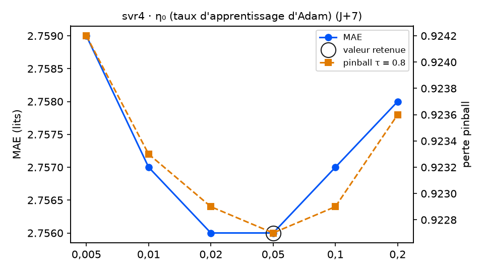

Amplitude de la MAE : 0.1 %. Aucune valeur ne fait significativement mieux que la valeur retenue.

### svr4 · nombre maximal d'itérations

| variante | MAE | RMSE | biais | pinball τ=0.8 | couverture 90 % | temps (s) | DM p (pinball τ=0.8) | p Holm | DM p (MAE) | vs choix retenu |
|---|---|---|---|---|---|---|---|---|---|---|
| iterations = 300 | 2.757 | 3.339 | -0.13 | 0.9282 | 90.4 | 0.9 | 0.2549 | 0.7647 | 0.342 | équivalent |
| iterations = 1000 | 2.756 | 3.338 | -0.133 | 0.9239 | 89.3 | 2.5 | 0.5178 | 1.0 | 0.5718 | équivalent |
| iterations = 3000 (retenu) | 2.756 | 3.338 | -0.134 | 0.9227 | 89.3 | 5.1 |  |  |  | — choix retenu |
| iterations = 6000 | 2.756 | 3.338 | -0.134 | 0.9228 | 89.3 | 8.0 | 0.9242 | 1.0 | 0.5979 | équivalent |

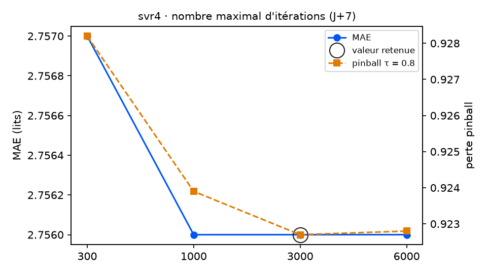

Amplitude de la MAE : 0.0 %. Aucune valeur ne fait significativement mieux que la valeur retenue.

### svr4 · T (décroissance du pas ; aucune = pas constant)

| variante | MAE | RMSE | biais | pinball τ=0.8 | couverture 90 % | temps (s) | DM p (pinball τ=0.8) | p Holm | DM p (MAE) | vs choix retenu |
|---|---|---|---|---|---|---|---|---|---|---|
| decroissance = aucune | 2.756 | 3.337 | -0.133 | 0.9226 | 89.3 | 6.1 | 0.7525 | 1.0 | 0.2589 | équivalent |
| decroissance = 100 | 2.757 | 3.338 | -0.133 | 0.9231 | 89.3 | 5.4 | 0.3661 | 1.0 | 0.2755 | équivalent |
| decroissance = 500 (retenu) | 2.756 | 3.338 | -0.134 | 0.9227 | 89.3 | 4.9 |  |  |  | — choix retenu |
| decroissance = 2000 | 2.756 | 3.338 | -0.134 | 0.9226 | 89.3 | 5.6 | 0.4868 | 1.0 | 0.5425 | équivalent |

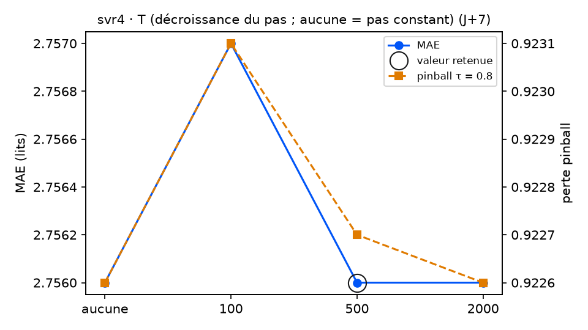

Amplitude de la MAE : 0.0 %. Aucune valeur ne fait significativement mieux que la valeur retenue.

### svr4 · part des pas moyennée (Polyak ; 0 = aucune)

| variante | MAE | RMSE | biais | pinball τ=0.8 | couverture 90 % | temps (s) | DM p (pinball τ=0.8) | p Holm | DM p (MAE) | vs choix retenu |
|---|---|---|---|---|---|---|---|---|---|---|
| moyenne_polyak = 0 | 2.756 | 3.338 | -0.134 | 0.9227 | 89.3 | 5.3 |  |  | 0.8016 | identique |
| moyenne_polyak = 0,25 | 2.756 | 3.338 | -0.134 | 0.9227 | 89.3 | 5.3 |  |  | 0.6811 | identique |
| moyenne_polyak = 0,5 (retenu) | 2.756 | 3.338 | -0.134 | 0.9227 | 89.3 | 5.1 |  |  |  | — choix retenu |
| moyenne_polyak = 0,75 | 2.756 | 3.338 | -0.134 | 0.9227 | 89.3 | 5.0 |  |  | 0.5979 | identique |

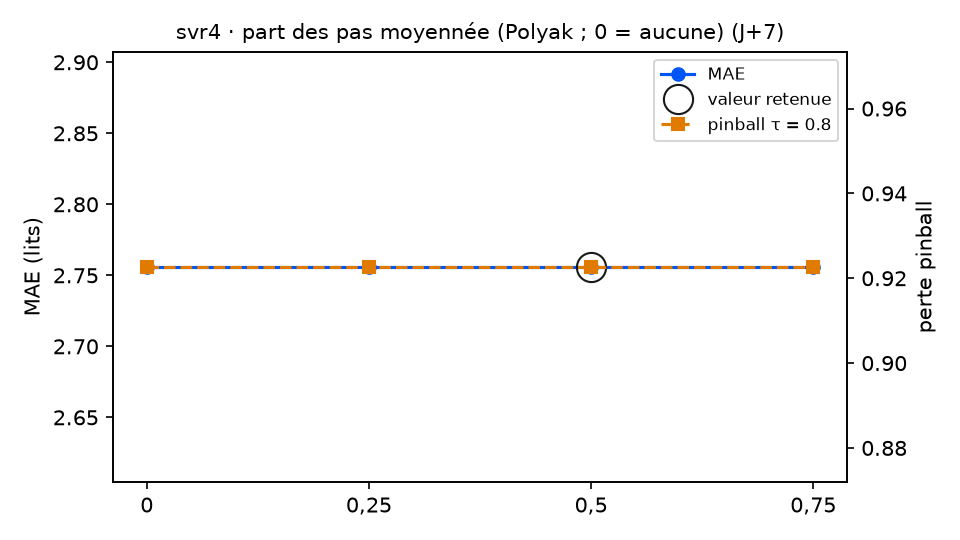

Amplitude de la MAE : 0.0 %. Aucune valeur ne fait significativement mieux que la valeur retenue.

### svr4 · tolérance d'arrêt anticipé

| variante | MAE | RMSE | biais | pinball τ=0.8 | couverture 90 % | temps (s) | DM p (pinball τ=0.8) | p Holm | DM p (MAE) | vs choix retenu |
|---|---|---|---|---|---|---|---|---|---|---|
| tolerance = 1e-05 | 2.757 | 3.339 | -0.133 | 0.9228 | 89.3 | 4.6 | 0.1649 | 0.1649 | 0.1967 | équivalent |
| tolerance = 1e-07 (retenu) | 2.756 | 3.338 | -0.134 | 0.9227 | 89.3 | 5.0 |  |  |  | — choix retenu |
| tolerance = 1e-09 | 2.755 | 3.337 | -0.132 | 0.9227 | 89.3 | 7.2 |  |  | 0.2119 | identique |

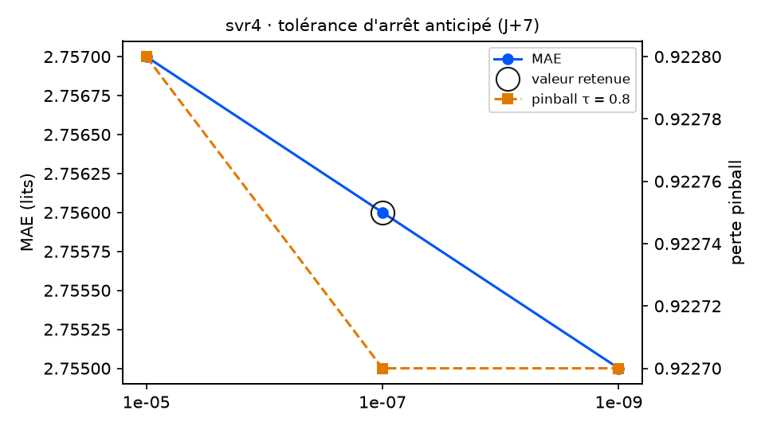

Amplitude de la MAE : 0.1 %. Aucune valeur ne fait significativement mieux que la valeur retenue.

### svr4 · direction préconditionnée α + Cg

| variante | MAE | RMSE | biais | pinball τ=0.8 | couverture 90 % | temps (s) | DM p (pinball τ=0.8) | p Holm | DM p (MAE) | vs choix retenu |
|---|---|---|---|---|---|---|---|---|---|---|
| preconditionne = True (retenu) | 2.756 | 3.338 | -0.134 | 0.9227 | 89.3 | 4.9 |  |  |  | — choix retenu |
| preconditionne = False | 2.766 | 3.348 | -0.104 | 0.9236 | 89.3 | 9.6 | 0.1943 | 0.1943 | 0.0825 | équivalent |

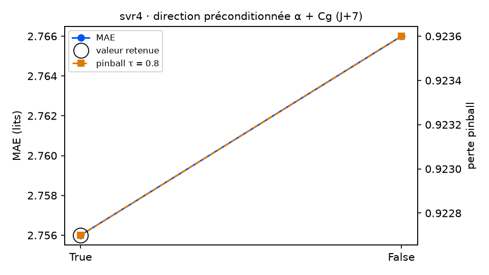

Amplitude de la MAE : 0.4 %. Aucune valeur ne fait significativement mieux que la valeur retenue.

### svr4 · optimiseur

| variante | MAE | RMSE | biais | pinball τ=0.8 | couverture 90 % | temps (s) | DM p (pinball τ=0.8) | p Holm | DM p (MAE) | vs choix retenu |
|---|---|---|---|---|---|---|---|---|---|---|
| optimiseur = adam (retenu) | 2.756 | 3.338 | -0.134 | 0.9227 | 89.3 | 5.1 |  |  |  | — choix retenu |
| optimiseur = momentum | 2.755 | 3.337 | -0.133 | 0.9224 | 89.3 | 3.9 | 0.6087 | 0.6087 | 0.206 | équivalent |
| optimiseur = sgd | 2.759 | 3.341 | -0.131 | 0.9223 | 89.3 | 3.6 | 0.21 | 0.42 | 0.1668 | équivalent |

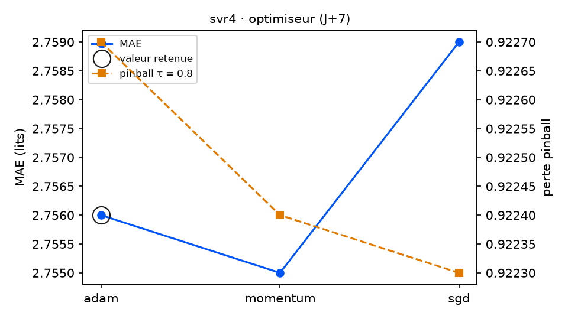

Amplitude de la MAE : 0.1 %. Aucune valeur ne fait significativement mieux que la valeur retenue.

### svr2 · C

| variante | MAE | RMSE | biais | pinball τ=0.8 | temps (s) | DM p (pinball τ=0.8) | p Holm | DM p (MAE) | vs choix retenu |
|---|---|---|---|---|---|---|---|---|---|
| C = 0,1 | 2.775 | 3.341 | 0.053 | 1.3718 | 0.3 | 0.2531 | 1.0 | 0.218 | équivalent |
| C = 0,3 (retenu) | 2.809 | 3.36 | 0.022 | 1.3979 | 0.3 |  |  |  | — choix retenu |
| C = 1 | 2.871 | 3.402 | -0.033 | 1.4453 | 0.5 | 0.1786 | 0.893 | 0.1543 | équivalent |
| C = 3 | 3.006 | 3.559 | 0.123 | 1.466 | 1.0 | 0.3374 | 1.0 | 0.0322 | équivalent |
| C = 10 | 3.144 | 3.792 | 0.329 | 1.4734 | 1.1 | 0.4011 | 1.0 | 0.0036 | équivalent |
| C = 30 | 3.198 | 3.881 | 0.417 | 1.4739 | 1.1 | 0.4124 | 1.0 | 0.0064 | équivalent |

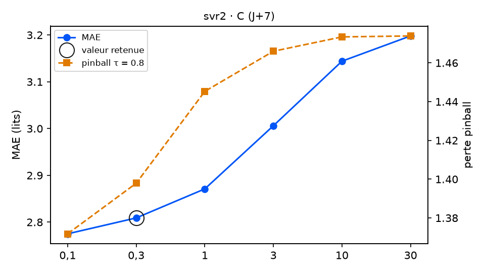

Amplitude de la MAE : 15.1 %. Aucune valeur ne fait significativement mieux que la valeur retenue.

### svr2 · ε (tube ε-insensible, en lits)

| variante | MAE | RMSE | biais | pinball τ=0.8 | temps (s) | DM p (pinball τ=0.8) | p Holm | DM p (MAE) | vs choix retenu |
|---|---|---|---|---|---|---|---|---|---|
| epsilon = 0 | 2.819 | 3.367 | 0.085 | 1.384 | 0.4 | 0.1594 | 0.2046 | 0.5588 | équivalent |
| epsilon = 0,25 | 2.816 | 3.368 | 0.086 | 1.3821 | 0.3 | 0.0514 | 0.1542 | 0.624 | équivalent |
| epsilon = 0,5 | 2.809 | 3.36 | 0.056 | 1.3876 | 0.3 | 0.0223 | 0.0892 | 0.9738 | équivalent |
| epsilon = 1 (retenu) | 2.809 | 3.36 | 0.022 | 1.3979 | 0.3 |  |  |  | — choix retenu |
| epsilon = 2 | 2.816 | 3.375 | 0.086 | 1.3821 | 0.3 | 0.1023 | 0.2046 | 0.7639 | équivalent |

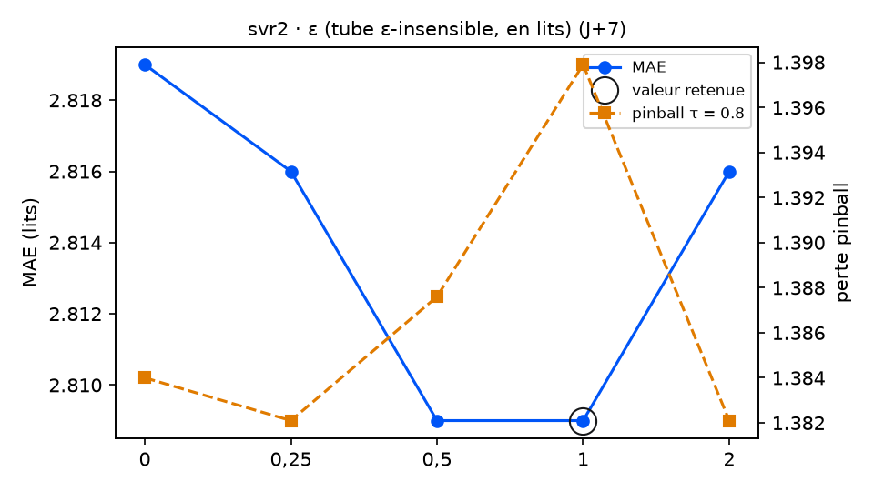

Amplitude de la MAE : 0.4 %. Aucune valeur ne fait significativement mieux que la valeur retenue.

### svr2 · γ (portée du noyau RBF)

| variante | MAE | RMSE | biais | pinball τ=0.8 | temps (s) | DM p (pinball τ=0.8) | p Holm | DM p (MAE) | vs choix retenu |
|---|---|---|---|---|---|---|---|---|---|
| gamma = 0,005 | 2.821 | 3.441 | -0.09 | 1.4377 | 0.4 | 0.391 | 0.5121 | 0.8353 | équivalent |
| gamma = 0,01 | 2.842 | 3.469 | -0.124 | 1.4581 | 0.4 | 0.2246 | 0.5121 | 0.6212 | équivalent |
| gamma = 0,02 | 2.849 | 3.472 | -0.117 | 1.4598 | 0.5 | 0.1707 | 0.5121 | 0.5299 | équivalent |
| gamma = 0,05 | 2.846 | 3.435 | -0.108 | 1.4553 | 0.3 | 0.0706 | 0.312 | 0.5061 | équivalent |
| gamma = 0,1 | 2.834 | 3.393 | -0.08 | 1.4409 | 0.3 | 0.0076 | 0.0456 | 0.4844 | moins bon |
| gamma = 0,2 (retenu) | 2.809 | 3.36 | 0.022 | 1.3979 | 0.3 |  |  |  | — choix retenu |
| gamma = 0,5 | 2.769 | 3.335 | 0.147 | 1.3406 | 0.3 | 0.0624 | 0.312 | 0.3856 | équivalent |

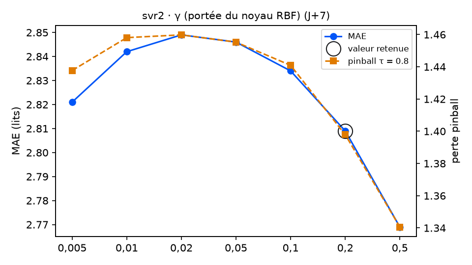

Amplitude de la MAE : 2.8 %. Aucune valeur ne fait significativement mieux que la valeur retenue.

### foret · nombre d'arbres

| variante | MAE | RMSE | biais | pinball τ=0.8 | couverture 90 % | temps (s) | DM p (pinball τ=0.8) | p Holm | DM p (MAE) | vs choix retenu |
|---|---|---|---|---|---|---|---|---|---|---|
| arbres = 25 | 2.869 | 3.442 | -0.304 | 0.9957 | 89.3 | 1.0 | 0.5957 | 1.0 | 0.6386 | équivalent |
| arbres = 50 | 2.797 | 3.373 | -0.26 | 1.0054 | 88.7 | 2.0 | 0.9666 | 1.0 | 0.2116 | équivalent |
| arbres = 100 | 2.83 | 3.386 | -0.198 | 1.0066 | 89.3 | 3.9 | 0.8071 | 1.0 | 0.455 | équivalent |
| arbres = 300 (retenu) | 2.847 | 3.387 | -0.195 | 1.0049 | 90.4 | 11.5 |  |  |  | — choix retenu |
| arbres = 500 | 2.854 | 3.388 | -0.181 | 1.0071 | 89.8 | 19.1 | 0.6911 | 1.0 | 0.542 | équivalent |

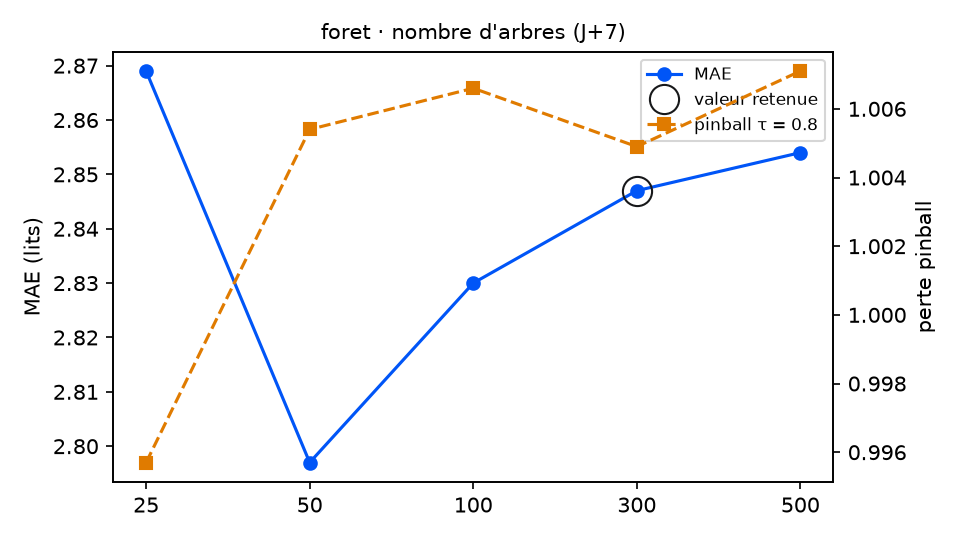

Amplitude de la MAE : 2.5 %. Aucune valeur ne fait significativement mieux que la valeur retenue.

### foret · profondeur maximale

| variante | MAE | RMSE | biais | pinball τ=0.8 | couverture 90 % | temps (s) | DM p (pinball τ=0.8) | p Holm | DM p (MAE) | vs choix retenu |
|---|---|---|---|---|---|---|---|---|---|---|
| profondeur_foret = 3 | 2.804 | 3.394 | -0.133 | 0.9822 | 92.1 | 1.3 | 0.4935 | 0.987 | 0.4675 | équivalent |
| profondeur_foret = 5 | 2.819 | 3.379 | -0.2 | 0.9728 | 91.5 | 3.1 | 0.1267 | 0.5068 | 0.3925 | équivalent |
| profondeur_foret = 8 | 2.842 | 3.384 | -0.216 | 0.9847 | 89.8 | 7.1 | 0.1291 | 0.5068 | 0.8332 | équivalent |
| profondeur_foret = 12 (retenu) | 2.847 | 3.387 | -0.195 | 1.0049 | 90.4 | 11.6 |  |  |  | — choix retenu |
| profondeur_foret = 20 | 2.843 | 3.368 | -0.186 | 0.999 | 90.4 | 13.2 | 0.5514 | 0.987 | 0.869 | équivalent |

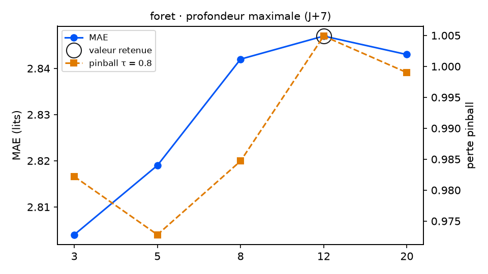

Amplitude de la MAE : 1.5 %. Aucune valeur ne fait significativement mieux que la valeur retenue.

### foret · taille minimale d'une feuille

| variante | MAE | RMSE | biais | pinball τ=0.8 | couverture 90 % | temps (s) | DM p (pinball τ=0.8) | p Holm | DM p (MAE) | vs choix retenu |
|---|---|---|---|---|---|---|---|---|---|---|
| min_feuille = 2 | 2.906 | 3.427 | -0.184 | 1.0297 | 91.0 | 22.1 | 0.0763 | 0.2289 | 0.0001 | équivalent |
| min_feuille = 5 (retenu) | 2.847 | 3.387 | -0.195 | 1.0049 | 90.4 | 11.7 |  |  |  | — choix retenu |
| min_feuille = 10 | 2.837 | 3.404 | -0.214 | 0.9978 | 89.3 | 7.0 | 0.3587 | 0.3587 | 0.6474 | équivalent |
| min_feuille = 20 | 2.857 | 3.428 | -0.219 | 0.9815 | 89.3 | 4.1 | 0.1788 | 0.3576 | 0.7735 | équivalent |

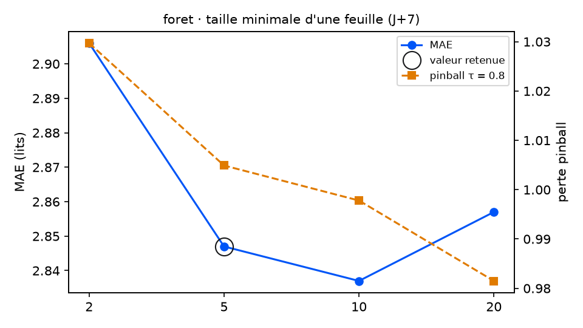

Amplitude de la MAE : 2.4 %. Aucune valeur ne fait significativement mieux que la valeur retenue.

### foret · part des variables tirées par nœud

| variante | MAE | RMSE | biais | pinball τ=0.8 | couverture 90 % | temps (s) | DM p (pinball τ=0.8) | p Holm | DM p (MAE) | vs choix retenu |
|---|---|---|---|---|---|---|---|---|---|---|
| part_variables = 0,15 | 2.871 | 3.424 | -0.124 | 0.9922 | 92.7 | 10.7 | 0.3481 | 1.0 | 0.4739 | équivalent |
| part_variables = 0,333333 (retenu) | 2.847 | 3.387 | -0.195 | 1.0049 | 90.4 | 11.6 |  |  |  | — choix retenu |
| part_variables = 0,5 | 2.865 | 3.393 | -0.23 | 1.0034 | 88.7 | 11.8 | 0.875 | 1.0 | 0.3283 | équivalent |
| part_variables = 1 | 2.853 | 3.374 | -0.253 | 1.0044 | 88.1 | 12.6 | 0.9775 | 1.0 | 0.8843 | équivalent |

Amplitude de la MAE : 0.8 %. Aucune valeur ne fait significativement mieux que la valeur retenue.

### boosting · nombre d'étapes

| variante | MAE | RMSE | biais | pinball τ=0.8 | couverture 90 % | temps (s) | DM p (pinball τ=0.8) | p Holm | DM p (MAE) | vs choix retenu |
|---|---|---|---|---|---|---|---|---|---|---|
| etapes = 50 | 2.808 | 3.392 | -0.172 | 0.9603 | 84.2 | 1.2 | 0.2336 | 0.3156 | 0.4087 | équivalent |
| etapes = 100 | 2.84 | 3.41 | -0.218 | 0.9739 | 82.5 | 2.2 | 0.1549 | 0.3156 | 0.6033 | équivalent |
| etapes = 300 (retenu) | 2.867 | 3.416 | -0.205 | 1.0127 | 76.3 | 6.4 |  |  |  | — choix retenu |
| etapes = 600 | 2.892 | 3.441 | -0.187 | 1.0528 | 74.6 | 12.8 | 0.1052 | 0.3156 | 0.5181 | équivalent |

Amplitude de la MAE : 2.9 %. Aucune valeur ne fait significativement mieux que la valeur retenue.

### boosting · taux ν (shrinkage)

| variante | MAE | RMSE | biais | pinball τ=0.8 | couverture 90 % | temps (s) | DM p (pinball τ=0.8) | p Holm | DM p (MAE) | vs choix retenu |
|---|---|---|---|---|---|---|---|---|---|---|
| taux_boosting = 0,01 | 2.818 | 3.371 | -0.142 | 0.9928 | 84.2 | 6.5 | 0.6072 | 0.7458 | 0.4513 | équivalent |
| taux_boosting = 0,05 (retenu) | 2.867 | 3.416 | -0.205 | 1.0127 | 76.3 | 6.5 |  |  |  | — choix retenu |
| taux_boosting = 0,1 | 2.875 | 3.446 | -0.247 | 1.0433 | 72.3 | 6.5 | 0.295 | 0.7458 | 0.9041 | équivalent |
| taux_boosting = 0,2 | 2.861 | 3.515 | -0.397 | 1.0756 | 72.9 | 6.7 | 0.2486 | 0.7458 | 0.9589 | équivalent |

Amplitude de la MAE : 2.0 %. Aucune valeur ne fait significativement mieux que la valeur retenue.

### boosting · profondeur des arbres

| variante | MAE | RMSE | biais | pinball τ=0.8 | couverture 90 % | temps (s) | DM p (pinball τ=0.8) | p Holm | DM p (MAE) | vs choix retenu |
|---|---|---|---|---|---|---|---|---|---|---|
| profondeur_boosting = 1 | 2.851 | 3.459 | -0.208 | 0.9952 | 80.2 | 2.2 | 0.6774 | 1.0 | 0.8392 | équivalent |
| profondeur_boosting = 2 | 2.828 | 3.398 | -0.251 | 1.0082 | 79.7 | 4.4 | 0.8521 | 1.0 | 0.3052 | équivalent |
| profondeur_boosting = 3 (retenu) | 2.867 | 3.416 | -0.205 | 1.0127 | 76.3 | 6.7 |  |  |  | — choix retenu |
| profondeur_boosting = 5 | 2.87 | 3.444 | -0.048 | 1.0519 | 71.2 | 13.1 | 0.311 | 0.933 | 0.9588 | équivalent |

Amplitude de la MAE : 1.5 %. Aucune valeur ne fait significativement mieux que la valeur retenue.

### boosting · part du sous-échantillon

| variante | MAE | RMSE | biais | pinball τ=0.8 | couverture 90 % | temps (s) | DM p (pinball τ=0.8) | p Holm | DM p (MAE) | vs choix retenu |
|---|---|---|---|---|---|---|---|---|---|---|
| sous_echantillon = 0,5 | 2.855 | 3.429 | -0.456 | 1.0177 | 74.0 | 6.0 | 0.8521 | 1.0 | 0.8399 | équivalent |
| sous_echantillon = 0,8 (retenu) | 2.867 | 3.416 | -0.205 | 1.0127 | 76.3 | 7.1 |  |  |  | — choix retenu |
| sous_echantillon = 1 | 2.863 | 3.371 | -0.138 | 1.0153 | 78.0 | 7.3 | 0.9244 | 1.0 | 0.9041 | équivalent |

Amplitude de la MAE : 0.4 %. Aucune valeur ne fait significativement mieux que la valeur retenue.

### mlp · architecture (neurones par couche)

| variante | MAE | RMSE | biais | pinball τ=0.8 | couverture 90 % | temps (s) | DM p (pinball τ=0.8) | p Holm | DM p (MAE) | vs choix retenu |
|---|---|---|---|---|---|---|---|---|---|---|
| couches = 8 | 2.887 | 3.478 | -0.177 | 0.9287 | 84.2 | 0.5 | 0.1174 | 0.4696 | 0.7989 | équivalent |
| couches = 32 | 2.868 | 3.472 | -0.41 | 0.9906 | 84.7 | 0.6 | 0.4395 | 0.879 | 0.9765 | équivalent |
| couches = 32×16 (retenu) | 2.865 | 3.51 | -0.323 | 1.029 | 85.3 | 0.7 |  |  |  | — choix retenu |
| couches = 64×32 | 2.852 | 3.503 | -0.67 | 1.033 | 85.9 | 1.0 | 0.9164 | 0.9164 | 0.8967 | équivalent |
| couches = 32×16×8 | 2.828 | 3.416 | 0.227 | 0.934 | 81.4 | 0.9 | 0.1274 | 0.4696 | 0.7519 | équivalent |

Amplitude de la MAE : 2.1 %. Aucune valeur ne fait significativement mieux que la valeur retenue.

### mlp · taux d'apprentissage

| variante | MAE | RMSE | biais | pinball τ=0.8 | couverture 90 % | temps (s) | DM p (pinball τ=0.8) | p Holm | DM p (MAE) | vs choix retenu |
|---|---|---|---|---|---|---|---|---|---|---|
| taux_reseau = 0,001 | 2.847 | 3.527 | -0.104 | 1.0269 | 80.2 | 1.4 | 0.9609 | 0.9609 | 0.7495 | équivalent |
| taux_reseau = 0,003 | 2.833 | 3.494 | -0.198 | 0.9987 | 83.6 | 1.0 | 0.2208 | 0.6624 | 0.3906 | équivalent |
| taux_reseau = 0,01 (retenu) | 2.865 | 3.51 | -0.323 | 1.029 | 85.3 | 0.7 |  |  |  | — choix retenu |
| taux_reseau = 0,03 | 2.847 | 3.467 | -0.237 | 1.0142 | 86.4 | 0.7 | 0.4145 | 0.829 | 0.7887 | équivalent |

Amplitude de la MAE : 1.1 %. Aucune valeur ne fait significativement mieux que la valeur retenue.

### mlp · pénalité L2 λ

| variante | MAE | RMSE | biais | pinball τ=0.8 | couverture 90 % | temps (s) | DM p (pinball τ=0.8) | p Holm | DM p (MAE) | vs choix retenu |
|---|---|---|---|---|---|---|---|---|---|---|
| lambda_ = 0 | 2.828 | 3.484 | -0.28 | 1.0163 | 85.9 | 0.7 | 0.2602 | 1.0 | 0.0775 | équivalent |
| lambda_ = 0,0001 | 2.836 | 3.493 | -0.285 | 1.0186 | 86.4 | 0.7 | 0.3495 | 1.0 | 0.1684 | équivalent |
| lambda_ = 0,001 (retenu) | 2.865 | 3.51 | -0.323 | 1.029 | 85.3 | 0.7 |  |  |  | — choix retenu |
| lambda_ = 0,01 | 2.869 | 3.517 | -0.318 | 1.0478 | 83.1 | 0.8 | 0.4534 | 1.0 | 0.9242 | équivalent |
| lambda_ = 0,1 | 2.85 | 3.467 | 0.085 | 0.9904 | 84.2 | 3.0 | 0.5765 | 1.0 | 0.9032 | équivalent |

Amplitude de la MAE : 1.4 %. Aucune valeur ne fait significativement mieux que la valeur retenue.

### mlp · époques maximales

| variante | MAE | RMSE | biais | pinball τ=0.8 | couverture 90 % | temps (s) | DM p (pinball τ=0.8) | p Holm | DM p (MAE) | vs choix retenu |
|---|---|---|---|---|---|---|---|---|---|---|
| epoques = 300 | 2.865 | 3.51 | -0.323 | 1.029 | 85.3 | 0.8 |  |  |  | identique |
| epoques = 800 | 2.865 | 3.51 | -0.323 | 1.029 | 85.3 | 0.7 |  |  |  | identique |
| epoques = 1500 (retenu) | 2.865 | 3.51 | -0.323 | 1.029 | 85.3 | 0.7 |  |  |  | — choix retenu |
| epoques = 3000 | 2.865 | 3.51 | -0.323 | 1.029 | 85.3 | 0.8 |  |  |  | identique |

Amplitude de la MAE : 0.0 %. Aucune valeur ne fait significativement mieux que la valeur retenue.

### mlp · patience de l'arrêt anticipé

| variante | MAE | RMSE | biais | pinball τ=0.8 | couverture 90 % | temps (s) | DM p (pinball τ=0.8) | p Holm | DM p (MAE) | vs choix retenu |
|---|---|---|---|---|---|---|---|---|---|---|
| patience = 50 | 2.865 | 3.51 | -0.323 | 1.029 | 85.3 | 0.5 |  |  |  | identique |
| patience = 150 (retenu) | 2.865 | 3.51 | -0.323 | 1.029 | 85.3 | 0.8 |  |  |  | — choix retenu |
| patience = 300 | 2.865 | 3.51 | -0.323 | 1.029 | 85.3 | 1.4 |  |  |  | identique |

Amplitude de la MAE : 0.0 %. Aucune valeur ne fait significativement mieux que la valeur retenue.

### mlp · nombre d'initialisations moyennées

| variante | MAE | RMSE | biais | pinball τ=0.8 | couverture 90 % | temps (s) | DM p (pinball τ=0.8) | p Holm | DM p (MAE) | vs choix retenu |
|---|---|---|---|---|---|---|---|---|---|---|
| graines = 1 | 2.841 | 3.53 | -0.355 | 1.1446 | 85.3 | 0.4 | 0.0036 | 0.0072 | 0.7932 | moins bon |
| graines = 3 (retenu) | 2.865 | 3.51 | -0.323 | 1.029 | 85.3 | 0.8 |  |  |  | — choix retenu |
| graines = 5 | 2.806 | 3.425 | -0.313 | 0.9615 | 85.9 | 1.3 | 0.0869 | 0.0869 | 0.2097 | équivalent |

Amplitude de la MAE : 2.1 %. Aucune valeur ne fait significativement mieux que la valeur retenue.

### lstm · taille de l'état caché H

| variante | MAE | RMSE | biais | pinball τ=0.8 | couverture 90 % | temps (s) | DM p (pinball τ=0.8) | p Holm | DM p (MAE) | vs choix retenu |
|---|---|---|---|---|---|---|---|---|---|---|
| cache_lstm = 4 | 2.905 | 3.559 | 0.131 | 1.0394 | 87.0 | 4.2 | 0.8352 | 1.0 | 0.1571 | équivalent |
| cache_lstm = 8 | 3.058 | 3.68 | -0.062 | 1.0329 | 80.2 | 7.1 | 0.6125 | 1.0 | 0.6257 | équivalent |
| cache_lstm = 16 (retenu) | 3.035 | 3.644 | -0.105 | 1.05 | 80.2 | 10.4 |  |  |  | — choix retenu |
| cache_lstm = 32 | 3.069 | 3.684 | -0.25 | 1.0954 | 82.5 | 12.2 | 0.2916 | 0.8748 | 0.4746 | équivalent |

Amplitude de la MAE : 5.4 %. Aucune valeur ne fait significativement mieux que la valeur retenue.

### lstm · taux d'apprentissage

| variante | MAE | RMSE | biais | pinball τ=0.8 | couverture 90 % | temps (s) | DM p (pinball τ=0.8) | p Holm | DM p (MAE) | vs choix retenu |
|---|---|---|---|---|---|---|---|---|---|---|
| taux_reseau = 0,003 | 2.968 | 3.571 | -0.137 | 1.0131 | 83.1 | 9.4 | 0.2497 | 0.4994 | 0.0134 | équivalent |
| taux_reseau = 0,01 (retenu) | 3.035 | 3.644 | -0.105 | 1.05 | 80.2 | 10.9 |  |  |  | — choix retenu |
| taux_reseau = 0,03 | 3.022 | 3.638 | -0.231 | 1.0739 | 81.9 | 6.4 | 0.4978 | 0.4994 | 0.8076 | équivalent |

Amplitude de la MAE : 2.2 %. Aucune valeur ne fait significativement mieux que la valeur retenue.

### lstm · pénalité L2 λ

| variante | MAE | RMSE | biais | pinball τ=0.8 | couverture 90 % | temps (s) | DM p (pinball τ=0.8) | p Holm | DM p (MAE) | vs choix retenu |
|---|---|---|---|---|---|---|---|---|---|---|
| lambda_ = 0 | 2.977 | 3.594 | -0.047 | 1.0197 | 82.5 | 6.4 | 0.3782 | 0.6266 | 0.3474 | équivalent |
| lambda_ = 0,001 (retenu) | 3.035 | 3.644 | -0.105 | 1.05 | 80.2 | 10.5 |  |  |  | — choix retenu |
| lambda_ = 0,01 | 2.959 | 3.579 | -0.16 | 1.0072 | 81.9 | 7.7 | 0.3133 | 0.6266 | 0.1655 | équivalent |

Amplitude de la MAE : 2.5 %. Aucune valeur ne fait significativement mieux que la valeur retenue.

### variables · jours d'occupation passée en entrée

| variante | MAE | RMSE | biais | pinball τ=0.8 | couverture 90 % | temps (s) | DM p (pinball τ=0.8) | p Holm | DM p (MAE) | vs choix retenu |
|---|---|---|---|---|---|---|---|---|---|---|
| retards = 3 | 2.756 | 3.337 | -0.133 | 0.9226 | 89.3 | 6.4 | 0.7196 | 1.0 | 0.2984 | équivalent |
| retards = 5 | 2.756 | 3.338 | -0.134 | 0.9226 | 89.3 | 5.4 | 0.6397 | 1.0 | 0.4325 | équivalent |
| retards = 7 (retenu) | 2.756 | 3.338 | -0.134 | 0.9227 | 89.3 | 5.9 |  |  |  | — choix retenu |
| retards = 10 | 2.774 | 3.356 | -0.103 | 0.9223 | 89.3 | 5.9 | 0.3137 | 1.0 | 0.1881 | équivalent |
| retards = 14 | 2.777 | 3.339 | -0.078 | 0.9207 | 89.8 | 4.9 | 0.1716 | 0.858 | 0.4782 | équivalent |
| retards = 21 | 2.766 | 3.311 | 0.005 | 0.9141 | 89.8 | 5.2 | 0.4636 | 1.0 | 0.8602 | équivalent |

Amplitude de la MAE : 0.8 %. Aucune valeur ne fait significativement mieux que la valeur retenue.

